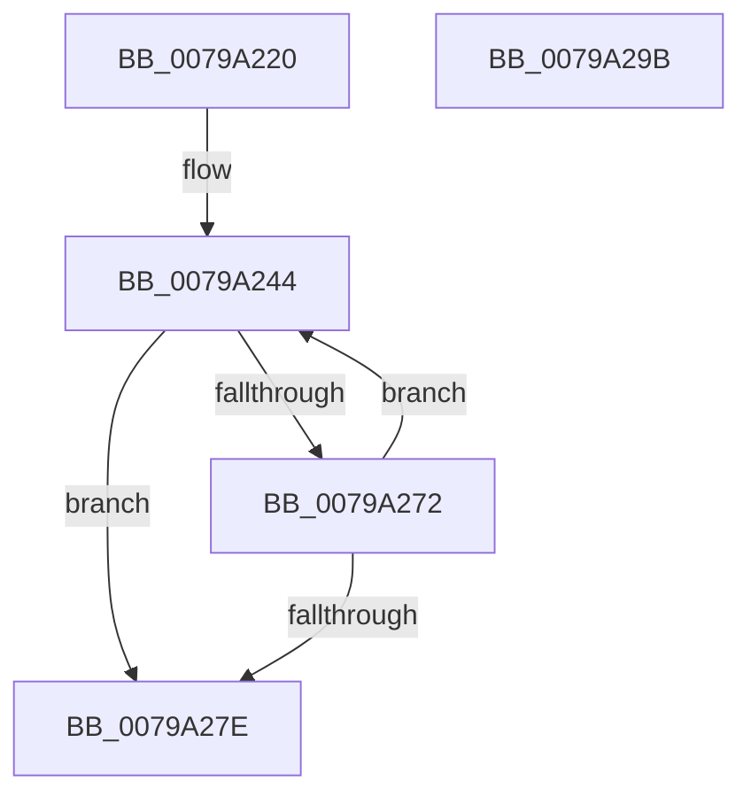

# Xp10ScatteredReadBytes

- RVA: `0x0079A220`–`0x0079A29C` (길이 `124` bytes)
- VA: `0x000000014079A220`
- 실행 섹션: `PAGE`
- PDB 이름 있음: `예`; PDB Function 태그: `아니요`
- unwind 정보 RVA: `0x0005E6B4`
- 디코드: `39`개 명령, `124/124` bytes 표시
- 미해석 바이트: `0` (있으면 어셈블리에 `.byte`로 보존)

> 이 문서는 커널 이미지의 기계어와 PDB 기호를 분석해 생성했습니다. 4번과 5번은 함수 원형과 자료형을 바이너리 사용 방식에서 추정한 C 해석이며 원본 소스 복구 결과는 아닙니다.

## 1. Dependencies

- 직접 호출 지점: **2**; 고유 호출 대상: **2**
- 직접 호출자로 확인된 함수: **7**
- RIP 상대 이미지 참조: **0**

### Outgoing calls
- `0x0079A260` → [memcpy](../../text/6C/memcpy_function_006C6840.md) (function, `0x006C6840`)
- `0x0079A275` → [Xp10ScatteredNextBuffer](Xp10ScatteredNextBuffer_function_0079A1CC.md) (function, `0x0079A1CC`)

### Direct callers
- [RtlDecompressBuffer2Xp10](RtlDecompressBuffer2Xp10_function_007959A0.md) at `0x00795A39`
- [RtlDecompressBuffer2Xp10](RtlDecompressBuffer2Xp10_function_007959A0.md) at `0x00795A9B`
- [Xp10Compute2Crc32](Xp10Compute2Crc32_function_00797688.md) at `0x00797711`
- [Xp10Compute2Crc64](Xp10Compute2Crc64_function_00797790.md) at `0x00797819`
- [Xp10ExecuteHuffmanDecode](Xp10ExecuteHuffmanDecode_function_007979C8.md) at `0x00797AEA`
- [Xp10ExecuteHuffmanDecode](Xp10ExecuteHuffmanDecode_function_007979C8.md) at `0x00797B75`
- [Xp10ExecuteHuffmanDecode](Xp10ExecuteHuffmanDecode_function_007979C8.md) at `0x00797BE0`
- [Xp10ExecuteHuffmanDecode](Xp10ExecuteHuffmanDecode_function_007979C8.md) at `0x00797C61`
- [Xp10ExecuteHuffmanDecode](Xp10ExecuteHuffmanDecode_function_007979C8.md) at `0x00797D20`
- [Xp10ExecuteHuffmanDecode](Xp10ExecuteHuffmanDecode_function_007979C8.md) at `0x00797D92`
- [Xp10ExecuteHuffmanDecode](Xp10ExecuteHuffmanDecode_function_007979C8.md) at `0x00797DEC`
- [Xp10ExecuteHuffmanDecode](Xp10ExecuteHuffmanDecode_function_007979C8.md) at `0x00797E63`
- [Xp10ExecuteHuffmanDecode](Xp10ExecuteHuffmanDecode_function_007979C8.md) at `0x00797EDA`
- [Xp10ExecuteHuffmanDecode](Xp10ExecuteHuffmanDecode_function_007979C8.md) at `0x00798016`
- [Xp10ReadAndDecodeHuffmanTables](Xp10ReadAndDecodeHuffmanTables_function_007993D4.md) at `0x00799434`
- [Xp10ReadAndDecodeHuffmanTables](Xp10ReadAndDecodeHuffmanTables_function_007993D4.md) at `0x007994F3`
- [Xp10ReadAndDecodeHuffmanTables](Xp10ReadAndDecodeHuffmanTables_function_007993D4.md) at `0x00799574`
- [Xp10ReadAndDecodeHuffmanTables](Xp10ReadAndDecodeHuffmanTables_function_007993D4.md) at `0x007996C6`
- [Xp10ReadAndDecodeHuffmanTables](Xp10ReadAndDecodeHuffmanTables_function_007993D4.md) at `0x00799741`
- [Xp10ReadAndDecodeHuffmanTables](Xp10ReadAndDecodeHuffmanTables_function_007993D4.md) at `0x007997DC`
- [Xp10ReadAndDecodeHuffmanTables](Xp10ReadAndDecodeHuffmanTables_function_007993D4.md) at `0x00799932`
- [Xp10ReadAndDecodeHuffmanTables](Xp10ReadAndDecodeHuffmanTables_function_007993D4.md) at `0x007999C2`
- [Xp10ReadMtfHeader](Xp10ReadMtfHeader_function_00799C40.md) at `0x00799CA7`
- [Xp10ReadMtfHeader](Xp10ReadMtfHeader_function_00799C40.md) at `0x00799D2E`
- [Xp10ScatteredBitBufferReadBytes](Xp10ScatteredBitBufferReadBytes_function_00799DB0.md) at `0x00799DFD`

### Static image references
- 디코드된 RIP-relative 메모리 참조가 없습니다.

## 2. Other-region calls and transfers

- 다른 실행 섹션으로 향하는 call: **1**
  - `0x0079A260` → [memcpy](../../text/6C/memcpy_function_006C6840.md) (`PAGE` → `.text`)
- 별도 외부 분기/꼬리 이동을 확인하지 못했습니다.

## 3. Assembly (complete function range)

```asm
0079A220  48 8B C4                        mov rax, rsp
0079A223  48 89 58 08                     mov qword ptr [rax + 8], rbx
0079A227  48 89 68 10                     mov qword ptr [rax + 0x10], rbp
0079A22B  48 89 70 18                     mov qword ptr [rax + 0x18], rsi
0079A22F  48 89 78 20                     mov qword ptr [rax + 0x20], rdi
0079A233  41 56                           push r14
0079A235  48 83 EC 20                     sub rsp, 0x20
0079A239  45 8B F0                        mov r14d, r8d
0079A23C  48 8B EA                        mov rbp, rdx
0079A23F  48 8B F1                        mov rsi, rcx
0079A242  33 FF                           xor edi, edi
0079A244  48 8B 16                        mov rdx, qword ptr [rsi]
0079A247  41 8B DE                        mov ebx, r14d
0079A24A  4C 8B 4E 08                     mov r9, qword ptr [rsi + 8]
0079A24E  2B DF                           sub ebx, edi
0079A250  4C 2B CA                        sub r9, rdx
0079A253  48 8B CD                        mov rcx, rbp
0079A256  4C 3B CB                        cmp r9, rbx
0079A259  49 0F 46 D9                     cmovbe rbx, r9
0079A25D  4C 8B C3                        mov r8, rbx
0079A260  E8 DB C5 F2 FF                  call 0x1406c6840
0079A265  48 01 1E                        add qword ptr [rsi], rbx
0079A268  03 FB                           add edi, ebx
0079A26A  48 03 EB                        add rbp, rbx
0079A26D  41 3B FE                        cmp edi, r14d
0079A270  74 0C                           je 0x14079a27e
0079A272  48 8B CE                        mov rcx, rsi
0079A275  E8 52 FF FF FF                  call 0x14079a1cc
0079A27A  85 C0                           test eax, eax
0079A27C  75 C6                           jne 0x14079a244
0079A27E  48 8B 5C 24 30                  mov rbx, qword ptr [rsp + 0x30]
0079A283  8B C7                           mov eax, edi
0079A285  48 8B 7C 24 48                  mov rdi, qword ptr [rsp + 0x48]
0079A28A  48 8B 6C 24 38                  mov rbp, qword ptr [rsp + 0x38]
0079A28F  48 8B 74 24 40                  mov rsi, qword ptr [rsp + 0x40]
0079A294  48 83 C4 20                     add rsp, 0x20
0079A298  41 5E                           pop r14
0079A29A  C3                              ret
0079A29B  CC                              int3
```

## 4. C-style interpretation (structured pseudocode)

```c
__int64 __fastcall Xp10ScatteredReadBytes(__int64 a1, __int64 a2, int a3)
{
    __int64 result;
    __int64 v_rbp;
    __int64 v_rbx;
    __int64 v_rdi;
    __int64 v_rsp;
    unsigned __int64 v_stack_p10;
    unsigned __int64 v_stack_p18;
    unsigned __int64 v_stack_p20;
    unsigned __int64 v_stack_p8;

    *(unsigned __int64 *)(v_rsp + 8) = v_rbx;
    *(unsigned __int64 *)(v_rsp + 16) = v_rbp;
    *(unsigned __int64 *)(v_rsp + 24) = v_rsi;
    *(unsigned __int64 *)(v_rsp + 32) = v_rdi;
    v_rsp = (v_rsp) - (32);
    v_rdi = 0;
loc_0079A244:
    v_rbx = (unsigned int)(((unsigned int)((unsigned int)((unsigned int)(a3)))) - (0));
    a4 = (*(unsigned __int64 *)(a1 + 8)) - (*(unsigned __int64 *)(a1));
    if (a4 <= v_rbx) { v_rbx = a4; }
    result = memcpy(a2, *(unsigned __int64 *)(a1), v_rbx, a4);
    v_rdi = (unsigned int)((v_rdi) + ((unsigned int)(v_rbx)));
    v_rbp = (a2) + (v_rbx);
    if (((unsigned int)(v_rdi)) == ((unsigned int)((unsigned int)(a3)))) goto loc_0079A27E;
    result = Xp10ScatteredNextBuffer(a1, *(unsigned __int64 *)(a1), v_rbx, a4);
    if ((unsigned int)(result) != 0) goto loc_0079A244;
loc_0079A27E:
    v_rsp = (v_rsp) + (32);
    return (unsigned int)((unsigned int)(v_rdi));
}
```

## 5. (Beta) C Style

```c
int64_t Xp10ScatteredReadBytes(void *Arg1, int64_t Arg2, int32_t Arg3)
{
    uint8_t *arg1 = (uint8_t *)Arg1;

    int64_t result;
    int64_t local_rbp;
    int64_t local_rbx;
    int64_t local_rdi;
    int64_t local_rsp;
    uint64_t v_stack_p10;
    uint64_t v_stack_p18;
    uint64_t v_stack_p20;
    uint64_t v_stack_p8;

    *(uint64_t *)(local_rsp + 0x8) = local_rbx;
    *(uint64_t *)(local_rsp + 0x10) = local_rbp;
    *(uint64_t *)(local_rsp + 0x18) = local_rsi;
    *(uint64_t *)(local_rsp + 0x20) = local_rdi;
    local_rsp = (local_rsp) - (32);
    local_rdi = 0;
loc_0079A244:
    local_rbx = (uint32_t)(((uint32_t)((uint32_t)((uint32_t)(Arg3)))) - (0));
    a4 = (*(uint64_t *)(arg1 + 0x8)) - (*(uint64_t *)(arg1));
    if (a4 <= local_rbx) { local_rbx = a4; }
    result = memcpy(Arg2, *(uint64_t *)(arg1), local_rbx, a4);
    local_rdi = (uint32_t)((local_rdi) + ((uint32_t)(local_rbx)));
    local_rbp = (Arg2) + (local_rbx);
    if (((uint32_t)(local_rdi)) == ((uint32_t)((uint32_t)(Arg3)))) goto loc_0079A27E;
    result = Xp10ScatteredNextBuffer(Arg1, *(uint64_t *)(arg1), local_rbx, a4);
    if ((uint32_t)(result) != 0) goto loc_0079A244;
loc_0079A27E:
    local_rsp = (local_rsp) + (32);
    return (uint32_t)((uint32_t)(local_rdi));
}
```

### 관측된 메모리 오프셋

구조체 형식이 확인되지 않은 접근은 인자 기준의 오프셋으로만 기록했습니다.

| 기준 인자 | 오프셋 표현 | 폭 (bit) | 접근 |
|---|---:|---:|---|
| `Arg1` | `+ 0x0` | `64` | `R` |
| `Arg1` | `+ 0x0` | `64` | `R/W` |
| `Arg1` | `+ 0x8` | `64` | `R` |

## 6. Execution-region graph

[열기: 2D/3D 그래프와 함수 탐색 컨트롤 패널](../../../control-panel.html?section=page&rva=0x0079A220&view=graph)

- 2D 그래프는 위에서 아래로 흐르고, 3D 그래프는 빈 공간을 드래그해 회전합니다. Shift+드래그는 이동, 휠은 확대·축소, 함수 노드 선택은 대상 보고서 이동입니다.

### Static fallback


