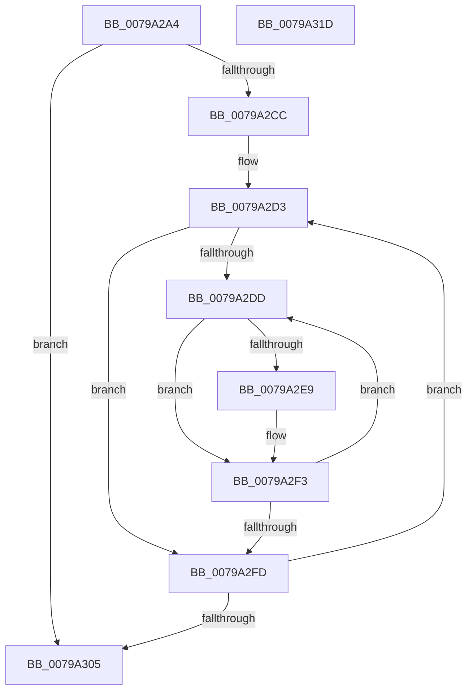

# Xp10SortHuffmanSymbols

- RVA: `0x0079A2A4`–`0x0079A31E` (길이 `122` bytes)
- VA: `0x000000014079A2A4`
- 실행 섹션: `PAGE`
- PDB 이름 있음: `예`; PDB Function 태그: `아니요`
- unwind 정보 RVA: `0x000A5A38`
- 디코드: `37`개 명령, `122/122` bytes 표시
- 미해석 바이트: `0` (있으면 어셈블리에 `.byte`로 보존)

> 이 문서는 커널 이미지의 기계어와 PDB 기호를 분석해 생성했습니다. 4번과 5번은 함수 원형과 자료형을 바이너리 사용 방식에서 추정한 C 해석이며 원본 소스 복구 결과는 아닙니다.

## 1. Dependencies

- 직접 호출 지점: **0**; 고유 호출 대상: **0**
- 직접 호출자로 확인된 함수: **1**
- RIP 상대 이미지 참조: **0**

### Outgoing calls
- 직접 디코드된 call 명령이 없습니다.

### Direct callers
- [Xp10ReadAndDecodeHuffmanTables](Xp10ReadAndDecodeHuffmanTables_function_007993D4.md) at `0x00799611`
- [Xp10ReadAndDecodeHuffmanTables](Xp10ReadAndDecodeHuffmanTables_function_007993D4.md) at `0x00799AFB`

### Static image references
- 디코드된 RIP-relative 메모리 참조가 없습니다.

## 2. Other-region calls and transfers

- 다른 실행 섹션으로 향하는 call: **0**
- 별도 외부 분기/꼬리 이동을 확인하지 못했습니다.

## 3. Assembly (complete function range)

```asm
0079A2A4  48 8B C4                        mov rax, rsp
0079A2A7  48 89 58 08                     mov qword ptr [rax + 8], rbx
0079A2AB  48 89 68 10                     mov qword ptr [rax + 0x10], rbp
0079A2AF  48 89 70 18                     mov qword ptr [rax + 0x18], rsi
0079A2B3  48 89 78 20                     mov qword ptr [rax + 0x20], rdi
0079A2B7  44 8B 54 24 28                  mov r10d, dword ptr [rsp + 0x28]
0079A2BC  33 ED                           xor ebp, ebp
0079A2BE  48 8B DA                        mov rbx, rdx
0079A2C1  48 8B F9                        mov rdi, rcx
0079A2C4  44 8B DD                        mov r11d, ebp
0079A2C7  45 3B D1                        cmp r10d, r9d
0079A2CA  72 39                           jb 0x14079a305
0079A2CC  8D 75 01                        lea esi, [rbp + 1]
0079A2CF  66 44 2B C6                     sub r8w, si
0079A2D3  41 0F B7 D0                     movzx edx, r8w
0079A2D7  66 45 85 C0                     test r8w, r8w
0079A2DB  78 20                           js 0x14079a2fd
0079A2DD  0F B7 C2                        movzx eax, dx
0079A2E0  0F B6 0C 38                     movzx ecx, byte ptr [rax + rdi]
0079A2E4  41 3B CA                        cmp ecx, r10d
0079A2E7  75 0A                           jne 0x14079a2f3
0079A2E9  41 8B C3                        mov eax, r11d
0079A2EC  44 03 DE                        add r11d, esi
0079A2EF  66 89 14 43                     mov word ptr [rbx + rax*2], dx
0079A2F3  B8 FF FF 00 00                  mov eax, 0xffff
0079A2F8  66 03 D0                        add dx, ax
0079A2FB  79 E0                           jns 0x14079a2dd
0079A2FD  41 FF CA                        dec r10d
0079A300  45 3B D1                        cmp r10d, r9d
0079A303  73 CE                           jae 0x14079a2d3
0079A305  48 8B 5C 24 08                  mov rbx, qword ptr [rsp + 8]
0079A30A  41 8B C3                        mov eax, r11d
0079A30D  48 8B 6C 24 10                  mov rbp, qword ptr [rsp + 0x10]
0079A312  48 8B 74 24 18                  mov rsi, qword ptr [rsp + 0x18]
0079A317  48 8B 7C 24 20                  mov rdi, qword ptr [rsp + 0x20]
0079A31C  C3                              ret
0079A31D  CC                              int3
```

## 4. C-style interpretation (structured pseudocode)

```c
__int64 __fastcall Xp10SortHuffmanSymbols(__int64 a1, __int64 a2, unsigned __int16 a3, int a4, unsigned int a5)
{
    __int64 result;
    __int64 v_r10;
    __int64 v_r11;
    __int64 v_rbp;
    unsigned __int64 v_stack_p10;
    unsigned __int64 v_stack_p18;
    unsigned __int64 v_stack_p20;
    unsigned __int64 v_stack_p8;

    *(unsigned __int64 *)(v_rsp + 8) = v_rbx;
    *(unsigned __int64 *)(v_rsp + 16) = v_rbp;
    *(unsigned __int64 *)(v_rsp + 24) = v_rsi;
    *(unsigned __int64 *)(v_rsp + 32) = v_rdi;
    v_rbp = 0;
    if (((unsigned int)((unsigned int)(a5))) < a4) goto loc_0079A305;
    a3 = (unsigned __int16)((a3) - ((unsigned __int16)(v_rbp + 1)));
loc_0079A2D3:
    if (sign_flag) goto loc_0079A2FD;
loc_0079A2DD:
    result = a3;
    v_r11 = 0;
    if (((unsigned int)(*(unsigned __int8 *)(a3 + a1 * 1))) == ((unsigned int)((unsigned int)(a5)))) {
        result = 0;
        v_r11 = (unsigned int)((0) + ((unsigned int)(v_rbp + 1)));
        *(unsigned __int16 *)(a2 + result * 2) = a3;
    }
    a2 = (unsigned __int16)((a3) + ((unsigned __int16)((unsigned int)(0xFFFFULL))));
    if (!sign_flag) goto loc_0079A2DD;
loc_0079A2FD:
    v_r10 = (unsigned int)(((unsigned int)(a5)) - 1);
    if (((unsigned int)(v_r10)) >= a4) goto loc_0079A2D3;
loc_0079A305:
    return (unsigned int)((unsigned int)(v_r11));
}
```

## 5. (Beta) C Style

```c
int64_t Xp10SortHuffmanSymbols(int64_t Arg1, void *Arg2, uint16_t Arg3, int32_t Arg4, uint32_t Arg5)
{
    uint8_t *arg2 = (uint8_t *)Arg2;

    int64_t result;
    int64_t local_r10;
    int64_t local_r11;
    int64_t local_rbp;
    uint64_t v_stack_p10;
    uint64_t v_stack_p18;
    uint64_t v_stack_p20;
    uint64_t v_stack_p8;

    *(uint64_t *)(local_rsp + 0x8) = local_rbx;
    *(uint64_t *)(local_rsp + 0x10) = local_rbp;
    *(uint64_t *)(local_rsp + 0x18) = local_rsi;
    *(uint64_t *)(local_rsp + 0x20) = local_rdi;
    local_rbp = 0;
    if (((uint32_t)((uint32_t)(Arg5))) < Arg4) goto loc_0079A305;
    Arg3 = (uint16_t)((Arg3) - ((uint16_t)(local_rbp + 1)));
loc_0079A2D3:
    if (sign_flag) goto loc_0079A2FD;
loc_0079A2DD:
    result = Arg3;
    local_r11 = 0;
    if (((uint32_t)(*(uint8_t *)(Arg3 + Arg1 * 1))) == ((uint32_t)((uint32_t)(Arg5)))) {
        result = 0;
        local_r11 = (uint32_t)((0) + ((uint32_t)(local_rbp + 1)));
        *(uint16_t *)(arg2 + result * 2) = Arg3;
    }
    Arg2 = (uint16_t)((Arg3) + ((uint16_t)((uint32_t)(0xFFFFULL))));
    if (!sign_flag) goto loc_0079A2DD;
loc_0079A2FD:
    local_r10 = (uint32_t)(((uint32_t)(Arg5)) - 1);
    if (((uint32_t)(local_r10)) >= Arg4) goto loc_0079A2D3;
loc_0079A305:
    return (uint32_t)((uint32_t)(local_r11));
}
```

### 관측된 메모리 오프셋

구조체 형식이 확인되지 않은 접근은 인자 기준의 오프셋으로만 기록했습니다.

| 기준 인자 | 오프셋 표현 | 폭 (bit) | 접근 |
|---|---:|---:|---|
| `Arg2` | `+ 0x0 + rax*2` | `16` | `W` |

## 6. Execution-region graph

[열기: 2D/3D 그래프와 함수 탐색 컨트롤 패널](../../../control-panel.html?section=page&rva=0x0079A2A4&view=graph)

- 2D 그래프는 위에서 아래로 흐르고, 3D 그래프는 빈 공간을 드래그해 회전합니다. Shift+드래그는 이동, 휠은 확대·축소, 함수 노드 선택은 대상 보고서 이동입니다.

### Static fallback


