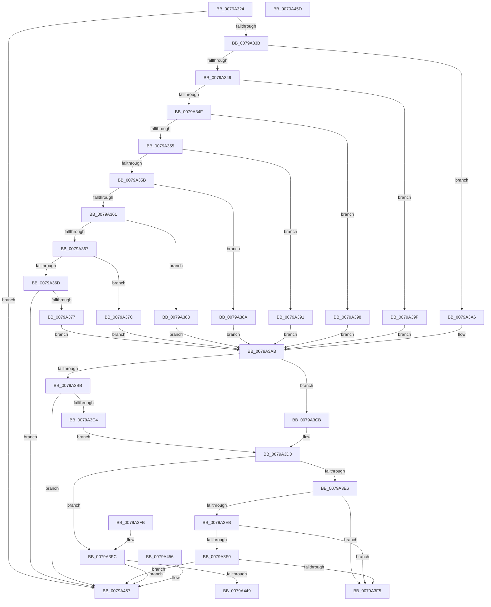

# Xp10ValidateFrameHeaderAndFillParameters

- RVA: `0x0079A324`–`0x0079A45E` (길이 `314` bytes)
- VA: `0x000000014079A324`
- 실행 섹션: `PAGE`
- PDB 이름 있음: `예`; PDB Function 태그: `아니요`
- unwind 정보 RVA: `0x000DB714`
- 디코드: `93`개 명령, `314/314` bytes 표시
- 미해석 바이트: `0` (있으면 어셈블리에 `.byte`로 보존)

> 이 문서는 커널 이미지의 기계어와 PDB 기호를 분석해 생성했습니다. 4번과 5번은 함수 원형과 자료형을 바이너리 사용 방식에서 추정한 C 해석이며 원본 소스 복구 결과는 아닙니다.

## 1. Dependencies

- 직접 호출 지점: **0**; 고유 호출 대상: **0**
- 직접 호출자로 확인된 함수: **1**
- RIP 상대 이미지 참조: **0**

### Outgoing calls
- 직접 디코드된 call 명령이 없습니다.

### Direct callers
- [RtlDecompressBuffer2Xp10](RtlDecompressBuffer2Xp10_function_007959A0.md) at `0x00795A4F`

### Static image references
- 디코드된 RIP-relative 메모리 참조가 없습니다.

## 2. Other-region calls and transfers

- 다른 실행 섹션으로 향하는 call: **0**
- 별도 외부 분기/꼬리 이동을 확인하지 못했습니다.

## 3. Assembly (complete function range)

```asm
0079A324  33 C0                           xor eax, eax
0079A326  4C 8B D2                        mov r10, rdx
0079A329  48 89 02                        mov qword ptr [rdx], rax
0079A32C  4C 8B C9                        mov r9, rcx
0079A32F  81 39 10 E5 39 C0               cmp dword ptr [rcx], 0xc039e510
0079A335  0F 85 1C 01 00 00               jne 0x14079a457
0079A33B  44 0F B7 41 04                  movzx r8d, word ptr [rcx + 4]
0079A340  45 33 DB                        xor r11d, r11d
0079A343  41 83 E0 07                     and r8d, 7
0079A347  74 5D                           je 0x14079a3a6
0079A349  41 83 E8 01                     sub r8d, 1
0079A34D  74 50                           je 0x14079a39f
0079A34F  41 83 E8 01                     sub r8d, 1
0079A353  74 43                           je 0x14079a398
0079A355  41 83 E8 01                     sub r8d, 1
0079A359  74 36                           je 0x14079a391
0079A35B  41 83 E8 01                     sub r8d, 1
0079A35F  74 29                           je 0x14079a38a
0079A361  41 83 E8 01                     sub r8d, 1
0079A365  74 1C                           je 0x14079a383
0079A367  41 83 E8 01                     sub r8d, 1
0079A36B  74 0F                           je 0x14079a37c
0079A36D  41 83 F8 01                     cmp r8d, 1
0079A371  0F 85 E0 00 00 00               jne 0x14079a457
0079A377  8D 48 18                        lea ecx, [rax + 0x18]
0079A37A  EB 2F                           jmp 0x14079a3ab
0079A37C  B9 16 00 00 00                  mov ecx, 0x16
0079A381  EB 28                           jmp 0x14079a3ab
0079A383  B9 14 00 00 00                  mov ecx, 0x14
0079A388  EB 21                           jmp 0x14079a3ab
0079A38A  B9 12 00 00 00                  mov ecx, 0x12
0079A38F  EB 1A                           jmp 0x14079a3ab
0079A391  B9 10 00 00 00                  mov ecx, 0x10
0079A396  EB 13                           jmp 0x14079a3ab
0079A398  B9 0E 00 00 00                  mov ecx, 0xe
0079A39D  EB 0C                           jmp 0x14079a3ab
0079A39F  B9 0D 00 00 00                  mov ecx, 0xd
0079A3A4  EB 05                           jmp 0x14079a3ab
0079A3A6  B9 0C 00 00 00                  mov ecx, 0xc
0079A3AB  66 89 0A                        mov word ptr [rdx], cx
0079A3AE  41 0F B7 51 04                  movzx edx, word ptr [r9 + 4]
0079A3B3  C1 EA 03                        shr edx, 3
0079A3B6  83 E2 01                        and edx, 1
0079A3B9  74 10                           je 0x14079a3cb
0079A3BB  83 EA 01                        sub edx, 1
0079A3BE  0F 85 93 00 00 00               jne 0x14079a457
0079A3C4  B8 80 00 00 00                  mov eax, 0x80
0079A3C9  EB 05                           jmp 0x14079a3d0
0079A3CB  B8 60 00 00 00                  mov eax, 0x60
0079A3D0  66 0B C1                        or ax, cx
0079A3D3  66 41 89 02                     mov word ptr [r10], ax
0079A3D7  41 0F B7 51 04                  movzx edx, word ptr [r9 + 4]
0079A3DC  8B CA                           mov ecx, edx
0079A3DE  C1 E9 04                        shr ecx, 4
0079A3E1  83 E1 03                        and ecx, 3
0079A3E4  74 16                           je 0x14079a3fc
0079A3E6  83 E9 01                        sub ecx, 1
0079A3E9  74 0A                           je 0x14079a3f5
0079A3EB  83 E9 01                        sub ecx, 1
0079A3EE  74 05                           je 0x14079a3f5
0079A3F0  83 F9 01                        cmp ecx, 1
0079A3F3  75 62                           jne 0x14079a457
0079A3F5  B8 02 00 00 C0                  mov eax, 0xc0000002
0079A3FA  C3                              ret
0079A3FB  CC                              int3
0079A3FC  B8 CF FF 00 00                  mov eax, 0xffcf
0079A401  B9 00 3F 00 00                  mov ecx, 0x3f00
0079A406  66 23 D0                        and dx, ax
0079A409  66 41 89 51 04                  mov word ptr [r9 + 4], dx
0079A40E  41 0F B7 02                     movzx eax, word ptr [r10]
0079A412  66 C1 E2 02                     shl dx, 2
0079A416  66 33 D0                        xor dx, ax
0079A419  66 23 D1                        and dx, cx
0079A41C  B9 00 40 00 00                  mov ecx, 0x4000
0079A421  66 33 D0                        xor dx, ax
0079A424  66 41 89 12                     mov word ptr [r10], dx
0079A428  0F B7 C2                        movzx eax, dx
0079A42B  66 41 33 41 04                  xor ax, word ptr [r9 + 4]
0079A430  66 23 C1                        and ax, cx
0079A433  66 33 C2                        xor ax, dx
0079A436  66 41 89 02                     mov word ptr [r10], ax
0079A43A  B8 00 30 00 00                  mov eax, 0x3000
0079A43F  41 0F B7 49 04                  movzx ecx, word ptr [r9 + 4]
0079A444  66 85 C8                        test ax, cx
0079A447  75 0E                           jne 0x14079a457
0079A449  66 85 C9                        test cx, cx
0079A44C  B8 42 02 00 C0                  mov eax, 0xc0000242
0079A451  41 0F 49 C3                     cmovns eax, r11d
0079A455  C3                              ret
0079A456  CC                              int3
0079A457  B8 42 02 00 C0                  mov eax, 0xc0000242
0079A45C  C3                              ret
0079A45D  CC                              int3
```

## 4. C-style interpretation (structured pseudocode)

```c
__int64 __fastcall Xp10ValidateFrameHeaderAndFillParameters(__int64 a1, __int64 a2)
{
    __int64 result;
    __int64 v_r11;

    result = 0;
    *(unsigned __int64 *)(a2) = 0;
    if ((*(unsigned int *)(a1)) != 0xC039E510ULL) goto loc_0079A457;
    v_r11 = 0;
    a3 = (unsigned int)((*(unsigned __int16 *)(a1 + 4)) & (7));
    if (condition_is_equal) goto loc_0079A3A6;
    a3 = (unsigned int)((a3) - (1));
    if (condition_is_equal) goto loc_0079A39F;
    a3 = (unsigned int)((a3) - (1));
    if (condition_is_equal) goto loc_0079A398;
    a3 = (unsigned int)((a3) - (1));
    if (condition_is_equal) goto loc_0079A391;
    a3 = (unsigned int)((a3) - (1));
    if (condition_is_equal) goto loc_0079A38A;
    a3 = (unsigned int)((a3) - (1));
    if (condition_is_equal) goto loc_0079A383;
    a3 = (unsigned int)((a3) - (1));
    if (condition_is_equal) goto loc_0079A37C;
    if (((unsigned int)(a3)) != 1) goto loc_0079A457;
    goto loc_0079A3AB;
loc_0079A37C:
    goto loc_0079A3AB;
loc_0079A383:
    goto loc_0079A3AB;
loc_0079A38A:
    goto loc_0079A3AB;
loc_0079A391:
    goto loc_0079A3AB;
loc_0079A398:
    goto loc_0079A3AB;
loc_0079A39F:
    goto loc_0079A3AB;
loc_0079A3A6:
loc_0079A3AB:
    *(unsigned __int16 *)(a2) = 12;
    a2 = (unsigned int)((*(unsigned __int16 *)(a1 + 4)) >> (3));
    a2 = (unsigned int)((a2) & (1));
    if (condition_is_equal) goto loc_0079A3CB;
    a2 = (unsigned int)((a2) - (1));
    if (condition_is_not_equal) goto loc_0079A457;
    goto loc_0079A3D0;
loc_0079A3CB:
loc_0079A3D0:
    result = (unsigned __int16)((96) | (12));
    *(unsigned __int16 *)(a2) = (unsigned __int16)(result);
    a1 = (unsigned int)(((unsigned int)((unsigned int)(*(unsigned __int16 *)(a1 + 4)))) >> (4));
    a1 = (unsigned int)((a1) & (3));
    if (condition_is_equal) goto loc_0079A3FC;
    a1 = (unsigned int)((a1) - (1));
    if (condition_is_equal) goto loc_0079A3F5;
    a1 = (unsigned int)((a1) - (1));
    if (condition_is_equal) goto loc_0079A3F5;
    if (((unsigned int)(a1)) != 1) goto loc_0079A457;
loc_0079A3F5:
    return (unsigned int)(0xC0000002ULL);
loc_0079A3FC:
    a2 = (unsigned __int16)((*(unsigned __int16 *)(a1 + 4)) & ((unsigned __int16)((unsigned int)(0xFFCFULL))));
    *(unsigned __int16 *)(a1 + 4) = (unsigned __int16)(a2);
    a2 = (unsigned __int16)((a2) << (2));
    a2 = (unsigned __int16)((a2) ^ ((unsigned __int16)(*(unsigned __int16 *)(a2))));
    a2 = (unsigned __int16)((a2) & ((unsigned __int16)((unsigned int)(0x3F00ULL))));
    a2 = (unsigned __int16)((a2) ^ ((unsigned __int16)(*(unsigned __int16 *)(a2))));
    *(unsigned __int16 *)(a2) = (unsigned __int16)(a2);
    result = (unsigned __int16)(((unsigned __int16)(a2)) ^ (*(unsigned __int16 *)(a1 + 4)));
    result = (unsigned __int16)((result) & ((unsigned __int16)((unsigned int)(0x4000ULL))));
    result = (unsigned __int16)((result) ^ ((unsigned __int16)(a2)));
    *(unsigned __int16 *)(a2) = (unsigned __int16)(result);
    if ((((unsigned __int16)((unsigned int)(0x3000ULL))) & ((unsigned __int16)(*(unsigned __int16 *)(a1 + 4)))) != 0) goto loc_0079A457;
    result = (unsigned int)(0xC0000242ULL);
    if (!sign_flag) { result = 0; }
    return result;
loc_0079A457:
    return (unsigned int)(0xC0000242ULL);
}
```

## 5. (Beta) C Style

```c
int64_t Xp10ValidateFrameHeaderAndFillParameters(void *Arg1, void *Arg2)
{
    uint8_t *arg1 = (uint8_t *)Arg1;
    uint8_t *arg2 = (uint8_t *)Arg2;

    int64_t result;
    int64_t local_r11;

    result = 0;
    *(uint64_t *)(arg2) = 0;
    if ((*(uint32_t *)(arg1)) != 0xC039E510ULL) goto loc_0079A457;
    local_r11 = 0;
    a3 = (uint32_t)((*(uint16_t *)(arg1 + 0x4)) & (7));
    if (condition_is_equal) goto loc_0079A3A6;
    a3 = (uint32_t)((a3) - (1));
    if (condition_is_equal) goto loc_0079A39F;
    a3 = (uint32_t)((a3) - (1));
    if (condition_is_equal) goto loc_0079A398;
    a3 = (uint32_t)((a3) - (1));
    if (condition_is_equal) goto loc_0079A391;
    a3 = (uint32_t)((a3) - (1));
    if (condition_is_equal) goto loc_0079A38A;
    a3 = (uint32_t)((a3) - (1));
    if (condition_is_equal) goto loc_0079A383;
    a3 = (uint32_t)((a3) - (1));
    if (condition_is_equal) goto loc_0079A37C;
    if (((uint32_t)(a3)) != 1) goto loc_0079A457;
    goto loc_0079A3AB;
loc_0079A37C:
    goto loc_0079A3AB;
loc_0079A383:
    goto loc_0079A3AB;
loc_0079A38A:
    goto loc_0079A3AB;
loc_0079A391:
    goto loc_0079A3AB;
loc_0079A398:
    goto loc_0079A3AB;
loc_0079A39F:
    goto loc_0079A3AB;
loc_0079A3A6:
loc_0079A3AB:
    *(uint16_t *)(arg2) = 12;
    Arg2 = (uint32_t)((*(uint16_t *)(arg1 + 0x4)) >> (3));
    Arg2 = (uint32_t)((Arg2) & (1));
    if (condition_is_equal) goto loc_0079A3CB;
    Arg2 = (uint32_t)((Arg2) - (1));
    if (condition_is_not_equal) goto loc_0079A457;
    goto loc_0079A3D0;
loc_0079A3CB:
loc_0079A3D0:
    result = (uint16_t)((96) | (12));
    *(uint16_t *)(arg2) = (uint16_t)(result);
    Arg1 = (uint32_t)(((uint32_t)((uint32_t)(*(uint16_t *)(arg1 + 0x4)))) >> (4));
    Arg1 = (uint32_t)((Arg1) & (3));
    if (condition_is_equal) goto loc_0079A3FC;
    Arg1 = (uint32_t)((Arg1) - (1));
    if (condition_is_equal) goto loc_0079A3F5;
    Arg1 = (uint32_t)((Arg1) - (1));
    if (condition_is_equal) goto loc_0079A3F5;
    if (((uint32_t)(Arg1)) != 1) goto loc_0079A457;
loc_0079A3F5:
    return (uint32_t)(0xC0000002ULL);
loc_0079A3FC:
    Arg2 = (uint16_t)((*(uint16_t *)(arg1 + 0x4)) & ((uint16_t)((uint32_t)(0xFFCFULL))));
    *(uint16_t *)(arg1 + 0x4) = (uint16_t)(Arg2);
    Arg2 = (uint16_t)((Arg2) << (2));
    Arg2 = (uint16_t)((Arg2) ^ ((uint16_t)(*(uint16_t *)(arg2))));
    Arg2 = (uint16_t)((Arg2) & ((uint16_t)((uint32_t)(0x3F00ULL))));
    Arg2 = (uint16_t)((Arg2) ^ ((uint16_t)(*(uint16_t *)(arg2))));
    *(uint16_t *)(arg2) = (uint16_t)(Arg2);
    result = (uint16_t)(((uint16_t)(Arg2)) ^ (*(uint16_t *)(arg1 + 0x4)));
    result = (uint16_t)((result) & ((uint16_t)((uint32_t)(0x4000ULL))));
    result = (uint16_t)((result) ^ ((uint16_t)(Arg2)));
    *(uint16_t *)(arg2) = (uint16_t)(result);
    if ((((uint16_t)((uint32_t)(0x3000ULL))) & ((uint16_t)(*(uint16_t *)(arg1 + 0x4)))) != 0) goto loc_0079A457;
    result = (uint32_t)(0xC0000242ULL);
    if (!sign_flag) { result = 0; }
    return result;
loc_0079A457:
    return (uint32_t)(0xC0000242ULL);
}
```

### 관측된 메모리 오프셋

구조체 형식이 확인되지 않은 접근은 인자 기준의 오프셋으로만 기록했습니다.

| 기준 인자 | 오프셋 표현 | 폭 (bit) | 접근 |
|---|---:|---:|---|
| `Arg1` | `+ 0x0` | `32` | `R` |
| `Arg1` | `+ 0x4` | `16` | `R` |
| `Arg1` | `+ 0x4` | `16` | `W` |
| `Arg2` | `+ 0x0` | `16` | `R` |
| `Arg2` | `+ 0x0` | `16` | `W` |
| `Arg2` | `+ 0x0` | `64` | `W` |

## 6. Execution-region graph

[열기: 2D/3D 그래프와 함수 탐색 컨트롤 패널](../../../control-panel.html?section=page&rva=0x0079A324&view=graph)

- 2D 그래프는 위에서 아래로 흐르고, 3D 그래프는 빈 공간을 드래그해 회전합니다. Shift+드래그는 이동, 휠은 확대·축소, 함수 노드 선택은 대상 보고서 이동입니다.

### Static fallback


