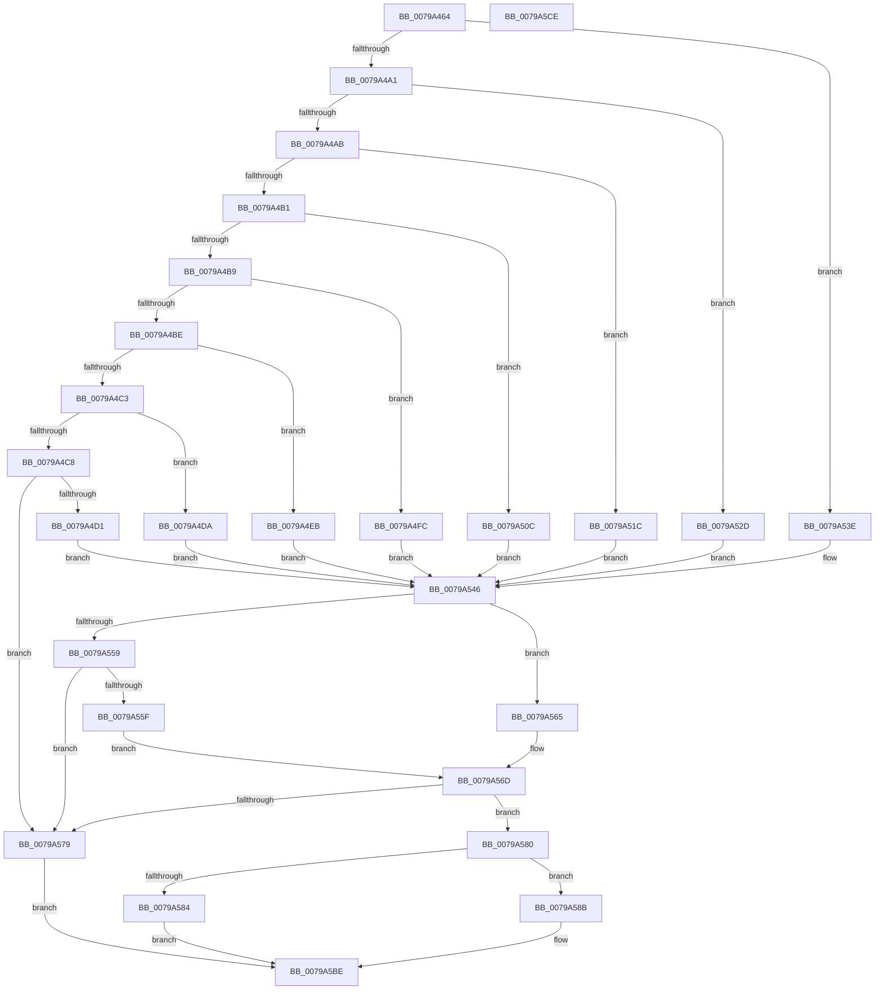

# Xp10ValidateParametersAndFillFrameHeader

- RVA: `0x0079A464`–`0x0079A5CF` (길이 `363` bytes)
- VA: `0x000000014079A464`
- 실행 섹션: `PAGE`
- PDB 이름 있음: `예`; PDB Function 태그: `아니요`
- unwind 정보 RVA: `0x00069588`
- 디코드: `105`개 명령, `363/363` bytes 표시
- 미해석 바이트: `0` (있으면 어셈블리에 `.byte`로 보존)

> 이 문서는 커널 이미지의 기계어와 PDB 기호를 분석해 생성했습니다. 4번과 5번은 함수 원형과 자료형을 바이너리 사용 방식에서 추정한 C 해석이며 원본 소스 복구 결과는 아닙니다.

## 1. Dependencies

- 직접 호출 지점: **0**; 고유 호출 대상: **0**
- 직접 호출자로 확인된 함수: **1**
- RIP 상대 이미지 참조: **0**

### Outgoing calls
- 직접 디코드된 call 명령이 없습니다.

### Direct callers
- [Xp10CompressBuffer](Xp10CompressBuffer_function_007972F4.md) at `0x0079738D`

### Static image references
- 디코드된 RIP-relative 메모리 참조가 없습니다.

## 2. Other-region calls and transfers

- 다른 실행 섹션으로 향하는 call: **0**
- 별도 외부 분기/꼬리 이동을 확인하지 못했습니다.

## 3. Assembly (complete function range)

```asm
0079A464  48 89 5C 24 08                  mov qword ptr [rsp + 8], rbx
0079A469  48 89 74 24 10                  mov qword ptr [rsp + 0x10], rsi
0079A46E  48 89 7C 24 18                  mov qword ptr [rsp + 0x18], rdi
0079A473  33 DB                           xor ebx, ebx
0079A475  4C 8B D1                        mov r10, rcx
0079A478  66 89 5A 04                     mov word ptr [rdx + 4], bx
0079A47C  44 0F B7 09                     movzx r9d, word ptr [rcx]
0079A480  45 8B C1                        mov r8d, r9d
0079A483  C7 02 10 E5 39 C0               mov dword ptr [rdx], 0xc039e510
0079A489  41 83 E0 1F                     and r8d, 0x1f
0079A48D  8D 7B 04                        lea edi, [rbx + 4]
0079A490  8D 73 03                        lea esi, [rbx + 3]
0079A493  44 8D 5B 07                     lea r11d, [rbx + 7]
0079A497  41 83 E8 0C                     sub r8d, 0xc
0079A49B  0F 84 9D 00 00 00               je 0x14079a53e
0079A4A1  41 83 E8 01                     sub r8d, 1
0079A4A5  0F 84 82 00 00 00               je 0x14079a52d
0079A4AB  41 83 E8 01                     sub r8d, 1
0079A4AF  74 6B                           je 0x14079a51c
0079A4B1  8D 43 02                        lea eax, [rbx + 2]
0079A4B4  44 2B C0                        sub r8d, eax
0079A4B7  74 53                           je 0x14079a50c
0079A4B9  44 2B C0                        sub r8d, eax
0079A4BC  74 3E                           je 0x14079a4fc
0079A4BE  44 2B C0                        sub r8d, eax
0079A4C1  74 28                           je 0x14079a4eb
0079A4C3  44 2B C0                        sub r8d, eax
0079A4C6  74 12                           je 0x14079a4da
0079A4C8  44 3B C0                        cmp r8d, eax
0079A4CB  0F 85 A8 00 00 00               jne 0x14079a579
0079A4D1  0F B7 CB                        movzx ecx, bx
0079A4D4  66 41 0B CB                     or cx, r11w
0079A4D8  EB 6C                           jmp 0x14079a546
0079A4DA  0F B7 CB                        movzx ecx, bx
0079A4DD  B8 FE FF 00 00                  mov eax, 0xfffe
0079A4E2  66 23 C8                        and cx, ax
0079A4E5  66 83 C9 06                     or cx, 6
0079A4E9  EB 5B                           jmp 0x14079a546
0079A4EB  0F B7 CB                        movzx ecx, bx
0079A4EE  B8 FD FF 00 00                  mov eax, 0xfffd
0079A4F3  66 23 C8                        and cx, ax
0079A4F6  66 83 C9 05                     or cx, 5
0079A4FA  EB 4A                           jmp 0x14079a546
0079A4FC  0F B7 CB                        movzx ecx, bx
0079A4FF  B8 FC FF 00 00                  mov eax, 0xfffc
0079A504  66 23 C8                        and cx, ax
0079A507  66 0B CF                        or cx, di
0079A50A  EB 3A                           jmp 0x14079a546
0079A50C  0F B7 CB                        movzx ecx, bx
0079A50F  B8 FB FF 00 00                  mov eax, 0xfffb
0079A514  66 23 C8                        and cx, ax
0079A517  66 0B CE                        or cx, si
0079A51A  EB 2A                           jmp 0x14079a546
0079A51C  0F B7 CB                        movzx ecx, bx
0079A51F  B8 FA FF 00 00                  mov eax, 0xfffa
0079A524  66 23 C8                        and cx, ax
0079A527  66 83 C9 02                     or cx, 2
0079A52B  EB 19                           jmp 0x14079a546
0079A52D  0F B7 CB                        movzx ecx, bx
0079A530  B8 F9 FF 00 00                  mov eax, 0xfff9
0079A535  66 23 C8                        and cx, ax
0079A538  66 83 C9 01                     or cx, 1
0079A53C  EB 08                           jmp 0x14079a546
0079A53E  B9 F8 FF 00 00                  mov ecx, 0xfff8
0079A543  66 23 CB                        and cx, bx
0079A546  45 8B C1                        mov r8d, r9d
0079A549  66 89 4A 04                     mov word ptr [rdx + 4], cx
0079A54D  41 C1 E8 05                     shr r8d, 5
0079A551  45 23 C3                        and r8d, r11d
0079A554  44 2B C6                        sub r8d, esi
0079A557  74 0C                           je 0x14079a565
0079A559  41 83 F8 01                     cmp r8d, 1
0079A55D  75 1A                           jne 0x14079a579
0079A55F  66 83 C9 08                     or cx, 8
0079A563  EB 08                           jmp 0x14079a56d
0079A565  B8 F7 FF 00 00                  mov eax, 0xfff7
0079A56A  66 23 C8                        and cx, ax
0079A56D  66 89 4A 04                     mov word ptr [rdx + 4], cx
0079A571  41 8B 42 04                     mov eax, dword ptr [r10 + 4]
0079A575  3B C7                           cmp eax, edi
0079A577  72 07                           jb 0x14079a580
0079A579  B8 0D 00 00 C0                  mov eax, 0xc000000d
0079A57E  EB 3E                           jmp 0x14079a5be
0079A580  85 C0                           test eax, eax
0079A582  74 07                           je 0x14079a58b
0079A584  B8 02 00 00 C0                  mov eax, 0xc0000002
0079A589  EB 33                           jmp 0x14079a5be
0079A58B  41 0F B7 42 04                  movzx eax, word ptr [r10 + 4]
0079A590  66 C1 E0 04                     shl ax, 4
0079A594  66 33 C1                        xor ax, cx
0079A597  66 83 E0 30                     and ax, 0x30
0079A59B  66 33 C1                        xor ax, cx
0079A59E  B9 3F F0 00 00                  mov ecx, 0xf03f
0079A5A3  66 23 C1                        and ax, cx
0079A5A6  B9 00 40 00 00                  mov ecx, 0x4000
0079A5AB  66 44 33 C8                     xor r9w, ax
0079A5AF  66 44 23 C9                     and r9w, cx
0079A5B3  66 44 33 C8                     xor r9w, ax
0079A5B7  66 44 89 4A 04                  mov word ptr [rdx + 4], r9w
0079A5BC  33 C0                           xor eax, eax
0079A5BE  48 8B 5C 24 08                  mov rbx, qword ptr [rsp + 8]
0079A5C3  48 8B 74 24 10                  mov rsi, qword ptr [rsp + 0x10]
0079A5C8  48 8B 7C 24 18                  mov rdi, qword ptr [rsp + 0x18]
0079A5CD  C3                              ret
0079A5CE  CC                              int3
```

## 4. C-style interpretation (structured pseudocode)

```c
__int64 __fastcall Xp10ValidateParametersAndFillFrameHeader(__int64 a1, __int64 a2)
{
    __int64 result;
    __int64 v_rbx;
    unsigned __int64 v_stack_p10;
    unsigned __int64 v_stack_p18;
    unsigned __int64 v_stack_p8;

    v_stack_p8 = v_rbx;
    v_stack_p10 = v_rsi;
    v_stack_p18 = v_rdi;
    v_rbx = 0;
    *(unsigned __int16 *)(a2 + 4) = 0;
    *(unsigned int *)(a2) = 0xC039E510ULL;
    a3 = (unsigned int)(((unsigned int)((unsigned int)(*(unsigned __int16 *)(a1)))) & (31));
    a3 = (unsigned int)((a3) - (12));
    if (condition_is_equal) goto loc_0079A53E;
    a3 = (unsigned int)((a3) - (1));
    if (condition_is_equal) goto loc_0079A52D;
    a3 = (unsigned int)((a3) - (1));
    if (condition_is_equal) goto loc_0079A51C;
    a3 = (unsigned int)((a3) - ((unsigned int)(v_rbx + 2)));
    if (condition_is_equal) goto loc_0079A50C;
    a3 = (unsigned int)((a3) - ((unsigned int)(v_rbx + 2)));
    if (condition_is_equal) goto loc_0079A4FC;
    a3 = (unsigned int)((a3) - ((unsigned int)(v_rbx + 2)));
    if (condition_is_equal) goto loc_0079A4EB;
    a3 = (unsigned int)((a3) - ((unsigned int)(v_rbx + 2)));
    if (condition_is_equal) goto loc_0079A4DA;
    if (((unsigned int)(a3)) != ((unsigned int)(v_rbx + 2))) goto loc_0079A579;
    a1 = (unsigned __int16)((0) | ((unsigned __int16)(v_rbx + 7)));
    goto loc_0079A546;
loc_0079A4DA:
    a1 = (unsigned __int16)((0) & ((unsigned __int16)((unsigned int)(0xFFFEULL))));
    a1 = (unsigned __int16)((a1) | (6));
    goto loc_0079A546;
loc_0079A4EB:
    a1 = (unsigned __int16)((0) & ((unsigned __int16)((unsigned int)(0xFFFDULL))));
    a1 = (unsigned __int16)((a1) | (5));
    goto loc_0079A546;
loc_0079A4FC:
    a1 = (unsigned __int16)((0) & ((unsigned __int16)((unsigned int)(0xFFFCULL))));
    a1 = (unsigned __int16)((a1) | ((unsigned __int16)(v_rbx + 4)));
    goto loc_0079A546;
loc_0079A50C:
    a1 = (unsigned __int16)((0) & ((unsigned __int16)((unsigned int)(0xFFFBULL))));
    a1 = (unsigned __int16)((a1) | ((unsigned __int16)(v_rbx + 3)));
    goto loc_0079A546;
loc_0079A51C:
    a1 = (unsigned __int16)((0) & ((unsigned __int16)((unsigned int)(0xFFFAULL))));
    a1 = (unsigned __int16)((a1) | (2));
    goto loc_0079A546;
loc_0079A52D:
    a1 = (unsigned __int16)((0) & ((unsigned __int16)((unsigned int)(0xFFF9ULL))));
    a1 = (unsigned __int16)((a1) | (1));
    goto loc_0079A546;
loc_0079A53E:
    a1 = (unsigned __int16)(((unsigned int)(0xFFF8ULL)) & (0));
loc_0079A546:
    *(unsigned __int16 *)(a2 + 4) = (unsigned __int16)(a1);
    a3 = (unsigned int)(((unsigned int)((unsigned int)(*(unsigned __int16 *)(a1)))) >> (5));
    a3 = (unsigned int)((a3) & ((unsigned int)(v_rbx + 7)));
    a3 = (unsigned int)((a3) - ((unsigned int)(v_rbx + 3)));
    if (condition_is_equal) goto loc_0079A565;
    if (((unsigned int)(a3)) != 1) goto loc_0079A579;
    a1 = (unsigned __int16)((a1) | (8));
    goto loc_0079A56D;
loc_0079A565:
    a1 = (unsigned __int16)((a1) & ((unsigned __int16)((unsigned int)(0xFFF7ULL))));
loc_0079A56D:
    *(unsigned __int16 *)(a2 + 4) = (unsigned __int16)(a1);
    if (((unsigned int)((unsigned int)(*(unsigned int *)(a1 + 4)))) < ((unsigned int)(v_rbx + 4))) goto loc_0079A580;
loc_0079A579:
    goto loc_0079A5BE;
loc_0079A580:
    if ((unsigned int)((unsigned int)(0xC000000DULL)) == 0) goto loc_0079A58B;
    goto loc_0079A5BE;
loc_0079A58B:
    result = (unsigned __int16)((*(unsigned __int16 *)(a1 + 4)) << (4));
    result = (unsigned __int16)((result) ^ ((unsigned __int16)(a1)));
    result = (unsigned __int16)((result) & (48));
    result = (unsigned __int16)((result) ^ ((unsigned __int16)(a1)));
    result = (unsigned __int16)((result) & ((unsigned __int16)((unsigned int)(0xF03FULL))));
    a4 = (unsigned __int16)((*(unsigned __int16 *)(a1)) ^ ((unsigned __int16)(result)));
    a4 = (unsigned __int16)((a4) & ((unsigned __int16)((unsigned int)(0x4000ULL))));
    a4 = (unsigned __int16)((a4) ^ ((unsigned __int16)(result)));
    *(unsigned __int16 *)(a2 + 4) = (unsigned __int16)(a4);
    result = 0;
loc_0079A5BE:
    return result;
}
```

## 5. (Beta) C Style

```c
int64_t Xp10ValidateParametersAndFillFrameHeader(void *Arg1, void *Arg2)
{
    uint8_t *arg1 = (uint8_t *)Arg1;
    uint8_t *arg2 = (uint8_t *)Arg2;

    int64_t result;
    int64_t local_rbx;
    uint64_t v_stack_p10;
    uint64_t v_stack_p18;
    uint64_t v_stack_p8;

    v_stack_p8 = local_rbx;
    v_stack_p10 = local_rsi;
    v_stack_p18 = local_rdi;
    local_rbx = 0;
    *(uint16_t *)(arg2 + 0x4) = 0;
    *(uint32_t *)(arg2) = 0xC039E510ULL;
    a3 = (uint32_t)(((uint32_t)((uint32_t)(*(uint16_t *)(arg1)))) & (31));
    a3 = (uint32_t)((a3) - (12));
    if (condition_is_equal) goto loc_0079A53E;
    a3 = (uint32_t)((a3) - (1));
    if (condition_is_equal) goto loc_0079A52D;
    a3 = (uint32_t)((a3) - (1));
    if (condition_is_equal) goto loc_0079A51C;
    a3 = (uint32_t)((a3) - ((uint32_t)(local_rbx + 2)));
    if (condition_is_equal) goto loc_0079A50C;
    a3 = (uint32_t)((a3) - ((uint32_t)(local_rbx + 2)));
    if (condition_is_equal) goto loc_0079A4FC;
    a3 = (uint32_t)((a3) - ((uint32_t)(local_rbx + 2)));
    if (condition_is_equal) goto loc_0079A4EB;
    a3 = (uint32_t)((a3) - ((uint32_t)(local_rbx + 2)));
    if (condition_is_equal) goto loc_0079A4DA;
    if (((uint32_t)(a3)) != ((uint32_t)(local_rbx + 2))) goto loc_0079A579;
    Arg1 = (uint16_t)((0) | ((uint16_t)(local_rbx + 7)));
    goto loc_0079A546;
loc_0079A4DA:
    Arg1 = (uint16_t)((0) & ((uint16_t)((uint32_t)(0xFFFEULL))));
    Arg1 = (uint16_t)((Arg1) | (6));
    goto loc_0079A546;
loc_0079A4EB:
    Arg1 = (uint16_t)((0) & ((uint16_t)((uint32_t)(0xFFFDULL))));
    Arg1 = (uint16_t)((Arg1) | (5));
    goto loc_0079A546;
loc_0079A4FC:
    Arg1 = (uint16_t)((0) & ((uint16_t)((uint32_t)(0xFFFCULL))));
    Arg1 = (uint16_t)((Arg1) | ((uint16_t)(local_rbx + 4)));
    goto loc_0079A546;
loc_0079A50C:
    Arg1 = (uint16_t)((0) & ((uint16_t)((uint32_t)(0xFFFBULL))));
    Arg1 = (uint16_t)((Arg1) | ((uint16_t)(local_rbx + 3)));
    goto loc_0079A546;
loc_0079A51C:
    Arg1 = (uint16_t)((0) & ((uint16_t)((uint32_t)(0xFFFAULL))));
    Arg1 = (uint16_t)((Arg1) | (2));
    goto loc_0079A546;
loc_0079A52D:
    Arg1 = (uint16_t)((0) & ((uint16_t)((uint32_t)(0xFFF9ULL))));
    Arg1 = (uint16_t)((Arg1) | (1));
    goto loc_0079A546;
loc_0079A53E:
    Arg1 = (uint16_t)(((uint32_t)(0xFFF8ULL)) & (0));
loc_0079A546:
    *(uint16_t *)(arg2 + 0x4) = (uint16_t)(Arg1);
    a3 = (uint32_t)(((uint32_t)((uint32_t)(*(uint16_t *)(arg1)))) >> (5));
    a3 = (uint32_t)((a3) & ((uint32_t)(local_rbx + 7)));
    a3 = (uint32_t)((a3) - ((uint32_t)(local_rbx + 3)));
    if (condition_is_equal) goto loc_0079A565;
    if (((uint32_t)(a3)) != 1) goto loc_0079A579;
    Arg1 = (uint16_t)((Arg1) | (8));
    goto loc_0079A56D;
loc_0079A565:
    Arg1 = (uint16_t)((Arg1) & ((uint16_t)((uint32_t)(0xFFF7ULL))));
loc_0079A56D:
    *(uint16_t *)(arg2 + 0x4) = (uint16_t)(Arg1);
    if (((uint32_t)((uint32_t)(*(uint32_t *)(arg1 + 0x4)))) < ((uint32_t)(local_rbx + 4))) goto loc_0079A580;
loc_0079A579:
    goto loc_0079A5BE;
loc_0079A580:
    if ((uint32_t)((uint32_t)(0xC000000DULL)) == 0) goto loc_0079A58B;
    goto loc_0079A5BE;
loc_0079A58B:
    result = (uint16_t)((*(uint16_t *)(arg1 + 0x4)) << (4));
    result = (uint16_t)((result) ^ ((uint16_t)(Arg1)));
    result = (uint16_t)((result) & (48));
    result = (uint16_t)((result) ^ ((uint16_t)(Arg1)));
    result = (uint16_t)((result) & ((uint16_t)((uint32_t)(0xF03FULL))));
    a4 = (uint16_t)((*(uint16_t *)(arg1)) ^ ((uint16_t)(result)));
    a4 = (uint16_t)((a4) & ((uint16_t)((uint32_t)(0x4000ULL))));
    a4 = (uint16_t)((a4) ^ ((uint16_t)(result)));
    *(uint16_t *)(arg2 + 0x4) = (uint16_t)(a4);
    result = 0;
loc_0079A5BE:
    return result;
}
```

### 관측된 메모리 오프셋

구조체 형식이 확인되지 않은 접근은 인자 기준의 오프셋으로만 기록했습니다.

| 기준 인자 | 오프셋 표현 | 폭 (bit) | 접근 |
|---|---:|---:|---|
| `Arg1` | `+ 0x0` | `16` | `R` |
| `Arg1` | `+ 0x4` | `16` | `R` |
| `Arg1` | `+ 0x4` | `32` | `R` |
| `Arg2` | `+ 0x0` | `32` | `W` |
| `Arg2` | `+ 0x4` | `16` | `W` |

## 6. Execution-region graph

[열기: 2D/3D 그래프와 함수 탐색 컨트롤 패널](../../../control-panel.html?section=page&rva=0x0079A464&view=graph)

- 2D 그래프는 위에서 아래로 흐르고, 3D 그래프는 빈 공간을 드래그해 회전합니다. Shift+드래그는 이동, 휠은 확대·축소, 함수 노드 선택은 대상 보고서 이동입니다.

### Static fallback


