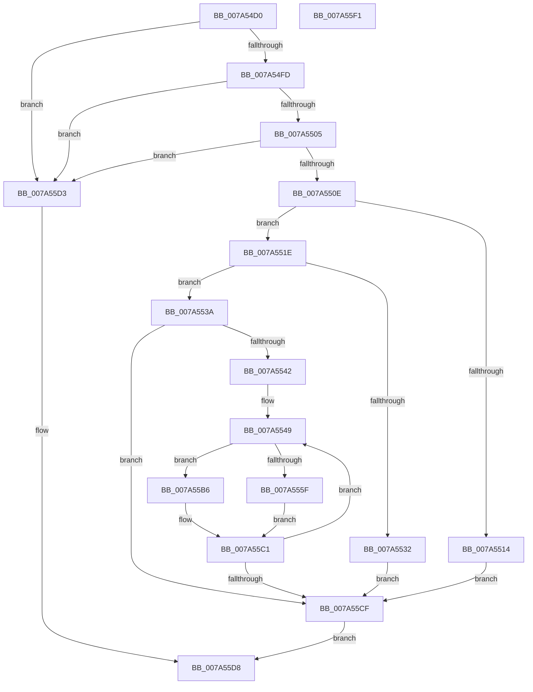

# EncodeAttributeName

- RVA: `0x007A54D0`–`0x007A55F2` (길이 `290` bytes)
- VA: `0x00000001407A54D0`
- 실행 섹션: `PAGE`
- PDB 이름 있음: `예`; PDB Function 태그: `아니요`
- unwind 정보 RVA: `0x00060300`
- 디코드: `82`개 명령, `290/290` bytes 표시
- 미해석 바이트: `0` (있으면 어셈블리에 `.byte`로 보존)

> 이 문서는 커널 이미지의 기계어와 PDB 기호를 분석해 생성했습니다. 4번과 5번은 함수 원형과 자료형을 바이너리 사용 방식에서 추정한 C 해석이며 원본 소스 복구 결과는 아닙니다.

## 1. Dependencies

- 직접 호출 지점: **2**; 고유 호출 대상: **2**
- 직접 호출자로 확인된 함수: **2**
- RIP 상대 이미지 참조: **1**

### Outgoing calls
- `0x007A5525` → [SddlpAlloc](../92/SddlpAlloc_function_00925F88.md) (function, `0x00925F88`)
- `0x007A554C` → [IsEncodedAttributeChar](IsEncodedAttributeChar_function_007A5944.md) (function, `0x007A5944`)

### Direct callers
- [GetPrintableAttributeName](../A0/GetPrintableAttributeName_function_00A019D0.md) at `0x00A01B47`
- [LocalGetStringForRelativeAttribute](../A0/LocalGetStringForRelativeAttribute_function_00A02C38.md) at `0x00A02D37`

### Static image references
- `0x007A5542` → RVA `0x00037FA8` (`.rdata`; read)

## 2. Other-region calls and transfers

- 다른 실행 섹션으로 향하는 call: **0**
- 별도 외부 분기/꼬리 이동을 확인하지 못했습니다.

## 3. Assembly (complete function range)

```asm
007A54D0  48 89 5C 24 08                  mov qword ptr [rsp + 8], rbx
007A54D5  48 89 6C 24 10                  mov qword ptr [rsp + 0x10], rbp
007A54DA  48 89 74 24 18                  mov qword ptr [rsp + 0x18], rsi
007A54DF  57                              push rdi
007A54E0  41 56                           push r14
007A54E2  41 57                           push r15
007A54E4  48 83 EC 20                     sub rsp, 0x20
007A54E8  33 DB                           xor ebx, ebx
007A54EA  4D 8B F0                        mov r14, r8
007A54ED  8B FA                           mov edi, edx
007A54EF  48 8B F1                        mov rsi, rcx
007A54F2  8B EB                           mov ebp, ebx
007A54F4  48 85 C9                        test rcx, rcx
007A54F7  0F 84 D6 00 00 00               je 0x1407a55d3
007A54FD  85 D2                           test edx, edx
007A54FF  0F 84 CE 00 00 00               je 0x1407a55d3
007A5505  4D 85 C0                        test r8, r8
007A5508  0F 84 C5 00 00 00               je 0x1407a55d3
007A550E  40 F6 C7 01                     test dil, 1
007A5512  74 0A                           je 0x1407a551e
007A5514  BB 38 05 00 00                  mov ebx, 0x538
007A5519  E9 B1 00 00 00                  jmp 0x1407a55cf
007A551E  8D 0C 92                        lea ecx, [rdx + rdx*4]
007A5521  48 83 C1 02                     add rcx, 2
007A5525  E8 5E 0A 18 00                  call 0x140925f88
007A552A  49 89 06                        mov qword ptr [r14], rax
007A552D  48 85 C0                        test rax, rax
007A5530  75 08                           jne 0x1407a553a
007A5532  8D 58 08                        lea ebx, [rax + 8]
007A5535  E9 95 00 00 00                  jmp 0x1407a55cf
007A553A  D1 EF                           shr edi, 1
007A553C  0F 84 8D 00 00 00               je 0x1407a55cf
007A5542  4C 8D 3D 5F 2A 89 FF            lea r15, [rip - 0x76d5a1]
007A5549  0F B7 0E                        movzx ecx, word ptr [rsi]
007A554C  E8 F3 03 00 00                  call 0x1407a5944
007A5551  49 8B 16                        mov rdx, qword ptr [r14]
007A5554  44 8D 45 01                     lea r8d, [rbp + 1]
007A5558  44 8B CD                        mov r9d, ebp
007A555B  84 C0                           test al, al
007A555D  74 57                           je 0x1407a55b6
007A555F  66 42 C7 04 4A 25 00            mov word ptr [rdx + r9*2], 0x25
007A5566  0F B7 06                        movzx eax, word ptr [rsi]
007A5569  48 C1 E8 0C                     shr rax, 0xc
007A556D  41 8B E8                        mov ebp, r8d
007A5570  FF C5                           inc ebp
007A5572  41 0F B7 04 47                  movzx eax, word ptr [r15 + rax*2]
007A5577  66 42 89 04 42                  mov word ptr [rdx + r8*2], ax
007A557C  0F B6 46 01                     movzx eax, byte ptr [rsi + 1]
007A5580  83 E0 0F                        and eax, 0xf
007A5583  41 0F B7 04 47                  movzx eax, word ptr [r15 + rax*2]
007A5588  66 89 04 6A                     mov word ptr [rdx + rbp*2], ax
007A558C  FF C5                           inc ebp
007A558E  0F B7 06                        movzx eax, word ptr [rsi]
007A5591  66 C1 E8 04                     shr ax, 4
007A5595  83 E0 0F                        and eax, 0xf
007A5598  41 0F B7 04 47                  movzx eax, word ptr [r15 + rax*2]
007A559D  66 89 04 6A                     mov word ptr [rdx + rbp*2], ax
007A55A1  FF C5                           inc ebp
007A55A3  0F B6 06                        movzx eax, byte ptr [rsi]
007A55A6  83 E0 0F                        and eax, 0xf
007A55A9  41 0F B7 04 47                  movzx eax, word ptr [r15 + rax*2]
007A55AE  66 89 04 6A                     mov word ptr [rdx + rbp*2], ax
007A55B2  FF C5                           inc ebp
007A55B4  EB 0B                           jmp 0x1407a55c1
007A55B6  0F B7 0E                        movzx ecx, word ptr [rsi]
007A55B9  41 8B E8                        mov ebp, r8d
007A55BC  66 42 89 0C 4A                  mov word ptr [rdx + r9*2], cx
007A55C1  48 83 C6 02                     add rsi, 2
007A55C5  48 83 EF 01                     sub rdi, 1
007A55C9  0F 85 7A FF FF FF               jne 0x1407a5549
007A55CF  8B C3                           mov eax, ebx
007A55D1  EB 05                           jmp 0x1407a55d8
007A55D3  B8 57 00 00 00                  mov eax, 0x57
007A55D8  48 8B 5C 24 40                  mov rbx, qword ptr [rsp + 0x40]
007A55DD  48 8B 6C 24 48                  mov rbp, qword ptr [rsp + 0x48]
007A55E2  48 8B 74 24 50                  mov rsi, qword ptr [rsp + 0x50]
007A55E7  48 83 C4 20                     add rsp, 0x20
007A55EB  41 5F                           pop r15
007A55ED  41 5E                           pop r14
007A55EF  5F                              pop rdi
007A55F0  C3                              ret
007A55F1  CC                              int3
```

## 4. C-style interpretation (structured pseudocode)

```c
__int64 __fastcall EncodeAttributeName(__int64 a1, __int64 a2, __int64 a3)
{
    __int64 result;
    __int64 v_rbp;
    __int64 v_rbx;
    __int64 v_rdi;
    __int64 v_rsi;
    __int64 v_rsp;
    unsigned __int64 v_stack_p10;
    unsigned __int64 v_stack_p18;
    unsigned __int64 v_stack_p8;

    v_stack_p8 = v_rbx;
    v_stack_p10 = v_rbp;
    v_stack_p18 = v_rsi;
    v_rsp = (v_rsp) - (32);
    v_rbx = 0;
    if (a1 == 0) goto loc_007A55D3;
    if ((unsigned int)(a2) == 0) goto loc_007A55D3;
    if (a3 == 0) goto loc_007A55D3;
    if ((((unsigned __int8)((unsigned int)((unsigned int)(a2)))) & (1)) == 0) goto loc_007A551E;
    goto loc_007A55CF;
loc_007A551E:
    a1 = (a2 + a2 * 4) + (2);
    result = SddlpAlloc(a1, a2, a3, a4);
    *(unsigned __int64 *)(a3) = result;
    if (result != 0) goto loc_007A553A;
    goto loc_007A55CF;
loc_007A553A:
    v_rdi = (unsigned int)(((unsigned int)((unsigned int)(a2))) >> (1));
    if (condition_is_equal) goto loc_007A55CF;
loc_007A5549:
    result = IsEncodedAttributeChar(*(unsigned __int16 *)(a1), a2, a3, a4);
    if ((unsigned __int8)(result) == 0) goto loc_007A55B6;
    *(unsigned __int16 *)(*(unsigned __int64 *)(a3) + 0 * 2) = 37;
    result = (*(unsigned __int16 *)(a1)) >> (12);
    v_rbp = (unsigned int)(((unsigned int)((unsigned int)(0 + 1))) + 1);
    *(unsigned __int16 *)(*(unsigned __int64 *)(a3) + 0 + 1 * 2) = (unsigned __int16)(*(unsigned __int16 *)(v_rip - 7787937 + result * 2));
    result = (unsigned int)((*(unsigned __int8 *)(a1 + 1)) & (15));
    *(unsigned __int16 *)(*(unsigned __int64 *)(a3) + v_rbp * 2) = (unsigned __int16)(*(unsigned __int16 *)(v_rip - 7787937 + result * 2));
    v_rbp = (unsigned int)((v_rbp) + 1);
    result = (unsigned __int16)((*(unsigned __int16 *)(a1)) >> (4));
    result = (unsigned int)((result) & (15));
    *(unsigned __int16 *)(*(unsigned __int64 *)(a3) + v_rbp * 2) = (unsigned __int16)(*(unsigned __int16 *)(v_rip - 7787937 + result * 2));
    v_rbp = (unsigned int)((v_rbp) + 1);
    result = (unsigned int)((*(unsigned __int8 *)(a1)) & (15));
    *(unsigned __int16 *)(*(unsigned __int64 *)(a3) + v_rbp * 2) = (unsigned __int16)(*(unsigned __int16 *)(v_rip - 7787937 + result * 2));
    v_rbp = (unsigned int)((v_rbp) + 1);
    goto loc_007A55C1;
loc_007A55B6:
    *(unsigned __int16 *)(*(unsigned __int64 *)(a3) + 0 * 2) = (unsigned __int16)(*(unsigned __int16 *)(a1));
loc_007A55C1:
    v_rsi = (a1) + (2);
    v_rdi = (v_rdi) - (1);
    if (condition_is_not_equal) goto loc_007A5549;
loc_007A55CF:
    goto loc_007A55D8;
loc_007A55D3:
loc_007A55D8:
    v_rsp = (v_rsp) + (32);
    return 87;
}
```

## 5. (Beta) C Style

```c
int64_t EncodeAttributeName(void *Arg1, int64_t Arg2, void *Arg3)
{
    uint8_t *arg1 = (uint8_t *)Arg1;
    uint8_t *arg3 = (uint8_t *)Arg3;

    int64_t result;
    int64_t local_rbp;
    int64_t local_rbx;
    int64_t local_rdi;
    int64_t local_rsi;
    int64_t local_rsp;
    uint64_t v_stack_p10;
    uint64_t v_stack_p18;
    uint64_t v_stack_p8;

    v_stack_p8 = local_rbx;
    v_stack_p10 = local_rbp;
    v_stack_p18 = local_rsi;
    local_rsp = (local_rsp) - (32);
    local_rbx = 0;
    if (Arg1 == NULL) goto loc_007A55D3;
    if ((uint32_t)(Arg2) == 0) goto loc_007A55D3;
    if (Arg3 == NULL) goto loc_007A55D3;
    if ((((uint8_t)((uint32_t)((uint32_t)(Arg2)))) & (1)) == 0) goto loc_007A551E;
    goto loc_007A55CF;
loc_007A551E:
    Arg1 = (Arg2 + Arg2 * 4) + (2);
    result = SddlpAlloc(Arg1, Arg2, Arg3, a4);
    *(uint64_t *)(arg3) = result;
    if (result != 0) goto loc_007A553A;
    goto loc_007A55CF;
loc_007A553A:
    local_rdi = (uint32_t)(((uint32_t)((uint32_t)(Arg2))) >> (1));
    if (condition_is_equal) goto loc_007A55CF;
loc_007A5549:
    result = IsEncodedAttributeChar(*(uint16_t *)(arg1), Arg2, Arg3, a4);
    if ((uint8_t)(result) == 0) goto loc_007A55B6;
    *(uint16_t *)(*(uint64_t *)(arg3) + 0x0 * 2) = 37;
    result = (*(uint16_t *)(arg1)) >> (12);
    local_rbp = (uint32_t)(((uint32_t)((uint32_t)(0 + 1))) + 1);
    *(uint16_t *)(*(uint64_t *)(arg3) + 0x0 + 0x1 * 2) = (uint16_t)(*(uint16_t *)(v_rip - 0x76D5A1 + result * 2));
    result = (uint32_t)((*(uint8_t *)(arg1 + 0x1)) & (15));
    *(uint16_t *)(*(uint64_t *)(arg3) + local_rbp * 2) = (uint16_t)(*(uint16_t *)(v_rip - 0x76D5A1 + result * 2));
    local_rbp = (uint32_t)((local_rbp) + 1);
    result = (uint16_t)((*(uint16_t *)(arg1)) >> (4));
    result = (uint32_t)((result) & (15));
    *(uint16_t *)(*(uint64_t *)(arg3) + local_rbp * 2) = (uint16_t)(*(uint16_t *)(v_rip - 0x76D5A1 + result * 2));
    local_rbp = (uint32_t)((local_rbp) + 1);
    result = (uint32_t)((*(uint8_t *)(arg1)) & (15));
    *(uint16_t *)(*(uint64_t *)(arg3) + local_rbp * 2) = (uint16_t)(*(uint16_t *)(v_rip - 0x76D5A1 + result * 2));
    local_rbp = (uint32_t)((local_rbp) + 1);
    goto loc_007A55C1;
loc_007A55B6:
    *(uint16_t *)(*(uint64_t *)(arg3) + 0x0 * 2) = (uint16_t)(*(uint16_t *)(arg1));
loc_007A55C1:
    local_rsi = (Arg1) + (2);
    local_rdi = (local_rdi) - (1);
    if (condition_is_not_equal) goto loc_007A5549;
loc_007A55CF:
    goto loc_007A55D8;
loc_007A55D3:
loc_007A55D8:
    local_rsp = (local_rsp) + (32);
    return 87;
}
```

### 관측된 메모리 오프셋

구조체 형식이 확인되지 않은 접근은 인자 기준의 오프셋으로만 기록했습니다.

| 기준 인자 | 오프셋 표현 | 폭 (bit) | 접근 |
|---|---:|---:|---|
| `Arg1` | `+ 0x0` | `8` | `R` |
| `Arg1` | `+ 0x0` | `16` | `R` |
| `Arg1` | `+ 0x1` | `8` | `R` |
| `Arg3` | `+ 0x0` | `64` | `R` |
| `Arg3` | `+ 0x0` | `64` | `W` |

## 6. Execution-region graph

[열기: 2D/3D 그래프와 함수 탐색 컨트롤 패널](../../../control-panel.html?section=page&rva=0x007A54D0&view=graph)

- 2D 그래프는 위에서 아래로 흐르고, 3D 그래프는 빈 공간을 드래그해 회전합니다. Shift+드래그는 이동, 휠은 확대·축소, 함수 노드 선택은 대상 보고서 이동입니다.

### Static fallback


