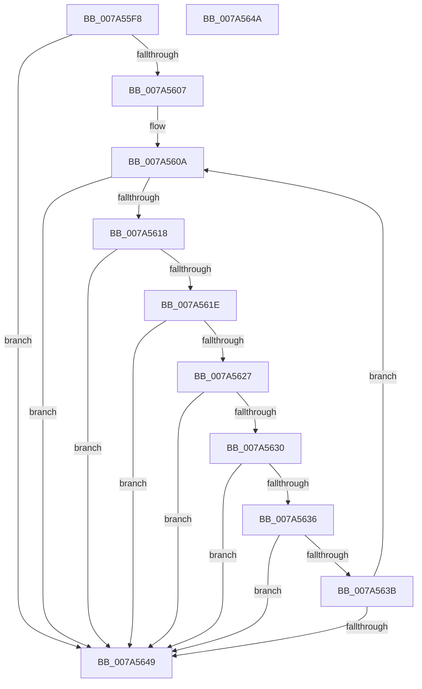

# GetBinaryOperandLen

- RVA: `0x007A55F8`–`0x007A564B` (길이 `83` bytes)
- VA: `0x00000001407A55F8`
- 실행 섹션: `PAGE`
- PDB 이름 있음: `예`; PDB Function 태그: `아니요`
- unwind 정보 RVA: `0x000DB714`
- 디코드: `26`개 명령, `83/83` bytes 표시
- 미해석 바이트: `0` (있으면 어셈블리에 `.byte`로 보존)

> 이 문서는 커널 이미지의 기계어와 PDB 기호를 분석해 생성했습니다. 4번과 5번은 함수 원형과 자료형을 바이너리 사용 방식에서 추정한 C 해석이며 원본 소스 복구 결과는 아닙니다.

## 1. Dependencies

- 직접 호출 지점: **0**; 고유 호출 대상: **0**
- 직접 호출자로 확인된 함수: **1**
- RIP 상대 이미지 참조: **2**

### Outgoing calls
- 직접 디코드된 call 명령이 없습니다.

### Direct callers
- [sub_00B32FE4](../B3/Unknown_function_00B32FE4.md) at `0x00B3329F`

### Static image references
- `0x007A561E` → RVA `0x00014B60` (`.rdata`; read)
- `0x007A5627` → RVA `0x00014B58` (`.rdata`; read)

## 2. Other-region calls and transfers

- 다른 실행 섹션으로 향하는 call: **0**
- 별도 외부 분기/꼬리 이동을 확인하지 못했습니다.

## 3. Assembly (complete function range)

```asm
007A55F8  45 33 D2                        xor r10d, r10d
007A55FB  4C 8B C9                        mov r9, rcx
007A55FE  66 83 39 20                     cmp word ptr [rcx], 0x20
007A5602  44 89 12                        mov dword ptr [rdx], r10d
007A5605  74 42                           je 0x1407a5649
007A5607  45 8B C2                        mov r8d, r10d
007A560A  41 8B C0                        mov eax, r8d
007A560D  41 0F B7 0C 41                  movzx ecx, word ptr [r9 + rax*2]
007A5612  66 83 F9 29                     cmp cx, 0x29
007A5616  74 31                           je 0x1407a5649
007A5618  66 83 F9 7D                     cmp cx, 0x7d
007A561C  74 2B                           je 0x1407a5649
007A561E  66 3B 0D 3B F5 86 FF            cmp cx, word ptr [rip - 0x790ac5]
007A5625  74 22                           je 0x1407a5649
007A5627  66 3B 0D 2A F5 86 FF            cmp cx, word ptr [rip - 0x790ad6]
007A562E  74 19                           je 0x1407a5649
007A5630  66 83 F9 2C                     cmp cx, 0x2c
007A5634  74 13                           je 0x1407a5649
007A5636  66 85 C9                        test cx, cx
007A5639  74 0E                           je 0x1407a5649
007A563B  41 FF C0                        inc r8d
007A563E  44 89 02                        mov dword ptr [rdx], r8d
007A5641  66 43 83 3C 41 20               cmp word ptr [r9 + r8*2], 0x20
007A5647  75 C1                           jne 0x1407a560a
007A5649  C3                              ret
007A564A  CC                              int3
```

## 4. C-style interpretation (structured pseudocode)

```c
__int64 __fastcall GetBinaryOperandLen(__int64 a1, __int64 a2)
{
    __int64 v_r10;

    v_r10 = 0;
    *(unsigned int *)(a2) = 0;
    if ((*(unsigned __int16 *)(a1)) == 32) goto loc_007A5649;
loc_007A560A:
    if (((unsigned __int16)(*(unsigned __int16 *)(a1 + 0 * 2))) == 41) goto loc_007A5649;
    if (((unsigned __int16)(*(unsigned __int16 *)(a1 + 0 * 2))) == 125) goto loc_007A5649;
    if (((unsigned __int16)(*(unsigned __int16 *)(a1 + 0 * 2))) == (*(unsigned __int16 *)(v_rip - 7932613))) goto loc_007A5649;
    if (((unsigned __int16)(*(unsigned __int16 *)(a1 + 0 * 2))) == (*(unsigned __int16 *)(v_rip - 7932630))) goto loc_007A5649;
    if (((unsigned __int16)(*(unsigned __int16 *)(a1 + 0 * 2))) == 44) goto loc_007A5649;
    if ((unsigned __int16)(*(unsigned __int16 *)(a1 + 0 * 2)) == 0) goto loc_007A5649;
    a3 = (unsigned int)((0) + 1);
    *(unsigned int *)(a2) = (unsigned int)(a3);
    if ((*(unsigned __int16 *)(a1 + a3 * 2)) != 32) goto loc_007A560A;
loc_007A5649:
    return 0;
}
```

## 5. (Beta) C Style

```c
int64_t GetBinaryOperandLen(void *Arg1, void *Arg2)
{
    uint8_t *arg1 = (uint8_t *)Arg1;
    uint8_t *arg2 = (uint8_t *)Arg2;

    int64_t local_r10;

    local_r10 = 0;
    *(uint32_t *)(arg2) = 0;
    if ((*(uint16_t *)(arg1)) == 32) goto loc_007A5649;
loc_007A560A:
    if (((uint16_t)(*(uint16_t *)(arg1 + 0x0 * 2))) == 41) goto loc_007A5649;
    if (((uint16_t)(*(uint16_t *)(arg1 + 0x0 * 2))) == 125) goto loc_007A5649;
    if (((uint16_t)(*(uint16_t *)(arg1 + 0x0 * 2))) == (*(uint16_t *)(v_rip - 0x790AC5))) goto loc_007A5649;
    if (((uint16_t)(*(uint16_t *)(arg1 + 0x0 * 2))) == (*(uint16_t *)(v_rip - 0x790AD6))) goto loc_007A5649;
    if (((uint16_t)(*(uint16_t *)(arg1 + 0x0 * 2))) == 44) goto loc_007A5649;
    if ((uint16_t)(*(uint16_t *)(arg1 + 0x0 * 2)) == 0) goto loc_007A5649;
    a3 = (uint32_t)((0) + 1);
    *(uint32_t *)(arg2) = (uint32_t)(a3);
    if ((*(uint16_t *)(arg1 + a3 * 2)) != 32) goto loc_007A560A;
loc_007A5649:
    return 0;
}
```

### 관측된 메모리 오프셋

구조체 형식이 확인되지 않은 접근은 인자 기준의 오프셋으로만 기록했습니다.

| 기준 인자 | 오프셋 표현 | 폭 (bit) | 접근 |
|---|---:|---:|---|
| `Arg1` | `+ 0x0` | `16` | `R` |
| `Arg1` | `+ 0x0 + r8*2` | `16` | `R` |
| `Arg1` | `+ 0x0 + rax*2` | `16` | `R` |
| `Arg2` | `+ 0x0` | `32` | `W` |

## 6. Execution-region graph

[열기: 2D/3D 그래프와 함수 탐색 컨트롤 패널](../../../control-panel.html?section=page&rva=0x007A55F8&view=graph)

- 2D 그래프는 위에서 아래로 흐르고, 3D 그래프는 빈 공간을 드래그해 회전합니다. Shift+드래그는 이동, 휠은 확대·축소, 함수 노드 선택은 대상 보고서 이동입니다.

### Static fallback


