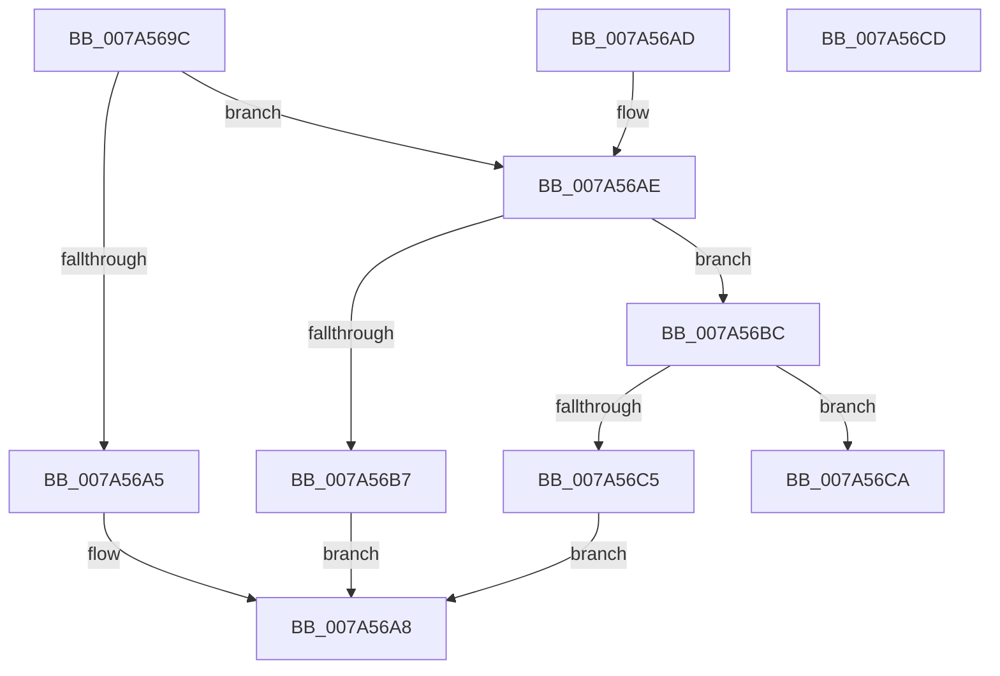

# GetDigitFromChar2

- RVA: `0x007A569C`–`0x007A56CE` (길이 `50` bytes)
- VA: `0x00000001407A569C`
- 실행 섹션: `PAGE`
- PDB 이름 있음: `예`; PDB Function 태그: `아니요`
- unwind 정보 RVA: `0x000DB714`
- 디코드: `21`개 명령, `50/50` bytes 표시
- 미해석 바이트: `0` (있으면 어셈블리에 `.byte`로 보존)

> 이 문서는 커널 이미지의 기계어와 PDB 기호를 분석해 생성했습니다. 4번과 5번은 함수 원형과 자료형을 바이너리 사용 방식에서 추정한 C 해석이며 원본 소스 복구 결과는 아닙니다.

## 1. Dependencies

- 직접 호출 지점: **0**; 고유 호출 대상: **0**
- 직접 호출자로 확인된 함수: **1**
- RIP 상대 이미지 참조: **0**

### Outgoing calls
- 직접 디코드된 call 명령이 없습니다.

### Direct callers
- [DecodeAttributeName](../A0/DecodeAttributeName_function_00A03460.md) at `0x00A03530`
- [DecodeAttributeName](../A0/DecodeAttributeName_function_00A03460.md) at `0x00A03549`
- [DecodeAttributeName](../A0/DecodeAttributeName_function_00A03460.md) at `0x00A03562`
- [DecodeAttributeName](../A0/DecodeAttributeName_function_00A03460.md) at `0x00A0357B`

### Static image references
- 디코드된 RIP-relative 메모리 참조가 없습니다.

## 2. Other-region calls and transfers

- 다른 실행 섹션으로 향하는 call: **0**
- 별도 외부 분기/꼬리 이동을 확인하지 못했습니다.

## 3. Assembly (complete function range)

```asm
007A569C  8D 41 D0                        lea eax, [rcx - 0x30]
007A569F  66 83 F8 09                     cmp ax, 9
007A56A3  77 09                           ja 0x1407a56ae
007A56A5  80 E9 30                        sub cl, 0x30
007A56A8  88 0A                           mov byte ptr [rdx], cl
007A56AA  B0 01                           mov al, 1
007A56AC  C3                              ret
007A56AD  CC                              int3
007A56AE  8D 41 BF                        lea eax, [rcx - 0x41]
007A56B1  66 83 F8 05                     cmp ax, 5
007A56B5  77 05                           ja 0x1407a56bc
007A56B7  80 E9 37                        sub cl, 0x37
007A56BA  EB EC                           jmp 0x1407a56a8
007A56BC  8D 41 9F                        lea eax, [rcx - 0x61]
007A56BF  66 83 F8 05                     cmp ax, 5
007A56C3  77 05                           ja 0x1407a56ca
007A56C5  80 E9 57                        sub cl, 0x57
007A56C8  EB DE                           jmp 0x1407a56a8
007A56CA  32 C0                           xor al, al
007A56CC  C3                              ret
007A56CD  CC                              int3
```

## 4. C-style interpretation (structured pseudocode)

```c
__int64 __fastcall GetDigitFromChar2(__int64 a1, __int64 a2)
{
    __int64 result;

    if (((unsigned __int16)(a1 - 48)) > 9) goto loc_007A56AE;
    a1 = (unsigned __int8)((a1) - (48));
loc_007A56A8:
    *(unsigned __int8 *)(a2) = (unsigned __int8)(a1);
    return 1;
loc_007A56AE:
    if (((unsigned __int16)(a1 - 65)) > 5) goto loc_007A56BC;
    a1 = (unsigned __int8)((a1) - (55));
    goto loc_007A56A8;
loc_007A56BC:
    if (((unsigned __int16)(a1 - 97)) > 5) goto loc_007A56CA;
    a1 = (unsigned __int8)((a1) - (87));
    goto loc_007A56A8;
loc_007A56CA:
    result = 0;
    return result;
}
```

## 5. (Beta) C Style

```c
int64_t GetDigitFromChar2(void *Arg1, void *Arg2)
{
    uint8_t *arg1 = (uint8_t *)Arg1;
    uint8_t *arg2 = (uint8_t *)Arg2;

    int64_t result;

    if (((uint16_t)(Arg1 - 48)) > 9) goto loc_007A56AE;
    Arg1 = (uint8_t)((Arg1) - (48));
loc_007A56A8:
    *(uint8_t *)(arg2) = (uint8_t)(Arg1);
    return 1;
loc_007A56AE:
    if (((uint16_t)(Arg1 - 65)) > 5) goto loc_007A56BC;
    Arg1 = (uint8_t)((Arg1) - (55));
    goto loc_007A56A8;
loc_007A56BC:
    if (((uint16_t)(Arg1 - 97)) > 5) goto loc_007A56CA;
    Arg1 = (uint8_t)((Arg1) - (87));
    goto loc_007A56A8;
loc_007A56CA:
    result = 0;
    return result;
}
```

### 관측된 메모리 오프셋

구조체 형식이 확인되지 않은 접근은 인자 기준의 오프셋으로만 기록했습니다.

| 기준 인자 | 오프셋 표현 | 폭 (bit) | 접근 |
|---|---:|---:|---|
| `Arg1` | `- 0x61` | `32` | `R` |
| `Arg1` | `- 0x41` | `32` | `R` |
| `Arg1` | `- 0x30` | `32` | `R` |
| `Arg2` | `+ 0x0` | `8` | `W` |

## 6. Execution-region graph

[열기: 2D/3D 그래프와 함수 탐색 컨트롤 패널](../../../control-panel.html?section=page&rva=0x007A569C&view=graph)

- 2D 그래프는 위에서 아래로 흐르고, 3D 그래프는 빈 공간을 드래그해 회전합니다. Shift+드래그는 이동, 휠은 확대·축소, 함수 노드 선택은 대상 보고서 이동입니다.

### Static fallback


