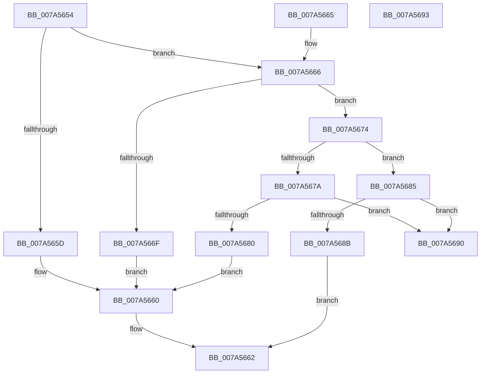

# GetDigitFromChar

- RVA: `0x007A5654`–`0x007A5694` (길이 `64` bytes)
- VA: `0x00000001407A5654`
- 실행 섹션: `PAGE`
- PDB 이름 있음: `예`; PDB Function 태그: `아니요`
- unwind 정보 RVA: `0x000DB714`
- 디코드: `26`개 명령, `64/64` bytes 표시
- 미해석 바이트: `0` (있으면 어셈블리에 `.byte`로 보존)

> 이 문서는 커널 이미지의 기계어와 PDB 기호를 분석해 생성했습니다. 4번과 5번은 함수 원형과 자료형을 바이너리 사용 방식에서 추정한 C 해석이며 원본 소스 복구 결과는 아닙니다.

## 1. Dependencies

- 직접 호출 지점: **0**; 고유 호출 대상: **0**
- 직접 호출자로 확인된 함수: **2**
- RIP 상대 이미지 참조: **0**

### Outgoing calls
- 직접 디코드된 call 명령이 없습니다.

### Direct callers
- [LocalGetRelativeAttributeForString](../AC/LocalGetRelativeAttributeForString_function_00AC74E4.md) at `0x00AC778C`
- [LocalGetRelativeAttributeForString](../AC/LocalGetRelativeAttributeForString_function_00AC74E4.md) at `0x00AC7C41`
- [LocalGetRelativeAttributeForString](../AC/LocalGetRelativeAttributeForString_function_00AC74E4.md) at `0x00AC7C81`
- [LocalGetRelativeAttributeForString](../AC/LocalGetRelativeAttributeForString_function_00AC74E4.md) at `0x00AC7C97`
- [LocalGetRelativeAttributeForString](../AC/LocalGetRelativeAttributeForString_function_00AC74E4.md) at `0x00AC7CCF`
- [sub_00B32FE4](../B3/Unknown_function_00B32FE4.md) at `0x00B33307`
- [sub_00B32FE4](../B3/Unknown_function_00B32FE4.md) at `0x00B3331E`

### Static image references
- 디코드된 RIP-relative 메모리 참조가 없습니다.

## 2. Other-region calls and transfers

- 다른 실행 섹션으로 향하는 call: **0**
- 별도 외부 분기/꼬리 이동을 확인하지 못했습니다.

## 3. Assembly (complete function range)

```asm
007A5654  8D 41 D0                        lea eax, [rcx - 0x30]
007A5657  66 83 F8 09                     cmp ax, 9
007A565B  77 09                           ja 0x1407a5666
007A565D  80 E9 30                        sub cl, 0x30
007A5660  88 0A                           mov byte ptr [rdx], cl
007A5662  B0 01                           mov al, 1
007A5664  C3                              ret
007A5665  CC                              int3
007A5666  8D 41 BF                        lea eax, [rcx - 0x41]
007A5669  66 83 F8 05                     cmp ax, 5
007A566D  77 05                           ja 0x1407a5674
007A566F  80 E9 37                        sub cl, 0x37
007A5672  EB EC                           jmp 0x1407a5660
007A5674  66 83 F9 61                     cmp cx, 0x61
007A5678  72 0B                           jb 0x1407a5685
007A567A  66 83 F9 66                     cmp cx, 0x66
007A567E  77 10                           ja 0x1407a5690
007A5680  80 E9 57                        sub cl, 0x57
007A5683  EB DB                           jmp 0x1407a5660
007A5685  66 83 F9 23                     cmp cx, 0x23
007A5689  75 05                           jne 0x1407a5690
007A568B  C6 02 00                        mov byte ptr [rdx], 0
007A568E  EB D2                           jmp 0x1407a5662
007A5690  32 C0                           xor al, al
007A5692  C3                              ret
007A5693  CC                              int3
```

## 4. C-style interpretation (structured pseudocode)

```c
__int64 __fastcall GetDigitFromChar(__int64 a1, __int64 a2)
{
    __int64 result;

    if (((unsigned __int16)(a1 - 48)) > 9) goto loc_007A5666;
    a1 = (unsigned __int8)((a1) - (48));
loc_007A5660:
    *(unsigned __int8 *)(a2) = (unsigned __int8)(a1);
loc_007A5662:
    return 1;
loc_007A5666:
    if (((unsigned __int16)(a1 - 65)) > 5) goto loc_007A5674;
    a1 = (unsigned __int8)((a1) - (55));
    goto loc_007A5660;
loc_007A5674:
    if (((unsigned __int16)(a1)) < 97) goto loc_007A5685;
    if (((unsigned __int16)(a1)) > 102) goto loc_007A5690;
    a1 = (unsigned __int8)((a1) - (87));
    goto loc_007A5660;
loc_007A5685:
    if (((unsigned __int16)(a1)) != 35) goto loc_007A5690;
    *(unsigned __int8 *)(a2) = 0;
    goto loc_007A5662;
loc_007A5690:
    result = 0;
    return result;
}
```

## 5. (Beta) C Style

```c
int64_t GetDigitFromChar(void *Arg1, void *Arg2)
{
    uint8_t *arg1 = (uint8_t *)Arg1;
    uint8_t *arg2 = (uint8_t *)Arg2;

    int64_t result;

    if (((uint16_t)(Arg1 - 48)) > 9) goto loc_007A5666;
    Arg1 = (uint8_t)((Arg1) - (48));
loc_007A5660:
    *(uint8_t *)(arg2) = (uint8_t)(Arg1);
loc_007A5662:
    return 1;
loc_007A5666:
    if (((uint16_t)(Arg1 - 65)) > 5) goto loc_007A5674;
    Arg1 = (uint8_t)((Arg1) - (55));
    goto loc_007A5660;
loc_007A5674:
    if (((uint16_t)(Arg1)) < 97) goto loc_007A5685;
    if (((uint16_t)(Arg1)) > 102) goto loc_007A5690;
    Arg1 = (uint8_t)((Arg1) - (87));
    goto loc_007A5660;
loc_007A5685:
    if (((uint16_t)(Arg1)) != 35) goto loc_007A5690;
    *(uint8_t *)(arg2) = 0;
    goto loc_007A5662;
loc_007A5690:
    result = 0;
    return result;
}
```

### 관측된 메모리 오프셋

구조체 형식이 확인되지 않은 접근은 인자 기준의 오프셋으로만 기록했습니다.

| 기준 인자 | 오프셋 표현 | 폭 (bit) | 접근 |
|---|---:|---:|---|
| `Arg1` | `- 0x41` | `32` | `R` |
| `Arg1` | `- 0x30` | `32` | `R` |
| `Arg2` | `+ 0x0` | `8` | `W` |

## 6. Execution-region graph

[열기: 2D/3D 그래프와 함수 탐색 컨트롤 패널](../../../control-panel.html?section=page&rva=0x007A5654&view=graph)

- 2D 그래프는 위에서 아래로 흐르고, 3D 그래프는 빈 공간을 드래그해 회전합니다. Shift+드래그는 이동, 휠은 확대·축소, 함수 노드 선택은 대상 보고서 이동입니다.

### Static fallback


