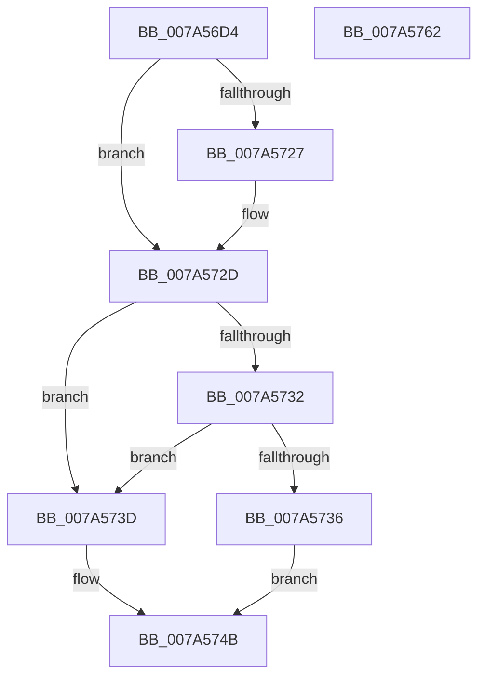

# GetFlags

- RVA: `0x007A56D4`–`0x007A5763` (길이 `143` bytes)
- VA: `0x00000001407A56D4`
- 실행 섹션: `PAGE`
- PDB 이름 있음: `예`; PDB Function 태그: `아니요`
- unwind 정보 RVA: `0x000A118C`
- 디코드: `44`개 명령, `143/143` bytes 표시
- 미해석 바이트: `0` (있으면 어셈블리에 `.byte`로 보존)

> 이 문서는 커널 이미지의 기계어와 PDB 기호를 분석해 생성했습니다. 4번과 5번은 함수 원형과 자료형을 바이너리 사용 방식에서 추정한 C 해석이며 원본 소스 복구 결과는 아닙니다.

## 1. Dependencies

- 직접 호출 지점: **2**; 고유 호출 대상: **2**
- 직접 호출자로 확인된 함수: **1**
- RIP 상대 이미지 참조: **0**

### Outgoing calls
- `0x007A5708` → [RtlInitUnicodeString](../../text/42/RtlInitUnicodeString_function_0042A780.md) (function, `0x0042A780`)
- `0x007A571C` → [RtlUnicodeStringToInt64](../78/RtlUnicodeStringToInt64_function_0078F7E0.md) (function, `0x0078F7E0`)

### Direct callers
- [LocalGetRelativeAttributeForString](../AC/LocalGetRelativeAttributeForString_function_00AC74E4.md) at `0x00AC76DC`

### Static image references
- 디코드된 RIP-relative 메모리 참조가 없습니다.

## 2. Other-region calls and transfers

- 다른 실행 섹션으로 향하는 call: **1**
  - `0x007A5708` → [RtlInitUnicodeString](../../text/42/RtlInitUnicodeString_function_0042A780.md) (`PAGE` → `.text`)
- 별도 외부 분기/꼬리 이동을 확인하지 못했습니다.

## 3. Assembly (complete function range)

```asm
007A56D4  48 8B C4                        mov rax, rsp
007A56D7  48 89 58 10                     mov qword ptr [rax + 0x10], rbx
007A56DB  48 89 68 18                     mov qword ptr [rax + 0x18], rbp
007A56DF  48 89 70 20                     mov qword ptr [rax + 0x20], rsi
007A56E3  57                              push rdi
007A56E4  48 83 EC 30                     sub rsp, 0x30
007A56E8  48 8B F2                        mov rsi, rdx
007A56EB  48 8B E9                        mov rbp, rcx
007A56EE  48 8B D1                        mov rdx, rcx
007A56F1  33 DB                           xor ebx, ebx
007A56F3  0F 57 C0                        xorps xmm0, xmm0
007A56F6  48 89 58 08                     mov qword ptr [rax + 8], rbx
007A56FA  48 8D 48 E8                     lea rcx, [rax - 0x18]
007A56FE  41 89 18                        mov dword ptr [r8], ebx
007A5701  49 8B F8                        mov rdi, r8
007A5704  0F 11 40 E8                     movups xmmword ptr [rax - 0x18], xmm0
007A5708  E8 73 50 C8 FF                  call 0x14042a780
007A570D  4C 8B CE                        mov r9, rsi
007A5710  4C 8D 44 24 40                  lea r8, [rsp + 0x40]
007A5715  33 D2                           xor edx, edx
007A5717  48 8D 4C 24 20                  lea rcx, [rsp + 0x20]
007A571C  E8 BF A0 FE FF                  call 0x14078f7e0
007A5721  8B C8                           mov ecx, eax
007A5723  85 C0                           test eax, eax
007A5725  78 06                           js 0x1407a572d
007A5727  8B 44 24 40                     mov eax, dword ptr [rsp + 0x40]
007A572B  89 07                           mov dword ptr [rdi], eax
007A572D  48 39 2E                        cmp qword ptr [rsi], rbp
007A5730  75 0B                           jne 0x1407a573d
007A5732  39 1F                           cmp dword ptr [rdi], ebx
007A5734  75 07                           jne 0x1407a573d
007A5736  BB 38 05 00 00                  mov ebx, 0x538
007A573B  EB 0E                           jmp 0x1407a574b
007A573D  81 F9 95 00 00 C0               cmp ecx, 0xc0000095
007A5743  B8 16 02 00 00                  mov eax, 0x216
007A5748  0F 44 D8                        cmove ebx, eax
007A574B  48 8B 6C 24 50                  mov rbp, qword ptr [rsp + 0x50]
007A5750  8B C3                           mov eax, ebx
007A5752  48 8B 5C 24 48                  mov rbx, qword ptr [rsp + 0x48]
007A5757  48 8B 74 24 58                  mov rsi, qword ptr [rsp + 0x58]
007A575C  48 83 C4 30                     add rsp, 0x30
007A5760  5F                              pop rdi
007A5761  C3                              ret
007A5762  CC                              int3
```

## 4. C-style interpretation (structured pseudocode)

```c
__int64 __fastcall GetFlags(__int64 a1, __int64 a2, __int64 a3)
{
    __int64 result;
    __int64 v_rbx;
    __int64 v_rsp;
    unsigned __int64 v_stack_m18;
    unsigned __int64 v_stack_p10;
    unsigned __int64 v_stack_p18;
    unsigned __int64 v_stack_p20;
    unsigned __int64 v_stack_p8;

    *(unsigned __int64 *)(v_rsp + 16) = v_rbx;
    *(unsigned __int64 *)(v_rsp + 24) = v_rbp;
    *(unsigned __int64 *)(v_rsp + 32) = v_rsi;
    v_rsp = (v_rsp) - (48);
    v_rbx = 0;
    *(unsigned __int64 *)(v_rsp + 8) = 0;
    *(unsigned int *)(a3) = 0;
    *(unsigned __int64 *)(v_rsp - 24) = v_xmm0;
    result = RtlInitUnicodeString(v_rsp - 24, a1, a3, a4);
    a2 = 0;
    result = RtlUnicodeStringToInt64(v_stack_m18, a2, v_stack_p8, a2);
    if (!(sign_flag)) {
        result = v_stack_p8;
        *(unsigned int *)(a3) = (unsigned int)(result);
    }
    if ((*(unsigned __int64 *)(a2)) != a1) goto loc_007A573D;
    if ((*(unsigned int *)(a3)) != 0) goto loc_007A573D;
    goto loc_007A574B;
loc_007A573D:
    v_rbx = (unsigned int)(0x538ULL);
    if (((unsigned int)((unsigned int)((unsigned int)(result)))) == 0xC0000095ULL) { v_rbx = 534; }
loc_007A574B:
    v_rsp = (v_rsp) + (48);
    return (unsigned int)((unsigned int)(v_rbx));
}
```

## 5. (Beta) C Style

```c
int64_t GetFlags(int64_t Arg1, void *Arg2, void *Arg3)
{
    uint8_t *arg2 = (uint8_t *)Arg2;
    uint8_t *arg3 = (uint8_t *)Arg3;

    int64_t result;
    int64_t local_rbx;
    int64_t local_rsp;
    uint64_t v_stack_m18;
    uint64_t v_stack_p10;
    uint64_t v_stack_p18;
    uint64_t v_stack_p20;
    uint64_t v_stack_p8;

    *(uint64_t *)(local_rsp + 0x10) = local_rbx;
    *(uint64_t *)(local_rsp + 0x18) = local_rbp;
    *(uint64_t *)(local_rsp + 0x20) = local_rsi;
    local_rsp = (local_rsp) - (48);
    local_rbx = 0;
    *(uint64_t *)(local_rsp + 0x8) = 0;
    *(uint32_t *)(arg3) = 0;
    *(uint64_t *)(local_rsp - 0x18) = v_xmm0;
    result = RtlInitUnicodeString(local_rsp - 24, Arg1, Arg3, a4);
    Arg2 = 0;
    result = RtlUnicodeStringToInt64(v_stack_m18, Arg2, v_stack_p8, Arg2);
    if (!(sign_flag)) {
        result = v_stack_p8;
        *(uint32_t *)(arg3) = (uint32_t)(result);
    }
    if ((*(uint64_t *)(arg2)) != Arg1) goto loc_007A573D;
    if ((*(uint32_t *)(arg3)) != 0) goto loc_007A573D;
    goto loc_007A574B;
loc_007A573D:
    local_rbx = (uint32_t)(0x538ULL);
    if (((uint32_t)((uint32_t)((uint32_t)(result)))) == 0xC0000095ULL) { local_rbx = 534; }
loc_007A574B:
    local_rsp = (local_rsp) + (48);
    return (uint32_t)((uint32_t)(local_rbx));
}
```

### 관측된 메모리 오프셋

구조체 형식이 확인되지 않은 접근은 인자 기준의 오프셋으로만 기록했습니다.

| 기준 인자 | 오프셋 표현 | 폭 (bit) | 접근 |
|---|---:|---:|---|
| `Arg2` | `+ 0x0` | `64` | `R` |
| `Arg3` | `+ 0x0` | `32` | `R` |
| `Arg3` | `+ 0x0` | `32` | `W` |

## 6. Execution-region graph

[열기: 2D/3D 그래프와 함수 탐색 컨트롤 패널](../../../control-panel.html?section=page&rva=0x007A56D4&view=graph)

- 2D 그래프는 위에서 아래로 흐르고, 3D 그래프는 빈 공간을 드래그해 회전합니다. Shift+드래그는 이동, 휠은 확대·축소, 함수 노드 선택은 대상 보고서 이동입니다.

### Static fallback


