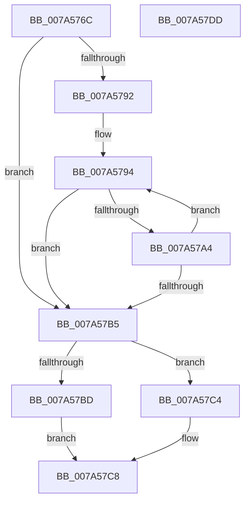

# GetNextNoneWhiteSpace

- RVA: `0x007A576C`–`0x007A57DE` (길이 `114` bytes)
- VA: `0x00000001407A576C`
- 실행 섹션: `PAGE`
- PDB 이름 있음: `예`; PDB Function 태그: `아니요`
- unwind 정보 RVA: `0x0005C954`
- 디코드: `39`개 명령, `114/114` bytes 표시
- 미해석 바이트: `0` (있으면 어셈블리에 `.byte`로 보존)

> 이 문서는 커널 이미지의 기계어와 PDB 기호를 분석해 생성했습니다. 4번과 5번은 함수 원형과 자료형을 바이너리 사용 방식에서 추정한 C 해석이며 원본 소스 복구 결과는 아닙니다.

## 1. Dependencies

- 직접 호출 지점: **1**; 고유 호출 대상: **1**
- 직접 호출자로 확인된 함수: **1**
- RIP 상대 이미지 참조: **0**

### Outgoing calls
- `0x007A579B` → [iswspace](../../text/50/iswspace_function_00500800.md) (function, `0x00500800`)

### Direct callers
- [sub_00B32FE4](../B3/Unknown_function_00B32FE4.md) at `0x00B32FF8`
- [sub_00B32FE4](../B3/Unknown_function_00B32FE4.md) at `0x00B33169`
- [sub_00B32FE4](../B3/Unknown_function_00B32FE4.md) at `0x00B331F0`
- [sub_00B32FE4](../B3/Unknown_function_00B32FE4.md) at `0x00B33249`

### Static image references
- 디코드된 RIP-relative 메모리 참조가 없습니다.

## 2. Other-region calls and transfers

- 다른 실행 섹션으로 향하는 call: **1**
  - `0x007A579B` → [iswspace](../../text/50/iswspace_function_00500800.md) (`PAGE` → `.text`)
- 별도 외부 분기/꼬리 이동을 확인하지 못했습니다.

## 3. Assembly (complete function range)

```asm
007A576C  48 89 5C 24 08                  mov qword ptr [rsp + 8], rbx
007A5771  48 89 6C 24 10                  mov qword ptr [rsp + 0x10], rbp
007A5776  48 89 74 24 18                  mov qword ptr [rsp + 0x18], rsi
007A577B  57                              push rdi
007A577C  48 83 EC 20                     sub rsp, 0x20
007A5780  48 8B F1                        mov rsi, rcx
007A5783  33 ED                           xor ebp, ebp
007A5785  8B 0A                           mov ecx, dword ptr [rdx]
007A5787  48 8B FA                        mov rdi, rdx
007A578A  8B DD                           mov ebx, ebp
007A578C  66 39 2C 4E                     cmp word ptr [rsi + rcx*2], bp
007A5790  74 23                           je 0x1407a57b5
007A5792  8B D5                           mov edx, ebp
007A5794  48 03 CA                        add rcx, rdx
007A5797  0F B7 0C 4E                     movzx ecx, word ptr [rsi + rcx*2]
007A579B  E8 60 B0 D5 FF                  call 0x140500800
007A57A0  85 C0                           test eax, eax
007A57A2  74 11                           je 0x1407a57b5
007A57A4  8B 07                           mov eax, dword ptr [rdi]
007A57A6  FF C3                           inc ebx
007A57A8  8B D3                           mov edx, ebx
007A57AA  8B C8                           mov ecx, eax
007A57AC  48 03 C2                        add rax, rdx
007A57AF  66 39 2C 46                     cmp word ptr [rsi + rax*2], bp
007A57B3  75 DF                           jne 0x1407a5794
007A57B5  8B C3                           mov eax, ebx
007A57B7  66 39 2C 46                     cmp word ptr [rsi + rax*2], bp
007A57BB  75 07                           jne 0x1407a57c4
007A57BD  B8 38 05 00 00                  mov eax, 0x538
007A57C2  EB 04                           jmp 0x1407a57c8
007A57C4  01 1F                           add dword ptr [rdi], ebx
007A57C6  33 C0                           xor eax, eax
007A57C8  48 8B 5C 24 30                  mov rbx, qword ptr [rsp + 0x30]
007A57CD  48 8B 6C 24 38                  mov rbp, qword ptr [rsp + 0x38]
007A57D2  48 8B 74 24 40                  mov rsi, qword ptr [rsp + 0x40]
007A57D7  48 83 C4 20                     add rsp, 0x20
007A57DB  5F                              pop rdi
007A57DC  C3                              ret
007A57DD  CC                              int3
```

## 4. C-style interpretation (structured pseudocode)

```c
__int64 __fastcall GetNextNoneWhiteSpace(__int64 a1, __int64 a2)
{
    __int64 result;
    __int64 v_rbp;
    __int64 v_rbx;
    __int64 v_rsp;
    unsigned __int64 v_stack_p10;
    unsigned __int64 v_stack_p18;
    unsigned __int64 v_stack_p8;

    v_stack_p8 = v_rbx;
    v_stack_p10 = v_rbp;
    v_stack_p18 = v_rsi;
    v_rsp = (v_rsp) - (32);
    v_rbp = 0;
    if ((*(unsigned __int16 *)(a1 + (unsigned int)(*(unsigned int *)(a2)) * 2)) == 0) goto loc_007A57B5;
loc_007A5794:
    a1 = ((unsigned int)(*(unsigned int *)(a2))) + (0);
    result = iswspace(*(unsigned __int16 *)(a1 + a1 * 2), 0, a3, a4);
    if ((unsigned int)(result) == 0) goto loc_007A57B5;
    v_rbx = (unsigned int)((0) + 1);
    result = ((unsigned int)(*(unsigned int *)(a2))) + ((unsigned int)((unsigned int)(v_rbx)));
    if ((*(unsigned __int16 *)(a1 + result * 2)) != 0) goto loc_007A5794;
loc_007A57B5:
    if ((*(unsigned __int16 *)(a1 + (unsigned int)((unsigned int)(v_rbx)) * 2)) != 0) goto loc_007A57C4;
    goto loc_007A57C8;
loc_007A57C4:
    result = 0;
loc_007A57C8:
    v_rsp = (v_rsp) + (32);
    return result;
}
```

## 5. (Beta) C Style

```c
int64_t GetNextNoneWhiteSpace(void *Arg1, void *Arg2)
{
    uint8_t *arg1 = (uint8_t *)Arg1;
    uint8_t *arg2 = (uint8_t *)Arg2;

    int64_t result;
    int64_t local_rbp;
    int64_t local_rbx;
    int64_t local_rsp;
    uint64_t v_stack_p10;
    uint64_t v_stack_p18;
    uint64_t v_stack_p8;

    v_stack_p8 = local_rbx;
    v_stack_p10 = local_rbp;
    v_stack_p18 = local_rsi;
    local_rsp = (local_rsp) - (32);
    local_rbp = 0;
    if ((*(uint16_t *)(arg1 + (uint32_t)(*(uint32_t *)(arg2)) * 2)) == 0) goto loc_007A57B5;
loc_007A5794:
    Arg1 = ((uint32_t)(*(uint32_t *)(arg2))) + (0);
    result = iswspace(*(uint16_t *)(arg1 + arg1 * 2), 0, a3, a4);
    if ((uint32_t)(result) == 0) goto loc_007A57B5;
    local_rbx = (uint32_t)((0) + 1);
    result = ((uint32_t)(*(uint32_t *)(arg2))) + ((uint32_t)((uint32_t)(local_rbx)));
    if ((*(uint16_t *)(arg1 + result * 2)) != 0) goto loc_007A5794;
loc_007A57B5:
    if ((*(uint16_t *)(arg1 + (uint32_t)((uint32_t)(local_rbx)) * 2)) != 0) goto loc_007A57C4;
    goto loc_007A57C8;
loc_007A57C4:
    result = 0;
loc_007A57C8:
    local_rsp = (local_rsp) + (32);
    return result;
}
```

### 관측된 메모리 오프셋

구조체 형식이 확인되지 않은 접근은 인자 기준의 오프셋으로만 기록했습니다.

| 기준 인자 | 오프셋 표현 | 폭 (bit) | 접근 |
|---|---:|---:|---|
| `Arg1` | `+ 0x0 + rax*2` | `16` | `R` |
| `Arg1` | `+ 0x0 + rcx*2` | `16` | `R` |
| `Arg2` | `+ 0x0` | `32` | `R` |
| `Arg2` | `+ 0x0` | `32` | `R/W` |

## 6. Execution-region graph

[열기: 2D/3D 그래프와 함수 탐색 컨트롤 패널](../../../control-panel.html?section=page&rva=0x007A576C&view=graph)

- 2D 그래프는 위에서 아래로 흐르고, 3D 그래프는 빈 공간을 드래그해 회전합니다. Shift+드래그는 이동, 휠은 확대·축소, 함수 노드 선택은 대상 보고서 이동입니다.

### Static fallback


