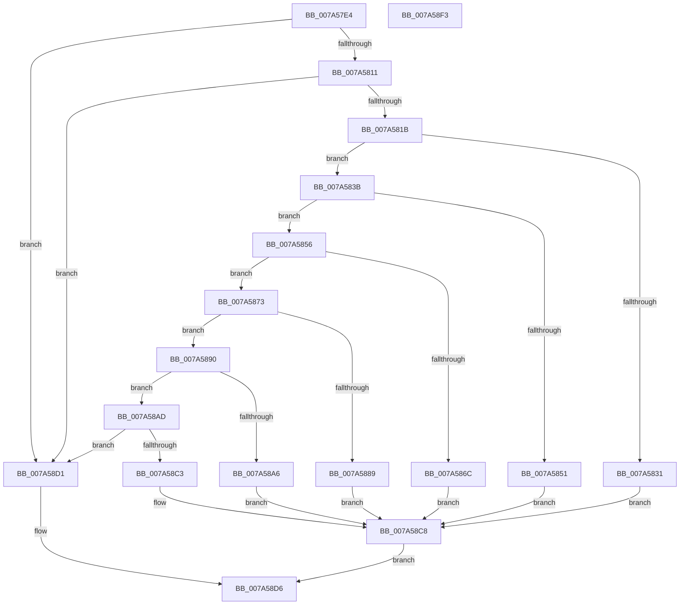

# GetValueType

- RVA: `0x007A57E4`–`0x007A58F4` (길이 `272` bytes)
- VA: `0x00000001407A57E4`
- 실행 섹션: `PAGE`
- PDB 이름 있음: `예`; PDB Function 태그: `아니요`
- unwind 정보 RVA: `0x0005E6B4`
- 디코드: `75`개 명령, `272/272` bytes 표시
- 미해석 바이트: `0` (있으면 어셈블리에 `.byte`로 보존)

> 이 문서는 커널 이미지의 기계어와 PDB 기호를 분석해 생성했습니다. 4번과 5번은 함수 원형과 자료형을 바이너리 사용 방식에서 추정한 C 해석이며 원본 소스 복구 결과는 아닙니다.

## 1. Dependencies

- 직접 호출 지점: **6**; 고유 호출 대상: **1**
- 직접 호출자로 확인된 함수: **1**
- RIP 상대 이미지 참조: **6**

### Outgoing calls
- `0x007A5828` → [wcsnicmp](../../text/50/wcsnicmp_function_005001C0.md) (function, `0x005001C0`)
- `0x007A5848` → [wcsnicmp](../../text/50/wcsnicmp_function_005001C0.md) (function, `0x005001C0`)
- `0x007A5863` → [wcsnicmp](../../text/50/wcsnicmp_function_005001C0.md) (function, `0x005001C0`)
- `0x007A5880` → [wcsnicmp](../../text/50/wcsnicmp_function_005001C0.md) (function, `0x005001C0`)
- `0x007A589D` → [wcsnicmp](../../text/50/wcsnicmp_function_005001C0.md) (function, `0x005001C0`)
- `0x007A58BA` → [wcsnicmp](../../text/50/wcsnicmp_function_005001C0.md) (function, `0x005001C0`)

### Direct callers
- [LocalGetRelativeAttributeForString](../AC/LocalGetRelativeAttributeForString_function_00AC74E4.md) at `0x00AC769C`

### Static image references
- `0x007A5821` → RVA `0x00037EFC` (`.rdata`; read)
- `0x007A583E` → RVA `0x00037EDC` (`.rdata`; read)
- `0x007A5859` → RVA `0x00037ED4` (`.rdata`; read)
- `0x007A5876` → RVA `0x00037EEC` (`.rdata`; read)
- `0x007A5893` → RVA `0x00037EE4` (`.rdata`; read)
- `0x007A58B0` → RVA `0x00037EF4` (`.rdata`; read)

## 2. Other-region calls and transfers

- 다른 실행 섹션으로 향하는 call: **6**
  - `0x007A5828` → [wcsnicmp](../../text/50/wcsnicmp_function_005001C0.md) (`PAGE` → `.text`)
  - `0x007A5848` → [wcsnicmp](../../text/50/wcsnicmp_function_005001C0.md) (`PAGE` → `.text`)
  - `0x007A5863` → [wcsnicmp](../../text/50/wcsnicmp_function_005001C0.md) (`PAGE` → `.text`)
  - `0x007A5880` → [wcsnicmp](../../text/50/wcsnicmp_function_005001C0.md) (`PAGE` → `.text`)
  - `0x007A589D` → [wcsnicmp](../../text/50/wcsnicmp_function_005001C0.md) (`PAGE` → `.text`)
  - `0x007A58BA` → [wcsnicmp](../../text/50/wcsnicmp_function_005001C0.md) (`PAGE` → `.text`)
- 별도 외부 분기/꼬리 이동을 확인하지 못했습니다.

## 3. Assembly (complete function range)

```asm
007A57E4  48 8B C4                        mov rax, rsp
007A57E7  48 89 58 08                     mov qword ptr [rax + 8], rbx
007A57EB  48 89 68 10                     mov qword ptr [rax + 0x10], rbp
007A57EF  48 89 70 18                     mov qword ptr [rax + 0x18], rsi
007A57F3  48 89 78 20                     mov qword ptr [rax + 0x20], rdi
007A57F7  41 56                           push r14
007A57F9  48 83 EC 20                     sub rsp, 0x20
007A57FD  33 DB                           xor ebx, ebx
007A57FF  49 8B F0                        mov rsi, r8
007A5802  4C 8B F2                        mov r14, rdx
007A5805  48 8B F9                        mov rdi, rcx
007A5808  66 39 19                        cmp word ptr [rcx], bx
007A580B  0F 84 C0 00 00 00               je 0x1407a58d1
007A5811  66 39 59 02                     cmp word ptr [rcx + 2], bx
007A5815  0F 84 B6 00 00 00               je 0x1407a58d1
007A581B  8D 6B 02                        lea ebp, [rbx + 2]
007A581E  44 8B C5                        mov r8d, ebp
007A5821  48 8D 15 D4 26 89 FF            lea rdx, [rip - 0x76d92c]
007A5828  E8 93 A9 D5 FF                  call 0x1405001c0
007A582D  85 C0                           test eax, eax
007A582F  75 0A                           jne 0x1407a583b
007A5831  66 C7 06 01 00                  mov word ptr [rsi], 1
007A5836  E9 8D 00 00 00                  jmp 0x1407a58c8
007A583B  4C 8B C5                        mov r8, rbp
007A583E  48 8D 15 97 26 89 FF            lea rdx, [rip - 0x76d969]
007A5845  48 8B CF                        mov rcx, rdi
007A5848  E8 73 A9 D5 FF                  call 0x1405001c0
007A584D  85 C0                           test eax, eax
007A584F  75 05                           jne 0x1407a5856
007A5851  66 89 2E                        mov word ptr [rsi], bp
007A5854  EB 72                           jmp 0x1407a58c8
007A5856  4C 8B C5                        mov r8, rbp
007A5859  48 8D 15 74 26 89 FF            lea rdx, [rip - 0x76d98c]
007A5860  48 8B CF                        mov rcx, rdi
007A5863  E8 58 A9 D5 FF                  call 0x1405001c0
007A5868  85 C0                           test eax, eax
007A586A  75 07                           jne 0x1407a5873
007A586C  66 C7 06 05 00                  mov word ptr [rsi], 5
007A5871  EB 55                           jmp 0x1407a58c8
007A5873  4C 8B C5                        mov r8, rbp
007A5876  48 8D 15 6F 26 89 FF            lea rdx, [rip - 0x76d991]
007A587D  48 8B CF                        mov rcx, rdi
007A5880  E8 3B A9 D5 FF                  call 0x1405001c0
007A5885  85 C0                           test eax, eax
007A5887  75 07                           jne 0x1407a5890
007A5889  66 C7 06 03 00                  mov word ptr [rsi], 3
007A588E  EB 38                           jmp 0x1407a58c8
007A5890  4C 8B C5                        mov r8, rbp
007A5893  48 8D 15 4A 26 89 FF            lea rdx, [rip - 0x76d9b6]
007A589A  48 8B CF                        mov rcx, rdi
007A589D  E8 1E A9 D5 FF                  call 0x1405001c0
007A58A2  85 C0                           test eax, eax
007A58A4  75 07                           jne 0x1407a58ad
007A58A6  66 C7 06 10 00                  mov word ptr [rsi], 0x10
007A58AB  EB 1B                           jmp 0x1407a58c8
007A58AD  4C 8B C5                        mov r8, rbp
007A58B0  48 8D 15 3D 26 89 FF            lea rdx, [rip - 0x76d9c3]
007A58B7  48 8B CF                        mov rcx, rdi
007A58BA  E8 01 A9 D5 FF                  call 0x1405001c0
007A58BF  85 C0                           test eax, eax
007A58C1  75 0E                           jne 0x1407a58d1
007A58C3  66 C7 06 06 00                  mov word ptr [rsi], 6
007A58C8  48 8D 47 04                     lea rax, [rdi + 4]
007A58CC  49 89 06                        mov qword ptr [r14], rax
007A58CF  EB 05                           jmp 0x1407a58d6
007A58D1  BB 38 05 00 00                  mov ebx, 0x538
007A58D6  48 8B 6C 24 38                  mov rbp, qword ptr [rsp + 0x38]
007A58DB  8B C3                           mov eax, ebx
007A58DD  48 8B 5C 24 30                  mov rbx, qword ptr [rsp + 0x30]
007A58E2  48 8B 74 24 40                  mov rsi, qword ptr [rsp + 0x40]
007A58E7  48 8B 7C 24 48                  mov rdi, qword ptr [rsp + 0x48]
007A58EC  48 83 C4 20                     add rsp, 0x20
007A58F0  41 5E                           pop r14
007A58F2  C3                              ret
007A58F3  CC                              int3
```

## 4. C-style interpretation (structured pseudocode)

```c
__int64 __fastcall GetValueType(__int64 a1, __int64 a2, __int64 a3)
{
    __int64 result;
    __int64 v_rbx;
    __int64 v_rsp;
    unsigned __int64 v_stack_p10;
    unsigned __int64 v_stack_p18;
    unsigned __int64 v_stack_p20;
    unsigned __int64 v_stack_p8;

    *(unsigned __int64 *)(v_rsp + 8) = v_rbx;
    *(unsigned __int64 *)(v_rsp + 16) = v_rbp;
    *(unsigned __int64 *)(v_rsp + 24) = v_rsi;
    *(unsigned __int64 *)(v_rsp + 32) = v_rdi;
    v_rsp = (v_rsp) - (32);
    v_rbx = 0;
    if ((*(unsigned __int16 *)(a1)) == 0) goto loc_007A58D1;
    if ((*(unsigned __int16 *)(a1 + 2)) == 0) goto loc_007A58D1;
    result = wcsnicmp(a1, v_rip - 7788844, (unsigned int)((unsigned int)(v_rbx + 2)), a4);
    if ((unsigned int)(result) != 0) goto loc_007A583B;
    *(unsigned __int16 *)(a3) = 1;
    goto loc_007A58C8;
loc_007A583B:
    result = wcsnicmp(a1, v_rip - 7788905, v_rbx + 2, a4);
    if ((unsigned int)(result) != 0) goto loc_007A5856;
    *(unsigned __int16 *)(a3) = (unsigned __int16)(v_rbx + 2);
    goto loc_007A58C8;
loc_007A5856:
    result = wcsnicmp(a1, v_rip - 7788940, v_rbx + 2, a4);
    if ((unsigned int)(result) != 0) goto loc_007A5873;
    *(unsigned __int16 *)(a3) = 5;
    goto loc_007A58C8;
loc_007A5873:
    result = wcsnicmp(a1, v_rip - 7788945, v_rbx + 2, a4);
    if ((unsigned int)(result) != 0) goto loc_007A5890;
    *(unsigned __int16 *)(a3) = 3;
    goto loc_007A58C8;
loc_007A5890:
    result = wcsnicmp(a1, v_rip - 7788982, v_rbx + 2, a4);
    if ((unsigned int)(result) != 0) goto loc_007A58AD;
    *(unsigned __int16 *)(a3) = 16;
    goto loc_007A58C8;
loc_007A58AD:
    result = wcsnicmp(a1, v_rip - 7788995, v_rbx + 2, a4);
    if ((unsigned int)(result) != 0) goto loc_007A58D1;
    *(unsigned __int16 *)(a3) = 6;
loc_007A58C8:
    *(unsigned __int64 *)(a2) = a1 + 4;
    goto loc_007A58D6;
loc_007A58D1:
loc_007A58D6:
    v_rsp = (v_rsp) + (32);
    return (unsigned int)((unsigned int)((unsigned int)(0x538ULL)));
}
```

## 5. (Beta) C Style

```c
int64_t GetValueType(void *Arg1, void *Arg2, void *Arg3)
{
    uint8_t *arg1 = (uint8_t *)Arg1;
    uint8_t *arg2 = (uint8_t *)Arg2;
    uint8_t *arg3 = (uint8_t *)Arg3;

    int64_t result;
    int64_t local_rbx;
    int64_t local_rsp;
    uint64_t v_stack_p10;
    uint64_t v_stack_p18;
    uint64_t v_stack_p20;
    uint64_t v_stack_p8;

    *(uint64_t *)(local_rsp + 0x8) = local_rbx;
    *(uint64_t *)(local_rsp + 0x10) = local_rbp;
    *(uint64_t *)(local_rsp + 0x18) = local_rsi;
    *(uint64_t *)(local_rsp + 0x20) = local_rdi;
    local_rsp = (local_rsp) - (32);
    local_rbx = 0;
    if ((*(uint16_t *)(arg1)) == 0) goto loc_007A58D1;
    if ((*(uint16_t *)(arg1 + 0x2)) == 0) goto loc_007A58D1;
    result = wcsnicmp(Arg1, v_rip - 7788844, (uint32_t)((uint32_t)(local_rbx + 2)), a4);
    if ((uint32_t)(result) != 0) goto loc_007A583B;
    *(uint16_t *)(arg3) = 1;
    goto loc_007A58C8;
loc_007A583B:
    result = wcsnicmp(Arg1, v_rip - 7788905, local_rbx + 2, a4);
    if ((uint32_t)(result) != 0) goto loc_007A5856;
    *(uint16_t *)(arg3) = (uint16_t)(local_rbx + 2);
    goto loc_007A58C8;
loc_007A5856:
    result = wcsnicmp(Arg1, v_rip - 7788940, local_rbx + 2, a4);
    if ((uint32_t)(result) != 0) goto loc_007A5873;
    *(uint16_t *)(arg3) = 5;
    goto loc_007A58C8;
loc_007A5873:
    result = wcsnicmp(Arg1, v_rip - 7788945, local_rbx + 2, a4);
    if ((uint32_t)(result) != 0) goto loc_007A5890;
    *(uint16_t *)(arg3) = 3;
    goto loc_007A58C8;
loc_007A5890:
    result = wcsnicmp(Arg1, v_rip - 7788982, local_rbx + 2, a4);
    if ((uint32_t)(result) != 0) goto loc_007A58AD;
    *(uint16_t *)(arg3) = 16;
    goto loc_007A58C8;
loc_007A58AD:
    result = wcsnicmp(Arg1, v_rip - 7788995, local_rbx + 2, a4);
    if ((uint32_t)(result) != 0) goto loc_007A58D1;
    *(uint16_t *)(arg3) = 6;
loc_007A58C8:
    *(void **)(arg2) = Arg1 + 4;
    goto loc_007A58D6;
loc_007A58D1:
loc_007A58D6:
    local_rsp = (local_rsp) + (32);
    return (uint32_t)((uint32_t)((uint32_t)(0x538ULL)));
}
```

### 관측된 메모리 오프셋

구조체 형식이 확인되지 않은 접근은 인자 기준의 오프셋으로만 기록했습니다.

| 기준 인자 | 오프셋 표현 | 폭 (bit) | 접근 |
|---|---:|---:|---|
| `Arg1` | `+ 0x0` | `16` | `R` |
| `Arg1` | `+ 0x2` | `16` | `R` |
| `Arg1` | `+ 0x4` | `64` | `R` |
| `Arg2` | `+ 0x0` | `64` | `W` |
| `Arg3` | `+ 0x0` | `16` | `W` |

## 6. Execution-region graph

[열기: 2D/3D 그래프와 함수 탐색 컨트롤 패널](../../../control-panel.html?section=page&rva=0x007A57E4&view=graph)

- 2D 그래프는 위에서 아래로 흐르고, 3D 그래프는 빈 공간을 드래그해 회전합니다. Shift+드래그는 이동, 휠은 확대·축소, 함수 노드 선택은 대상 보고서 이동입니다.

### Static fallback


