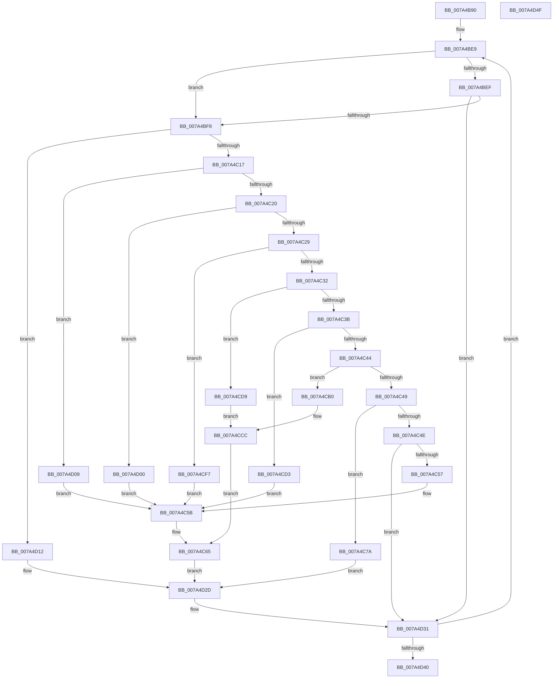

# InitializeSidLookupTable

- RVA: `0x007A4B90`–`0x007A4D50` (길이 `448` bytes)
- VA: `0x00000001407A4B90`
- 실행 섹션: `PAGE`
- PDB 이름 있음: `예`; PDB Function 태그: `아니요`
- unwind 정보 RVA: `0x000C8D78`
- 디코드: `122`개 명령, `448/448` bytes 표시
- 미해석 바이트: `0` (있으면 어셈블리에 `.byte`로 보존)

> 이 문서는 커널 이미지의 기계어와 PDB 기호를 분석해 생성했습니다. 4번과 5번은 함수 원형과 자료형을 바이너리 사용 방식에서 추정한 C 해석이며 원본 소스 복구 결과는 아닙니다.

## 1. Dependencies

- 직접 호출 지점: **11**; 고유 호출 대상: **2**
- 직접 호출자로 확인된 함수: **1**
- RIP 상대 이미지 참조: **2**

### Outgoing calls
- `0x007A4C5E` → [RtlInitializeSid](../9E/RtlInitializeSid_function_009EB720.md) (function, `0x009EB720`)
- `0x007A4C68` → [RtlSubAuthoritySid](../../text/45/RtlSubAuthoritySid_function_00456D10.md) (function, `0x00456D10`)
- `0x007A4C81` → [RtlInitializeSid](../9E/RtlInitializeSid_function_009EB720.md) (function, `0x009EB720`)
- `0x007A4C8B` → [RtlSubAuthoritySid](../../text/45/RtlSubAuthoritySid_function_00456D10.md) (function, `0x00456D10`)
- `0x007A4C9E` → [RtlSubAuthoritySid](../../text/45/RtlSubAuthoritySid_function_00456D10.md) (function, `0x00456D10`)
- `0x007A4CB7` → [RtlInitializeSid](../9E/RtlInitializeSid_function_009EB720.md) (function, `0x009EB720`)
- `0x007A4CC1` → [RtlSubAuthoritySid](../../text/45/RtlSubAuthoritySid_function_00456D10.md) (function, `0x00456D10`)
- `0x007A4CE0` → [RtlInitializeSid](../9E/RtlInitializeSid_function_009EB720.md) (function, `0x009EB720`)
- `0x007A4CEA` → [RtlSubAuthoritySid](../../text/45/RtlSubAuthoritySid_function_00456D10.md) (function, `0x00456D10`)
- `0x007A4D19` → [RtlInitializeSid](../9E/RtlInitializeSid_function_009EB720.md) (function, `0x009EB720`)
- `0x007A4D23` → [RtlSubAuthoritySid](../../text/45/RtlSubAuthoritySid_function_00456D10.md) (function, `0x00456D10`)

### Direct callers
- [SddlBaseInitialize](../../text/60/SddlBaseInitialize_function_0060BB1C.md) at `0x0060BB20`

### Static image references
- `0x007A4BAA` → RVA `0x00E0CDF0` (`.data`; read)
- `0x007A4C01` → RVA `0x00E0CE00` (`.data`; read)

## 2. Other-region calls and transfers

- 다른 실행 섹션으로 향하는 call: **6**
  - `0x007A4C68` → [RtlSubAuthoritySid](../../text/45/RtlSubAuthoritySid_function_00456D10.md) (`PAGE` → `.text`)
  - `0x007A4C8B` → [RtlSubAuthoritySid](../../text/45/RtlSubAuthoritySid_function_00456D10.md) (`PAGE` → `.text`)
  - `0x007A4C9E` → [RtlSubAuthoritySid](../../text/45/RtlSubAuthoritySid_function_00456D10.md) (`PAGE` → `.text`)
  - `0x007A4CC1` → [RtlSubAuthoritySid](../../text/45/RtlSubAuthoritySid_function_00456D10.md) (`PAGE` → `.text`)
  - `0x007A4CEA` → [RtlSubAuthoritySid](../../text/45/RtlSubAuthoritySid_function_00456D10.md) (`PAGE` → `.text`)
  - `0x007A4D23` → [RtlSubAuthoritySid](../../text/45/RtlSubAuthoritySid_function_00456D10.md) (`PAGE` → `.text`)
- 별도 외부 분기/꼬리 이동을 확인하지 못했습니다.

## 3. Assembly (complete function range)

```asm
007A4B90  48 89 5C 24 08                  mov qword ptr [rsp + 8], rbx
007A4B95  55                              push rbp
007A4B96  56                              push rsi
007A4B97  57                              push rdi
007A4B98  48 8B EC                        mov rbp, rsp
007A4B9B  48 83 EC 40                     sub rsp, 0x40
007A4B9F  33 F6                           xor esi, esi
007A4BA1  66 C7 45 FC 00 01               mov word ptr [rbp - 4], 0x100
007A4BA7  89 75 F8                        mov dword ptr [rbp - 8], esi
007A4BAA  48 8D 1D 3F 82 66 00            lea rbx, [rip + 0x66823f]
007A4BB1  89 75 F0                        mov dword ptr [rbp - 0x10], esi
007A4BB4  8B FE                           mov edi, esi
007A4BB6  89 75 E8                        mov dword ptr [rbp - 0x18], esi
007A4BB9  89 75 28                        mov dword ptr [rbp + 0x28], esi
007A4BBC  89 75 E0                        mov dword ptr [rbp - 0x20], esi
007A4BBF  89 75 38                        mov dword ptr [rbp + 0x38], esi
007A4BC2  89 75 30                        mov dword ptr [rbp + 0x30], esi
007A4BC5  66 C7 45 F4 00 02               mov word ptr [rbp - 0xc], 0x200
007A4BCB  66 C7 45 EC 00 03               mov word ptr [rbp - 0x14], 0x300
007A4BD1  66 C7 45 2C 00 05               mov word ptr [rbp + 0x2c], 0x500
007A4BD7  66 C7 45 E4 00 10               mov word ptr [rbp - 0x1c], 0x1000
007A4BDD  66 C7 45 3C 00 0F               mov word ptr [rbp + 0x3c], 0xf00
007A4BE3  66 C7 45 34 00 12               mov word ptr [rbp + 0x34], 0x1200
007A4BE9  80 7B F0 01                     cmp byte ptr [rbx - 0x10], 1
007A4BED  75 09                           jne 0x1407a4bf8
007A4BEF  48 39 33                        cmp qword ptr [rbx], rsi
007A4BF2  0F 85 39 01 00 00               jne 0x1407a4d31
007A4BF8  8B 53 0C                        mov edx, dword ptr [rbx + 0xc]
007A4BFB  8B C7                           mov eax, edi
007A4BFD  48 6B C8 68                     imul rcx, rax, 0x68
007A4C01  48 8D 05 F8 81 66 00            lea rax, [rip + 0x6681f8]
007A4C08  48 03 C8                        add rcx, rax
007A4C0B  48 89 0B                        mov qword ptr [rbx], rcx
007A4C0E  83 EA 01                        sub edx, 1
007A4C11  0F 84 FB 00 00 00               je 0x1407a4d12
007A4C17  83 EA 01                        sub edx, 1
007A4C1A  0F 84 E9 00 00 00               je 0x1407a4d09
007A4C20  83 EA 02                        sub edx, 2
007A4C23  0F 84 D7 00 00 00               je 0x1407a4d00
007A4C29  83 EA 01                        sub edx, 1
007A4C2C  0F 84 C5 00 00 00               je 0x1407a4cf7
007A4C32  83 EA 01                        sub edx, 1
007A4C35  0F 84 9E 00 00 00               je 0x1407a4cd9
007A4C3B  83 EA 02                        sub edx, 2
007A4C3E  0F 84 8F 00 00 00               je 0x1407a4cd3
007A4C44  83 EA 01                        sub edx, 1
007A4C47  74 67                           je 0x1407a4cb0
007A4C49  83 EA 01                        sub edx, 1
007A4C4C  74 2C                           je 0x1407a4c7a
007A4C4E  83 FA 01                        cmp edx, 1
007A4C51  0F 85 DA 00 00 00               jne 0x1407a4d31
007A4C57  48 8D 55 30                     lea rdx, [rbp + 0x30]
007A4C5B  41 B0 01                        mov r8b, 1
007A4C5E  E8 BD 6A 24 00                  call 0x1409eb720
007A4C63  33 D2                           xor edx, edx
007A4C65  48 8B 0B                        mov rcx, qword ptr [rbx]
007A4C68  E8 A3 20 CB FF                  call 0x140456d10
007A4C6D  48 8B C8                        mov rcx, rax
007A4C70  8B 43 08                        mov eax, dword ptr [rbx + 8]
007A4C73  89 01                           mov dword ptr [rcx], eax
007A4C75  E9 B3 00 00 00                  jmp 0x1407a4d2d
007A4C7A  41 B0 06                        mov r8b, 6
007A4C7D  48 8D 55 28                     lea rdx, [rbp + 0x28]
007A4C81  E8 9A 6A 24 00                  call 0x1409eb720
007A4C86  48 8B 0B                        mov rcx, qword ptr [rbx]
007A4C89  33 D2                           xor edx, edx
007A4C8B  E8 80 20 CB FF                  call 0x140456d10
007A4C90  BA 01 00 00 00                  mov edx, 1
007A4C95  C7 00 54 00 00 00               mov dword ptr [rax], 0x54
007A4C9B  48 8B 0B                        mov rcx, qword ptr [rbx]
007A4C9E  E8 6D 20 CB FF                  call 0x140456d10
007A4CA3  0F 57 C0                        xorps xmm0, xmm0
007A4CA6  33 C9                           xor ecx, ecx
007A4CA8  0F 11 00                        movups xmmword ptr [rax], xmm0
007A4CAB  89 48 10                        mov dword ptr [rax + 0x10], ecx
007A4CAE  EB 7D                           jmp 0x1407a4d2d
007A4CB0  41 B0 02                        mov r8b, 2
007A4CB3  48 8D 55 38                     lea rdx, [rbp + 0x38]
007A4CB7  E8 64 6A 24 00                  call 0x1409eb720
007A4CBC  48 8B 0B                        mov rcx, qword ptr [rbx]
007A4CBF  33 D2                           xor edx, edx
007A4CC1  E8 4A 20 CB FF                  call 0x140456d10
007A4CC6  C7 00 02 00 00 00               mov dword ptr [rax], 2
007A4CCC  BA 01 00 00 00                  mov edx, 1
007A4CD1  EB 92                           jmp 0x1407a4c65
007A4CD3  48 8D 55 E0                     lea rdx, [rbp - 0x20]
007A4CD7  EB 82                           jmp 0x1407a4c5b
007A4CD9  41 B0 02                        mov r8b, 2
007A4CDC  48 8D 55 28                     lea rdx, [rbp + 0x28]
007A4CE0  E8 3B 6A 24 00                  call 0x1409eb720
007A4CE5  48 8B 0B                        mov rcx, qword ptr [rbx]
007A4CE8  33 D2                           xor edx, edx
007A4CEA  E8 21 20 CB FF                  call 0x140456d10
007A4CEF  C7 00 20 00 00 00               mov dword ptr [rax], 0x20
007A4CF5  EB D5                           jmp 0x1407a4ccc
007A4CF7  48 8D 55 28                     lea rdx, [rbp + 0x28]
007A4CFB  E9 5B FF FF FF                  jmp 0x1407a4c5b
007A4D00  48 8D 55 E8                     lea rdx, [rbp - 0x18]
007A4D04  E9 52 FF FF FF                  jmp 0x1407a4c5b
007A4D09  48 8D 55 F0                     lea rdx, [rbp - 0x10]
007A4D0D  E9 49 FF FF FF                  jmp 0x1407a4c5b
007A4D12  41 B0 01                        mov r8b, 1
007A4D15  48 8D 55 F8                     lea rdx, [rbp - 8]
007A4D19  E8 02 6A 24 00                  call 0x1409eb720
007A4D1E  48 8B 0B                        mov rcx, qword ptr [rbx]
007A4D21  33 D2                           xor edx, edx
007A4D23  E8 E8 1F CB FF                  call 0x140456d10
007A4D28  8B 4B 08                        mov ecx, dword ptr [rbx + 8]
007A4D2B  89 08                           mov dword ptr [rax], ecx
007A4D2D  C6 43 F0 01                     mov byte ptr [rbx - 0x10], 1
007A4D31  FF C7                           inc edi
007A4D33  48 83 C3 68                     add rbx, 0x68
007A4D37  83 FF 43                        cmp edi, 0x43
007A4D3A  0F 82 A9 FE FF FF               jb 0x1407a4be9
007A4D40  48 8B 5C 24 60                  mov rbx, qword ptr [rsp + 0x60]
007A4D45  B0 01                           mov al, 1
007A4D47  48 83 C4 40                     add rsp, 0x40
007A4D4B  5F                              pop rdi
007A4D4C  5E                              pop rsi
007A4D4D  5D                              pop rbp
007A4D4E  C3                              ret
007A4D4F  CC                              int3
```

## 4. C-style interpretation (structured pseudocode)

```c
__int64 __fastcall InitializeSidLookupTable(void)
{
    __int64 result;
    __int64 v_rbx;
    __int64 v_rdi;
    __int64 v_rsi;
    __int64 v_rsp;
    unsigned __int16 v_stack_m1C;
    unsigned int v_stack_m20;
    unsigned __int16 v_stack_m24;
    unsigned int v_stack_m28;
    unsigned __int16 v_stack_m2C;
    unsigned int v_stack_m30;
    unsigned __int16 v_stack_m34;
    unsigned int v_stack_m38;
    unsigned int v_stack_p10;
    unsigned __int16 v_stack_p14;
    unsigned int v_stack_p18;
    unsigned __int16 v_stack_p1C;
    unsigned int v_stack_p20;
    unsigned __int16 v_stack_p24;
    unsigned __int64 v_stack_p8;

    v_stack_p8 = v_rbx;
    v_rsp = (v_rsp) - (64);
    v_rsi = 0;
    v_stack_m1C = 256;
    v_stack_m20 = 0;
    v_stack_m28 = 0;
    v_stack_m30 = 0;
    v_stack_p10 = 0;
    v_stack_m38 = 0;
    v_stack_p20 = 0;
    v_stack_p18 = 0;
    v_stack_m24 = 512;
    v_stack_m2C = 768;
    v_stack_p14 = 0x500ULL;
    v_stack_m34 = 0x1000ULL;
    v_stack_p24 = 0xF00ULL;
    v_stack_p1C = 0x1200ULL;
loc_007A4BE9:
    if ((*(unsigned __int8 *)(v_rip + 6718015 - 16)) != 1) goto loc_007A4BF8;
    if ((*(unsigned __int64 *)(v_rip + 6718015)) != 0) goto loc_007A4D31;
loc_007A4BF8:
    a1 = (a1) * (0);
    a1 = (a1) + (v_rip + 6717944);
    *(unsigned __int64 *)(v_rip + 6718015) = a1;
    a2 = (unsigned int)(((unsigned int)(*(unsigned int *)(v_rip + 6718015 + 12))) - (1));
    if (condition_is_equal) goto loc_007A4D12;
    a2 = (unsigned int)((a2) - (1));
    if (condition_is_equal) goto loc_007A4D09;
    a2 = (unsigned int)((a2) - (2));
    if (condition_is_equal) goto loc_007A4D00;
    a2 = (unsigned int)((a2) - (1));
    if (condition_is_equal) goto loc_007A4CF7;
    a2 = (unsigned int)((a2) - (1));
    if (condition_is_equal) goto loc_007A4CD9;
    a2 = (unsigned int)((a2) - (2));
    if (condition_is_equal) goto loc_007A4CD3;
    a2 = (unsigned int)((a2) - (1));
    if (condition_is_equal) goto loc_007A4CB0;
    a2 = (unsigned int)((a2) - (1));
    if (condition_is_equal) goto loc_007A4C7A;
    if (((unsigned int)(a2)) != 1) goto loc_007A4D31;
loc_007A4C5B:
    result = RtlInitializeSid(a1, v_stack_p18, 1, a4);
    a2 = 0;
loc_007A4C65:
    result = RtlSubAuthoritySid(*(unsigned __int64 *)(v_rip + 6718015), a2, 1, a4);
    *(unsigned int *)(result) = (unsigned int)((unsigned int)(*(unsigned int *)(v_rip + 6718015 + 8)));
    goto loc_007A4D2D;
loc_007A4C7A:
    result = RtlInitializeSid(result, v_stack_p10, 6, a4);
    a2 = 0;
    result = RtlSubAuthoritySid(*(unsigned __int64 *)(v_rip + 6718015), a2, 6, a4);
    *(unsigned int *)(result) = 84;
    result = RtlSubAuthoritySid(*(unsigned __int64 *)(v_rip + 6718015), 1, 6, a4);
    a1 = 0;
    *(unsigned __int64 *)(result) = v_xmm0;
    *(unsigned int *)(result + 16) = 0;
    goto loc_007A4D2D;
loc_007A4CB0:
    result = RtlInitializeSid(a1, v_stack_p20, 2, a4);
    a2 = 0;
    result = RtlSubAuthoritySid(*(unsigned __int64 *)(v_rip + 6718015), a2, 2, a4);
    *(unsigned int *)(result) = 2;
loc_007A4CCC:
    goto loc_007A4C65;
loc_007A4CD3:
    goto loc_007A4C5B;
loc_007A4CD9:
    result = RtlInitializeSid(*(unsigned __int64 *)(v_rip + 6718015), v_stack_p10, 2, a4);
    a2 = 0;
    result = RtlSubAuthoritySid(*(unsigned __int64 *)(v_rip + 6718015), a2, 2, a4);
    *(unsigned int *)(result) = 32;
    goto loc_007A4CCC;
loc_007A4CF7:
    goto loc_007A4C5B;
loc_007A4D00:
    goto loc_007A4C5B;
loc_007A4D09:
    goto loc_007A4C5B;
loc_007A4D12:
    result = RtlInitializeSid(*(unsigned __int64 *)(v_rip + 6718015), v_stack_m20, 1, a4);
    a2 = 0;
    result = RtlSubAuthoritySid(*(unsigned __int64 *)(v_rip + 6718015), a2, 1, a4);
    *(unsigned int *)(result) = (unsigned int)((unsigned int)(*(unsigned int *)(v_rip + 6718015 + 8)));
loc_007A4D2D:
    *(unsigned __int8 *)(v_rip + 6718015 - 16) = 1;
loc_007A4D31:
    v_rdi = (unsigned int)((0) + 1);
    v_rbx = (v_rip + 6718015) + (104);
    if (((unsigned int)(v_rdi)) < 67) goto loc_007A4BE9;
    v_rsp = (v_rsp) + (64);
    return 1;
}
```

## 5. (Beta) C Style

```c
void InitializeSidLookupTable(void)
{
    int64_t result;
    int64_t local_rbx;
    int64_t local_rdi;
    int64_t local_rsi;
    int64_t local_rsp;
    uint16_t v_stack_m1C;
    uint32_t v_stack_m20;
    uint16_t v_stack_m24;
    uint32_t v_stack_m28;
    uint16_t v_stack_m2C;
    uint32_t v_stack_m30;
    uint16_t v_stack_m34;
    uint32_t v_stack_m38;
    uint32_t v_stack_p10;
    uint16_t v_stack_p14;
    uint32_t v_stack_p18;
    uint16_t v_stack_p1C;
    uint32_t v_stack_p20;
    uint16_t v_stack_p24;
    uint64_t v_stack_p8;

    v_stack_p8 = local_rbx;
    local_rsp = (local_rsp) - (64);
    local_rsi = 0;
    v_stack_m1C = 256;
    v_stack_m20 = 0;
    v_stack_m28 = 0;
    v_stack_m30 = 0;
    v_stack_p10 = 0;
    v_stack_m38 = 0;
    v_stack_p20 = 0;
    v_stack_p18 = 0;
    v_stack_m24 = 512;
    v_stack_m2C = 768;
    v_stack_p14 = 0x500ULL;
    v_stack_m34 = 0x1000ULL;
    v_stack_p24 = 0xF00ULL;
    v_stack_p1C = 0x1200ULL;
loc_007A4BE9:
    if ((*(uint8_t *)(v_rip + 0x66823F - 0x10)) != 1) goto loc_007A4BF8;
    if ((*(uint64_t *)(v_rip + 0x66823F)) != 0) goto loc_007A4D31;
loc_007A4BF8:
    a1 = (a1) * (0);
    a1 = (a1) + (v_rip + 6717944);
    *(uint64_t *)(v_rip + 0x66823F) = a1;
    a2 = (uint32_t)(((uint32_t)(*(uint32_t *)(v_rip + 0x66823F + 0xC))) - (1));
    if (condition_is_equal) goto loc_007A4D12;
    a2 = (uint32_t)((a2) - (1));
    if (condition_is_equal) goto loc_007A4D09;
    a2 = (uint32_t)((a2) - (2));
    if (condition_is_equal) goto loc_007A4D00;
    a2 = (uint32_t)((a2) - (1));
    if (condition_is_equal) goto loc_007A4CF7;
    a2 = (uint32_t)((a2) - (1));
    if (condition_is_equal) goto loc_007A4CD9;
    a2 = (uint32_t)((a2) - (2));
    if (condition_is_equal) goto loc_007A4CD3;
    a2 = (uint32_t)((a2) - (1));
    if (condition_is_equal) goto loc_007A4CB0;
    a2 = (uint32_t)((a2) - (1));
    if (condition_is_equal) goto loc_007A4C7A;
    if (((uint32_t)(a2)) != 1) goto loc_007A4D31;
loc_007A4C5B:
    result = RtlInitializeSid(a1, v_stack_p18, 1, a4);
    a2 = 0;
loc_007A4C65:
    result = RtlSubAuthoritySid(*(uint64_t *)(v_rip + 0x66823F), a2, 1, a4);
    *(uint32_t *)(result) = (uint32_t)((uint32_t)(*(uint32_t *)(v_rip + 0x66823F + 0x8)));
    goto loc_007A4D2D;
loc_007A4C7A:
    result = RtlInitializeSid(result, v_stack_p10, 6, a4);
    a2 = 0;
    result = RtlSubAuthoritySid(*(uint64_t *)(v_rip + 0x66823F), a2, 6, a4);
    *(uint32_t *)(result) = 84;
    result = RtlSubAuthoritySid(*(uint64_t *)(v_rip + 0x66823F), 1, 6, a4);
    a1 = 0;
    *(uint64_t *)(result) = v_xmm0;
    *(uint32_t *)(result + 0x10) = 0;
    goto loc_007A4D2D;
loc_007A4CB0:
    result = RtlInitializeSid(a1, v_stack_p20, 2, a4);
    a2 = 0;
    result = RtlSubAuthoritySid(*(uint64_t *)(v_rip + 0x66823F), a2, 2, a4);
    *(uint32_t *)(result) = 2;
loc_007A4CCC:
    goto loc_007A4C65;
loc_007A4CD3:
    goto loc_007A4C5B;
loc_007A4CD9:
    result = RtlInitializeSid(*(uint64_t *)(v_rip + 0x66823F), v_stack_p10, 2, a4);
    a2 = 0;
    result = RtlSubAuthoritySid(*(uint64_t *)(v_rip + 0x66823F), a2, 2, a4);
    *(uint32_t *)(result) = 32;
    goto loc_007A4CCC;
loc_007A4CF7:
    goto loc_007A4C5B;
loc_007A4D00:
    goto loc_007A4C5B;
loc_007A4D09:
    goto loc_007A4C5B;
loc_007A4D12:
    result = RtlInitializeSid(*(uint64_t *)(v_rip + 0x66823F), v_stack_m20, 1, a4);
    a2 = 0;
    result = RtlSubAuthoritySid(*(uint64_t *)(v_rip + 0x66823F), a2, 1, a4);
    *(uint32_t *)(result) = (uint32_t)((uint32_t)(*(uint32_t *)(v_rip + 0x66823F + 0x8)));
loc_007A4D2D:
    *(uint8_t *)(v_rip + 0x66823F - 0x10) = 1;
loc_007A4D31:
    local_rdi = (uint32_t)((0) + 1);
    local_rbx = (v_rip + 6718015) + (104);
    if (((uint32_t)(local_rdi)) < 67) goto loc_007A4BE9;
    local_rsp = (local_rsp) + (64);
    return 1;
}
```

## 6. Execution-region graph

[열기: 2D/3D 그래프와 함수 탐색 컨트롤 패널](../../../control-panel.html?section=page&rva=0x007A4B90&view=graph)

- 2D 그래프는 위에서 아래로 흐르고, 3D 그래프는 빈 공간을 드래그해 회전합니다. Shift+드래그는 이동, 휠은 확대·축소, 함수 노드 선택은 대상 보고서 이동입니다.

### Static fallback


