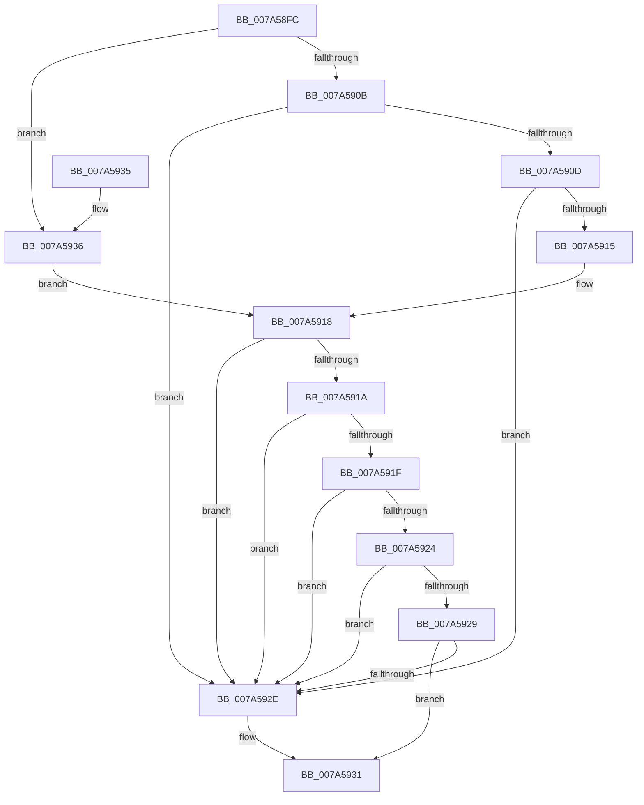

# IsArrayType

- RVA: `0x007A58FC`–`0x007A593E` (길이 `66` bytes)
- VA: `0x00000001407A58FC`
- 실행 섹션: `PAGE`
- PDB 이름 있음: `예`; PDB Function 태그: `아니요`
- unwind 정보 RVA: `0x000DB714`
- 디코드: `24`개 명령, `66/66` bytes 표시
- 미해석 바이트: `0` (있으면 어셈블리에 `.byte`로 보존)

> 이 문서는 커널 이미지의 기계어와 PDB 기호를 분석해 생성했습니다. 4번과 5번은 함수 원형과 자료형을 바이너리 사용 방식에서 추정한 C 해석이며 원본 소스 복구 결과는 아닙니다.

## 1. Dependencies

- 직접 호출 지점: **0**; 고유 호출 대상: **0**
- 직접 호출자로 확인된 함수: **1**
- RIP 상대 이미지 참조: **0**

### Outgoing calls
- 직접 디코드된 call 명령이 없습니다.

### Direct callers
- [LocalGetConditionForString](../A0/LocalGetConditionForString_function_00A01C20.md) at `0x00A02384`

### Static image references
- 디코드된 RIP-relative 메모리 참조가 없습니다.

## 2. Other-region calls and transfers

- 다른 실행 섹션으로 향하는 call: **0**
- 별도 외부 분기/꼬리 이동을 확인하지 못했습니다.

## 3. Assembly (complete function range)

```asm
007A58FC  45 32 C0                        xor r8b, r8b
007A58FF  0F B6 D1                        movzx edx, cl
007A5902  B8 8E 00 00 00                  mov eax, 0x8e
007A5907  3B D0                           cmp edx, eax
007A5909  77 2B                           ja 0x1407a5936
007A590B  74 21                           je 0x1407a592e
007A590D  81 EA 86 00 00 00               sub edx, 0x86
007A5913  74 19                           je 0x1407a592e
007A5915  83 EA 02                        sub edx, 2
007A5918  74 14                           je 0x1407a592e
007A591A  83 EA 01                        sub edx, 1
007A591D  74 0F                           je 0x1407a592e
007A591F  83 EA 01                        sub edx, 1
007A5922  74 0A                           je 0x1407a592e
007A5924  83 EA 01                        sub edx, 1
007A5927  74 05                           je 0x1407a592e
007A5929  83 FA 01                        cmp edx, 1
007A592C  75 03                           jne 0x1407a5931
007A592E  41 B0 01                        mov r8b, 1
007A5931  41 8A C0                        mov al, r8b
007A5934  C3                              ret
007A5935  CC                              int3
007A5936  81 EA 8F 00 00 00               sub edx, 0x8f
007A593C  EB DA                           jmp 0x1407a5918
```

## 4. C-style interpretation (structured pseudocode)

```c
__int64 __fastcall IsArrayType(unsigned __int8 a1, __int64 a2, unsigned __int8 a3)
{
    a3 = 0;
    if (a1 > 142) goto loc_007A5936;
    if (a1 == 142) goto loc_007A592E;
    a2 = (unsigned int)((a1) - (134));
    if (condition_is_equal) goto loc_007A592E;
    a2 = (unsigned int)((a2) - (2));
loc_007A5918:
    if (condition_is_equal) goto loc_007A592E;
    a2 = (unsigned int)((a2) - (1));
    if (condition_is_equal) goto loc_007A592E;
    a2 = (unsigned int)((a2) - (1));
    if (condition_is_equal) goto loc_007A592E;
    a2 = (unsigned int)((a2) - (1));
    if (condition_is_equal) goto loc_007A592E;
    if (((unsigned int)(a2)) == 1) {
        a3 = 1;
    }
    return a3;
loc_007A5936:
    a2 = (unsigned int)((a2) - (143));
    goto loc_007A5918;
}
```

## 5. (Beta) C Style

```c
int64_t IsArrayType(uint8_t Arg1, int64_t Arg2, uint8_t Arg3)
{
    Arg3 = 0;
    if (Arg1 > 142) goto loc_007A5936;
    if (Arg1 == 142) goto loc_007A592E;
    Arg2 = (uint32_t)((Arg1) - (134));
    if (condition_is_equal) goto loc_007A592E;
    Arg2 = (uint32_t)((Arg2) - (2));
loc_007A5918:
    if (condition_is_equal) goto loc_007A592E;
    Arg2 = (uint32_t)((Arg2) - (1));
    if (condition_is_equal) goto loc_007A592E;
    Arg2 = (uint32_t)((Arg2) - (1));
    if (condition_is_equal) goto loc_007A592E;
    Arg2 = (uint32_t)((Arg2) - (1));
    if (condition_is_equal) goto loc_007A592E;
    if (((uint32_t)(Arg2)) == 1) {
        Arg3 = 1;
    }
    return Arg3;
loc_007A5936:
    Arg2 = (uint32_t)((Arg2) - (143));
    goto loc_007A5918;
}
```

## 6. Execution-region graph

[열기: 2D/3D 그래프와 함수 탐색 컨트롤 패널](../../../control-panel.html?section=page&rva=0x007A58FC&view=graph)

- 2D 그래프는 위에서 아래로 흐르고, 3D 그래프는 빈 공간을 드래그해 회전합니다. Shift+드래그는 이동, 휠은 확대·축소, 함수 노드 선택은 대상 보고서 이동입니다.

### Static fallback


