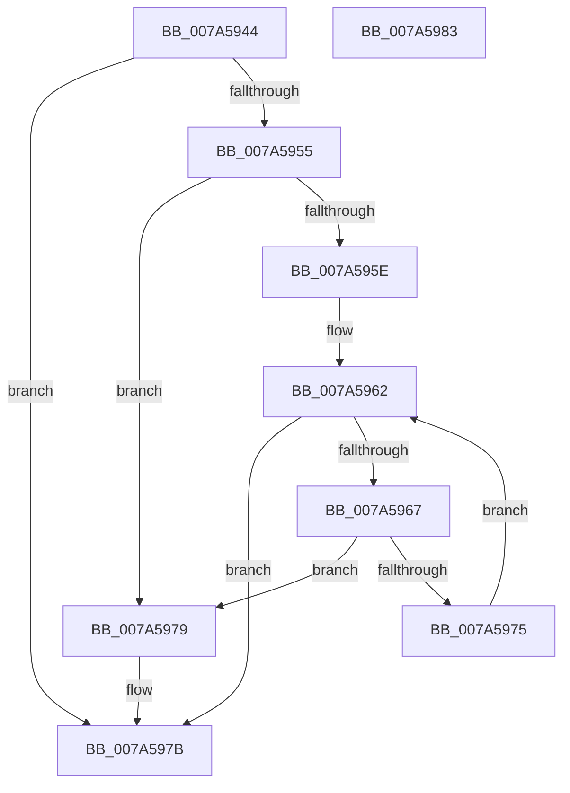

# IsEncodedAttributeChar

- RVA: `0x007A5944`–`0x007A5984` (길이 `64` bytes)
- VA: `0x00000001407A5944`
- 실행 섹션: `PAGE`
- PDB 이름 있음: `예`; PDB Function 태그: `아니요`
- unwind 정보 RVA: `0x0005CF00`
- 디코드: `24`개 명령, `64/64` bytes 표시
- 미해석 바이트: `0` (있으면 어셈블리에 `.byte`로 보존)

> 이 문서는 커널 이미지의 기계어와 PDB 기호를 분석해 생성했습니다. 4번과 5번은 함수 원형과 자료형을 바이너리 사용 방식에서 추정한 C 해석이며 원본 소스 복구 결과는 아닙니다.

## 1. Dependencies

- 직접 호출 지점: **1**; 고유 호출 대상: **1**
- 직접 호출자로 확인된 함수: **2**
- RIP 상대 이미지 참조: **1**

### Outgoing calls
- `0x007A5955` → [iswalnum](../../text/50/iswalnum_function_005007A0.md) (function, `0x005007A0`)

### Direct callers
- [EncodeAttributeName](EncodeAttributeName_function_007A54D0.md) at `0x007A554C`
- [DecodeAttributeName](../A0/DecodeAttributeName_function_00A03460.md) at `0x00A035B1`

### Static image references
- `0x007A5967` → RVA `0x00037FE8` (`.rdata`; read)

## 2. Other-region calls and transfers

- 다른 실행 섹션으로 향하는 call: **1**
  - `0x007A5955` → [iswalnum](../../text/50/iswalnum_function_005007A0.md) (`PAGE` → `.text`)
- 별도 외부 분기/꼬리 이동을 확인하지 못했습니다.

## 3. Assembly (complete function range)

```asm
007A5944  40 53                           push rbx
007A5946  48 83 EC 20                     sub rsp, 0x20
007A594A  0F B7 D9                        movzx ebx, cx
007A594D  B2 01                           mov dl, 1
007A594F  66 83 F9 7F                     cmp cx, 0x7f
007A5953  73 26                           jae 0x1407a597b
007A5955  E8 46 AE D5 FF                  call 0x1405007a0
007A595A  85 C0                           test eax, eax
007A595C  75 1B                           jne 0x1407a5979
007A595E  B2 01                           mov dl, 1
007A5960  33 C9                           xor ecx, ecx
007A5962  83 F9 15                        cmp ecx, 0x15
007A5965  73 14                           jae 0x1407a597b
007A5967  4C 8D 05 7A 26 89 FF            lea r8, [rip - 0x76d986]
007A596E  66 41 39 1C 48                  cmp word ptr [r8 + rcx*2], bx
007A5973  74 04                           je 0x1407a5979
007A5975  FF C1                           inc ecx
007A5977  EB E9                           jmp 0x1407a5962
007A5979  32 D2                           xor dl, dl
007A597B  8A C2                           mov al, dl
007A597D  48 83 C4 20                     add rsp, 0x20
007A5981  5B                              pop rbx
007A5982  C3                              ret
007A5983  CC                              int3
```

## 4. C-style interpretation (structured pseudocode)

```c
__int64 __fastcall IsEncodedAttributeChar(int a1)
{
    __int64 result;
    __int64 v_rsp;

    v_rsp = (v_rsp) - (32);
    if (((unsigned __int16)(a1)) >= 127) goto loc_007A597B;
    result = iswalnum(a1, 1, a3, a4);
    if ((unsigned int)(result) != 0) goto loc_007A5979;
    a1 = 0;
loc_007A5962:
    if (0 >= 21) goto loc_007A597B;
    if ((*(unsigned __int16 *)(v_rip - 7788934 + a1 * 2)) == ((unsigned __int16)((unsigned __int16)(a1)))) goto loc_007A5979;
    a1 = (unsigned int)((a1) + 1);
    goto loc_007A5962;
loc_007A5979:
    a2 = 0;
loc_007A597B:
    v_rsp = (v_rsp) + (32);
    return 0;
}
```

## 5. (Beta) C Style

```c
int64_t IsEncodedAttributeChar(int32_t Arg1)
{
    int64_t result;
    int64_t local_rsp;

    local_rsp = (local_rsp) - (32);
    if (((uint16_t)(Arg1)) >= 127) goto loc_007A597B;
    result = iswalnum(Arg1, 1, a3, a4);
    if ((uint32_t)(result) != 0) goto loc_007A5979;
    Arg1 = 0;
loc_007A5962:
    if (0 >= 21) goto loc_007A597B;
    if ((*(uint16_t *)(v_rip - 0x76D986 + Arg1 * 2)) == ((uint16_t)((uint16_t)(Arg1)))) goto loc_007A5979;
    Arg1 = (uint32_t)((Arg1) + 1);
    goto loc_007A5962;
loc_007A5979:
    a2 = 0;
loc_007A597B:
    local_rsp = (local_rsp) + (32);
    return 0;
}
```

## 6. Execution-region graph

[열기: 2D/3D 그래프와 함수 탐색 컨트롤 패널](../../../control-panel.html?section=page&rva=0x007A5944&view=graph)

- 2D 그래프는 위에서 아래로 흐르고, 3D 그래프는 빈 공간을 드래그해 회전합니다. Shift+드래그는 이동, 휠은 확대·축소, 함수 노드 선택은 대상 보고서 이동입니다.

### Static fallback


