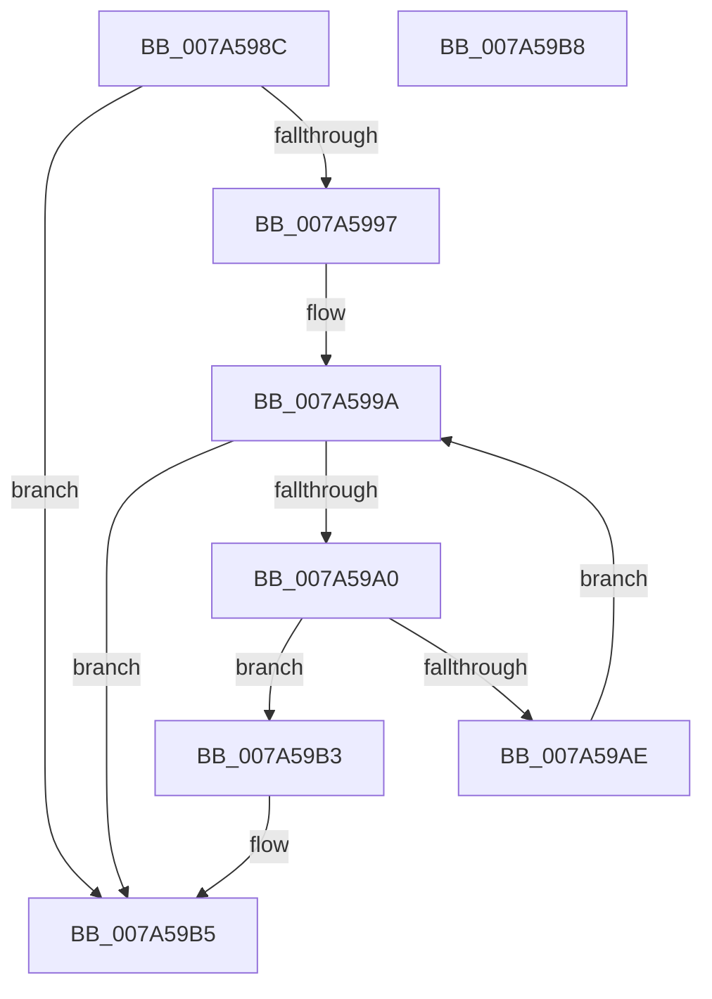

# IsLegalAttributeChar2

- RVA: `0x007A598C`–`0x007A59B9` (길이 `45` bytes)
- VA: `0x00000001407A598C`
- 실행 섹션: `PAGE`
- PDB 이름 있음: `예`; PDB Function 태그: `아니요`
- unwind 정보 RVA: `0x000DB714`
- 디코드: `15`개 명령, `45/45` bytes 표시
- 미해석 바이트: `0` (있으면 어셈블리에 `.byte`로 보존)

> 이 문서는 커널 이미지의 기계어와 PDB 기호를 분석해 생성했습니다. 4번과 5번은 함수 원형과 자료형을 바이너리 사용 방식에서 추정한 C 해석이며 원본 소스 복구 결과는 아닙니다.

## 1. Dependencies

- 직접 호출 지점: **0**; 고유 호출 대상: **0**
- 직접 호출자로 확인된 함수: **3**
- RIP 상대 이미지 참조: **1**

### Outgoing calls
- 직접 디코드된 call 명령이 없습니다.

### Direct callers
- [GetAttributeName](../A0/GetAttributeName_function_00A02768.md) at `0x00A029BF`
- [LocalGetRelativeAttributeForString](../AC/LocalGetRelativeAttributeForString_function_00AC74E4.md) at `0x00AC75B5`
- [sub_00B334A0](../B3/Unknown_function_00B334A0.md) at `0x00B334AF`

### Static image references
- `0x007A59A0` → RVA `0x00037FD0` (`.rdata`; read)

## 2. Other-region calls and transfers

- 다른 실행 섹션으로 향하는 call: **0**
- 별도 외부 분기/꼬리 이동을 확인하지 못했습니다.

## 3. Assembly (complete function range)

```asm
007A598C  BA 01 00 00 00                  mov edx, 1
007A5991  66 83 F9 7F                     cmp cx, 0x7f
007A5995  73 1E                           jae 0x1407a59b5
007A5997  45 33 C0                        xor r8d, r8d
007A599A  41 83 F8 0A                     cmp r8d, 0xa
007A599E  73 15                           jae 0x1407a59b5
007A59A0  4C 8D 0D 29 26 89 FF            lea r9, [rip - 0x76d9d7]
007A59A7  66 43 39 0C 41                  cmp word ptr [r9 + r8*2], cx
007A59AC  74 05                           je 0x1407a59b3
007A59AE  44 03 C2                        add r8d, edx
007A59B1  EB E7                           jmp 0x1407a599a
007A59B3  32 D2                           xor dl, dl
007A59B5  8A C2                           mov al, dl
007A59B7  C3                              ret
007A59B8  CC                              int3
```

## 4. C-style interpretation (structured pseudocode)

```c
__int64 __fastcall IsLegalAttributeChar2(unsigned __int16 a1, __int64 a2, int a3)
{
    if (a1 >= 127) goto loc_007A59B5;
    a3 = 0;
loc_007A599A:
    if (0 >= 10) goto loc_007A59B5;
    if ((*(unsigned __int16 *)(v_rip - 7789015 + a3 * 2)) == a1) goto loc_007A59B3;
    a3 = (unsigned int)((a3) + (1));
    goto loc_007A599A;
loc_007A59B3:
    a2 = 0;
loc_007A59B5:
    return 0;
}
```

## 5. (Beta) C Style

```c
int64_t IsLegalAttributeChar2(uint16_t Arg1, int64_t Arg2, int32_t Arg3)
{
    if (Arg1 >= 127) goto loc_007A59B5;
    Arg3 = 0;
loc_007A599A:
    if (0 >= 10) goto loc_007A59B5;
    if ((*(uint16_t *)(v_rip - 0x76D9D7 + Arg3 * 2)) == Arg1) goto loc_007A59B3;
    Arg3 = (uint32_t)((Arg3) + (1));
    goto loc_007A599A;
loc_007A59B3:
    Arg2 = 0;
loc_007A59B5:
    return 0;
}
```

## 6. Execution-region graph

[열기: 2D/3D 그래프와 함수 탐색 컨트롤 패널](../../../control-panel.html?section=page&rva=0x007A598C&view=graph)

- 2D 그래프는 위에서 아래로 흐르고, 3D 그래프는 빈 공간을 드래그해 회전합니다. Shift+드래그는 이동, 휠은 확대·축소, 함수 노드 선택은 대상 보고서 이동입니다.

### Static fallback


