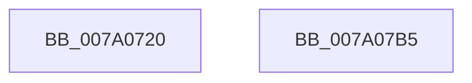

# NtCreateToken

- RVA: `0x007A0720`–`0x007A07B6` (길이 `150` bytes)
- VA: `0x00000001407A0720`
- 실행 섹션: `PAGE`
- PDB 이름 있음: `예`; PDB Function 태그: `아니요`
- unwind 정보 RVA: `0x000AA4F0`
- 디코드: `29`개 명령, `150/150` bytes 표시
- 미해석 바이트: `0` (있으면 어셈블리에 `.byte`로 보존)

> 이 문서는 커널 이미지의 기계어와 PDB 기호를 분석해 생성했습니다. 4번과 5번은 함수 원형과 자료형을 바이너리 사용 방식에서 추정한 C 해석이며 원본 소스 복구 결과는 아닙니다.

## 1. Dependencies

- 직접 호출 지점: **1**; 고유 호출 대상: **1**
- 직접 호출자로 확인된 함수: **0**
- RIP 상대 이미지 참조: **0**

### Outgoing calls
- `0x007A07A8` → [NtCreateTokenEx](../9C/NtCreateTokenEx_function_009C7C80.md) (function, `0x009C7C80`)

### Direct callers
- 이 함수 시작 RVA로 연결되는 직접 call은 확인되지 않았습니다. 간접 호출은 완전히 역산할 수 없습니다.

### Static image references
- 디코드된 RIP-relative 메모리 참조가 없습니다.

## 2. Other-region calls and transfers

- 다른 실행 섹션으로 향하는 call: **0**
- 별도 외부 분기/꼬리 이동을 확인하지 못했습니다.

## 3. Assembly (complete function range)

```asm
007A0720  4C 8B DC                        mov r11, rsp
007A0723  48 81 EC 98 00 00 00            sub rsp, 0x98
007A072A  48 8B 84 24 00 01 00 00         mov rax, qword ptr [rsp + 0x100]
007A0732  49 89 43 E8                     mov qword ptr [r11 - 0x18], rax
007A0736  48 8B 84 24 F8 00 00 00         mov rax, qword ptr [rsp + 0xf8]
007A073E  49 89 43 E0                     mov qword ptr [r11 - 0x20], rax
007A0742  48 8B 84 24 F0 00 00 00         mov rax, qword ptr [rsp + 0xf0]
007A074A  49 89 43 D8                     mov qword ptr [r11 - 0x28], rax
007A074E  48 8B 84 24 E8 00 00 00         mov rax, qword ptr [rsp + 0xe8]
007A0756  49 89 43 D0                     mov qword ptr [r11 - 0x30], rax
007A075A  33 C0                           xor eax, eax
007A075C  49 89 43 C8                     mov qword ptr [r11 - 0x38], rax
007A0760  49 89 43 C0                     mov qword ptr [r11 - 0x40], rax
007A0764  49 89 43 B8                     mov qword ptr [r11 - 0x48], rax
007A0768  49 89 43 B0                     mov qword ptr [r11 - 0x50], rax
007A076C  48 8B 84 24 E0 00 00 00         mov rax, qword ptr [rsp + 0xe0]
007A0774  49 89 43 A8                     mov qword ptr [r11 - 0x58], rax
007A0778  48 8B 84 24 D8 00 00 00         mov rax, qword ptr [rsp + 0xd8]
007A0780  49 89 43 A0                     mov qword ptr [r11 - 0x60], rax
007A0784  48 8B 84 24 D0 00 00 00         mov rax, qword ptr [rsp + 0xd0]
007A078C  49 89 43 98                     mov qword ptr [r11 - 0x68], rax
007A0790  48 8B 84 24 C8 00 00 00         mov rax, qword ptr [rsp + 0xc8]
007A0798  49 89 43 90                     mov qword ptr [r11 - 0x70], rax
007A079C  48 8B 84 24 C0 00 00 00         mov rax, qword ptr [rsp + 0xc0]
007A07A4  49 89 43 88                     mov qword ptr [r11 - 0x78], rax
007A07A8  E8 D3 74 22 00                  call 0x1409c7c80
007A07AD  48 81 C4 98 00 00 00            add rsp, 0x98
007A07B4  C3                              ret
007A07B5  CC                              int3
```

## 4. C-style interpretation (structured pseudocode)

```c
__int64 __fastcall NtCreateToken(__int64 a1, __int64 a2, __int64 a3, __int64 a4, __int64 a5, __int64 a6, __int64 a7, __int64 a8, __int64 a9, __int64 a10, __int64 a11, __int64 a12, __int64 a13)
{
    __int64 result;
    __int64 v_rsp;

    v_rsp = (v_rsp) - (152);
    *(unsigned __int64 *)(v_rsp - 24) = a13;
    *(unsigned __int64 *)(v_rsp - 32) = a12;
    *(unsigned __int64 *)(v_rsp - 40) = a11;
    *(unsigned __int64 *)(v_rsp - 48) = a10;
    result = 0;
    *(unsigned __int64 *)(v_rsp - 56) = 0;
    *(unsigned __int64 *)(v_rsp - 64) = 0;
    *(unsigned __int64 *)(v_rsp - 72) = 0;
    *(unsigned __int64 *)(v_rsp - 80) = 0;
    *(unsigned __int64 *)(v_rsp - 88) = a9;
    *(unsigned __int64 *)(v_rsp - 96) = a8;
    *(unsigned __int64 *)(v_rsp - 104) = a7;
    *(unsigned __int64 *)(v_rsp - 112) = a6;
    *(unsigned __int64 *)(v_rsp - 120) = a5;
    result = NtCreateTokenEx(a1, a2, a3, a4);
    v_rsp = (v_rsp) + (152);
    return result;
}
```

## 5. (Beta) C Style

```c
int64_t NtCreateToken(int64_t Arg1, int64_t Arg2, int64_t Arg3, int64_t Arg4, int64_t Arg5, int64_t Arg6, int64_t Arg7, int64_t Arg8, int64_t Arg9, int64_t Arg10, int64_t Arg11, int64_t Arg12, int64_t Arg13)
{
    int64_t result;
    int64_t local_rsp;

    local_rsp = (local_rsp) - (152);
    *(uint64_t *)(local_rsp - 0x18) = Arg13;
    *(uint64_t *)(local_rsp - 0x20) = Arg12;
    *(uint64_t *)(local_rsp - 0x28) = Arg11;
    *(uint64_t *)(local_rsp - 0x30) = Arg10;
    result = 0;
    *(uint64_t *)(local_rsp - 0x38) = 0;
    *(uint64_t *)(local_rsp - 0x40) = 0;
    *(uint64_t *)(local_rsp - 0x48) = 0;
    *(uint64_t *)(local_rsp - 0x50) = 0;
    *(uint64_t *)(local_rsp - 0x58) = Arg9;
    *(uint64_t *)(local_rsp - 0x60) = Arg8;
    *(uint64_t *)(local_rsp - 0x68) = Arg7;
    *(uint64_t *)(local_rsp - 0x70) = Arg6;
    *(uint64_t *)(local_rsp - 0x78) = Arg5;
    result = NtCreateTokenEx(Arg1, Arg2, Arg3, Arg4);
    local_rsp = (local_rsp) + (152);
    return result;
}
```

## 6. Execution-region graph

[열기: 2D/3D 그래프와 함수 탐색 컨트롤 패널](../../../control-panel.html?section=page&rva=0x007A0720&view=graph)

- 2D 그래프는 위에서 아래로 흐르고, 3D 그래프는 빈 공간을 드래그해 회전합니다. Shift+드래그는 이동, 휠은 확대·축소, 함수 노드 선택은 대상 보고서 이동입니다.

### Static fallback


