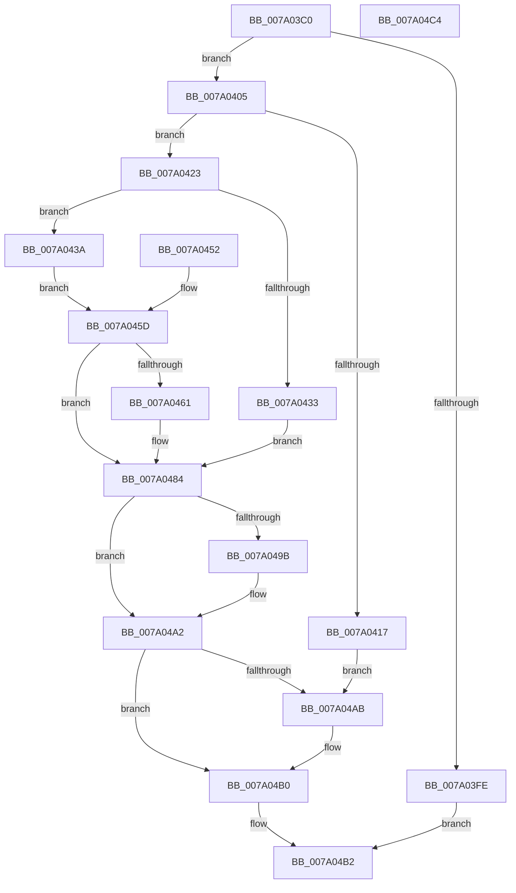

# NtDeleteObjectAuditAlarm

- RVA: `0x007A03C0`–`0x007A04C5` (길이 `261` bytes)
- VA: `0x00000001407A03C0`
- 실행 섹션: `PAGE`
- PDB 이름 있음: `예`; PDB Function 태그: `아니요`
- unwind 정보 RVA: `0x000D13A4`
- 디코드: `69`개 명령, `261/261` bytes 표시
- 미해석 바이트: `0` (있으면 어셈블리에 `.byte`로 보존)

> 이 문서는 커널 이미지의 기계어와 PDB 기호를 분석해 생성했습니다. 4번과 5번은 함수 원형과 자료형을 바이너리 사용 방식에서 추정한 C 해석이며 원본 소스 복구 결과는 아닙니다.

## 1. Dependencies

- 직접 호출 지점: **7**; 고유 호출 대상: **7**
- 직접 호출자로 확인된 함수: **0**
- RIP 상대 이미지 참조: **0**

### Outgoing calls
- `0x007A040A` → [SeCaptureSubjectContext](../86/SeCaptureSubjectContext_function_0086B820.md) (function, `0x0086B820`)
- `0x007A042A` → [SeCheckAuditPrivilege](../97/SeCheckAuditPrivilege_function_00974E48.md) (function, `0x00974E48`)
- `0x007A0445` → [SepProbeAndCaptureString_U](../97/SepProbeAndCaptureString_U_function_00975070.md) (function, `0x00975070`)
- `0x007A047F` → [SepAdtDeleteObjectAuditAlarm](../91/SepAdtDeleteObjectAuditAlarm_function_0091E824.md) (function, `0x0091E824`)
- `0x007A0489` → [SeReleaseSubjectContext](../86/SeReleaseSubjectContext_function_0086B710.md) (function, `0x0086B710`)
- `0x007A049D` → [ExFreePoolWithTag](../../poolcode/B8/ExFreePoolWithTag_function_00B82870.md) (function, `0x00B82870`)
- `0x007A04AB` → [SepAuditFailed](../86/SepAuditFailed_function_0086EE20.md) (function, `0x0086EE20`)

### Direct callers
- 이 함수 시작 RVA로 연결되는 직접 call은 확인되지 않았습니다. 간접 호출은 완전히 역산할 수 없습니다.

### Static image references
- 디코드된 RIP-relative 메모리 참조가 없습니다.

## 2. Other-region calls and transfers

- 다른 실행 섹션으로 향하는 call: **1**
  - `0x007A049D` → [ExFreePoolWithTag](../../poolcode/B8/ExFreePoolWithTag_function_00B82870.md) (`PAGE` → `POOLCODE`)
- 별도 외부 분기/꼬리 이동을 확인하지 못했습니다.

## 3. Assembly (complete function range)

```asm
007A03C0  48 8B C4                        mov rax, rsp
007A03C3  48 89 58 08                     mov qword ptr [rax + 8], rbx
007A03C7  48 89 70 18                     mov qword ptr [rax + 0x18], rsi
007A03CB  48 89 50 10                     mov qword ptr [rax + 0x10], rdx
007A03CF  57                              push rdi
007A03D0  48 83 EC 60                     sub rsp, 0x60
007A03D4  48 8B FA                        mov rdi, rdx
007A03D7  48 8B F1                        mov rsi, rcx
007A03DA  0F 57 C0                        xorps xmm0, xmm0
007A03DD  0F 11 40 D0                     movups xmmword ptr [rax - 0x30], xmm0
007A03E1  0F 11 40 E0                     movups xmmword ptr [rax - 0x20], xmm0
007A03E5  48 83 60 20 00                  and qword ptr [rax + 0x20], 0
007A03EA  65 48 8B 04 25 88 01 00 00      mov rax, qword ptr gs:[0x188]
007A03F3  8A 98 32 02 00 00               mov bl, byte ptr [rax + 0x232]
007A03F9  45 84 C0                        test r8b, r8b
007A03FC  75 07                           jne 0x1407a0405
007A03FE  33 C0                           xor eax, eax
007A0400  E9 AD 00 00 00                  jmp 0x1407a04b2
007A0405  48 8D 4C 24 38                  lea rcx, [rsp + 0x38]
007A040A  E8 11 B4 0C 00                  call 0x14086b820
007A040F  48 83 7C 24 48 00               cmp qword ptr [rsp + 0x48], 0
007A0415  75 0C                           jne 0x1407a0423
007A0417  BB 7C 00 00 C0                  mov ebx, 0xc000007c
007A041C  8B CB                           mov ecx, ebx
007A041E  E9 88 00 00 00                  jmp 0x1407a04ab
007A0423  8A D3                           mov dl, bl
007A0425  48 8D 4C 24 38                  lea rcx, [rsp + 0x38]
007A042A  E8 19 4A 1D 00                  call 0x140974e48
007A042F  84 C0                           test al, al
007A0431  75 07                           jne 0x1407a043a
007A0433  BB 61 00 00 C0                  mov ebx, 0xc0000061
007A0438  EB 4A                           jmp 0x1407a0484
007A043A  48 8D 94 24 88 00 00 00         lea rdx, [rsp + 0x88]
007A0442  48 8B CE                        mov rcx, rsi
007A0445  E8 26 4C 1D 00                  call 0x140975070
007A044A  8B D8                           mov ebx, eax
007A044C  89 44 24 30                     mov dword ptr [rsp + 0x30], eax
007A0450  EB 0B                           jmp 0x1407a045d
007A0452  8B D8                           mov ebx, eax
007A0454  89 44 24 30                     mov dword ptr [rsp + 0x30], eax
007A0458  48 8B 7C 24 78                  mov rdi, qword ptr [rsp + 0x78]
007A045D  85 DB                           test ebx, ebx
007A045F  78 23                           js 0x1407a0484
007A0461  C6 44 24 28 00                  mov byte ptr [rsp + 0x28], 0
007A0466  48 83 64 24 20 00               and qword ptr [rsp + 0x20], 0
007A046C  45 33 C9                        xor r9d, r9d
007A046F  4C 8D 44 24 38                  lea r8, [rsp + 0x38]
007A0474  48 8B D7                        mov rdx, rdi
007A0477  48 8B 8C 24 88 00 00 00         mov rcx, qword ptr [rsp + 0x88]
007A047F  E8 A0 E3 17 00                  call 0x14091e824
007A0484  48 8D 4C 24 38                  lea rcx, [rsp + 0x38]
007A0489  E8 82 B2 0C 00                  call 0x14086b710
007A048E  48 8B 8C 24 88 00 00 00         mov rcx, qword ptr [rsp + 0x88]
007A0496  48 85 C9                        test rcx, rcx
007A0499  74 07                           je 0x1407a04a2
007A049B  33 D2                           xor edx, edx
007A049D  E8 CE 23 3E 00                  call 0x140b82870
007A04A2  B9 9A 00 00 C0                  mov ecx, 0xc000009a
007A04A7  3B D9                           cmp ebx, ecx
007A04A9  75 05                           jne 0x1407a04b0
007A04AB  E8 70 E9 0C 00                  call 0x14086ee20
007A04B0  8B C3                           mov eax, ebx
007A04B2  4C 8D 5C 24 60                  lea r11, [rsp + 0x60]
007A04B7  49 8B 5B 10                     mov rbx, qword ptr [r11 + 0x10]
007A04BB  49 8B 73 20                     mov rsi, qword ptr [r11 + 0x20]
007A04BF  49 8B E3                        mov rsp, r11
007A04C2  5F                              pop rdi
007A04C3  C3                              ret
007A04C4  CC                              int3
```

## 4. C-style interpretation (structured pseudocode)

```c
__int64 __fastcall NtDeleteObjectAuditAlarm(__int64 a1, __int64 a2, unsigned __int8 a3, int a4)
{
    __int64 result;
    __int64 v_rsp;
    unsigned __int64 v_stack_m20;
    unsigned __int64 v_stack_m30;
    unsigned int v_stack_m38;
    unsigned __int8 v_stack_m40;
    unsigned __int64 v_stack_m48;
    unsigned __int64 v_stack_m8;
    unsigned __int64 v_stack_p10;
    unsigned __int64 v_stack_p20;

    *(unsigned __int64 *)(v_rsp + 8) = v_rbx;
    *(unsigned __int64 *)(v_rsp + 24) = v_rsi;
    *(unsigned __int64 *)(v_rsp + 16) = a2;
    v_rsp = (v_rsp) - (96);
    *(unsigned __int64 *)(v_rsp - 48) = v_xmm0;
    *(unsigned __int64 *)(v_rsp - 32) = v_xmm0;
    if (a3 != 0) goto loc_007A0405;
    result = 0;
    goto loc_007A04B2;
loc_007A0405:
    result = SeCaptureSubjectContext(v_stack_m30, a2, a3, a4);
    if (v_stack_m20 != 0) goto loc_007A0423;
    goto loc_007A04AB;
loc_007A0423:
    result = SeCheckAuditPrivilege(v_stack_m30, (unsigned __int8)((unsigned int)(0xC000007CULL)), a3, a4);
    if ((unsigned __int8)(result) != 0) goto loc_007A043A;
    goto loc_007A0484;
loc_007A043A:
    result = SepProbeAndCaptureString_U(a1, v_stack_p20, a3, a4);
    v_stack_m38 = (unsigned int)(result);
    goto loc_007A045D;
loc_007A045D:
    if (!(sign_flag)) {
        v_stack_m40 = 0;
        a4 = 0;
        a3 = v_stack_m30;
        a2 = a2;
        a1 = v_stack_p20;
        result = SepAdtDeleteObjectAuditAlarm(a1, a2, a3, a4);
    }
    result = SeReleaseSubjectContext(v_stack_m30, a2, a3, a4);
    if (v_stack_p20 != 0) {
        a2 = 0;
        result = ExFreePoolWithTag(v_stack_p20, a2, a3, a4);
    }
    if (((unsigned int)((unsigned int)((unsigned int)(result)))) == ((unsigned int)((unsigned int)(0xC000009AULL)))) {
        result = SepAuditFailed((unsigned int)(0xC000009AULL), a2, a3, a4);
    }
loc_007A04B2:
    return (unsigned int)((unsigned int)((unsigned int)((unsigned int)(result))));
}
```

## 5. (Beta) C Style

```c
int64_t NtDeleteObjectAuditAlarm(int64_t Arg1, int64_t Arg2, uint8_t Arg3, int32_t Arg4)
{
    int64_t result;
    int64_t local_rsp;
    uint64_t v_stack_m20;
    uint64_t v_stack_m30;
    uint32_t v_stack_m38;
    uint8_t v_stack_m40;
    uint64_t v_stack_m48;
    uint64_t v_stack_m8;
    uint64_t v_stack_p10;
    uint64_t v_stack_p20;

    *(uint64_t *)(local_rsp + 0x8) = local_rbx;
    *(uint64_t *)(local_rsp + 0x18) = local_rsi;
    *(uint64_t *)(local_rsp + 0x10) = Arg2;
    local_rsp = (local_rsp) - (96);
    *(uint64_t *)(local_rsp - 0x30) = v_xmm0;
    *(uint64_t *)(local_rsp - 0x20) = v_xmm0;
    if (Arg3 != 0) goto loc_007A0405;
    result = 0;
    goto loc_007A04B2;
loc_007A0405:
    result = SeCaptureSubjectContext(v_stack_m30, Arg2, Arg3, Arg4);
    if (v_stack_m20 != 0) goto loc_007A0423;
    goto loc_007A04AB;
loc_007A0423:
    result = SeCheckAuditPrivilege(v_stack_m30, (uint8_t)((uint32_t)(0xC000007CULL)), Arg3, Arg4);
    if ((uint8_t)(result) != 0) goto loc_007A043A;
    goto loc_007A0484;
loc_007A043A:
    result = SepProbeAndCaptureString_U(Arg1, v_stack_p20, Arg3, Arg4);
    v_stack_m38 = (uint32_t)(result);
    goto loc_007A045D;
loc_007A045D:
    if (!(sign_flag)) {
        v_stack_m40 = 0;
        Arg4 = 0;
        Arg3 = v_stack_m30;
        Arg2 = Arg2;
        Arg1 = v_stack_p20;
        result = SepAdtDeleteObjectAuditAlarm(Arg1, Arg2, Arg3, Arg4);
    }
    result = SeReleaseSubjectContext(v_stack_m30, Arg2, Arg3, Arg4);
    if (v_stack_p20 != 0) {
        Arg2 = 0;
        result = ExFreePoolWithTag(v_stack_p20, Arg2, Arg3, Arg4);
    }
    if (((uint32_t)((uint32_t)((uint32_t)(result)))) == ((uint32_t)((uint32_t)(0xC000009AULL)))) {
        result = SepAuditFailed((uint32_t)(0xC000009AULL), Arg2, Arg3, Arg4);
    }
loc_007A04B2:
    return (uint32_t)((uint32_t)((uint32_t)((uint32_t)(result))));
}
```

## 6. Execution-region graph

[열기: 2D/3D 그래프와 함수 탐색 컨트롤 패널](../../../control-panel.html?section=page&rva=0x007A03C0&view=graph)

- 2D 그래프는 위에서 아래로 흐르고, 3D 그래프는 빈 공간을 드래그해 회전합니다. Shift+드래그는 이동, 휠은 확대·축소, 함수 노드 선택은 대상 보고서 이동입니다.

### Static fallback


