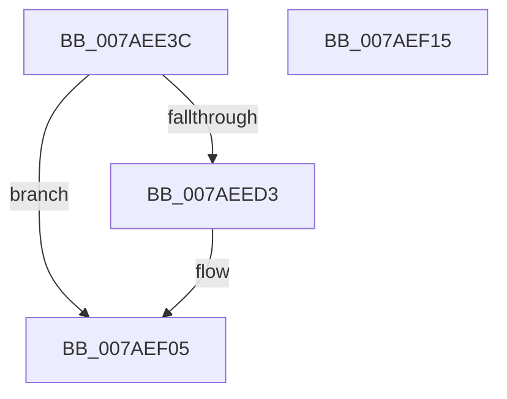

# PerfDiagpInitializeLoggerInfo

- RVA: `0x007AEE3C`–`0x007AEF16` (길이 `218` bytes)
- VA: `0x00000001407AEE3C`
- 실행 섹션: `PAGE`
- PDB 이름 있음: `예`; PDB Function 태그: `아니요`
- unwind 정보 RVA: `0x00060BC4`
- 디코드: `42`개 명령, `218/218` bytes 표시
- 미해석 바이트: `0` (있으면 어셈블리에 `.byte`로 보존)

> 이 문서는 커널 이미지의 기계어와 PDB 기호를 분석해 생성했습니다. 4번과 5번은 함수 원형과 자료형을 바이너리 사용 방식에서 추정한 C 해석이며 원본 소스 복구 결과는 아닙니다.

## 1. Dependencies

- 직접 호출 지점: **2**; 고유 호출 대상: **2**
- 직접 호출자로 확인된 함수: **2**
- RIP 상대 이미지 참조: **14**

### Outgoing calls
- `0x007AEE60` → [memset](../../text/6C/memset_function_006C6C40.md) (function, `0x006C6C40`)
- `0x007AEEB1` → [RtlInitUnicodeString](../../text/42/RtlInitUnicodeString_function_0042A780.md) (function, `0x0042A780`)

### Direct callers
- [PerfDiagpProxyWorker](PerfDiagpProxyWorker_function_007AEF20.md) at `0x007AF032`
- [PerfDiagpUpdatePerfDiagLoggerEnableFlags](PerfDiagpUpdatePerfDiagLoggerEnableFlags_function_007AF21C.md) at `0x007AF2DF`

### Static image references
- `0x007AEE54` → RVA `0x00EFFCD0` (`.data`; read)
- `0x007AEE65` → RVA `0x00B06A70` (` ?? ::NNGAKEGL::`string'`; read)
- `0x007AEE6C` → RVA `0x00EFFD18` (`.data`; write)
- `0x007AEE76` → RVA `0x00EFFCAC` (`.data`; read)
- `0x007AEE7D` → RVA `0x00B06A80` (`PAGE`; read)
- `0x007AEE84` → RVA `0x00EFFD60` (`.data`; read)
- `0x007AEE8B` → RVA `0x00EFFCFC` (`.data`; write)
- `0x007AEE9C` → RVA `0x00EFFD1A` (`.data`; write)
- `0x007AEEA3` → RVA `0x00EFFCBC` (`.data`; read)
- `0x007AEEB6` → RVA `0x00EFFCD0` (`.data`; write)
- `0x007AEEC5` → RVA `0x00EFFD80` (`.data`; write)
- `0x007AEED6` → RVA `0x00EFFD86` (`.data`; write)
- `0x007AEEE0` → RVA `0x00EFFD84` (`.data`; write)
- `0x007AEEE7` → RVA `0x00EFFD82` (`.data`; write)

## 2. Other-region calls and transfers

- 다른 실행 섹션으로 향하는 call: **2**
  - `0x007AEE60` → [memset](../../text/6C/memset_function_006C6C40.md) (`PAGE` → `.text`)
  - `0x007AEEB1` → [RtlInitUnicodeString](../../text/42/RtlInitUnicodeString_function_0042A780.md) (`PAGE` → `.text`)
- 별도 외부 분기/꼬리 이동을 확인하지 못했습니다.

## 3. Assembly (complete function range)

```asm
007AEE3C  48 89 5C 24 08                  mov qword ptr [rsp + 8], rbx
007AEE41  48 89 74 24 10                  mov qword ptr [rsp + 0x10], rsi
007AEE46  57                              push rdi
007AEE47  48 83 EC 20                     sub rsp, 0x20
007AEE4B  8B FA                           mov edi, edx
007AEE4D  8B D9                           mov ebx, ecx
007AEE4F  BE B0 00 00 00                  mov esi, 0xb0
007AEE54  48 8D 0D 75 0E 75 00            lea rcx, [rip + 0x750e75]
007AEE5B  44 8B C6                        mov r8d, esi
007AEE5E  33 D2                           xor edx, edx
007AEE60  E8 DB 7D F1 FF                  call 0x1406c6c40
007AEE65  0F 10 05 04 7C 35 00            movups xmm0, xmmword ptr [rip + 0x357c04]
007AEE6C  C7 05 A2 0E 75 00 00 00 00 80   mov dword ptr [rip + 0x750ea2], 0x80000000
007AEE76  48 8D 15 2F 0E 75 00            lea rdx, [rip + 0x750e2f]
007AEE7D  0F 10 0D FC 7B 35 00            movups xmm1, xmmword ptr [rip + 0x357bfc]
007AEE84  48 8D 0D D5 0E 75 00            lea rcx, [rip + 0x750ed5]
007AEE8B  C7 05 67 0E 75 00 00 00 02 00   mov dword ptr [rip + 0x750e67], 0x20000
007AEE95  0F 11 05 10 0E 75 00            movups xmmword ptr [rip + 0x750e10], xmm0
007AEE9C  C6 05 77 0E 75 00 FF            mov byte ptr [rip + 0x750e77], 0xff
007AEEA3  0F 11 0D 12 0E 75 00            movups xmmword ptr [rip + 0x750e12], xmm1
007AEEAA  66 89 35 67 0E 75 00            mov word ptr [rip + 0x750e67], si
007AEEB1  E8 CA B8 C7 FF                  call 0x14042a780
007AEEB6  C7 05 10 0E 75 00 B4 00 00 00   mov dword ptr [rip + 0x750e10], 0xb4
007AEEC0  BA 01 00 00 00                  mov edx, 1
007AEEC5  C7 05 B1 0E 75 00 01 00 00 00   mov dword ptr [rip + 0x750eb1], 1
007AEECF  85 DB                           test ebx, ebx
007AEED1  74 32                           je 0x1407aef05
007AEED3  66 03 FA                        add di, dx
007AEED6  66 89 15 A9 0E 75 00            mov word ptr [rip + 0x750ea9], dx
007AEEDD  0F B7 CF                        movzx ecx, di
007AEEE0  66 89 0D 9D 0E 75 00            mov word ptr [rip + 0x750e9d], cx
007AEEE7  66 89 15 94 0E 75 00            mov word ptr [rip + 0x750e94], dx
007AEEEE  8D 04 0A                        lea eax, [rdx + rcx]
007AEEF1  66 89 05 88 0E 75 00            mov word ptr [rip + 0x750e88], ax
007AEEF8  8D 04 8D B4 00 00 00            lea eax, [rcx*4 + 0xb4]
007AEEFF  89 05 CB 0D 75 00               mov dword ptr [rip + 0x750dcb], eax
007AEF05  48 8B 5C 24 30                  mov rbx, qword ptr [rsp + 0x30]
007AEF0A  48 8B 74 24 38                  mov rsi, qword ptr [rsp + 0x38]
007AEF0F  48 83 C4 20                     add rsp, 0x20
007AEF13  5F                              pop rdi
007AEF14  C3                              ret
007AEF15  CC                              int3
```

## 4. C-style interpretation (structured pseudocode)

```c
__int64 __fastcall PerfDiagpInitializeLoggerInfo(int a1, int a2)
{
    __int64 result;
    __int64 v_rdi;
    __int64 v_rsp;
    unsigned __int64 v_stack_p10;
    unsigned __int64 v_stack_p8;

    v_stack_p8 = v_rbx;
    v_stack_p10 = v_rsi;
    v_rsp = (v_rsp) - (32);
    a2 = 0;
    result = memset(v_rip + 7671413, a2, 176, a4);
    *(unsigned int *)(v_rip + 7671458) = 0x80000000ULL;
    *(unsigned int *)(v_rip + 7671399) = 0x20000ULL;
    *(unsigned __int64 *)(v_rip + 7671312) = v_xmm0;
    *(unsigned __int8 *)(v_rip + 7671415) = 255;
    *(unsigned __int64 *)(v_rip + 7671314) = v_xmm1;
    *(unsigned __int16 *)(v_rip + 7671399) = 176;
    result = RtlInitUnicodeString(v_rip + 7671509, v_rip + 7671343, 176, a4);
    *(unsigned int *)(v_rip + 7671312) = 180;
    *(unsigned int *)(v_rip + 7671473) = 1;
    v_rdi = (unsigned int)(a2);
    if ((unsigned int)((unsigned int)(a1)) != 0) {
        v_rdi = (unsigned __int16)(((unsigned int)(a2)) + (1));
        *(unsigned __int16 *)(v_rip + 7671465) = 1;
        a1 = (unsigned __int16)(v_rdi);
        *(unsigned __int16 *)(v_rip + 7671453) = (unsigned __int16)(a1);
        *(unsigned __int16 *)(v_rip + 7671444) = 1;
        result = 1 + a1 * 1;
        *(unsigned __int16 *)(v_rip + 7671432) = (unsigned __int16)(result);
        result = a1 * 4 + 180;
        *(unsigned int *)(v_rip + 7671243) = (unsigned int)(result);
    }
    v_rsp = (v_rsp) + (32);
    return result;
}
```

## 5. (Beta) C Style

```c
int64_t PerfDiagpInitializeLoggerInfo(int32_t Arg1, int32_t Arg2)
{
    int64_t result;
    int64_t local_rdi;
    int64_t local_rsp;
    uint64_t v_stack_p10;
    uint64_t v_stack_p8;

    v_stack_p8 = local_rbx;
    v_stack_p10 = local_rsi;
    local_rsp = (local_rsp) - (32);
    Arg2 = 0;
    result = memset(v_rip + 7671413, Arg2, 176, a4);
    *(uint32_t *)(v_rip + 0x750EA2) = 0x80000000ULL;
    *(uint32_t *)(v_rip + 0x750E67) = 0x20000ULL;
    *(uint64_t *)(v_rip + 0x750E10) = v_xmm0;
    *(uint8_t *)(v_rip + 0x750E77) = 255;
    *(uint64_t *)(v_rip + 0x750E12) = v_xmm1;
    *(uint16_t *)(v_rip + 0x750E67) = 176;
    result = RtlInitUnicodeString(v_rip + 7671509, v_rip + 7671343, 176, a4);
    *(uint32_t *)(v_rip + 0x750E10) = 180;
    *(uint32_t *)(v_rip + 0x750EB1) = 1;
    local_rdi = (uint32_t)(Arg2);
    if ((uint32_t)((uint32_t)(Arg1)) != 0) {
        local_rdi = (uint16_t)(((uint32_t)(Arg2)) + (1));
        *(uint16_t *)(v_rip + 0x750EA9) = 1;
        Arg1 = (uint16_t)(local_rdi);
        *(uint16_t *)(v_rip + 0x750E9D) = (uint16_t)(Arg1);
        *(uint16_t *)(v_rip + 0x750E94) = 1;
        result = 1 + Arg1 * 1;
        *(uint16_t *)(v_rip + 0x750E88) = (uint16_t)(result);
        result = Arg1 * 4 + 180;
        *(uint32_t *)(v_rip + 0x750DCB) = (uint32_t)(result);
    }
    local_rsp = (local_rsp) + (32);
    return result;
}
```

## 6. Execution-region graph

[열기: 2D/3D 그래프와 함수 탐색 컨트롤 패널](../../../control-panel.html?section=page&rva=0x007AEE3C&view=graph)

- 2D 그래프는 위에서 아래로 흐르고, 3D 그래프는 빈 공간을 드래그해 회전합니다. Shift+드래그는 이동, 휠은 확대·축소, 함수 노드 선택은 대상 보고서 이동입니다.

### Static fallback


