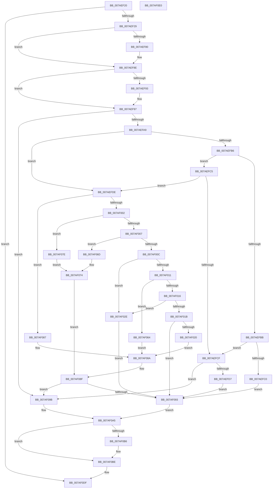

# PerfDiagpProxyWorker

- RVA: `0x007AEF20`–`0x007AF0E1` (길이 `449` bytes)
- VA: `0x00000001407AEF20`
- 실행 섹션: `PAGE`
- PDB 이름 있음: `예`; PDB Function 태그: `아니요`
- unwind 정보 RVA: `0x000D2F80`
- 디코드: `117`개 명령, `449/449` bytes 표시
- 미해석 바이트: `0` (있으면 어셈블리에 `.byte`로 보존)

> 이 문서는 커널 이미지의 기계어와 PDB 기호를 분석해 생성했습니다. 4번과 5번은 함수 원형과 자료형을 바이너리 사용 방식에서 추정한 C 해석이며 원본 소스 복구 결과는 아닙니다.

## 1. Dependencies

- 직접 호출 지점: **13**; 고유 호출 대상: **13**
- 직접 호출자로 확인된 함수: **0**
- RIP 상대 이미지 참조: **11**

### Outgoing calls
- `0x007AEF46` → [ExFreePoolWithTag](../../poolcode/B8/ExFreePoolWithTag_function_00B82870.md) (function, `0x00B82870`)
- `0x007AEF6F` → [KeAbPreAcquire](../../text/21/KeAbPreAcquire_function_00210230.md) (function, `0x00210230`)
- `0x007AEF89` → [ExfAcquirePushLockExclusiveEx](../../text/20/ExfAcquirePushLockExclusiveEx_function_0020FC90.md) (function, `0x0020FC90`)
- `0x007AEF97` → [PerfDiagpIsTracingAllowed](../AD/PerfDiagpIsTracingAllowed_function_00AD06C0.md) (function, `0x00AD06C0`)
- `0x007AEFDE` → [Feature_AddMemInfoToBootTrace__private_IsEnabledDeviceUsageNoInline](../../text/64/Feature_AddMemInfoToBootTrace__private_IsEnabledDeviceUsageNoInline_function_0064E2EC.md) (function, `0x0064E2EC`)
- `0x007AF020` → [PerfDiagpSaveActiveDCLLogFileName](../A9/PerfDiagpSaveActiveDCLLogFileName_function_00A9EB80.md) (function, `0x00A9EB80`)
- `0x007AF032` → [PerfDiagpInitializeLoggerInfo](PerfDiagpInitializeLoggerInfo_function_007AEE3C.md) (function, `0x007AEE3C`)
- `0x007AF05D` → [NtTraceControl](../A9/NtTraceControl_function_00A9ED40.md) (function, `0x00A9ED40`)
- `0x007AF077` → [PerfDiagpUpdatePerfDiagLoggerEnableFlags](PerfDiagpUpdatePerfDiagLoggerEnableFlags_function_007AF21C.md) (function, `0x007AF21C`)
- `0x007AF08A` → [PerfDiagpStartPerfDiagLogger](PerfDiagpStartPerfDiagLogger_function_007AF144.md) (function, `0x007AF144`)
- `0x007AF0B9` → [ExfTryToWakePushLock](../../text/26/ExfTryToWakePushLock_function_00265DD0.md) (function, `0x00265DD0`)
- `0x007AF0C1` → [KeAbPostRelease](../../text/2E/KeAbPostRelease_function_002E1600.md) (function, `0x002E1600`)
- `0x007AF0C6` → [KeLeaveCriticalRegion](../../text/25/KeLeaveCriticalRegion_function_0025D8B0.md) (function, `0x0025D8B0`)

### Direct callers
- 이 함수 시작 RVA로 연결되는 직접 call은 확인되지 않았습니다. 간접 호출은 완전히 역산할 수 없습니다.

### Static image references
- `0x007AEF54` → RVA `0x00EFFCA0` (`.data`; read)
- `0x007AEFA9` → RVA `0x00EFFCA8` (`.data`; read)
- `0x007AEFE5` → RVA `0x00B066E0` (` ?? ::NNGAKEGL::`string'`; read)
- `0x007AEFEC` → RVA `0x00B067E0` (` ?? ::NNGAKEGL::`string'`; read)
- `0x007AF025` → RVA `0x00B069E0` (` ?? ::NNGAKEGL::`string'`; read)
- `0x007AF037` → RVA `0x00EFFCD0` (`.data`; read)
- `0x007AF064` → RVA `0x00B06740` (` ?? ::NNGAKEGL::`string'`; read)
- `0x007AF06D` → RVA `0x00B067B0` (` ?? ::NNGAKEGL::`string'`; read)
- `0x007AF07E` → RVA `0x00B06690` (` ?? ::NNGAKEGL::`string'`; read)
- `0x007AF093` → RVA `0x00EFFCA8` (`.data`; write)
- `0x007AF0A5` → RVA `0x00EFFCA0` (`.data`; read/write)

## 2. Other-region calls and transfers

- 다른 실행 섹션으로 향하는 call: **7**
  - `0x007AEF46` → [ExFreePoolWithTag](../../poolcode/B8/ExFreePoolWithTag_function_00B82870.md) (`PAGE` → `POOLCODE`)
  - `0x007AEF6F` → [KeAbPreAcquire](../../text/21/KeAbPreAcquire_function_00210230.md) (`PAGE` → `.text`)
  - `0x007AEF89` → [ExfAcquirePushLockExclusiveEx](../../text/20/ExfAcquirePushLockExclusiveEx_function_0020FC90.md) (`PAGE` → `.text`)
  - `0x007AEFDE` → [Feature_AddMemInfoToBootTrace__private_IsEnabledDeviceUsageNoInline](../../text/64/Feature_AddMemInfoToBootTrace__private_IsEnabledDeviceUsageNoInline_function_0064E2EC.md) (`PAGE` → `.text`)
  - `0x007AF0B9` → [ExfTryToWakePushLock](../../text/26/ExfTryToWakePushLock_function_00265DD0.md) (`PAGE` → `.text`)
  - `0x007AF0C1` → [KeAbPostRelease](../../text/2E/KeAbPostRelease_function_002E1600.md) (`PAGE` → `.text`)
  - `0x007AF0C6` → [KeLeaveCriticalRegion](../../text/25/KeLeaveCriticalRegion_function_0025D8B0.md) (`PAGE` → `.text`)
- 별도 외부 분기/꼬리 이동을 확인하지 못했습니다.

## 3. Assembly (complete function range)

```asm
007AEF20  48 85 C9                        test rcx, rcx
007AEF23  0F 84 B6 01 00 00               je 0x1407af0df
007AEF29  48 8B C4                        mov rax, rsp
007AEF2C  48 89 58 10                     mov qword ptr [rax + 0x10], rbx
007AEF30  48 89 68 18                     mov qword ptr [rax + 0x18], rbp
007AEF34  48 89 70 20                     mov qword ptr [rax + 0x20], rsi
007AEF38  57                              push rdi
007AEF39  48 83 EC 30                     sub rsp, 0x30
007AEF3D  83 60 08 00                     and dword ptr [rax + 8], 0
007AEF41  33 D2                           xor edx, edx
007AEF43  8B 79 20                        mov edi, dword ptr [rcx + 0x20]
007AEF46  E8 25 39 3D 00                  call 0x140b82870
007AEF4B  65 48 8B 04 25 88 01 00 00      mov rax, qword ptr gs:[0x188]
007AEF54  48 8D 2D 45 0D 75 00            lea rbp, [rip + 0x750d45]
007AEF5B  48 83 CB FF                     or rbx, 0xffffffffffffffff
007AEF5F  45 33 C0                        xor r8d, r8d
007AEF62  33 D2                           xor edx, edx
007AEF64  48 8B CD                        mov rcx, rbp
007AEF67  66 01 98 E4 01 00 00            add word ptr [rax + 0x1e4], bx
007AEF6E  90                              nop
007AEF6F  E8 BC 12 A6 FF                  call 0x140210230
007AEF74  F0 48 0F BA 6D 00 00            lock bts qword ptr [rbp], 0
007AEF7B  48 8B F0                        mov rsi, rax
007AEF7E  73 0E                           jae 0x1407aef8e
007AEF80  4C 8B C5                        mov r8, rbp
007AEF83  48 8B D0                        mov rdx, rax
007AEF86  48 8B CD                        mov rcx, rbp
007AEF89  E8 02 0D A6 FF                  call 0x14020fc90
007AEF8E  48 85 F6                        test rsi, rsi
007AEF91  74 04                           je 0x1407aef97
007AEF93  C6 46 0A 01                     mov byte ptr [rsi + 0xa], 1
007AEF97  E8 24 17 32 00                  call 0x140ad06c0
007AEF9C  BE 02 00 00 00                  mov esi, 2
007AEFA1  85 C0                           test eax, eax
007AEFA3  0F 84 F2 00 00 00               je 0x1407af09b
007AEFA9  8B 0D F9 0C 75 00               mov ecx, dword ptr [rip + 0x750cf9]
007AEFAF  8D 47 FF                        lea eax, [rdi - 1]
007AEFB2  3B C8                           cmp ecx, eax
007AEFB4  74 28                           je 0x1407aefde
007AEFB6  83 FF 03                        cmp edi, 3
007AEFB9  75 0A                           jne 0x1407aefc5
007AEFBB  83 F9 01                        cmp ecx, 1
007AEFBE  75 0F                           jne 0x1407aefcf
007AEFC0  E9 CE 00 00 00                  jmp 0x1407af093
007AEFC5  8D 47 FB                        lea eax, [rdi - 5]
007AEFC8  A9 FD FF FF FF                  test eax, 0xfffffffd
007AEFCD  74 0F                           je 0x1407aefde
007AEFCF  3B F9                           cmp edi, ecx
007AEFD1  0F 8D C4 00 00 00               jge 0x1407af09b
007AEFD7  8B F9                           mov edi, ecx
007AEFD9  E9 B5 00 00 00                  jmp 0x1407af093
007AEFDE  E8 09 F3 E9 FF                  call 0x14064e2ec
007AEFE3  85 C0                           test eax, eax
007AEFE5  48 8D 0D F4 76 35 00            lea rcx, [rip + 0x3576f4]
007AEFEC  4C 8D 05 ED 77 35 00            lea r8, [rip + 0x3577ed]
007AEFF3  4C 0F 44 C1                     cmove r8, rcx
007AEFF7  8B CF                           mov ecx, edi
007AEFF9  83 E9 01                        sub ecx, 1
007AEFFC  0F 84 85 00 00 00               je 0x1407af087
007AF002  83 E9 01                        sub ecx, 1
007AF005  74 77                           je 0x1407af07e
007AF007  83 E9 01                        sub ecx, 1
007AF00A  74 61                           je 0x1407af06d
007AF00C  83 E9 01                        sub ecx, 1
007AF00F  74 1D                           je 0x1407af02e
007AF011  83 E9 01                        sub ecx, 1
007AF014  74 4E                           je 0x1407af064
007AF016  83 E9 01                        sub ecx, 1
007AF019  74 13                           je 0x1407af02e
007AF01B  83 F9 01                        cmp ecx, 1
007AF01E  75 73                           jne 0x1407af093
007AF020  E8 5B FB 2E 00                  call 0x140a9eb80
007AF025  48 8D 0D B4 79 35 00            lea rcx, [rip + 0x3579b4]
007AF02C  EB 5C                           jmp 0x1407af08a
007AF02E  33 D2                           xor edx, edx
007AF030  33 C9                           xor ecx, ecx
007AF032  E8 05 FE FF FF                  call 0x1407aee3c
007AF037  44 8B 05 92 0C 75 00            mov r8d, dword ptr [rip + 0x750c92]
007AF03E  48 8D 44 24 40                  lea rax, [rsp + 0x40]
007AF043  48 89 44 24 28                  mov qword ptr [rsp + 0x28], rax
007AF048  4C 8D 0D 81 0C 75 00            lea r9, [rip + 0x750c81]
007AF04F  48 8D 15 7A 0C 75 00            lea rdx, [rip + 0x750c7a]
007AF056  44 89 44 24 20                  mov dword ptr [rsp + 0x20], r8d
007AF05B  8B CE                           mov ecx, esi
007AF05D  E8 DE FC 2E 00                  call 0x140a9ed40
007AF062  EB 2F                           jmp 0x1407af093
007AF064  48 8D 0D D5 76 35 00            lea rcx, [rip + 0x3576d5]
007AF06B  EB 1D                           jmp 0x1407af08a
007AF06D  48 8D 15 3C 77 35 00            lea rdx, [rip + 0x35773c]
007AF074  49 8B C8                        mov rcx, r8
007AF077  E8 A0 01 00 00                  call 0x1407af21c
007AF07C  EB 11                           jmp 0x1407af08f
007AF07E  48 8D 15 0B 76 35 00            lea rdx, [rip + 0x35760b]
007AF085  EB ED                           jmp 0x1407af074
007AF087  49 8B C8                        mov rcx, r8
007AF08A  E8 B5 00 00 00                  call 0x1407af144
007AF08F  85 C0                           test eax, eax
007AF091  78 08                           js 0x1407af09b
007AF093  89 3D 0F 0C 75 00               mov dword ptr [rip + 0x750c0f], edi
007AF099  EB 0A                           jmp 0x1407af0a5
007AF09B  C7 05 03 0C 75 00 08 00 00 00   mov dword ptr [rip + 0x750c03], 8
007AF0A5  F0 48 0F C1 1D F2 0B 75 00      lock xadd qword ptr [rip + 0x750bf2], rbx
007AF0AE  80 E3 06                        and bl, 6
007AF0B1  40 3A DE                        cmp bl, sil
007AF0B4  75 08                           jne 0x1407af0be
007AF0B6  48 8B CD                        mov rcx, rbp
007AF0B9  E8 12 6D AB FF                  call 0x140265dd0
007AF0BE  48 8B CD                        mov rcx, rbp
007AF0C1  E8 3A 25 B3 FF                  call 0x1402e1600
007AF0C6  E8 E5 E7 AA FF                  call 0x14025d8b0
007AF0CB  48 8B 5C 24 48                  mov rbx, qword ptr [rsp + 0x48]
007AF0D0  48 8B 6C 24 50                  mov rbp, qword ptr [rsp + 0x50]
007AF0D5  48 8B 74 24 58                  mov rsi, qword ptr [rsp + 0x58]
007AF0DA  48 83 C4 30                     add rsp, 0x30
007AF0DE  5F                              pop rdi
007AF0DF  C3                              ret
007AF0E0  CC                              int3
```

## 4. C-style interpretation (structured pseudocode)

```c
__int64 __fastcall PerfDiagpProxyWorker(__int64 a1, int a2, int a3)
{
    __int64 result;
    __int64 v_rbx;
    __int64 v_rsp;
    unsigned __int64 v_stack_m10;
    unsigned int v_stack_m18;
    unsigned __int64 v_stack_p10;
    unsigned __int64 v_stack_p18;
    unsigned __int64 v_stack_p20;
    unsigned __int64 v_stack_p8;

    if (a1 == 0) goto loc_007AF0DF;
    *(unsigned __int64 *)(v_rsp + 16) = v_rbx;
    *(unsigned __int64 *)(v_rsp + 24) = v_rbp;
    *(unsigned __int64 *)(v_rsp + 32) = v_rsi;
    v_rsp = (v_rsp) - (48);
    a2 = 0;
    result = ExFreePoolWithTag(a1, a2, a3, a4);
    v_rbx = (v_rbx) | (-1);
    a3 = 0;
    a2 = 0;
    result = KeAbPreAcquire(v_rip + 7671109, a2, a3, a4);
    if (!(condition_is_above_or_equal)) {
        a3 = v_rip + 7671109;
        a2 = result;
        a1 = v_rip + 7671109;
        result = ExfAcquirePushLockExclusiveEx(a1, a2, a3, a4);
    }
    if (result != 0) {
        *(unsigned __int8 *)(result + 10) = 1;
    }
    result = PerfDiagpIsTracingAllowed(a1, a2, a3, a4);
    if ((unsigned int)(result) == 0) goto loc_007AF09B;
    if (((unsigned int)((unsigned int)(*(unsigned int *)(v_rip + 7671033)))) == ((unsigned int)((unsigned int)(*(unsigned int *)(a1 + 32)) - 1))) goto loc_007AEFDE;
    if (((unsigned int)((unsigned int)(*(unsigned int *)(a1 + 32)))) != 3) goto loc_007AEFC5;
    if (((unsigned int)((unsigned int)(*(unsigned int *)(v_rip + 7671033)))) != 1) goto loc_007AEFCF;
    goto loc_007AF093;
loc_007AEFC5:
    if ((((unsigned int)((unsigned int)(*(unsigned int *)(a1 + 32)) - 5)) & (0xFFFFFFFDULL)) == 0) goto loc_007AEFDE;
loc_007AEFCF:
    if (((unsigned int)((unsigned int)(*(unsigned int *)(a1 + 32)))) >= ((unsigned int)((unsigned int)(*(unsigned int *)(v_rip + 7671033))))) goto loc_007AF09B;
    goto loc_007AF093;
loc_007AEFDE:
    result = Feature_AddMemInfoToBootTrace__private_IsEnabledDeviceUsageNoInline((unsigned int)(*(unsigned int *)(v_rip + 7671033)), a2, a3, a4);
    a3 = v_rip + 3504109;
    if ((unsigned int)(result) == 0) { a3 = v_rip + 3503860; }
    a1 = (unsigned int)(((unsigned int)((unsigned int)((unsigned int)((unsigned int)((unsigned int)(*(unsigned int *)(v_rip + 7671033))))))) - (1));
    if (condition_is_equal) goto loc_007AF087;
    a1 = (unsigned int)((a1) - (1));
    if (condition_is_equal) goto loc_007AF07E;
    a1 = (unsigned int)((a1) - (1));
    if (condition_is_equal) goto loc_007AF06D;
    a1 = (unsigned int)((a1) - (1));
    if (condition_is_equal) goto loc_007AF02E;
    a1 = (unsigned int)((a1) - (1));
    if (condition_is_equal) goto loc_007AF064;
    a1 = (unsigned int)((a1) - (1));
    if (condition_is_equal) goto loc_007AF02E;
    if (((unsigned int)(a1)) != 1) goto loc_007AF093;
    result = PerfDiagpSaveActiveDCLLogFileName(a1, a2, a3, a4);
    goto loc_007AF08A;
loc_007AF02E:
    a2 = 0;
    a1 = 0;
    result = PerfDiagpInitializeLoggerInfo(a1, a2, a3, a4);
    v_stack_m10 = v_stack_p8;
    v_stack_m18 = (unsigned int)((unsigned int)(*(unsigned int *)(v_rip + 7670930)));
    result = NtTraceControl(2, v_rip + 7670906, (unsigned int)(*(unsigned int *)(v_rip + 7670930)), v_rip + 7670913);
    goto loc_007AF093;
loc_007AF064:
    goto loc_007AF08A;
loc_007AF06D:
loc_007AF074:
    result = PerfDiagpUpdatePerfDiagLoggerEnableFlags((unsigned int)(*(unsigned int *)(v_rip + 7670930)), v_rip + 3503932, (unsigned int)(*(unsigned int *)(v_rip + 7670930)), v_rip + 7670913);
    goto loc_007AF08F;
loc_007AF07E:
    goto loc_007AF074;
loc_007AF087:
loc_007AF08A:
    result = PerfDiagpStartPerfDiagLogger((unsigned int)(*(unsigned int *)(v_rip + 7670930)), v_rip + 3503627, (unsigned int)(*(unsigned int *)(v_rip + 7670930)), v_rip + 7670913);
loc_007AF08F:
    if (sign_flag) goto loc_007AF09B;
loc_007AF093:
    *(unsigned int *)(v_rip + 7670799) = (unsigned int)((unsigned int)((unsigned int)((unsigned int)(*(unsigned int *)(v_rip + 7671033)))));
    goto loc_007AF0A5;
loc_007AF09B:
    *(unsigned int *)(v_rip + 7670787) = 8;
loc_007AF0A5:
    v_rbx = (unsigned __int8)((v_rbx) & (6));
    if (((unsigned __int8)(v_rbx)) == 2) {
        a1 = v_rip + 7671109;
        result = ExfTryToWakePushLock(a1, v_rip + 3503627, (unsigned int)(*(unsigned int *)(v_rip + 7670930)), v_rip + 7670913);
    }
    result = KeAbPostRelease(v_rip + 7671109, v_rip + 3503627, (unsigned int)(*(unsigned int *)(v_rip + 7670930)), v_rip + 7670913);
    result = KeLeaveCriticalRegion(v_rip + 7671109, v_rip + 3503627, (unsigned int)(*(unsigned int *)(v_rip + 7670930)), v_rip + 7670913);
    v_rsp = (v_rsp) + (48);
loc_007AF0DF:
    return result;
}
```

## 5. (Beta) C Style

```c
int64_t PerfDiagpProxyWorker(int64_t Arg1, int32_t Arg2, int32_t Arg3)
{
    int64_t result;
    int64_t local_rbx;
    int64_t local_rsp;
    uint64_t v_stack_m10;
    uint32_t v_stack_m18;
    uint64_t v_stack_p10;
    uint64_t v_stack_p18;
    uint64_t v_stack_p20;
    uint64_t v_stack_p8;

    if (Arg1 == 0) goto loc_007AF0DF;
    *(uint64_t *)(local_rsp + 0x10) = local_rbx;
    *(uint64_t *)(local_rsp + 0x18) = local_rbp;
    *(uint64_t *)(local_rsp + 0x20) = local_rsi;
    local_rsp = (local_rsp) - (48);
    Arg2 = 0;
    result = ExFreePoolWithTag(Arg1, Arg2, Arg3, a4);
    local_rbx = (local_rbx) | (-1);
    Arg3 = 0;
    Arg2 = 0;
    result = KeAbPreAcquire(v_rip + 7671109, Arg2, Arg3, a4);
    if (!(condition_is_above_or_equal)) {
        Arg3 = v_rip + 7671109;
        Arg2 = result;
        Arg1 = v_rip + 7671109;
        result = ExfAcquirePushLockExclusiveEx(Arg1, Arg2, Arg3, a4);
    }
    if (result != 0) {
        *(uint8_t *)(result + 0xA) = 1;
    }
    result = PerfDiagpIsTracingAllowed(Arg1, Arg2, Arg3, a4);
    if ((uint32_t)(result) == 0) goto loc_007AF09B;
    if (((uint32_t)((uint32_t)(*(uint32_t *)(v_rip + 0x750CF9)))) == ((uint32_t)((uint32_t)(*(uint32_t *)(Arg1 + 0x20)) - 1))) goto loc_007AEFDE;
    if (((uint32_t)((uint32_t)(*(uint32_t *)(Arg1 + 0x20)))) != 3) goto loc_007AEFC5;
    if (((uint32_t)((uint32_t)(*(uint32_t *)(v_rip + 0x750CF9)))) != 1) goto loc_007AEFCF;
    goto loc_007AF093;
loc_007AEFC5:
    if ((((uint32_t)((uint32_t)(*(uint32_t *)(Arg1 + 0x20)) - 5)) & (0xFFFFFFFDULL)) == 0) goto loc_007AEFDE;
loc_007AEFCF:
    if (((uint32_t)((uint32_t)(*(uint32_t *)(Arg1 + 0x20)))) >= ((uint32_t)((uint32_t)(*(uint32_t *)(v_rip + 0x750CF9))))) goto loc_007AF09B;
    goto loc_007AF093;
loc_007AEFDE:
    result = Feature_AddMemInfoToBootTrace__private_IsEnabledDeviceUsageNoInline((uint32_t)(*(uint32_t *)(v_rip + 0x750CF9)), Arg2, Arg3, a4);
    Arg3 = v_rip + 3504109;
    if ((uint32_t)(result) == 0) { Arg3 = v_rip + 3503860; }
    Arg1 = (uint32_t)(((uint32_t)((uint32_t)((uint32_t)((uint32_t)((uint32_t)(*(uint32_t *)(v_rip + 0x750CF9))))))) - (1));
    if (condition_is_equal) goto loc_007AF087;
    Arg1 = (uint32_t)((Arg1) - (1));
    if (condition_is_equal) goto loc_007AF07E;
    Arg1 = (uint32_t)((Arg1) - (1));
    if (condition_is_equal) goto loc_007AF06D;
    Arg1 = (uint32_t)((Arg1) - (1));
    if (condition_is_equal) goto loc_007AF02E;
    Arg1 = (uint32_t)((Arg1) - (1));
    if (condition_is_equal) goto loc_007AF064;
    Arg1 = (uint32_t)((Arg1) - (1));
    if (condition_is_equal) goto loc_007AF02E;
    if (((uint32_t)(Arg1)) != 1) goto loc_007AF093;
    result = PerfDiagpSaveActiveDCLLogFileName(Arg1, Arg2, Arg3, a4);
    goto loc_007AF08A;
loc_007AF02E:
    Arg2 = 0;
    Arg1 = 0;
    result = PerfDiagpInitializeLoggerInfo(Arg1, Arg2, Arg3, a4);
    v_stack_m10 = v_stack_p8;
    v_stack_m18 = (uint32_t)((uint32_t)(*(uint32_t *)(v_rip + 0x750C92)));
    result = NtTraceControl(2, v_rip + 7670906, (uint32_t)(*(uint32_t *)(v_rip + 0x750C92)), v_rip + 7670913);
    goto loc_007AF093;
loc_007AF064:
    goto loc_007AF08A;
loc_007AF06D:
loc_007AF074:
    result = PerfDiagpUpdatePerfDiagLoggerEnableFlags((uint32_t)(*(uint32_t *)(v_rip + 0x750C92)), v_rip + 3503932, (uint32_t)(*(uint32_t *)(v_rip + 0x750C92)), v_rip + 7670913);
    goto loc_007AF08F;
loc_007AF07E:
    goto loc_007AF074;
loc_007AF087:
loc_007AF08A:
    result = PerfDiagpStartPerfDiagLogger((uint32_t)(*(uint32_t *)(v_rip + 0x750C92)), v_rip + 3503627, (uint32_t)(*(uint32_t *)(v_rip + 0x750C92)), v_rip + 7670913);
loc_007AF08F:
    if (sign_flag) goto loc_007AF09B;
loc_007AF093:
    *(uint32_t *)(v_rip + 0x750C0F) = (uint32_t)((uint32_t)((uint32_t)((uint32_t)(*(uint32_t *)(v_rip + 0x750CF9)))));
    goto loc_007AF0A5;
loc_007AF09B:
    *(uint32_t *)(v_rip + 0x750C03) = 8;
loc_007AF0A5:
    local_rbx = (uint8_t)((local_rbx) & (6));
    if (((uint8_t)(local_rbx)) == 2) {
        Arg1 = v_rip + 7671109;
        result = ExfTryToWakePushLock(Arg1, v_rip + 3503627, (uint32_t)(*(uint32_t *)(v_rip + 0x750C92)), v_rip + 7670913);
    }
    result = KeAbPostRelease(v_rip + 7671109, v_rip + 3503627, (uint32_t)(*(uint32_t *)(v_rip + 0x750C92)), v_rip + 7670913);
    result = KeLeaveCriticalRegion(v_rip + 7671109, v_rip + 3503627, (uint32_t)(*(uint32_t *)(v_rip + 0x750C92)), v_rip + 7670913);
    local_rsp = (local_rsp) + (48);
loc_007AF0DF:
    return result;
}
```

## 6. Execution-region graph

[열기: 2D/3D 그래프와 함수 탐색 컨트롤 패널](../../../control-panel.html?section=page&rva=0x007AEF20&view=graph)

- 2D 그래프는 위에서 아래로 흐르고, 3D 그래프는 빈 공간을 드래그해 회전합니다. Shift+드래그는 이동, 휠은 확대·축소, 함수 노드 선택은 대상 보고서 이동입니다.

### Static fallback


