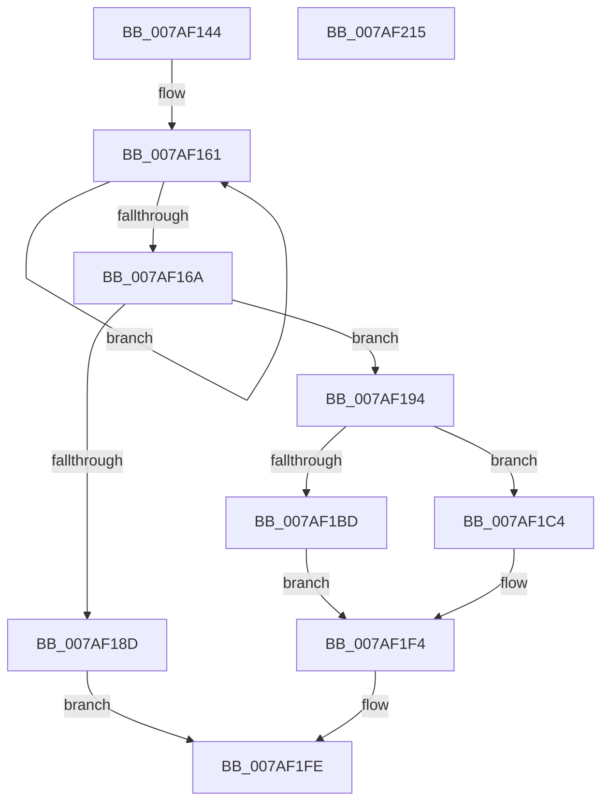

# PerfDiagpStartPerfDiagLogger

- RVA: `0x007AF144`–`0x007AF216` (길이 `210` bytes)
- VA: `0x00000001407AF144`
- 실행 섹션: `PAGE`
- PDB 이름 있음: `예`; PDB Function 태그: `아니요`
- unwind 정보 RVA: `0x0005C954`
- 디코드: `55`개 명령, `210/210` bytes 표시
- 미해석 바이트: `0` (있으면 어셈블리에 `.byte`로 보존)

> 이 문서는 커널 이미지의 기계어와 PDB 기호를 분석해 생성했습니다. 4번과 5번은 함수 원형과 자료형을 바이너리 사용 방식에서 추정한 C 해석이며 원본 소스 복구 결과는 아닙니다.

## 1. Dependencies

- 직접 호출 지점: **6**; 고유 호출 대상: **6**
- 직접 호출자로 확인된 함수: **1**
- RIP 상대 이미지 참조: **5**

### Outgoing calls
- `0x007AF180` → [ExAllocatePool2](../../poolcode/B8/ExAllocatePool2_function_00B820F0.md) (function, `0x00B820F0`)
- `0x007AF1A1` → [RtlStringCbCopyW](../../text/43/RtlStringCbCopyW_function_0043B910.md) (function, `0x0043B910`)
- `0x007AF1AF` → [RtlStringCbCatW](../../text/45/RtlStringCbCatW_function_00453E24.md) (function, `0x00453E24`)
- `0x007AF1B4` → [PerfDiagpIsTracingAllowed](../AD/PerfDiagpIsTracingAllowed_function_00AD06C0.md) (function, `0x00AD06C0`)
- `0x007AF1ED` → [EtwStartAutoLogger](../7B/EtwStartAutoLogger_function_007BD2F8.md) (function, `0x007BD2F8`)
- `0x007AF1F9` → [ExFreePoolWithTag](../../poolcode/B8/ExFreePoolWithTag_function_00B82870.md) (function, `0x00B82870`)

### Direct callers
- [PerfDiagpProxyWorker](PerfDiagpProxyWorker_function_007AEF20.md) at `0x007AF08A`

### Static image references
- `0x007AF194` → RVA `0x00B06970` (` ?? ::NNGAKEGL::`string'`; read)
- `0x007AF1C4` → RVA `0x00B06A70` (` ?? ::NNGAKEGL::`string'`; read)
- `0x007AF1D1` → RVA `0x00B06A80` (`PAGE`; read)
- `0x007AF1D8` → RVA `0x00EFFCAC` (`.data`; read)
- `0x007AF1E6` → RVA `0x00EFFCBC` (`.data`; read)

## 2. Other-region calls and transfers

- 다른 실행 섹션으로 향하는 call: **4**
  - `0x007AF180` → [ExAllocatePool2](../../poolcode/B8/ExAllocatePool2_function_00B820F0.md) (`PAGE` → `POOLCODE`)
  - `0x007AF1A1` → [RtlStringCbCopyW](../../text/43/RtlStringCbCopyW_function_0043B910.md) (`PAGE` → `.text`)
  - `0x007AF1AF` → [RtlStringCbCatW](../../text/45/RtlStringCbCatW_function_00453E24.md) (`PAGE` → `.text`)
  - `0x007AF1F9` → [ExFreePoolWithTag](../../poolcode/B8/ExFreePoolWithTag_function_00B82870.md) (`PAGE` → `POOLCODE`)
- 별도 외부 분기/꼬리 이동을 확인하지 못했습니다.

## 3. Assembly (complete function range)

```asm
007AF144  48 89 5C 24 08                  mov qword ptr [rsp + 8], rbx
007AF149  48 89 6C 24 10                  mov qword ptr [rsp + 0x10], rbp
007AF14E  48 89 74 24 18                  mov qword ptr [rsp + 0x18], rsi
007AF153  57                              push rdi
007AF154  48 83 EC 20                     sub rsp, 0x20
007AF158  48 83 C8 FF                     or rax, 0xffffffffffffffff
007AF15C  48 8B D9                        mov rbx, rcx
007AF15F  33 ED                           xor ebp, ebp
007AF161  48 FF C0                        inc rax
007AF164  66 39 2C 41                     cmp word ptr [rcx + rax*2], bp
007AF168  75 F7                           jne 0x1407af161
007AF16A  8D 04 45 68 00 00 00            lea eax, [rax*2 + 0x68]
007AF171  41 B8 50 52 46 64               mov r8d, 0x64465250
007AF177  8B D0                           mov edx, eax
007AF179  B9 00 01 00 00                  mov ecx, 0x100
007AF17E  8B F0                           mov esi, eax
007AF180  E8 6B 2F 3D 00                  call 0x140b820f0
007AF185  48 8B F8                        mov rdi, rax
007AF188  48 85 C0                        test rax, rax
007AF18B  75 07                           jne 0x1407af194
007AF18D  BB 17 00 00 C0                  mov ebx, 0xc0000017
007AF192  EB 6A                           jmp 0x1407af1fe
007AF194  4C 8D 05 D5 77 35 00            lea r8, [rip + 0x3577d5]
007AF19B  48 8B D6                        mov rdx, rsi
007AF19E  48 8B CF                        mov rcx, rdi
007AF1A1  E8 6A C7 C8 FF                  call 0x14043b910
007AF1A6  4C 8B C3                        mov r8, rbx
007AF1A9  48 8B D6                        mov rdx, rsi
007AF1AC  48 8B CF                        mov rcx, rdi
007AF1AF  E8 70 4C CA FF                  call 0x140453e24
007AF1B4  E8 07 15 32 00                  call 0x140ad06c0
007AF1B9  85 C0                           test eax, eax
007AF1BB  75 07                           jne 0x1407af1c4
007AF1BD  BB 01 00 00 C0                  mov ebx, 0xc0000001
007AF1C2  EB 30                           jmp 0x1407af1f4
007AF1C4  0F 10 05 A5 78 35 00            movups xmm0, xmmword ptr [rip + 0x3578a5]
007AF1CB  45 33 C0                        xor r8d, r8d
007AF1CE  48 8B D7                        mov rdx, rdi
007AF1D1  0F 10 0D A8 78 35 00            movups xmm1, xmmword ptr [rip + 0x3578a8]
007AF1D8  48 8D 0D CD 0A 75 00            lea rcx, [rip + 0x750acd]
007AF1DF  0F 11 05 C6 0A 75 00            movups xmmword ptr [rip + 0x750ac6], xmm0
007AF1E6  0F 11 0D CF 0A 75 00            movups xmmword ptr [rip + 0x750acf], xmm1
007AF1ED  E8 06 E1 00 00                  call 0x1407bd2f8
007AF1F2  8B D8                           mov ebx, eax
007AF1F4  33 D2                           xor edx, edx
007AF1F6  48 8B CF                        mov rcx, rdi
007AF1F9  E8 72 36 3D 00                  call 0x140b82870
007AF1FE  48 8B 6C 24 38                  mov rbp, qword ptr [rsp + 0x38]
007AF203  8B C3                           mov eax, ebx
007AF205  48 8B 5C 24 30                  mov rbx, qword ptr [rsp + 0x30]
007AF20A  48 8B 74 24 40                  mov rsi, qword ptr [rsp + 0x40]
007AF20F  48 83 C4 20                     add rsp, 0x20
007AF213  5F                              pop rdi
007AF214  C3                              ret
007AF215  CC                              int3
```

## 4. C-style interpretation (structured pseudocode)

```c
__int64 __fastcall PerfDiagpStartPerfDiagLogger(__int64 a1)
{
    __int64 result;
    __int64 v_rbp;
    __int64 v_rsp;
    unsigned __int64 v_stack_p10;
    unsigned __int64 v_stack_p18;
    unsigned __int64 v_stack_p8;

    v_stack_p8 = v_rbx;
    v_stack_p10 = v_rbp;
    v_stack_p18 = v_rsi;
    v_rsp = (v_rsp) - (32);
    result = (result) | (-1);
    v_rbp = 0;
loc_007AF161:
    result = (result) + 1;
    if ((*(unsigned __int16 *)(a1 + result * 2)) != 0) goto loc_007AF161;
    result = ExAllocatePool2(256, (unsigned int)((unsigned int)(result * 2 + 104)), (unsigned int)(0x64465250ULL), a4);
    if (result != 0) goto loc_007AF194;
    goto loc_007AF1FE;
loc_007AF194:
    result = RtlStringCbCopyW(result, (unsigned int)((unsigned int)(result * 2 + 104)), v_rip + 3504085, a4);
    result = RtlStringCbCatW(result, (unsigned int)((unsigned int)(result * 2 + 104)), (unsigned int)(0xC0000017ULL), a4);
    result = PerfDiagpIsTracingAllowed(result, (unsigned int)((unsigned int)(result * 2 + 104)), (unsigned int)(0xC0000017ULL), a4);
    if ((unsigned int)(result) != 0) goto loc_007AF1C4;
    goto loc_007AF1F4;
loc_007AF1C4:
    a3 = 0;
    *(unsigned __int64 *)(v_rip + 7670470) = v_xmm0;
    *(unsigned __int64 *)(v_rip + 7670479) = v_xmm1;
    result = EtwStartAutoLogger(v_rip + 7670477, result, a3, a4);
loc_007AF1F4:
    a2 = 0;
    result = ExFreePoolWithTag(result, a2, a3, a4);
loc_007AF1FE:
    v_rsp = (v_rsp) + (32);
    return (unsigned int)((unsigned int)((unsigned int)((unsigned int)(result))));
}
```

## 5. (Beta) C Style

```c
int64_t PerfDiagpStartPerfDiagLogger(void *Arg1)
{
    uint8_t *arg1 = (uint8_t *)Arg1;

    int64_t result;
    int64_t local_rbp;
    int64_t local_rsp;
    uint64_t v_stack_p10;
    uint64_t v_stack_p18;
    uint64_t v_stack_p8;

    v_stack_p8 = local_rbx;
    v_stack_p10 = local_rbp;
    v_stack_p18 = local_rsi;
    local_rsp = (local_rsp) - (32);
    result = (result) | (-1);
    local_rbp = 0;
loc_007AF161:
    result = (result) + 1;
    if ((*(uint16_t *)(arg1 + result * 2)) != 0) goto loc_007AF161;
    result = ExAllocatePool2(256, (uint32_t)((uint32_t)(result * 2 + 104)), (uint32_t)(0x64465250ULL), a4);
    if (result != 0) goto loc_007AF194;
    goto loc_007AF1FE;
loc_007AF194:
    result = RtlStringCbCopyW(result, (uint32_t)((uint32_t)(result * 2 + 104)), v_rip + 3504085, a4);
    result = RtlStringCbCatW(result, (uint32_t)((uint32_t)(result * 2 + 104)), (uint32_t)(0xC0000017ULL), a4);
    result = PerfDiagpIsTracingAllowed(result, (uint32_t)((uint32_t)(result * 2 + 104)), (uint32_t)(0xC0000017ULL), a4);
    if ((uint32_t)(result) != 0) goto loc_007AF1C4;
    goto loc_007AF1F4;
loc_007AF1C4:
    a3 = 0;
    *(uint64_t *)(v_rip + 0x750AC6) = v_xmm0;
    *(uint64_t *)(v_rip + 0x750ACF) = v_xmm1;
    result = EtwStartAutoLogger(v_rip + 7670477, result, a3, a4);
loc_007AF1F4:
    a2 = 0;
    result = ExFreePoolWithTag(result, a2, a3, a4);
loc_007AF1FE:
    local_rsp = (local_rsp) + (32);
    return (uint32_t)((uint32_t)((uint32_t)((uint32_t)(result))));
}
```

### 관측된 메모리 오프셋

구조체 형식이 확인되지 않은 접근은 인자 기준의 오프셋으로만 기록했습니다.

| 기준 인자 | 오프셋 표현 | 폭 (bit) | 접근 |
|---|---:|---:|---|
| `Arg1` | `+ 0x0 + rax*2` | `16` | `R` |

## 6. Execution-region graph

[열기: 2D/3D 그래프와 함수 탐색 컨트롤 패널](../../../control-panel.html?section=page&rva=0x007AF144&view=graph)

- 2D 그래프는 위에서 아래로 흐르고, 3D 그래프는 빈 공간을 드래그해 회전합니다. Shift+드래그는 이동, 휠은 확대·축소, 함수 노드 선택은 대상 보고서 이동입니다.

### Static fallback


