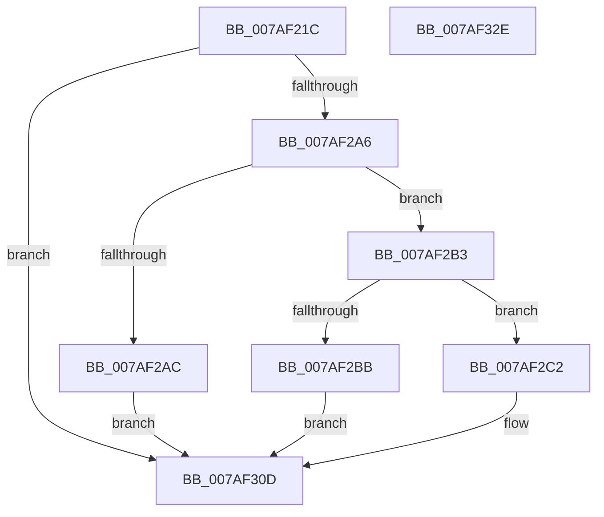

# PerfDiagpUpdatePerfDiagLoggerEnableFlags

- RVA: `0x007AF21C`–`0x007AF32F` (길이 `275` bytes)
- VA: `0x00000001407AF21C`
- 실행 섹션: `PAGE`
- PDB 이름 있음: `예`; PDB Function 태그: `아니요`
- unwind 정보 RVA: `0x000CCEF0`
- 디코드: `68`개 명령, `275/275` bytes 표시
- 미해석 바이트: `0` (있으면 어셈블리에 `.byte`로 보존)

> 이 문서는 커널 이미지의 기계어와 PDB 기호를 분석해 생성했습니다. 4번과 5번은 함수 원형과 자료형을 바이너리 사용 방식에서 추정한 C 해석이며 원본 소스 복구 결과는 아닙니다.

## 1. Dependencies

- 직접 호출 지점: **6**; 고유 호출 대상: **6**
- 직접 호출자로 확인된 함수: **1**
- RIP 상대 이미지 참조: **3**

### Outgoing calls
- `0x007AF264` → [memset](../../text/6C/memset_function_006C6C40.md) (function, `0x006C6C40`)
- `0x007AF29D` → [RtlpQueryRegistryValues](../8C/RtlpQueryRegistryValues_function_008C9050.md) (function, `0x008C9050`)
- `0x007AF2D0` → [memcpy](../../text/6C/memcpy_function_006C6840.md) (function, `0x006C6840`)
- `0x007AF2DF` → [PerfDiagpInitializeLoggerInfo](PerfDiagpInitializeLoggerInfo_function_007AEE3C.md) (function, `0x007AEE3C`)
- `0x007AF308` → [NtTraceControl](../A9/NtTraceControl_function_00A9ED40.md) (function, `0x00A9ED40`)
- `0x007AF314` → [_security_check_cookie](../../text/6A/_security_check_cookie_function_006AC640.md) (function, `0x006AC640`)

### Direct callers
- [PerfDiagpProxyWorker](PerfDiagpProxyWorker_function_007AEF20.md) at `0x007AF077`

### Static image references
- `0x007AF233` → RVA `0x00E0A740` (`.data`; read)
- `0x007AF2C9` → RVA `0x00EFFD88` (`.data`; read)
- `0x007AF2E4` → RVA `0x00EFFCD0` (`.data`; read)

## 2. Other-region calls and transfers

- 다른 실행 섹션으로 향하는 call: **3**
  - `0x007AF264` → [memset](../../text/6C/memset_function_006C6C40.md) (`PAGE` → `.text`)
  - `0x007AF2D0` → [memcpy](../../text/6C/memcpy_function_006C6840.md) (`PAGE` → `.text`)
  - `0x007AF314` → [_security_check_cookie](../../text/6A/_security_check_cookie_function_006AC640.md) (`PAGE` → `.text`)
- 별도 외부 분기/꼬리 이동을 확인하지 못했습니다.

## 3. Assembly (complete function range)

```asm
007AF21C  48 89 5C 24 10                  mov qword ptr [rsp + 0x10], rbx
007AF221  48 89 7C 24 18                  mov qword ptr [rsp + 0x18], rdi
007AF226  55                              push rbp
007AF227  48 8D 6C 24 A9                  lea rbp, [rsp - 0x57]
007AF22C  48 81 EC F0 00 00 00            sub rsp, 0xf0
007AF233  48 8B 05 06 B5 65 00            mov rax, qword ptr [rip + 0x65b506]
007AF23A  48 33 C4                        xor rax, rsp
007AF23D  48 89 45 47                     mov qword ptr [rbp + 0x47], rax
007AF241  83 65 97 00                     and dword ptr [rbp - 0x69], 0
007AF245  0F 57 C0                        xorps xmm0, xmm0
007AF248  48 8B DA                        mov rbx, rdx
007AF24B  48 8B F9                        mov rdi, rcx
007AF24E  33 D2                           xor edx, edx
007AF250  48 8D 4D A7                     lea rcx, [rbp - 0x59]
007AF254  0F 11 45 17                     movups xmmword ptr [rbp + 0x17], xmm0
007AF258  0F 11 45 27                     movups xmmword ptr [rbp + 0x27], xmm0
007AF25C  44 8D 42 70                     lea r8d, [rdx + 0x70]
007AF260  0F 11 45 37                     movups xmmword ptr [rbp + 0x37], xmm0
007AF264  E8 D7 79 F1 FF                  call 0x1406c6c40
007AF269  45 33 C9                        xor r9d, r9d
007AF26C  C7 45 AF 20 00 00 00            mov dword ptr [rbp - 0x51], 0x20
007AF273  48 8D 45 17                     lea rax, [rbp + 0x17]
007AF277  48 89 5D B7                     mov qword ptr [rbp - 0x49], rbx
007AF27B  4C 8D 45 A7                     lea r8, [rbp - 0x59]
007AF27F  48 89 45 BF                     mov qword ptr [rbp - 0x41], rax
007AF283  48 8B D7                        mov rdx, rdi
007AF286  C7 45 C7 03 00 00 00            mov dword ptr [rbp - 0x39], 3
007AF28D  41 8D 49 02                     lea ecx, [r9 + 2]
007AF291  C7 45 17 30 00 00 00            mov dword ptr [rbp + 0x17], 0x30
007AF298  C6 44 24 28 01                  mov byte ptr [rsp + 0x28], 1
007AF29D  E8 AE 9D 11 00                  call 0x1408c9050
007AF2A2  85 C0                           test eax, eax
007AF2A4  78 67                           js 0x1407af30d
007AF2A6  83 7D 1B 03                     cmp dword ptr [rbp + 0x1b], 3
007AF2AA  74 07                           je 0x1407af2b3
007AF2AC  B8 0D 00 00 C0                  mov eax, 0xc000000d
007AF2B1  EB 5A                           jmp 0x1407af30d
007AF2B3  8B 5D 17                        mov ebx, dword ptr [rbp + 0x17]
007AF2B6  83 FB 28                        cmp ebx, 0x28
007AF2B9  76 07                           jbe 0x1407af2c2
007AF2BB  B8 23 00 00 C0                  mov eax, 0xc0000023
007AF2C0  EB 4B                           jmp 0x1407af30d
007AF2C2  4C 8B C3                        mov r8, rbx
007AF2C5  48 8D 55 1F                     lea rdx, [rbp + 0x1f]
007AF2C9  48 8D 0D B8 0A 75 00            lea rcx, [rip + 0x750ab8]
007AF2D0  E8 6B 75 F1 FF                  call 0x1406c6840
007AF2D5  C1 EB 02                        shr ebx, 2
007AF2D8  B9 01 00 00 00                  mov ecx, 1
007AF2DD  8B D3                           mov edx, ebx
007AF2DF  E8 58 FB FF FF                  call 0x1407aee3c
007AF2E4  44 8B 05 E5 09 75 00            mov r8d, dword ptr [rip + 0x7509e5]
007AF2EB  48 8D 45 97                     lea rax, [rbp - 0x69]
007AF2EF  48 8D 15 DA 09 75 00            lea rdx, [rip + 0x7509da]
007AF2F6  48 89 44 24 28                  mov qword ptr [rsp + 0x28], rax
007AF2FB  4C 8B CA                        mov r9, rdx
007AF2FE  44 89 44 24 20                  mov dword ptr [rsp + 0x20], r8d
007AF303  B9 04 00 00 00                  mov ecx, 4
007AF308  E8 33 FA 2E 00                  call 0x140a9ed40
007AF30D  48 8B 4D 47                     mov rcx, qword ptr [rbp + 0x47]
007AF311  48 33 CC                        xor rcx, rsp
007AF314  E8 27 D3 EF FF                  call 0x1406ac640
007AF319  4C 8D 9C 24 F0 00 00 00         lea r11, [rsp + 0xf0]
007AF321  49 8B 5B 18                     mov rbx, qword ptr [r11 + 0x18]
007AF325  49 8B 7B 20                     mov rdi, qword ptr [r11 + 0x20]
007AF329  49 8B E3                        mov rsp, r11
007AF32C  5D                              pop rbp
007AF32D  C3                              ret
007AF32E  CC                              int3
```

## 4. C-style interpretation (structured pseudocode)

```c
__int64 __fastcall PerfDiagpUpdatePerfDiagLoggerEnableFlags(__int64 a1, __int64 a2, __int64 a3, int a4)
{
    __int64 result;
    __int64 v_rbx;
    __int64 v_rsp;
    unsigned __int64 v_stack_m18;
    unsigned __int64 v_stack_m28;
    unsigned __int64 v_stack_m38;
    unsigned __int64 v_stack_m40;
    unsigned int v_stack_m44;
    unsigned __int64 v_stack_m48;
    unsigned __int64 v_stack_m5F;
    unsigned __int64 v_stack_m8;
    unsigned int v_stack_m98;
    unsigned __int64 v_stack_mA0;
    unsigned __int64 v_stack_mA8;
    unsigned int v_stack_mB0;
    unsigned __int64 v_stack_mB8;
    unsigned int v_stack_mC8;
    unsigned __int8 v_stack_mD0;
    unsigned int v_stack_mD8;
    unsigned __int64 v_stack_p10;
    unsigned __int64 v_stack_p18;

    v_stack_p10 = v_rbx;
    v_stack_p18 = v_rdi;
    v_rsp = (v_rsp) - (240);
    result = (*(unsigned __int64 *)(v_rip + 6665478)) ^ (v_rsp);
    v_stack_m18 = result;
    a2 = 0;
    v_stack_m48 = v_xmm0;
    v_stack_m38 = v_xmm0;
    v_stack_m28 = v_xmm0;
    result = memset(v_stack_mB8, a2, a2 + 112, a4);
    a4 = 0;
    v_stack_mB0 = 32;
    v_stack_mA8 = 0;
    v_stack_mA0 = v_stack_m48;
    v_stack_m98 = 3;
    v_stack_m48 = 48;
    v_stack_mD0 = 1;
    result = RtlpQueryRegistryValues(a4 + 2, a1, v_stack_mB8, a4);
    if (sign_flag) goto loc_007AF30D;
    if (v_stack_m44 == 3) goto loc_007AF2B3;
    goto loc_007AF30D;
loc_007AF2B3:
    if (((unsigned int)((unsigned int)(v_stack_m48))) <= 40) goto loc_007AF2C2;
    goto loc_007AF30D;
loc_007AF2C2:
    result = memcpy(v_rip + 7670456, v_stack_m40, (unsigned int)(v_stack_m48), a4);
    v_rbx = (unsigned int)(((unsigned int)(v_stack_m48)) >> (2));
    result = PerfDiagpInitializeLoggerInfo(1, (unsigned int)((unsigned int)(v_rbx)), (unsigned int)(v_stack_m48), a4);
    v_stack_mD0 = v_stack_mC8;
    v_stack_mD8 = (unsigned int)((unsigned int)(*(unsigned int *)(v_rip + 7670245)));
    result = NtTraceControl(4, v_rip + 7670234, (unsigned int)(*(unsigned int *)(v_rip + 7670245)), v_rip + 7670234);
loc_007AF30D:
    a1 = (v_stack_m18) ^ (v_rsp);
    result = _security_check_cookie(a1, v_rip + 7670234, (unsigned int)(*(unsigned int *)(v_rip + 7670245)), v_rip + 7670234);
    return result;
}
```

## 5. (Beta) C Style

```c
int64_t PerfDiagpUpdatePerfDiagLoggerEnableFlags(int64_t Arg1, int64_t Arg2, int64_t Arg3, int32_t Arg4)
{
    int64_t result;
    int64_t local_rbx;
    int64_t local_rsp;
    uint64_t v_stack_m18;
    uint64_t v_stack_m28;
    uint64_t v_stack_m38;
    uint64_t v_stack_m40;
    uint32_t v_stack_m44;
    uint64_t v_stack_m48;
    uint64_t v_stack_m5F;
    uint64_t v_stack_m8;
    uint32_t v_stack_m98;
    uint64_t v_stack_mA0;
    uint64_t v_stack_mA8;
    uint32_t v_stack_mB0;
    uint64_t v_stack_mB8;
    uint32_t v_stack_mC8;
    uint8_t v_stack_mD0;
    uint32_t v_stack_mD8;
    uint64_t v_stack_p10;
    uint64_t v_stack_p18;

    v_stack_p10 = local_rbx;
    v_stack_p18 = local_rdi;
    local_rsp = (local_rsp) - (240);
    result = (*(uint64_t *)(v_rip + 0x65B506)) ^ (local_rsp);
    v_stack_m18 = result;
    Arg2 = 0;
    v_stack_m48 = v_xmm0;
    v_stack_m38 = v_xmm0;
    v_stack_m28 = v_xmm0;
    result = memset(v_stack_mB8, Arg2, Arg2 + 112, Arg4);
    Arg4 = 0;
    v_stack_mB0 = 32;
    v_stack_mA8 = 0;
    v_stack_mA0 = v_stack_m48;
    v_stack_m98 = 3;
    v_stack_m48 = 48;
    v_stack_mD0 = 1;
    result = RtlpQueryRegistryValues(Arg4 + 2, Arg1, v_stack_mB8, Arg4);
    if (sign_flag) goto loc_007AF30D;
    if (v_stack_m44 == 3) goto loc_007AF2B3;
    goto loc_007AF30D;
loc_007AF2B3:
    if (((uint32_t)((uint32_t)(v_stack_m48))) <= 40) goto loc_007AF2C2;
    goto loc_007AF30D;
loc_007AF2C2:
    result = memcpy(v_rip + 7670456, v_stack_m40, (uint32_t)(v_stack_m48), Arg4);
    local_rbx = (uint32_t)(((uint32_t)(v_stack_m48)) >> (2));
    result = PerfDiagpInitializeLoggerInfo(1, (uint32_t)((uint32_t)(local_rbx)), (uint32_t)(v_stack_m48), Arg4);
    v_stack_mD0 = v_stack_mC8;
    v_stack_mD8 = (uint32_t)((uint32_t)(*(uint32_t *)(v_rip + 0x7509E5)));
    result = NtTraceControl(4, v_rip + 7670234, (uint32_t)(*(uint32_t *)(v_rip + 0x7509E5)), v_rip + 7670234);
loc_007AF30D:
    Arg1 = (v_stack_m18) ^ (local_rsp);
    result = _security_check_cookie(Arg1, v_rip + 7670234, (uint32_t)(*(uint32_t *)(v_rip + 0x7509E5)), v_rip + 7670234);
    return result;
}
```

## 6. Execution-region graph

[열기: 2D/3D 그래프와 함수 탐색 컨트롤 패널](../../../control-panel.html?section=page&rva=0x007AF21C&view=graph)

- 2D 그래프는 위에서 아래로 흐르고, 3D 그래프는 빈 공간을 드래그해 회전합니다. Shift+드래그는 이동, 휠은 확대·축소, 함수 노드 선택은 대상 보고서 이동입니다.

### Static fallback


