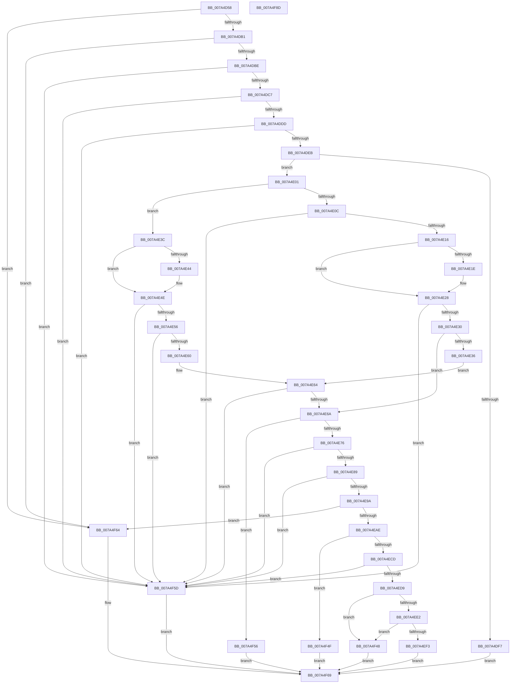

# SddlAddAccessFilterAce

- RVA: `0x007A4D58`–`0x007A4F8E` (길이 `566` bytes)
- VA: `0x00000001407A4D58`
- 실행 섹션: `PAGE`
- PDB 이름 있음: `예`; PDB Function 태그: `아니요`
- unwind 정보 RVA: `0x000D1798`
- 디코드: `155`개 명령, `566/566` bytes 표시
- 미해석 바이트: `0` (있으면 어셈블리에 `.byte`로 보존)

> 이 문서는 커널 이미지의 기계어와 PDB 기호를 분석해 생성했습니다. 4번과 5번은 함수 원형과 자료형을 바이너리 사용 방식에서 추정한 C 해석이며 원본 소스 복구 결과는 아닙니다.

## 1. Dependencies

- 직접 호출 지점: **9**; 고유 호출 대상: **7**
- 직접 호출자로 확인된 함수: **1**
- RIP 상대 이미지 참조: **1**

### Outgoing calls
- `0x007A4DB1` → [RtlValidAcl](../92/RtlValidAcl_function_0092A7A0.md) (function, `0x0092A7A0`)
- `0x007A4DEE` → [RtlValidSid](../92/RtlValidSid_function_00929710.md) (function, `0x00929710`)
- `0x007A4EA1` → [RtlFirstFreeAce](../9A/RtlFirstFreeAce_function_009A8FF0.md) (function, `0x009A8FF0`)
- `0x007A4EBB` → [RtlLengthSid](../../text/45/RtlLengthSid_function_0045D270.md) (function, `0x0045D270`)
- `0x007A4F0A` → [RtlLengthSid](../../text/45/RtlLengthSid_function_0045D270.md) (function, `0x0045D270`)
- `0x007A4F18` → [RtlCopySid](../9A/RtlCopySid_function_009A9A50.md) (function, `0x009A9A50`)
- `0x007A4F24` → [RtlLengthSid](../../text/45/RtlLengthSid_function_0045D270.md) (function, `0x0045D270`)
- `0x007A4F38` → [memcpy](../../text/6C/memcpy_function_006C6840.md) (function, `0x006C6840`)
- `0x007A4F70` → [_security_check_cookie](../../text/6A/_security_check_cookie_function_006AC640.md) (function, `0x006AC640`)

### Direct callers
- [LocalGetAclForString](../92/LocalGetAclForString_function_00927F30.md) at `0x00928EC3`

### Static image references
- `0x007A4D6F` → RVA `0x00E0A740` (`.data`; read)

## 2. Other-region calls and transfers

- 다른 실행 섹션으로 향하는 call: **5**
  - `0x007A4EBB` → [RtlLengthSid](../../text/45/RtlLengthSid_function_0045D270.md) (`PAGE` → `.text`)
  - `0x007A4F0A` → [RtlLengthSid](../../text/45/RtlLengthSid_function_0045D270.md) (`PAGE` → `.text`)
  - `0x007A4F24` → [RtlLengthSid](../../text/45/RtlLengthSid_function_0045D270.md) (`PAGE` → `.text`)
  - `0x007A4F38` → [memcpy](../../text/6C/memcpy_function_006C6840.md) (`PAGE` → `.text`)
  - `0x007A4F70` → [_security_check_cookie](../../text/6A/_security_check_cookie_function_006AC640.md) (`PAGE` → `.text`)
- 별도 외부 분기/꼬리 이동을 확인하지 못했습니다.

## 3. Assembly (complete function range)

```asm
007A4D58  48 89 5C 24 10                  mov qword ptr [rsp + 0x10], rbx
007A4D5D  55                              push rbp
007A4D5E  56                              push rsi
007A4D5F  57                              push rdi
007A4D60  41 54                           push r12
007A4D62  41 55                           push r13
007A4D64  41 56                           push r14
007A4D66  41 57                           push r15
007A4D68  48 8B EC                        mov rbp, rsp
007A4D6B  48 83 EC 50                     sub rsp, 0x50
007A4D6F  48 8B 05 CA 59 66 00            mov rax, qword ptr [rip + 0x6659ca]
007A4D76  48 33 C4                        xor rax, rsp
007A4D79  48 89 45 F0                     mov qword ptr [rbp - 0x10], rax
007A4D7D  4C 8B 65 70                     mov r12, qword ptr [rbp + 0x70]
007A4D81  45 33 F6                        xor r14d, r14d
007A4D84  4C 89 75 D8                     mov qword ptr [rbp - 0x28], r14
007A4D88  41 8B D8                        mov ebx, r8d
007A4D8B  89 5D D0                        mov dword ptr [rbp - 0x30], ebx
007A4D8E  49 8B F9                        mov rdi, r9
007A4D91  44 89 75 E8                     mov dword ptr [rbp - 0x18], r14d
007A4D95  48 8B F1                        mov rsi, rcx
007A4D98  66 C7 45 EC 00 01               mov word ptr [rbp - 0x14], 0x100
007A4D9E  44 89 75 E0                     mov dword ptr [rbp - 0x20], r14d
007A4DA2  66 C7 45 E4 00 13               mov word ptr [rbp - 0x1c], 0x1300
007A4DA8  48 85 C9                        test rcx, rcx
007A4DAB  0F 84 B3 01 00 00               je 0x1407a4f64
007A4DB1  E8 EA 59 18 00                  call 0x14092a7a0
007A4DB6  84 C0                           test al, al
007A4DB8  0F 84 A6 01 00 00               je 0x1407a4f64
007A4DBE  4D 85 E4                        test r12, r12
007A4DC1  0F 84 96 01 00 00               je 0x1407a4f5d
007A4DC7  0F B7 45 78                     movzx eax, word ptr [rbp + 0x78]
007A4DCB  B9 F8 FF 00 00                  mov ecx, 0xfff8
007A4DD0  66 83 E8 06                     sub ax, 6
007A4DD4  66 3B C1                        cmp ax, cx
007A4DD7  0F 87 80 01 00 00               ja 0x1407a4f5d
007A4DDD  41 81 3C 24 61 72 74 78         cmp dword ptr [r12], 0x78747261
007A4DE5  0F 85 72 01 00 00               jne 0x1407a4f5d
007A4DEB  48 8B CF                        mov rcx, rdi
007A4DEE  E8 1D 49 18 00                  call 0x140929710
007A4DF3  84 C0                           test al, al
007A4DF5  75 0A                           jne 0x1407a4e01
007A4DF7  B8 78 00 00 C0                  mov eax, 0xc0000078
007A4DFC  E9 68 01 00 00                  jmp 0x1407a4f69
007A4E01  41 BF 02 00 00 00               mov r15d, 2
007A4E07  F6 C3 40                        test bl, 0x40
007A4E0A  74 30                           je 0x1407a4e3c
007A4E0C  44 38 7F 01                     cmp byte ptr [rdi + 1], r15b
007A4E10  0F 85 47 01 00 00               jne 0x1407a4f5d
007A4E16  8B 4F 02                        mov ecx, dword ptr [rdi + 2]
007A4E19  2B 4D E0                        sub ecx, dword ptr [rbp - 0x20]
007A4E1C  75 0A                           jne 0x1407a4e28
007A4E1E  0F B7 4F 06                     movzx ecx, word ptr [rdi + 6]
007A4E22  0F B7 45 E4                     movzx eax, word ptr [rbp - 0x1c]
007A4E26  2B C8                           sub ecx, eax
007A4E28  85 C9                           test ecx, ecx
007A4E2A  0F 85 2D 01 00 00               jne 0x1407a4f5d
007A4E30  44 39 77 08                     cmp dword ptr [rdi + 8], r14d
007A4E34  75 34                           jne 0x1407a4e6a
007A4E36  44 39 77 0C                     cmp dword ptr [rdi + 0xc], r14d
007A4E3A  EB 28                           jmp 0x1407a4e64
007A4E3C  8B 4F 02                        mov ecx, dword ptr [rdi + 2]
007A4E3F  2B 4D E8                        sub ecx, dword ptr [rbp - 0x18]
007A4E42  75 0A                           jne 0x1407a4e4e
007A4E44  0F B7 4F 06                     movzx ecx, word ptr [rdi + 6]
007A4E48  0F B7 45 EC                     movzx eax, word ptr [rbp - 0x14]
007A4E4C  2B C8                           sub ecx, eax
007A4E4E  85 C9                           test ecx, ecx
007A4E50  0F 85 07 01 00 00               jne 0x1407a4f5d
007A4E56  80 7F 01 01                     cmp byte ptr [rdi + 1], 1
007A4E5A  0F 85 FD 00 00 00               jne 0x1407a4f5d
007A4E60  44 39 77 08                     cmp dword ptr [rdi + 8], r14d
007A4E64  0F 85 F3 00 00 00               jne 0x1407a4f5d
007A4E6A  0F B6 0E                        movzx ecx, byte ptr [rsi]
007A4E6D  80 F9 04                        cmp cl, 4
007A4E70  0F 87 E0 00 00 00               ja 0x1407a4f56
007A4E76  41 3A CF                        cmp cl, r15b
007A4E79  44 0F 47 F9                     cmova r15d, ecx
007A4E7D  F7 C3 A0 FF FF FF               test ebx, 0xffffffa0
007A4E83  0F 85 D4 00 00 00               jne 0x1407a4f5d
007A4E89  44 8B 6D 68                     mov r13d, dword ptr [rbp + 0x68]
007A4E8D  41 F7 C5 00 00 00 FF            test r13d, 0xff000000
007A4E94  0F 85 C3 00 00 00               jne 0x1407a4f5d
007A4E9A  48 8D 55 D8                     lea rdx, [rbp - 0x28]
007A4E9E  48 8B CE                        mov rcx, rsi
007A4EA1  E8 4A 41 20 00                  call 0x1409a8ff0
007A4EA6  84 C0                           test al, al
007A4EA8  0F 84 B6 00 00 00               je 0x1407a4f64
007A4EAE  0F B7 5D 78                     movzx ebx, word ptr [rbp + 0x78]
007A4EB2  48 8B CF                        mov rcx, rdi
007A4EB5  83 C3 03                        add ebx, 3
007A4EB8  83 E3 FC                        and ebx, 0xfffffffc
007A4EBB  E8 B0 83 CB FF                  call 0x14045d270
007A4EC0  8D 53 08                        lea edx, [rbx + 8]
007A4EC3  03 D0                           add edx, eax
007A4EC5  3B D3                           cmp edx, ebx
007A4EC7  0F 82 82 00 00 00               jb 0x1407a4f4f
007A4ECD  81 FA FF FF 00 00               cmp edx, 0xffff
007A4ED3  0F 87 84 00 00 00               ja 0x1407a4f5d
007A4ED9  4C 8B 75 D8                     mov r14, qword ptr [rbp - 0x28]
007A4EDD  4D 85 F6                        test r14, r14
007A4EE0  74 66                           je 0x1407a4f48
007A4EE2  0F B7 4E 02                     movzx ecx, word ptr [rsi + 2]
007A4EE6  8B C2                           mov eax, edx
007A4EE8  48 03 CE                        add rcx, rsi
007A4EEB  49 03 C6                        add rax, r14
007A4EEE  48 3B C1                        cmp rax, rcx
007A4EF1  77 55                           ja 0x1407a4f48
007A4EF3  8B 45 D0                        mov eax, dword ptr [rbp - 0x30]
007A4EF6  48 8B CF                        mov rcx, rdi
007A4EF9  41 88 46 01                     mov byte ptr [r14 + 1], al
007A4EFD  41 C6 06 15                     mov byte ptr [r14], 0x15
007A4F01  66 41 89 56 02                  mov word ptr [r14 + 2], dx
007A4F06  45 89 6E 04                     mov dword ptr [r14 + 4], r13d
007A4F0A  E8 61 83 CB FF                  call 0x14045d270
007A4F0F  8B C8                           mov ecx, eax
007A4F11  49 8D 56 08                     lea rdx, [r14 + 8]
007A4F15  4C 8B C7                        mov r8, rdi
007A4F18  E8 33 4B 20 00                  call 0x1409a9a50
007A4F1D  0F B7 5D 78                     movzx ebx, word ptr [rbp + 0x78]
007A4F21  48 8B CF                        mov rcx, rdi
007A4F24  E8 47 83 CB FF                  call 0x14045d270
007A4F29  8B C8                           mov ecx, eax
007A4F2B  44 8B C3                        mov r8d, ebx
007A4F2E  48 83 C1 08                     add rcx, 8
007A4F32  49 8B D4                        mov rdx, r12
007A4F35  49 03 CE                        add rcx, r14
007A4F38  E8 03 19 F2 FF                  call 0x1406c6840
007A4F3D  66 FF 46 04                     inc word ptr [rsi + 4]
007A4F41  33 C0                           xor eax, eax
007A4F43  44 88 3E                        mov byte ptr [rsi], r15b
007A4F46  EB 21                           jmp 0x1407a4f69
007A4F48  B8 99 00 00 C0                  mov eax, 0xc0000099
007A4F4D  EB 1A                           jmp 0x1407a4f69
007A4F4F  B8 16 02 00 00                  mov eax, 0x216
007A4F54  EB 13                           jmp 0x1407a4f69
007A4F56  B8 59 00 00 C0                  mov eax, 0xc0000059
007A4F5B  EB 0C                           jmp 0x1407a4f69
007A4F5D  B8 0D 00 00 C0                  mov eax, 0xc000000d
007A4F62  EB 05                           jmp 0x1407a4f69
007A4F64  B8 77 00 00 C0                  mov eax, 0xc0000077
007A4F69  48 8B 4D F0                     mov rcx, qword ptr [rbp - 0x10]
007A4F6D  48 33 CC                        xor rcx, rsp
007A4F70  E8 CB 76 F0 FF                  call 0x1406ac640
007A4F75  48 8B 9C 24 98 00 00 00         mov rbx, qword ptr [rsp + 0x98]
007A4F7D  48 83 C4 50                     add rsp, 0x50
007A4F81  41 5F                           pop r15
007A4F83  41 5E                           pop r14
007A4F85  41 5D                           pop r13
007A4F87  41 5C                           pop r12
007A4F89  5F                              pop rdi
007A4F8A  5E                              pop rsi
007A4F8B  5D                              pop rbp
007A4F8C  C3                              ret
007A4F8D  CC                              int3
```

## 4. C-style interpretation (structured pseudocode)

```c
__int64 __fastcall SddlAddAccessFilterAce(__int64 a1, __int64 a2, int a3, __int64 a4, __int64 a5, unsigned int a6, __int64 a7, unsigned __int16 a8)
{
    __int64 result;
    __int64 v_r14;
    __int64 v_r15;
    __int64 v_rbx;
    __int64 v_rsp;
    unsigned __int64 v_stack_m48;
    unsigned __int16 v_stack_m4C;
    unsigned int v_stack_m50;
    unsigned __int16 v_stack_m54;
    unsigned int v_stack_m58;
    unsigned __int64 v_stack_m60;
    unsigned int v_stack_m68;
    unsigned __int64 v_stack_p10;

    v_stack_p10 = v_rbx;
    v_rsp = (v_rsp) - (80);
    result = (*(unsigned __int64 *)(v_rip + 6707658)) ^ (v_rsp);
    v_stack_m48 = result;
    v_r14 = 0;
    v_stack_m60 = 0;
    v_stack_m68 = (unsigned int)((unsigned int)(a3));
    v_stack_m50 = 0;
    v_stack_m4C = 256;
    v_stack_m58 = 0;
    v_stack_m54 = 0x1300ULL;
    if (a1 == 0) goto loc_007A4F64;
    result = RtlValidAcl(a1, a2, a3, a4);
    if ((unsigned __int8)(result) == 0) goto loc_007A4F64;
    if (a7 == 0) goto loc_007A4F5D;
    result = (unsigned __int16)((a8) - (6));
    if (((unsigned __int16)(result)) > ((unsigned __int16)((unsigned int)(0xFFF8ULL)))) goto loc_007A4F5D;
    if ((*(unsigned int *)(a7)) != 0x78747261ULL) goto loc_007A4F5D;
    result = RtlValidSid(a4, a2, a3, a4);
    if ((unsigned __int8)(result) != 0) goto loc_007A4E01;
    goto loc_007A4F69;
loc_007A4E01:
    if ((((unsigned __int8)((unsigned int)(a3))) & (64)) == 0) goto loc_007A4E3C;
    if ((*(unsigned __int8 *)(a4 + 1)) != 2) goto loc_007A4F5D;
    a1 = (unsigned int)(((unsigned int)(*(unsigned int *)(a4 + 2))) - (v_stack_m58));
    result = (unsigned int)(0xC0000078ULL);
    if (!(condition_is_not_equal)) {
        a1 = *(unsigned __int16 *)(a4 + 6);
        result = v_stack_m54;
        a1 = (unsigned int)((a1) - ((unsigned int)(result)));
    }
    if ((unsigned int)(a1) != 0) goto loc_007A4F5D;
    if ((*(unsigned int *)(a4 + 8)) != 0) goto loc_007A4E6A;
    goto loc_007A4E64;
loc_007A4E3C:
    a1 = (unsigned int)(((unsigned int)(*(unsigned int *)(a4 + 2))) - (v_stack_m50));
    if (!(condition_is_not_equal)) {
        a1 = *(unsigned __int16 *)(a4 + 6);
        result = v_stack_m4C;
        a1 = (unsigned int)((a1) - ((unsigned int)(result)));
    }
    if ((unsigned int)(a1) != 0) goto loc_007A4F5D;
    if ((*(unsigned __int8 *)(a4 + 1)) != 1) goto loc_007A4F5D;
loc_007A4E64:
    if ((*(unsigned int *)(a4 + 8)) != 0) goto loc_007A4F5D;
loc_007A4E6A:
    if (((unsigned __int8)(*(unsigned __int8 *)(a1))) > 4) goto loc_007A4F56;
    v_r15 = 2;
    if (((unsigned __int8)(*(unsigned __int8 *)(a1))) > 2) { v_r15 = (unsigned int)(*(unsigned __int8 *)(a1)); }
    if ((((unsigned int)((unsigned int)(a3))) & (0xFFFFFFA0ULL)) != 0) goto loc_007A4F5D;
    if ((((unsigned int)((unsigned int)(a6))) & (0xFF000000ULL)) != 0) goto loc_007A4F5D;
    result = RtlFirstFreeAce(a1, v_stack_m60, a3, a4);
    if ((unsigned __int8)(result) == 0) goto loc_007A4F64;
    v_rbx = (unsigned int)((a8) + (3));
    v_rbx = (unsigned int)((v_rbx) & (0xFFFFFFFCULL));
    result = RtlLengthSid(a4, v_stack_m60, a3, a4);
    a2 = (unsigned int)((v_rbx + 8) + ((unsigned int)(result)));
    if (((unsigned int)(a2)) < ((unsigned int)(v_rbx))) goto loc_007A4F4F;
    if (((unsigned int)(a2)) > 0xFFFFULL) goto loc_007A4F5D;
    if (v_stack_m60 == 0) goto loc_007A4F48;
    a1 = (*(unsigned __int16 *)(a1 + 2)) + (a1);
    result = ((unsigned int)((unsigned int)(a2))) + (v_stack_m60);
    if (result > a1) goto loc_007A4F48;
    *(unsigned __int8 *)(v_stack_m60 + 1) = (unsigned __int8)((unsigned int)(v_stack_m68));
    *(unsigned __int8 *)(v_stack_m60) = 21;
    *(unsigned __int16 *)(v_stack_m60 + 2) = (unsigned __int16)(a2);
    *(unsigned int *)(v_stack_m60 + 4) = (unsigned int)((unsigned int)(a6));
    result = RtlLengthSid(a4, a2, a3, a4);
    result = RtlCopySid((unsigned int)((unsigned int)(result)), v_stack_m60 + 8, a4, a4);
    result = RtlLengthSid(a4, v_stack_m60 + 8, a4, a4);
    a1 = ((unsigned int)((unsigned int)(result))) + (8);
    a1 = (a1) + (v_stack_m60);
    result = memcpy(a1, a7, (unsigned int)(a8), a4);
    result = 0;
    *(unsigned __int8 *)(a1) = (unsigned __int8)(v_r15);
    goto loc_007A4F69;
loc_007A4F48:
    goto loc_007A4F69;
loc_007A4F4F:
    goto loc_007A4F69;
loc_007A4F56:
    goto loc_007A4F69;
loc_007A4F5D:
    goto loc_007A4F69;
loc_007A4F64:
loc_007A4F69:
    a1 = (v_stack_m48) ^ (v_rsp);
    result = _security_check_cookie(a1, a7, (unsigned int)(a8), a4);
    v_rsp = (v_rsp) + (80);
    return result;
}
```

## 5. (Beta) C Style

```c
int64_t SddlAddAccessFilterAce(void *Arg1, int64_t Arg2, int32_t Arg3, void *Arg4, uint64_t Arg5, uint32_t Arg6, int64_t Arg7, void *Arg8)
{
    uint8_t *arg1 = (uint8_t *)Arg1;
    uint8_t *arg4 = (uint8_t *)Arg4;
    uint8_t *arg8 = (uint8_t *)Arg8;

    int64_t result;
    int64_t local_r14;
    int64_t local_r15;
    int64_t local_rbx;
    int64_t local_rsp;
    uint64_t v_stack_m48;
    uint16_t v_stack_m4C;
    uint32_t v_stack_m50;
    uint16_t v_stack_m54;
    uint32_t v_stack_m58;
    uint64_t v_stack_m60;
    uint32_t v_stack_m68;
    uint64_t v_stack_p10;

    v_stack_p10 = local_rbx;
    local_rsp = (local_rsp) - (80);
    result = (*(uint64_t *)(v_rip + 0x6659CA)) ^ (local_rsp);
    v_stack_m48 = result;
    local_r14 = 0;
    v_stack_m60 = 0;
    v_stack_m68 = (uint32_t)((uint32_t)(Arg3));
    v_stack_m50 = 0;
    v_stack_m4C = 256;
    v_stack_m58 = 0;
    v_stack_m54 = 0x1300ULL;
    if (Arg1 == NULL) goto loc_007A4F64;
    result = RtlValidAcl(Arg1, Arg2, Arg3, Arg4);
    if ((uint8_t)(result) == 0) goto loc_007A4F64;
    if (Arg7 == 0) goto loc_007A4F5D;
    result = (uint16_t)((Arg8) - (6));
    if (((uint16_t)(result)) > ((uint16_t)((uint32_t)(0xFFF8ULL)))) goto loc_007A4F5D;
    if ((*(uint32_t *)(Arg7)) != 0x78747261ULL) goto loc_007A4F5D;
    result = RtlValidSid(Arg4, Arg2, Arg3, Arg4);
    if ((uint8_t)(result) != 0) goto loc_007A4E01;
    goto loc_007A4F69;
loc_007A4E01:
    if ((((uint8_t)((uint32_t)(Arg3))) & (64)) == 0) goto loc_007A4E3C;
    if ((*(uint8_t *)(arg4 + 0x1)) != 2) goto loc_007A4F5D;
    Arg1 = (uint32_t)(((uint32_t)(*(uint32_t *)(arg4 + 0x2))) - (v_stack_m58));
    result = (uint32_t)(0xC0000078ULL);
    if (!(condition_is_not_equal)) {
        Arg1 = *(uint16_t *)(arg4 + 0x6);
        result = v_stack_m54;
        Arg1 = (uint32_t)((Arg1) - ((uint32_t)(result)));
    }
    if ((uint32_t)(Arg1) != 0) goto loc_007A4F5D;
    if ((*(uint32_t *)(arg4 + 0x8)) != 0) goto loc_007A4E6A;
    goto loc_007A4E64;
loc_007A4E3C:
    Arg1 = (uint32_t)(((uint32_t)(*(uint32_t *)(arg4 + 0x2))) - (v_stack_m50));
    if (!(condition_is_not_equal)) {
        Arg1 = *(uint16_t *)(arg4 + 0x6);
        result = v_stack_m4C;
        Arg1 = (uint32_t)((Arg1) - ((uint32_t)(result)));
    }
    if ((uint32_t)(Arg1) != 0) goto loc_007A4F5D;
    if ((*(uint8_t *)(arg4 + 0x1)) != 1) goto loc_007A4F5D;
loc_007A4E64:
    if ((*(uint32_t *)(arg4 + 0x8)) != 0) goto loc_007A4F5D;
loc_007A4E6A:
    if (((uint8_t)(*(uint8_t *)(arg1))) > 4) goto loc_007A4F56;
    local_r15 = 2;
    if (((uint8_t)(*(uint8_t *)(arg1))) > 2) { local_r15 = (uint32_t)(*(uint8_t *)(arg1)); }
    if ((((uint32_t)((uint32_t)(Arg3))) & (0xFFFFFFA0ULL)) != 0) goto loc_007A4F5D;
    if ((((uint32_t)((uint32_t)(Arg6))) & (0xFF000000ULL)) != 0) goto loc_007A4F5D;
    result = RtlFirstFreeAce(Arg1, v_stack_m60, Arg3, Arg4);
    if ((uint8_t)(result) == 0) goto loc_007A4F64;
    local_rbx = (uint32_t)((Arg8) + (3));
    local_rbx = (uint32_t)((local_rbx) & (0xFFFFFFFCULL));
    result = RtlLengthSid(Arg4, v_stack_m60, Arg3, Arg4);
    Arg2 = (uint32_t)((local_rbx + 8) + ((uint32_t)(result)));
    if (((uint32_t)(Arg2)) < ((uint32_t)(local_rbx))) goto loc_007A4F4F;
    if (((uint32_t)(Arg2)) > 0xFFFFULL) goto loc_007A4F5D;
    if (v_stack_m60 == 0) goto loc_007A4F48;
    Arg1 = (*(uint16_t *)(arg1 + 0x2)) + (Arg1);
    result = ((uint32_t)((uint32_t)(Arg2))) + (v_stack_m60);
    if (result > Arg1) goto loc_007A4F48;
    *(uint8_t *)(v_stack_m60 + 0x1) = (uint8_t)((uint32_t)(v_stack_m68));
    *(uint8_t *)(v_stack_m60) = 21;
    *(uint16_t *)(v_stack_m60 + 0x2) = (uint16_t)(Arg2);
    *(uint32_t *)(v_stack_m60 + 0x4) = (uint32_t)((uint32_t)(Arg6));
    result = RtlLengthSid(Arg4, Arg2, Arg3, Arg4);
    result = RtlCopySid((uint32_t)((uint32_t)(result)), v_stack_m60 + 8, Arg4, Arg4);
    result = RtlLengthSid(Arg4, v_stack_m60 + 8, Arg4, Arg4);
    Arg1 = ((uint32_t)((uint32_t)(result))) + (8);
    Arg1 = (Arg1) + (v_stack_m60);
    result = memcpy(Arg1, Arg7, (uint32_t)(Arg8), Arg4);
    result = 0;
    *(uint8_t *)(arg1) = (uint8_t)(local_r15);
    goto loc_007A4F69;
loc_007A4F48:
    goto loc_007A4F69;
loc_007A4F4F:
    goto loc_007A4F69;
loc_007A4F56:
    goto loc_007A4F69;
loc_007A4F5D:
    goto loc_007A4F69;
loc_007A4F64:
loc_007A4F69:
    Arg1 = (v_stack_m48) ^ (local_rsp);
    result = _security_check_cookie(Arg1, Arg7, (uint32_t)(Arg8), Arg4);
    local_rsp = (local_rsp) + (80);
    return result;
}
```

### 관측된 메모리 오프셋

구조체 형식이 확인되지 않은 접근은 인자 기준의 오프셋으로만 기록했습니다.

| 기준 인자 | 오프셋 표현 | 폭 (bit) | 접근 |
|---|---:|---:|---|
| `Arg1` | `+ 0x0` | `8` | `R` |
| `Arg1` | `+ 0x0` | `8` | `W` |
| `Arg1` | `+ 0x2` | `16` | `R` |
| `Arg1` | `+ 0x4` | `16` | `R/W` |
| `Arg4` | `+ 0x1` | `8` | `R` |
| `Arg4` | `+ 0x2` | `32` | `R` |
| `Arg4` | `+ 0x6` | `16` | `R` |
| `Arg4` | `+ 0x8` | `32` | `R` |
| `Arg4` | `+ 0xC` | `32` | `R` |
| `Arg8` | `+ 0x8` | `32` | `R` |

## 6. Execution-region graph

[열기: 2D/3D 그래프와 함수 탐색 컨트롤 패널](../../../control-panel.html?section=page&rva=0x007A4D58&view=graph)

- 2D 그래프는 위에서 아래로 흐르고, 3D 그래프는 빈 공간을 드래그해 회전합니다. Shift+드래그는 이동, 휠은 확대·축소, 함수 노드 선택은 대상 보고서 이동입니다.

### Static fallback


