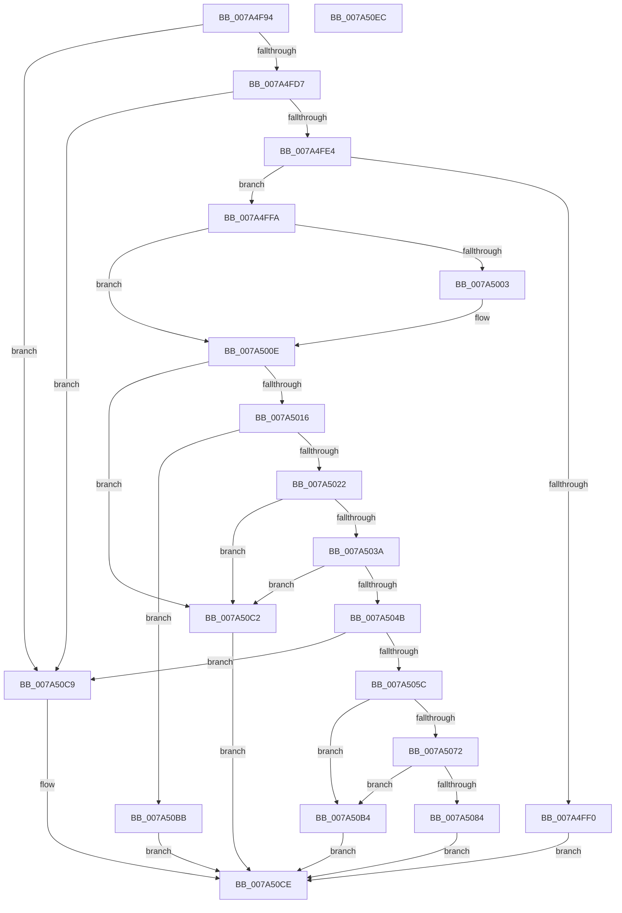

# SddlAddProcessTrustLabelAce

- RVA: `0x007A4F94`–`0x007A50ED` (길이 `345` bytes)
- VA: `0x00000001407A4F94`
- 실행 섹션: `PAGE`
- PDB 이름 있음: `예`; PDB Function 태그: `아니요`
- unwind 정보 RVA: `0x000D17BC`
- 디코드: `96`개 명령, `345/345` bytes 표시
- 미해석 바이트: `0` (있으면 어셈블리에 `.byte`로 보존)

> 이 문서는 커널 이미지의 기계어와 PDB 기호를 분석해 생성했습니다. 4번과 5번은 함수 원형과 자료형을 바이너리 사용 방식에서 추정한 C 해석이며 원본 소스 복구 결과는 아닙니다.

## 1. Dependencies

- 직접 호출 지점: **7**; 고유 호출 대상: **6**
- 직접 호출자로 확인된 함수: **1**
- RIP 상대 이미지 참조: **1**

### Outgoing calls
- `0x007A4FD7` → [RtlValidAcl](../92/RtlValidAcl_function_0092A7A0.md) (function, `0x0092A7A0`)
- `0x007A4FE7` → [RtlValidSid](../92/RtlValidSid_function_00929710.md) (function, `0x00929710`)
- `0x007A5053` → [RtlFirstFreeAce](../9A/RtlFirstFreeAce_function_009A8FF0.md) (function, `0x009A8FF0`)
- `0x007A505F` → [RtlLengthSid](../../text/45/RtlLengthSid_function_0045D270.md) (function, `0x0045D270`)
- `0x007A5096` → [RtlLengthSid](../../text/45/RtlLengthSid_function_0045D270.md) (function, `0x0045D270`)
- `0x007A50A4` → [RtlCopySid](../9A/RtlCopySid_function_009A9A50.md) (function, `0x009A9A50`)
- `0x007A50D6` → [_security_check_cookie](../../text/6A/_security_check_cookie_function_006AC640.md) (function, `0x006AC640`)

### Direct callers
- [LocalGetAclForString](../92/LocalGetAclForString_function_00927F30.md) at `0x00928E7C`

### Static image references
- `0x007A4FA4` → RVA `0x00E0A740` (`.data`; read)

## 2. Other-region calls and transfers

- 다른 실행 섹션으로 향하는 call: **3**
  - `0x007A505F` → [RtlLengthSid](../../text/45/RtlLengthSid_function_0045D270.md) (`PAGE` → `.text`)
  - `0x007A5096` → [RtlLengthSid](../../text/45/RtlLengthSid_function_0045D270.md) (`PAGE` → `.text`)
  - `0x007A50D6` → [_security_check_cookie](../../text/6A/_security_check_cookie_function_006AC640.md) (`PAGE` → `.text`)
- 별도 외부 분기/꼬리 이동을 확인하지 못했습니다.

## 3. Assembly (complete function range)

```asm
007A4F94  48 89 5C 24 10                  mov qword ptr [rsp + 0x10], rbx
007A4F99  55                              push rbp
007A4F9A  56                              push rsi
007A4F9B  57                              push rdi
007A4F9C  41 56                           push r14
007A4F9E  41 57                           push r15
007A4FA0  48 83 EC 40                     sub rsp, 0x40
007A4FA4  48 8B 05 95 57 66 00            mov rax, qword ptr [rip + 0x665795]
007A4FAB  48 33 C4                        xor rax, rsp
007A4FAE  48 89 44 24 30                  mov qword ptr [rsp + 0x30], rax
007A4FB3  48 83 64 24 20 00               and qword ptr [rsp + 0x20], 0
007A4FB9  49 8B F1                        mov rsi, r9
007A4FBC  83 64 24 28 00                  and dword ptr [rsp + 0x28], 0
007A4FC1  45 8B F8                        mov r15d, r8d
007A4FC4  66 C7 44 24 2C 00 13            mov word ptr [rsp + 0x2c], 0x1300
007A4FCB  48 8B F9                        mov rdi, rcx
007A4FCE  48 85 C9                        test rcx, rcx
007A4FD1  0F 84 F2 00 00 00               je 0x1407a50c9
007A4FD7  E8 C4 57 18 00                  call 0x14092a7a0
007A4FDC  84 C0                           test al, al
007A4FDE  0F 84 E5 00 00 00               je 0x1407a50c9
007A4FE4  48 8B CE                        mov rcx, rsi
007A4FE7  E8 24 47 18 00                  call 0x140929710
007A4FEC  84 C0                           test al, al
007A4FEE  75 0A                           jne 0x1407a4ffa
007A4FF0  B8 78 00 00 C0                  mov eax, 0xc0000078
007A4FF5  E9 D4 00 00 00                  jmp 0x1407a50ce
007A4FFA  8B 4E 02                        mov ecx, dword ptr [rsi + 2]
007A4FFD  2B 4C 24 28                     sub ecx, dword ptr [rsp + 0x28]
007A5001  75 0B                           jne 0x1407a500e
007A5003  0F B7 4E 06                     movzx ecx, word ptr [rsi + 6]
007A5007  0F B7 44 24 2C                  movzx eax, word ptr [rsp + 0x2c]
007A500C  2B C8                           sub ecx, eax
007A500E  85 C9                           test ecx, ecx
007A5010  0F 85 AC 00 00 00               jne 0x1407a50c2
007A5016  0F B6 0F                        movzx ecx, byte ptr [rdi]
007A5019  80 F9 04                        cmp cl, 4
007A501C  0F 87 99 00 00 00               ja 0x1407a50bb
007A5022  BD 02 00 00 00                  mov ebp, 2
007A5027  40 3A CD                        cmp cl, bpl
007A502A  0F 47 E9                        cmova ebp, ecx
007A502D  41 F7 C7 E0 FF FF FF            test r15d, 0xffffffe0
007A5034  0F 85 88 00 00 00               jne 0x1407a50c2
007A503A  44 8B B4 24 98 00 00 00         mov r14d, dword ptr [rsp + 0x98]
007A5042  41 F7 C6 00 00 00 FF            test r14d, 0xff000000
007A5049  75 77                           jne 0x1407a50c2
007A504B  48 8D 54 24 20                  lea rdx, [rsp + 0x20]
007A5050  48 8B CF                        mov rcx, rdi
007A5053  E8 98 3F 20 00                  call 0x1409a8ff0
007A5058  84 C0                           test al, al
007A505A  74 6D                           je 0x1407a50c9
007A505C  48 8B CE                        mov rcx, rsi
007A505F  E8 0C 82 CB FF                  call 0x14045d270
007A5064  48 8B 5C 24 20                  mov rbx, qword ptr [rsp + 0x20]
007A5069  66 83 C0 08                     add ax, 8
007A506D  48 85 DB                        test rbx, rbx
007A5070  74 42                           je 0x1407a50b4
007A5072  0F B7 57 02                     movzx edx, word ptr [rdi + 2]
007A5076  0F B7 C8                        movzx ecx, ax
007A5079  48 03 D7                        add rdx, rdi
007A507C  48 03 CB                        add rcx, rbx
007A507F  48 3B CA                        cmp rcx, rdx
007A5082  77 30                           ja 0x1407a50b4
007A5084  48 8B CE                        mov rcx, rsi
007A5087  44 88 7B 01                     mov byte ptr [rbx + 1], r15b
007A508B  C6 03 14                        mov byte ptr [rbx], 0x14
007A508E  66 89 43 02                     mov word ptr [rbx + 2], ax
007A5092  44 89 73 04                     mov dword ptr [rbx + 4], r14d
007A5096  E8 D5 81 CB FF                  call 0x14045d270
007A509B  8B C8                           mov ecx, eax
007A509D  48 8D 53 08                     lea rdx, [rbx + 8]
007A50A1  4C 8B C6                        mov r8, rsi
007A50A4  E8 A7 49 20 00                  call 0x1409a9a50
007A50A9  66 FF 47 04                     inc word ptr [rdi + 4]
007A50AD  33 C0                           xor eax, eax
007A50AF  40 88 2F                        mov byte ptr [rdi], bpl
007A50B2  EB 1A                           jmp 0x1407a50ce
007A50B4  B8 99 00 00 C0                  mov eax, 0xc0000099
007A50B9  EB 13                           jmp 0x1407a50ce
007A50BB  B8 59 00 00 C0                  mov eax, 0xc0000059
007A50C0  EB 0C                           jmp 0x1407a50ce
007A50C2  B8 0D 00 00 C0                  mov eax, 0xc000000d
007A50C7  EB 05                           jmp 0x1407a50ce
007A50C9  B8 77 00 00 C0                  mov eax, 0xc0000077
007A50CE  48 8B 4C 24 30                  mov rcx, qword ptr [rsp + 0x30]
007A50D3  48 33 CC                        xor rcx, rsp
007A50D6  E8 65 75 F0 FF                  call 0x1406ac640
007A50DB  48 8B 5C 24 78                  mov rbx, qword ptr [rsp + 0x78]
007A50E0  48 83 C4 40                     add rsp, 0x40
007A50E4  41 5F                           pop r15
007A50E6  41 5E                           pop r14
007A50E8  5F                              pop rdi
007A50E9  5E                              pop rsi
007A50EA  5D                              pop rbp
007A50EB  C3                              ret
007A50EC  CC                              int3
```

## 4. C-style interpretation (structured pseudocode)

```c
__int64 __fastcall SddlAddProcessTrustLabelAce(__int64 a1, __int64 a2, int a3, __int64 a4, __int64 a5, unsigned int a6)
{
    __int64 result;
    __int64 v_rbp;
    __int64 v_rsp;
    unsigned __int64 v_stack_m38;
    unsigned __int16 v_stack_m3C;
    unsigned int v_stack_m40;
    unsigned __int64 v_stack_m48;
    unsigned __int64 v_stack_p10;

    v_stack_p10 = v_rbx;
    v_rsp = (v_rsp) - (64);
    result = (*(unsigned __int64 *)(v_rip + 6707093)) ^ (v_rsp);
    v_stack_m38 = result;
    v_stack_m3C = 0x1300ULL;
    if (a1 == 0) goto loc_007A50C9;
    result = RtlValidAcl(a1, a2, a3, a4);
    if ((unsigned __int8)(result) == 0) goto loc_007A50C9;
    result = RtlValidSid(a4, a2, a3, a4);
    if ((unsigned __int8)(result) != 0) goto loc_007A4FFA;
    goto loc_007A50CE;
loc_007A4FFA:
    a1 = (unsigned int)(((unsigned int)(*(unsigned int *)(a4 + 2))) - (v_stack_m40));
    result = (unsigned int)(0xC0000078ULL);
    if (!(condition_is_not_equal)) {
        a1 = *(unsigned __int16 *)(a4 + 6);
        result = v_stack_m3C;
        a1 = (unsigned int)((a1) - ((unsigned int)(result)));
    }
    if ((unsigned int)(a1) != 0) goto loc_007A50C2;
    if (((unsigned __int8)(*(unsigned __int8 *)(a1))) > 4) goto loc_007A50BB;
    v_rbp = 2;
    if (((unsigned __int8)(*(unsigned __int8 *)(a1))) > 2) { v_rbp = (unsigned int)(*(unsigned __int8 *)(a1)); }
    if ((((unsigned int)((unsigned int)(a3))) & (0xFFFFFFE0ULL)) != 0) goto loc_007A50C2;
    if ((((unsigned int)((unsigned int)(a6))) & (0xFF000000ULL)) != 0) goto loc_007A50C2;
    result = RtlFirstFreeAce(a1, v_stack_m48, a3, a4);
    if ((unsigned __int8)(result) == 0) goto loc_007A50C9;
    result = RtlLengthSid(a4, v_stack_m48, a3, a4);
    result = (unsigned __int16)((result) + (8));
    if (v_stack_m48 == 0) goto loc_007A50B4;
    a2 = (*(unsigned __int16 *)(a1 + 2)) + (a1);
    a1 = ((unsigned __int16)(result)) + (v_stack_m48);
    if (a1 > a2) goto loc_007A50B4;
    *(unsigned __int8 *)(v_stack_m48 + 1) = (unsigned __int8)((unsigned int)(a3));
    *(unsigned __int8 *)(v_stack_m48) = 20;
    *(unsigned __int16 *)(v_stack_m48 + 2) = (unsigned __int16)(result);
    *(unsigned int *)(v_stack_m48 + 4) = (unsigned int)((unsigned int)(a6));
    result = RtlLengthSid(a4, a2, a3, a4);
    result = RtlCopySid((unsigned int)((unsigned int)(result)), v_stack_m48 + 8, a4, a4);
    result = 0;
    *(unsigned __int8 *)(a1) = (unsigned __int8)(v_rbp);
    goto loc_007A50CE;
loc_007A50B4:
    goto loc_007A50CE;
loc_007A50BB:
    goto loc_007A50CE;
loc_007A50C2:
    goto loc_007A50CE;
loc_007A50C9:
loc_007A50CE:
    a1 = (v_stack_m38) ^ (v_rsp);
    result = _security_check_cookie(a1, v_stack_m48 + 8, a4, a4);
    v_rsp = (v_rsp) + (64);
    return result;
}
```

## 5. (Beta) C Style

```c
int64_t SddlAddProcessTrustLabelAce(void *Arg1, int64_t Arg2, int32_t Arg3, void *Arg4, uint64_t Arg5, uint32_t Arg6)
{
    uint8_t *arg1 = (uint8_t *)Arg1;
    uint8_t *arg4 = (uint8_t *)Arg4;

    int64_t result;
    int64_t local_rbp;
    int64_t local_rsp;
    uint64_t v_stack_m38;
    uint16_t v_stack_m3C;
    uint32_t v_stack_m40;
    uint64_t v_stack_m48;
    uint64_t v_stack_p10;

    v_stack_p10 = local_rbx;
    local_rsp = (local_rsp) - (64);
    result = (*(uint64_t *)(v_rip + 0x665795)) ^ (local_rsp);
    v_stack_m38 = result;
    v_stack_m3C = 0x1300ULL;
    if (Arg1 == NULL) goto loc_007A50C9;
    result = RtlValidAcl(Arg1, Arg2, Arg3, Arg4);
    if ((uint8_t)(result) == 0) goto loc_007A50C9;
    result = RtlValidSid(Arg4, Arg2, Arg3, Arg4);
    if ((uint8_t)(result) != 0) goto loc_007A4FFA;
    goto loc_007A50CE;
loc_007A4FFA:
    Arg1 = (uint32_t)(((uint32_t)(*(uint32_t *)(arg4 + 0x2))) - (v_stack_m40));
    result = (uint32_t)(0xC0000078ULL);
    if (!(condition_is_not_equal)) {
        Arg1 = *(uint16_t *)(arg4 + 0x6);
        result = v_stack_m3C;
        Arg1 = (uint32_t)((Arg1) - ((uint32_t)(result)));
    }
    if ((uint32_t)(Arg1) != 0) goto loc_007A50C2;
    if (((uint8_t)(*(uint8_t *)(arg1))) > 4) goto loc_007A50BB;
    local_rbp = 2;
    if (((uint8_t)(*(uint8_t *)(arg1))) > 2) { local_rbp = (uint32_t)(*(uint8_t *)(arg1)); }
    if ((((uint32_t)((uint32_t)(Arg3))) & (0xFFFFFFE0ULL)) != 0) goto loc_007A50C2;
    if ((((uint32_t)((uint32_t)(Arg6))) & (0xFF000000ULL)) != 0) goto loc_007A50C2;
    result = RtlFirstFreeAce(Arg1, v_stack_m48, Arg3, Arg4);
    if ((uint8_t)(result) == 0) goto loc_007A50C9;
    result = RtlLengthSid(Arg4, v_stack_m48, Arg3, Arg4);
    result = (uint16_t)((result) + (8));
    if (v_stack_m48 == 0) goto loc_007A50B4;
    Arg2 = (*(uint16_t *)(arg1 + 0x2)) + (Arg1);
    Arg1 = ((uint16_t)(result)) + (v_stack_m48);
    if (Arg1 > Arg2) goto loc_007A50B4;
    *(uint8_t *)(v_stack_m48 + 0x1) = (uint8_t)((uint32_t)(Arg3));
    *(uint8_t *)(v_stack_m48) = 20;
    *(uint16_t *)(v_stack_m48 + 0x2) = (uint16_t)(result);
    *(uint32_t *)(v_stack_m48 + 0x4) = (uint32_t)((uint32_t)(Arg6));
    result = RtlLengthSid(Arg4, Arg2, Arg3, Arg4);
    result = RtlCopySid((uint32_t)((uint32_t)(result)), v_stack_m48 + 8, Arg4, Arg4);
    result = 0;
    *(uint8_t *)(arg1) = (uint8_t)(local_rbp);
    goto loc_007A50CE;
loc_007A50B4:
    goto loc_007A50CE;
loc_007A50BB:
    goto loc_007A50CE;
loc_007A50C2:
    goto loc_007A50CE;
loc_007A50C9:
loc_007A50CE:
    Arg1 = (v_stack_m38) ^ (local_rsp);
    result = _security_check_cookie(Arg1, v_stack_m48 + 8, Arg4, Arg4);
    local_rsp = (local_rsp) + (64);
    return result;
}
```

### 관측된 메모리 오프셋

구조체 형식이 확인되지 않은 접근은 인자 기준의 오프셋으로만 기록했습니다.

| 기준 인자 | 오프셋 표현 | 폭 (bit) | 접근 |
|---|---:|---:|---|
| `Arg1` | `+ 0x0` | `8` | `R` |
| `Arg1` | `+ 0x0` | `8` | `W` |
| `Arg1` | `+ 0x2` | `16` | `R` |
| `Arg1` | `+ 0x4` | `16` | `R/W` |
| `Arg4` | `+ 0x2` | `32` | `R` |
| `Arg4` | `+ 0x6` | `16` | `R` |

## 6. Execution-region graph

[열기: 2D/3D 그래프와 함수 탐색 컨트롤 패널](../../../control-panel.html?section=page&rva=0x007A4F94&view=graph)

- 2D 그래프는 위에서 아래로 흐르고, 3D 그래프는 빈 공간을 드래그해 회전합니다. Shift+드래그는 이동, 휠은 확대·축소, 함수 노드 선택은 대상 보고서 이동입니다.

### Static fallback


