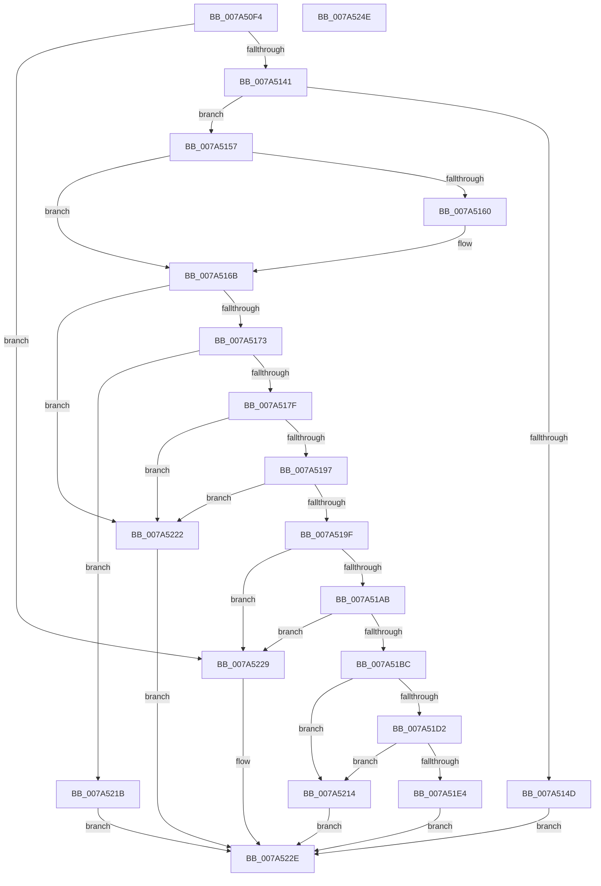

# SddlAddScopedPolicyIDAce

- RVA: `0x007A50F4`–`0x007A524F` (길이 `347` bytes)
- VA: `0x00000001407A50F4`
- 실행 섹션: `PAGE`
- PDB 이름 있음: `예`; PDB Function 태그: `아니요`
- unwind 정보 RVA: `0x000D1778`
- 디코드: `95`개 명령, `347/347` bytes 표시
- 미해석 바이트: `0` (있으면 어셈블리에 `.byte`로 보존)

> 이 문서는 커널 이미지의 기계어와 PDB 기호를 분석해 생성했습니다. 4번과 5번은 함수 원형과 자료형을 바이너리 사용 방식에서 추정한 C 해석이며 원본 소스 복구 결과는 아닙니다.

## 1. Dependencies

- 직접 호출 지점: **7**; 고유 호출 대상: **6**
- 직접 호출자로 확인된 함수: **1**
- RIP 상대 이미지 참조: **1**

### Outgoing calls
- `0x007A5144` → [RtlValidSid](../92/RtlValidSid_function_00929710.md) (function, `0x00929710`)
- `0x007A51A2` → [RtlValidAcl](../92/RtlValidAcl_function_0092A7A0.md) (function, `0x0092A7A0`)
- `0x007A51B3` → [RtlFirstFreeAce](../9A/RtlFirstFreeAce_function_009A8FF0.md) (function, `0x009A8FF0`)
- `0x007A51BF` → [RtlLengthSid](../../text/45/RtlLengthSid_function_0045D270.md) (function, `0x0045D270`)
- `0x007A51F6` → [RtlLengthSid](../../text/45/RtlLengthSid_function_0045D270.md) (function, `0x0045D270`)
- `0x007A5204` → [RtlCopySid](../9A/RtlCopySid_function_009A9A50.md) (function, `0x009A9A50`)
- `0x007A5236` → [_security_check_cookie](../../text/6A/_security_check_cookie_function_006AC640.md) (function, `0x006AC640`)

### Direct callers
- [LocalGetAclForString](../92/LocalGetAclForString_function_00927F30.md) at `0x00928EED`

### Static image references
- `0x007A5106` → RVA `0x00E0A740` (`.data`; read)

## 2. Other-region calls and transfers

- 다른 실행 섹션으로 향하는 call: **3**
  - `0x007A51BF` → [RtlLengthSid](../../text/45/RtlLengthSid_function_0045D270.md) (`PAGE` → `.text`)
  - `0x007A51F6` → [RtlLengthSid](../../text/45/RtlLengthSid_function_0045D270.md) (`PAGE` → `.text`)
  - `0x007A5236` → [_security_check_cookie](../../text/6A/_security_check_cookie_function_006AC640.md) (`PAGE` → `.text`)
- 별도 외부 분기/꼬리 이동을 확인하지 못했습니다.

## 3. Assembly (complete function range)

```asm
007A50F4  48 89 5C 24 10                  mov qword ptr [rsp + 0x10], rbx
007A50F9  48 89 6C 24 18                  mov qword ptr [rsp + 0x18], rbp
007A50FE  56                              push rsi
007A50FF  57                              push rdi
007A5100  41 56                           push r14
007A5102  48 83 EC 40                     sub rsp, 0x40
007A5106  48 8B 05 33 56 66 00            mov rax, qword ptr [rip + 0x665633]
007A510D  48 33 C4                        xor rax, rsp
007A5110  48 89 44 24 30                  mov qword ptr [rsp + 0x30], rax
007A5115  48 83 64 24 20 00               and qword ptr [rsp + 0x20], 0
007A511B  41 8B D9                        mov ebx, r9d
007A511E  83 64 24 28 00                  and dword ptr [rsp + 0x28], 0
007A5123  45 8B F0                        mov r14d, r8d
007A5126  48 8B B4 24 80 00 00 00         mov rsi, qword ptr [rsp + 0x80]
007A512E  48 8B F9                        mov rdi, rcx
007A5131  66 C7 44 24 2C 00 11            mov word ptr [rsp + 0x2c], 0x1100
007A5138  48 85 C9                        test rcx, rcx
007A513B  0F 84 E8 00 00 00               je 0x1407a5229
007A5141  48 8B CE                        mov rcx, rsi
007A5144  E8 C7 45 18 00                  call 0x140929710
007A5149  84 C0                           test al, al
007A514B  75 0A                           jne 0x1407a5157
007A514D  B8 78 00 00 C0                  mov eax, 0xc0000078
007A5152  E9 D7 00 00 00                  jmp 0x1407a522e
007A5157  8B 4E 02                        mov ecx, dword ptr [rsi + 2]
007A515A  2B 4C 24 28                     sub ecx, dword ptr [rsp + 0x28]
007A515E  75 0B                           jne 0x1407a516b
007A5160  0F B7 4E 06                     movzx ecx, word ptr [rsi + 6]
007A5164  0F B7 44 24 2C                  movzx eax, word ptr [rsp + 0x2c]
007A5169  2B C8                           sub ecx, eax
007A516B  85 C9                           test ecx, ecx
007A516D  0F 85 AF 00 00 00               jne 0x1407a5222
007A5173  0F B6 0F                        movzx ecx, byte ptr [rdi]
007A5176  80 F9 04                        cmp cl, 4
007A5179  0F 87 9C 00 00 00               ja 0x1407a521b
007A517F  BD 02 00 00 00                  mov ebp, 2
007A5184  40 3A CD                        cmp cl, bpl
007A5187  0F 47 E9                        cmova ebp, ecx
007A518A  41 F7 C6 E0 FF FF FF            test r14d, 0xffffffe0
007A5191  0F 85 8B 00 00 00               jne 0x1407a5222
007A5197  85 DB                           test ebx, ebx
007A5199  0F 85 83 00 00 00               jne 0x1407a5222
007A519F  48 8B CF                        mov rcx, rdi
007A51A2  E8 F9 55 18 00                  call 0x14092a7a0
007A51A7  84 C0                           test al, al
007A51A9  74 7E                           je 0x1407a5229
007A51AB  48 8D 54 24 20                  lea rdx, [rsp + 0x20]
007A51B0  48 8B CF                        mov rcx, rdi
007A51B3  E8 38 3E 20 00                  call 0x1409a8ff0
007A51B8  84 C0                           test al, al
007A51BA  74 6D                           je 0x1407a5229
007A51BC  48 8B CE                        mov rcx, rsi
007A51BF  E8 AC 80 CB FF                  call 0x14045d270
007A51C4  48 8B 5C 24 20                  mov rbx, qword ptr [rsp + 0x20]
007A51C9  66 83 C0 08                     add ax, 8
007A51CD  48 85 DB                        test rbx, rbx
007A51D0  74 42                           je 0x1407a5214
007A51D2  0F B7 57 02                     movzx edx, word ptr [rdi + 2]
007A51D6  0F B7 C8                        movzx ecx, ax
007A51D9  48 03 D7                        add rdx, rdi
007A51DC  48 03 CB                        add rcx, rbx
007A51DF  48 3B CA                        cmp rcx, rdx
007A51E2  77 30                           ja 0x1407a5214
007A51E4  83 63 04 00                     and dword ptr [rbx + 4], 0
007A51E8  48 8B CE                        mov rcx, rsi
007A51EB  44 88 73 01                     mov byte ptr [rbx + 1], r14b
007A51EF  C6 03 13                        mov byte ptr [rbx], 0x13
007A51F2  66 89 43 02                     mov word ptr [rbx + 2], ax
007A51F6  E8 75 80 CB FF                  call 0x14045d270
007A51FB  8B C8                           mov ecx, eax
007A51FD  48 8D 53 08                     lea rdx, [rbx + 8]
007A5201  4C 8B C6                        mov r8, rsi
007A5204  E8 47 48 20 00                  call 0x1409a9a50
007A5209  66 FF 47 04                     inc word ptr [rdi + 4]
007A520D  33 C0                           xor eax, eax
007A520F  40 88 2F                        mov byte ptr [rdi], bpl
007A5212  EB 1A                           jmp 0x1407a522e
007A5214  B8 99 00 00 C0                  mov eax, 0xc0000099
007A5219  EB 13                           jmp 0x1407a522e
007A521B  B8 59 00 00 C0                  mov eax, 0xc0000059
007A5220  EB 0C                           jmp 0x1407a522e
007A5222  B8 0D 00 00 C0                  mov eax, 0xc000000d
007A5227  EB 05                           jmp 0x1407a522e
007A5229  B8 77 00 00 C0                  mov eax, 0xc0000077
007A522E  48 8B 4C 24 30                  mov rcx, qword ptr [rsp + 0x30]
007A5233  48 33 CC                        xor rcx, rsp
007A5236  E8 05 74 F0 FF                  call 0x1406ac640
007A523B  48 8B 5C 24 68                  mov rbx, qword ptr [rsp + 0x68]
007A5240  48 8B 6C 24 70                  mov rbp, qword ptr [rsp + 0x70]
007A5245  48 83 C4 40                     add rsp, 0x40
007A5249  41 5E                           pop r14
007A524B  5F                              pop rdi
007A524C  5E                              pop rsi
007A524D  C3                              ret
007A524E  CC                              int3
```

## 4. C-style interpretation (structured pseudocode)

```c
__int64 __fastcall SddlAddScopedPolicyIDAce(__int64 a1, __int64 a2, int a3, int a4, __int64 a5)
{
    __int64 result;
    __int64 v_rbp;
    __int64 v_rsp;
    unsigned __int64 v_stack_m28;
    unsigned __int16 v_stack_m2C;
    unsigned int v_stack_m30;
    unsigned __int64 v_stack_m38;
    unsigned __int64 v_stack_p10;
    unsigned __int64 v_stack_p18;

    v_stack_p10 = v_rbx;
    v_stack_p18 = v_rbp;
    v_rsp = (v_rsp) - (64);
    result = (*(unsigned __int64 *)(v_rip + 6706739)) ^ (v_rsp);
    v_stack_m28 = result;
    v_stack_m2C = 0x1100ULL;
    if (a1 == 0) goto loc_007A5229;
    result = RtlValidSid(a5, a2, a3, a4);
    if ((unsigned __int8)(result) != 0) goto loc_007A5157;
    goto loc_007A522E;
loc_007A5157:
    a1 = (unsigned int)(((unsigned int)(*(unsigned int *)(a5 + 2))) - (v_stack_m30));
    result = (unsigned int)(0xC0000078ULL);
    if (!(condition_is_not_equal)) {
        a1 = *(unsigned __int16 *)(a5 + 6);
        result = v_stack_m2C;
        a1 = (unsigned int)((a1) - ((unsigned int)(result)));
    }
    if ((unsigned int)(a1) != 0) goto loc_007A5222;
    if (((unsigned __int8)(*(unsigned __int8 *)(a1))) > 4) goto loc_007A521B;
    v_rbp = 2;
    if (((unsigned __int8)(*(unsigned __int8 *)(a1))) > 2) { v_rbp = (unsigned int)(*(unsigned __int8 *)(a1)); }
    if ((((unsigned int)((unsigned int)(a3))) & (0xFFFFFFE0ULL)) != 0) goto loc_007A5222;
    if ((unsigned int)((unsigned int)(a4)) != 0) goto loc_007A5222;
    result = RtlValidAcl(a1, a2, a3, a4);
    if ((unsigned __int8)(result) == 0) goto loc_007A5229;
    result = RtlFirstFreeAce(a1, v_stack_m38, a3, a4);
    if ((unsigned __int8)(result) == 0) goto loc_007A5229;
    result = RtlLengthSid(a5, v_stack_m38, a3, a4);
    result = (unsigned __int16)((result) + (8));
    if (v_stack_m38 == 0) goto loc_007A5214;
    a2 = (*(unsigned __int16 *)(a1 + 2)) + (a1);
    a1 = ((unsigned __int16)(result)) + (v_stack_m38);
    if (a1 > a2) goto loc_007A5214;
    *(unsigned __int8 *)(v_stack_m38 + 1) = (unsigned __int8)((unsigned int)(a3));
    *(unsigned __int8 *)(v_stack_m38) = 19;
    *(unsigned __int16 *)(v_stack_m38 + 2) = (unsigned __int16)(result);
    result = RtlLengthSid(a5, a2, a3, a4);
    result = RtlCopySid((unsigned int)((unsigned int)(result)), v_stack_m38 + 8, a5, a4);
    result = 0;
    *(unsigned __int8 *)(a1) = (unsigned __int8)(v_rbp);
    goto loc_007A522E;
loc_007A5214:
    goto loc_007A522E;
loc_007A521B:
    goto loc_007A522E;
loc_007A5222:
    goto loc_007A522E;
loc_007A5229:
loc_007A522E:
    a1 = (v_stack_m28) ^ (v_rsp);
    result = _security_check_cookie(a1, v_stack_m38 + 8, a5, a4);
    v_rsp = (v_rsp) + (64);
    return result;
}
```

## 5. (Beta) C Style

```c
int64_t SddlAddScopedPolicyIDAce(void *Arg1, int64_t Arg2, int32_t Arg3, int32_t Arg4, void *Arg5)
{
    uint8_t *arg1 = (uint8_t *)Arg1;
    uint8_t *arg5 = (uint8_t *)Arg5;

    int64_t result;
    int64_t local_rbp;
    int64_t local_rsp;
    uint64_t v_stack_m28;
    uint16_t v_stack_m2C;
    uint32_t v_stack_m30;
    uint64_t v_stack_m38;
    uint64_t v_stack_p10;
    uint64_t v_stack_p18;

    v_stack_p10 = local_rbx;
    v_stack_p18 = local_rbp;
    local_rsp = (local_rsp) - (64);
    result = (*(uint64_t *)(v_rip + 0x665633)) ^ (local_rsp);
    v_stack_m28 = result;
    v_stack_m2C = 0x1100ULL;
    if (Arg1 == NULL) goto loc_007A5229;
    result = RtlValidSid(Arg5, Arg2, Arg3, Arg4);
    if ((uint8_t)(result) != 0) goto loc_007A5157;
    goto loc_007A522E;
loc_007A5157:
    Arg1 = (uint32_t)(((uint32_t)(*(uint32_t *)(arg5 + 0x2))) - (v_stack_m30));
    result = (uint32_t)(0xC0000078ULL);
    if (!(condition_is_not_equal)) {
        Arg1 = *(uint16_t *)(arg5 + 0x6);
        result = v_stack_m2C;
        Arg1 = (uint32_t)((Arg1) - ((uint32_t)(result)));
    }
    if ((uint32_t)(Arg1) != 0) goto loc_007A5222;
    if (((uint8_t)(*(uint8_t *)(arg1))) > 4) goto loc_007A521B;
    local_rbp = 2;
    if (((uint8_t)(*(uint8_t *)(arg1))) > 2) { local_rbp = (uint32_t)(*(uint8_t *)(arg1)); }
    if ((((uint32_t)((uint32_t)(Arg3))) & (0xFFFFFFE0ULL)) != 0) goto loc_007A5222;
    if ((uint32_t)((uint32_t)(Arg4)) != 0) goto loc_007A5222;
    result = RtlValidAcl(Arg1, Arg2, Arg3, Arg4);
    if ((uint8_t)(result) == 0) goto loc_007A5229;
    result = RtlFirstFreeAce(Arg1, v_stack_m38, Arg3, Arg4);
    if ((uint8_t)(result) == 0) goto loc_007A5229;
    result = RtlLengthSid(Arg5, v_stack_m38, Arg3, Arg4);
    result = (uint16_t)((result) + (8));
    if (v_stack_m38 == 0) goto loc_007A5214;
    Arg2 = (*(uint16_t *)(arg1 + 0x2)) + (Arg1);
    Arg1 = ((uint16_t)(result)) + (v_stack_m38);
    if (Arg1 > Arg2) goto loc_007A5214;
    *(uint8_t *)(v_stack_m38 + 0x1) = (uint8_t)((uint32_t)(Arg3));
    *(uint8_t *)(v_stack_m38) = 19;
    *(uint16_t *)(v_stack_m38 + 0x2) = (uint16_t)(result);
    result = RtlLengthSid(Arg5, Arg2, Arg3, Arg4);
    result = RtlCopySid((uint32_t)((uint32_t)(result)), v_stack_m38 + 8, Arg5, Arg4);
    result = 0;
    *(uint8_t *)(arg1) = (uint8_t)(local_rbp);
    goto loc_007A522E;
loc_007A5214:
    goto loc_007A522E;
loc_007A521B:
    goto loc_007A522E;
loc_007A5222:
    goto loc_007A522E;
loc_007A5229:
loc_007A522E:
    Arg1 = (v_stack_m28) ^ (local_rsp);
    result = _security_check_cookie(Arg1, v_stack_m38 + 8, Arg5, Arg4);
    local_rsp = (local_rsp) + (64);
    return result;
}
```

### 관측된 메모리 오프셋

구조체 형식이 확인되지 않은 접근은 인자 기준의 오프셋으로만 기록했습니다.

| 기준 인자 | 오프셋 표현 | 폭 (bit) | 접근 |
|---|---:|---:|---|
| `Arg1` | `+ 0x0` | `8` | `R` |
| `Arg1` | `+ 0x0` | `8` | `W` |
| `Arg1` | `+ 0x2` | `16` | `R` |
| `Arg1` | `+ 0x4` | `16` | `R/W` |
| `Arg5` | `+ 0x2` | `32` | `R` |
| `Arg5` | `+ 0x6` | `16` | `R` |

## 6. Execution-region graph

[열기: 2D/3D 그래프와 함수 탐색 컨트롤 패널](../../../control-panel.html?section=page&rva=0x007A50F4&view=graph)

- 2D 그래프는 위에서 아래로 흐르고, 3D 그래프는 빈 공간을 드래그해 회전합니다. Shift+드래그는 이동, 휠은 확대·축소, 함수 노드 선택은 대상 보고서 이동입니다.

### Static fallback


