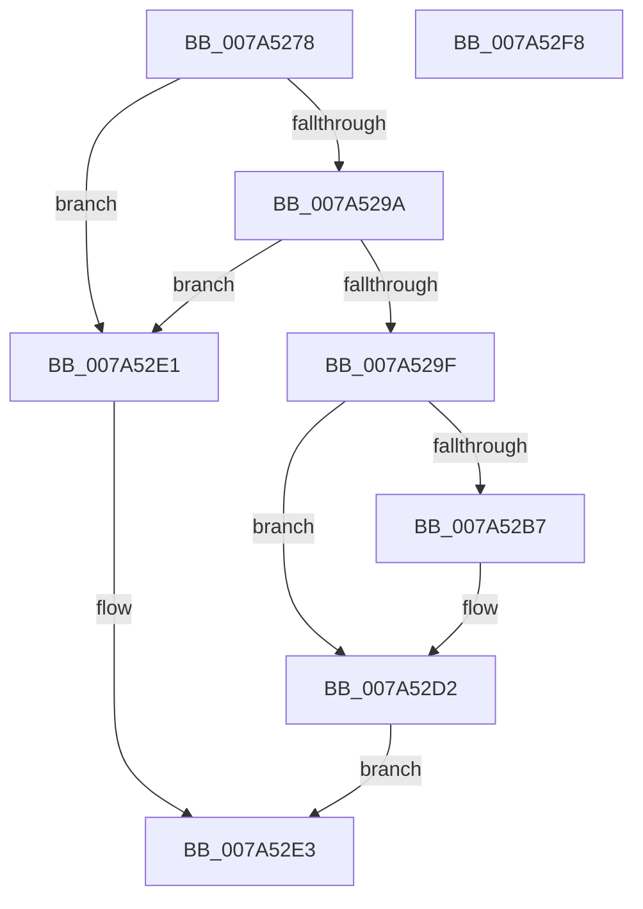

# SddlpReAlloc

- RVA: `0x007A5278`–`0x007A52F9` (길이 `129` bytes)
- VA: `0x00000001407A5278`
- 실행 섹션: `PAGE`
- PDB 이름 있음: `예`; PDB Function 태그: `아니요`
- unwind 정보 RVA: `0x0005C954`
- 디코드: `39`개 명령, `129/129` bytes 표시
- 미해석 바이트: `0` (있으면 어셈블리에 `.byte`로 보존)

> 이 문서는 커널 이미지의 기계어와 PDB 기호를 분석해 생성했습니다. 4번과 5번은 함수 원형과 자료형을 바이너리 사용 방식에서 추정한 C 해석이며 원본 소스 복구 결과는 아닙니다.

## 1. Dependencies

- 직접 호출 지점: **4**; 고유 호출 대상: **4**
- 직접 호출자로 확인된 함수: **2**
- RIP 상대 이미지 참조: **0**

### Outgoing calls
- `0x007A52AA` → [ExAllocatePoolWithTag](../../poolcode/B8/ExAllocatePoolWithTag_function_00B82010.md) (function, `0x00B82010`)
- `0x007A52BF` → [memset](../../text/6C/memset_function_006C6C40.md) (function, `0x006C6C40`)
- `0x007A52CD` → [memcpy](../../text/6C/memcpy_function_006C6840.md) (function, `0x006C6840`)
- `0x007A52D7` → [ExFreePoolWithTag](../../poolcode/B8/ExFreePoolWithTag_function_00B82870.md) (function, `0x00B82870`)

### Direct callers
- [sub_00B32AA2](../B3/Unknown_function_00B32AA2.md) at `0x00B32CBD`
- [sub_00B32FE4](../B3/Unknown_function_00B32FE4.md) at `0x00B330B3`

### Static image references
- 디코드된 RIP-relative 메모리 참조가 없습니다.

## 2. Other-region calls and transfers

- 다른 실행 섹션으로 향하는 call: **4**
  - `0x007A52AA` → [ExAllocatePoolWithTag](../../poolcode/B8/ExAllocatePoolWithTag_function_00B82010.md) (`PAGE` → `POOLCODE`)
  - `0x007A52BF` → [memset](../../text/6C/memset_function_006C6C40.md) (`PAGE` → `.text`)
  - `0x007A52CD` → [memcpy](../../text/6C/memcpy_function_006C6840.md) (`PAGE` → `.text`)
  - `0x007A52D7` → [ExFreePoolWithTag](../../poolcode/B8/ExFreePoolWithTag_function_00B82870.md) (`PAGE` → `POOLCODE`)
- 별도 외부 분기/꼬리 이동을 확인하지 못했습니다.

## 3. Assembly (complete function range)

```asm
007A5278  48 89 5C 24 08                  mov qword ptr [rsp + 8], rbx
007A527D  48 89 6C 24 10                  mov qword ptr [rsp + 0x10], rbp
007A5282  48 89 74 24 18                  mov qword ptr [rsp + 0x18], rsi
007A5287  57                              push rdi
007A5288  48 83 EC 20                     sub rsp, 0x20
007A528C  49 8B F0                        mov rsi, r8
007A528F  48 8B FA                        mov rdi, rdx
007A5292  48 8B E9                        mov rbp, rcx
007A5295  4D 85 C0                        test r8, r8
007A5298  74 47                           je 0x1407a52e1
007A529A  48 3B D1                        cmp rdx, rcx
007A529D  72 42                           jb 0x1407a52e1
007A529F  B9 01 00 00 00                  mov ecx, 1
007A52A4  41 B8 53 65 53 64               mov r8d, 0x64536553
007A52AA  E8 61 CD 3D 00                  call 0x140b82010
007A52AF  48 8B D8                        mov rbx, rax
007A52B2  48 85 C0                        test rax, rax
007A52B5  74 1B                           je 0x1407a52d2
007A52B7  4C 8B C7                        mov r8, rdi
007A52BA  33 D2                           xor edx, edx
007A52BC  48 8B C8                        mov rcx, rax
007A52BF  E8 7C 19 F2 FF                  call 0x1406c6c40
007A52C4  4C 8B C5                        mov r8, rbp
007A52C7  48 8B D6                        mov rdx, rsi
007A52CA  48 8B CB                        mov rcx, rbx
007A52CD  E8 6E 15 F2 FF                  call 0x1406c6840
007A52D2  33 D2                           xor edx, edx
007A52D4  48 8B CE                        mov rcx, rsi
007A52D7  E8 94 D5 3D 00                  call 0x140b82870
007A52DC  48 8B C3                        mov rax, rbx
007A52DF  EB 02                           jmp 0x1407a52e3
007A52E1  33 C0                           xor eax, eax
007A52E3  48 8B 5C 24 30                  mov rbx, qword ptr [rsp + 0x30]
007A52E8  48 8B 6C 24 38                  mov rbp, qword ptr [rsp + 0x38]
007A52ED  48 8B 74 24 40                  mov rsi, qword ptr [rsp + 0x40]
007A52F2  48 83 C4 20                     add rsp, 0x20
007A52F6  5F                              pop rdi
007A52F7  C3                              ret
007A52F8  CC                              int3
```

## 4. C-style interpretation (structured pseudocode)

```c
__int64 __fastcall SddlpReAlloc(__int64 a1, __int64 a2, __int64 a3)
{
    __int64 result;
    __int64 v_rsp;
    unsigned __int64 v_stack_p10;
    unsigned __int64 v_stack_p18;
    unsigned __int64 v_stack_p8;

    v_stack_p8 = v_rbx;
    v_stack_p10 = v_rbp;
    v_stack_p18 = v_rsi;
    v_rsp = (v_rsp) - (32);
    if (a3 == 0) goto loc_007A52E1;
    if (a2 < a1) goto loc_007A52E1;
    result = ExAllocatePoolWithTag(1, a2, (unsigned int)(0x64536553ULL), a4);
    if (result != 0) {
        a3 = a2;
        a2 = 0;
        a1 = result;
        result = memset(a1, a2, a3, a4);
        a3 = a1;
        a2 = a3;
        a1 = result;
        result = memcpy(a1, a2, a3, a4);
    }
    a2 = 0;
    result = ExFreePoolWithTag(a3, a2, a3, a4);
    goto loc_007A52E3;
loc_007A52E1:
    result = 0;
loc_007A52E3:
    v_rsp = (v_rsp) + (32);
    return result;
}
```

## 5. (Beta) C Style

```c
int64_t SddlpReAlloc(int64_t Arg1, int64_t Arg2, int64_t Arg3)
{
    int64_t result;
    int64_t local_rsp;
    uint64_t v_stack_p10;
    uint64_t v_stack_p18;
    uint64_t v_stack_p8;

    v_stack_p8 = local_rbx;
    v_stack_p10 = local_rbp;
    v_stack_p18 = local_rsi;
    local_rsp = (local_rsp) - (32);
    if (Arg3 == 0) goto loc_007A52E1;
    if (Arg2 < Arg1) goto loc_007A52E1;
    result = ExAllocatePoolWithTag(1, Arg2, (uint32_t)(0x64536553ULL), a4);
    if (result != 0) {
        Arg3 = Arg2;
        Arg2 = 0;
        Arg1 = result;
        result = memset(Arg1, Arg2, Arg3, a4);
        Arg3 = Arg1;
        Arg2 = Arg3;
        Arg1 = result;
        result = memcpy(Arg1, Arg2, Arg3, a4);
    }
    Arg2 = 0;
    result = ExFreePoolWithTag(Arg3, Arg2, Arg3, a4);
    goto loc_007A52E3;
loc_007A52E1:
    result = 0;
loc_007A52E3:
    local_rsp = (local_rsp) + (32);
    return result;
}
```

## 6. Execution-region graph

[열기: 2D/3D 그래프와 함수 탐색 컨트롤 패널](../../../control-panel.html?section=page&rva=0x007A5278&view=graph)

- 2D 그래프는 위에서 아래로 흐르고, 3D 그래프는 빈 공간을 드래그해 회전합니다. Shift+드래그는 이동, 휠은 확대·축소, 함수 노드 선택은 대상 보고서 이동입니다.

### Static fallback


