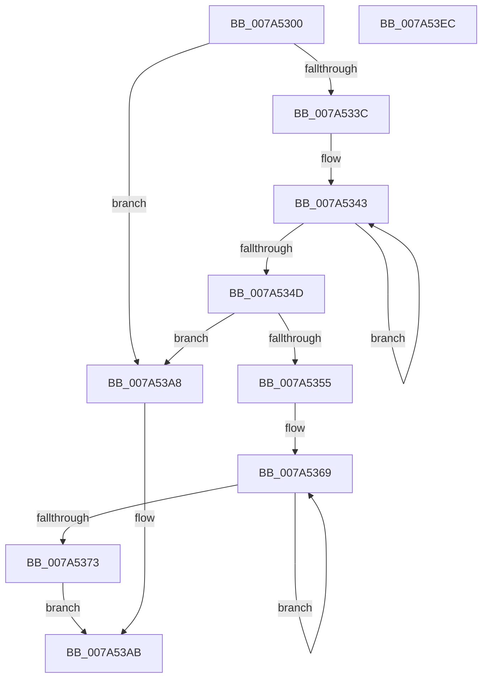

# SddlpUuidFromString

- RVA: `0x007A5300`–`0x007A53ED` (길이 `237` bytes)
- VA: `0x00000001407A5300`
- 실행 섹션: `PAGE`
- PDB 이름 있음: `예`; PDB Function 태그: `아니요`
- unwind 정보 RVA: `0x000BD914`
- 디코드: `60`개 명령, `237/237` bytes 표시
- 미해석 바이트: `0` (있으면 어셈블리에 `.byte`로 보존)

> 이 문서는 커널 이미지의 기계어와 PDB 기호를 분석해 생성했습니다. 4번과 5번은 함수 원형과 자료형을 바이너리 사용 방식에서 추정한 C 해석이며 원본 소스 복구 결과는 아닙니다.

## 1. Dependencies

- 직접 호출 지점: **6**; 고유 호출 대상: **5**
- 직접 호출자로 확인된 함수: **1**
- RIP 상대 이미지 참조: **2**

### Outgoing calls
- `0x007A5364` → [memset](../../text/6C/memset_function_006C6C40.md) (function, `0x006C6C40`)
- `0x007A5385` → [wcsncat_s](../../text/50/wcsncat_s_function_00506540.md) (function, `0x00506540`)
- `0x007A539C` → [wcsncat_s](../../text/50/wcsncat_s_function_00506540.md) (function, `0x00506540`)
- `0x007A53B0` → [RtlInitUnicodeString](../../text/42/RtlInitUnicodeString_function_0042A780.md) (function, `0x0042A780`)
- `0x007A53BD` → [RtlGUIDFromString](../8F/RtlGUIDFromString_function_008F1EF0.md) (function, `0x008F1EF0`)
- `0x007A53D2` → [_security_check_cookie](../../text/6A/_security_check_cookie_function_006AC640.md) (function, `0x006AC640`)

### Direct callers
- [sub_00B22C34](../B2/Unknown_function_00B22C34.md) at `0x00B22C5C`
- [sub_00B22C34](../B2/Unknown_function_00B22C34.md) at `0x00B22C73`

### Static image references
- `0x007A5312` → RVA `0x00E0A740` (`.data`; read)
- `0x007A5390` → RVA `0x00037E68` (`.rdata`; read)

## 2. Other-region calls and transfers

- 다른 실행 섹션으로 향하는 call: **5**
  - `0x007A5364` → [memset](../../text/6C/memset_function_006C6C40.md) (`PAGE` → `.text`)
  - `0x007A5385` → [wcsncat_s](../../text/50/wcsncat_s_function_00506540.md) (`PAGE` → `.text`)
  - `0x007A539C` → [wcsncat_s](../../text/50/wcsncat_s_function_00506540.md) (`PAGE` → `.text`)
  - `0x007A53B0` → [RtlInitUnicodeString](../../text/42/RtlInitUnicodeString_function_0042A780.md) (`PAGE` → `.text`)
  - `0x007A53D2` → [_security_check_cookie](../../text/6A/_security_check_cookie_function_006AC640.md) (`PAGE` → `.text`)
- 별도 외부 분기/꼬리 이동을 확인하지 못했습니다.

## 3. Assembly (complete function range)

```asm
007A5300  48 89 5C 24 18                  mov qword ptr [rsp + 0x18], rbx
007A5305  48 89 74 24 20                  mov qword ptr [rsp + 0x20], rsi
007A530A  57                              push rdi
007A530B  48 81 EC 90 00 00 00            sub rsp, 0x90
007A5312  48 8B 05 27 54 66 00            mov rax, qword ptr [rip + 0x665427]
007A5319  48 33 C4                        xor rax, rsp
007A531C  48 89 84 24 80 00 00 00         mov qword ptr [rsp + 0x80], rax
007A5324  48 8B D9                        mov rbx, rcx
007A5327  0F 57 C0                        xorps xmm0, xmm0
007A532A  B9 7B 00 00 00                  mov ecx, 0x7b
007A532F  48 8B F2                        mov rsi, rdx
007A5332  0F 11 44 24 20                  movups xmmword ptr [rsp + 0x20], xmm0
007A5337  66 39 0B                        cmp word ptr [rbx], cx
007A533A  74 6C                           je 0x1407a53a8
007A533C  48 83 CF FF                     or rdi, 0xffffffffffffffff
007A5340  48 8B C7                        mov rax, rdi
007A5343  48 FF C0                        inc rax
007A5346  66 83 3C 43 00                  cmp word ptr [rbx + rax*2], 0
007A534B  75 F6                           jne 0x1407a5343
007A534D  66 83 7C 43 FE 7D               cmp word ptr [rbx + rax*2 - 2], 0x7d
007A5353  74 53                           je 0x1407a53a8
007A5355  33 D2                           xor edx, edx
007A5357  89 4C 24 30                     mov dword ptr [rsp + 0x30], ecx
007A535B  48 8D 4C 24 34                  lea rcx, [rsp + 0x34]
007A5360  44 8D 42 4A                     lea r8d, [rdx + 0x4a]
007A5364  E8 D7 18 F2 FF                  call 0x1406c6c40
007A5369  48 FF C7                        inc rdi
007A536C  66 83 3C 7B 00                  cmp word ptr [rbx + rdi*2], 0
007A5371  75 F6                           jne 0x1407a5369
007A5373  4C 8B C3                        mov r8, rbx
007A5376  48 8D 4C 24 30                  lea rcx, [rsp + 0x30]
007A537B  BB 27 00 00 00                  mov ebx, 0x27
007A5380  4C 8B CF                        mov r9, rdi
007A5383  8B D3                           mov edx, ebx
007A5385  E8 B6 11 D6 FF                  call 0x140506540
007A538A  44 8D 4B DB                     lea r9d, [rbx - 0x25]
007A538E  8B D3                           mov edx, ebx
007A5390  4C 8D 05 D1 2A 89 FF            lea r8, [rip - 0x76d52f]
007A5397  48 8D 4C 24 30                  lea rcx, [rsp + 0x30]
007A539C  E8 9F 11 D6 FF                  call 0x140506540
007A53A1  48 8D 54 24 30                  lea rdx, [rsp + 0x30]
007A53A6  EB 03                           jmp 0x1407a53ab
007A53A8  48 8B D3                        mov rdx, rbx
007A53AB  48 8D 4C 24 20                  lea rcx, [rsp + 0x20]
007A53B0  E8 CB 53 C8 FF                  call 0x14042a780
007A53B5  48 8B D6                        mov rdx, rsi
007A53B8  48 8D 4C 24 20                  lea rcx, [rsp + 0x20]
007A53BD  E8 2E CB 14 00                  call 0x1408f1ef0
007A53C2  F7 D0                           not eax
007A53C4  C1 E8 1F                        shr eax, 0x1f
007A53C7  48 8B 8C 24 80 00 00 00         mov rcx, qword ptr [rsp + 0x80]
007A53CF  48 33 CC                        xor rcx, rsp
007A53D2  E8 69 72 F0 FF                  call 0x1406ac640
007A53D7  4C 8D 9C 24 90 00 00 00         lea r11, [rsp + 0x90]
007A53DF  49 8B 5B 20                     mov rbx, qword ptr [r11 + 0x20]
007A53E3  49 8B 73 28                     mov rsi, qword ptr [r11 + 0x28]
007A53E7  49 8B E3                        mov rsp, r11
007A53EA  5F                              pop rdi
007A53EB  C3                              ret
007A53EC  CC                              int3
```

## 4. C-style interpretation (structured pseudocode)

```c
__int64 __fastcall SddlpUuidFromString(__int64 a1, __int64 a2)
{
    __int64 result;
    __int64 v_rdi;
    __int64 v_rsp;
    unsigned __int64 v_stack_m18;
    unsigned __int64 v_stack_m64;
    unsigned int v_stack_m68;
    unsigned __int64 v_stack_m78;
    unsigned __int64 v_stack_m8;
    unsigned __int64 v_stack_p18;
    unsigned __int64 v_stack_p20;

    v_stack_p18 = v_rbx;
    v_stack_p20 = v_rsi;
    v_rsp = (v_rsp) - (144);
    result = (*(unsigned __int64 *)(v_rip + 6706215)) ^ (v_rsp);
    v_stack_m18 = result;
    v_stack_m78 = v_xmm0;
    if ((*(unsigned __int16 *)(a1)) == 123) goto loc_007A53A8;
    v_rdi = (v_rdi) | (-1);
loc_007A5343:
    result = (v_rdi) + 1;
    if ((*(unsigned __int16 *)(a1 + result * 2)) != 0) goto loc_007A5343;
    if ((*(unsigned __int16 *)(a1 + result * 2 - 2)) == 125) goto loc_007A53A8;
    a2 = 0;
    v_stack_m68 = 123;
    result = memset(v_stack_m64, a2, a2 + 74, a4);
loc_007A5369:
    v_rdi = (v_rdi) + 1;
    if ((*(unsigned __int16 *)(a1 + v_rdi * 2)) != 0) goto loc_007A5369;
    result = wcsncat_s(v_stack_m68, 39, a1, v_rdi);
    result = wcsncat_s(v_stack_m68, 39, v_rip - 7787823, 39 - 37);
    goto loc_007A53AB;
loc_007A53A8:
loc_007A53AB:
    result = RtlInitUnicodeString(v_stack_m78, 39, v_rip - 7787823, 39 - 37);
    result = RtlGUIDFromString(v_stack_m78, 0, v_rip - 7787823, 39 - 37);
    result = (unsigned int)(~(result));
    result = (unsigned int)((result) >> (31));
    a1 = (v_stack_m18) ^ (v_rsp);
    result = _security_check_cookie(a1, 0, v_rip - 7787823, 39 - 37);
    return result;
}
```

## 5. (Beta) C Style

```c
int64_t SddlpUuidFromString(void *Arg1, int64_t Arg2)
{
    uint8_t *arg1 = (uint8_t *)Arg1;

    int64_t result;
    int64_t local_rdi;
    int64_t local_rsp;
    uint64_t v_stack_m18;
    uint64_t v_stack_m64;
    uint32_t v_stack_m68;
    uint64_t v_stack_m78;
    uint64_t v_stack_m8;
    uint64_t v_stack_p18;
    uint64_t v_stack_p20;

    v_stack_p18 = local_rbx;
    v_stack_p20 = local_rsi;
    local_rsp = (local_rsp) - (144);
    result = (*(uint64_t *)(v_rip + 0x665427)) ^ (local_rsp);
    v_stack_m18 = result;
    v_stack_m78 = v_xmm0;
    if ((*(uint16_t *)(arg1)) == 123) goto loc_007A53A8;
    local_rdi = (local_rdi) | (-1);
loc_007A5343:
    result = (local_rdi) + 1;
    if ((*(uint16_t *)(arg1 + result * 2)) != 0) goto loc_007A5343;
    if ((*(uint16_t *)(arg1 + result * 2 - 0x2)) == 125) goto loc_007A53A8;
    Arg2 = 0;
    v_stack_m68 = 123;
    result = memset(v_stack_m64, Arg2, Arg2 + 74, a4);
loc_007A5369:
    local_rdi = (local_rdi) + 1;
    if ((*(uint16_t *)(arg1 + local_rdi * 2)) != 0) goto loc_007A5369;
    result = wcsncat_s(v_stack_m68, 39, Arg1, local_rdi);
    result = wcsncat_s(v_stack_m68, 39, v_rip - 7787823, 39 - 37);
    goto loc_007A53AB;
loc_007A53A8:
loc_007A53AB:
    result = RtlInitUnicodeString(v_stack_m78, 39, v_rip - 7787823, 39 - 37);
    result = RtlGUIDFromString(v_stack_m78, 0, v_rip - 7787823, 39 - 37);
    result = (uint32_t)(~(result));
    result = (uint32_t)((result) >> (31));
    Arg1 = (v_stack_m18) ^ (local_rsp);
    result = _security_check_cookie(Arg1, 0, v_rip - 7787823, 39 - 37);
    return result;
}
```

### 관측된 메모리 오프셋

구조체 형식이 확인되지 않은 접근은 인자 기준의 오프셋으로만 기록했습니다.

| 기준 인자 | 오프셋 표현 | 폭 (bit) | 접근 |
|---|---:|---:|---|
| `Arg1` | `- 0x2 + rax*2` | `16` | `R` |
| `Arg1` | `+ 0x0` | `16` | `R` |
| `Arg1` | `+ 0x0 + rax*2` | `16` | `R` |
| `Arg1` | `+ 0x0 + rdi*2` | `16` | `R` |

## 6. Execution-region graph

[열기: 2D/3D 그래프와 함수 탐색 컨트롤 패널](../../../control-panel.html?section=page&rva=0x007A5300&view=graph)

- 2D 그래프는 위에서 아래로 흐르고, 3D 그래프는 빈 공간을 드래그해 회전합니다. Shift+드래그는 이동, 휠은 확대·축소, 함수 노드 선택은 대상 보고서 이동입니다.

### Static fallback


