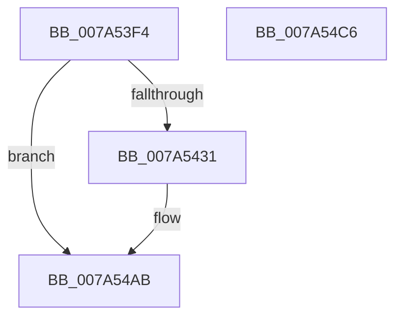

# SddlpUuidToString

- RVA: `0x007A53F4`–`0x007A54C7` (길이 `211` bytes)
- VA: `0x00000001407A53F4`
- 실행 섹션: `PAGE`
- PDB 이름 있음: `예`; PDB Function 태그: `아니요`
- unwind 정보 RVA: `0x000D175C`
- 디코드: `52`개 명령, `211/211` bytes 표시
- 미해석 바이트: `0` (있으면 어셈블리에 `.byte`로 보존)

> 이 문서는 커널 이미지의 기계어와 PDB 기호를 분석해 생성했습니다. 4번과 5번은 함수 원형과 자료형을 바이너리 사용 방식에서 추정한 C 해석이며 원본 소스 복구 결과는 아닙니다.

## 1. Dependencies

- 직접 호출 지점: **2**; 고유 호출 대상: **2**
- 직접 호출자로 확인된 함수: **1**
- RIP 상대 이미지 참조: **1**

### Outgoing calls
- `0x007A5421` → [ExAllocatePoolWithTag](../../poolcode/B8/ExAllocatePoolWithTag_function_00B82010.md) (function, `0x00B82010`)
- `0x007A54A1` → [swprintf_s](../../text/50/swprintf_s_function_00504B20.md) (function, `0x00504B20`)

### Direct callers
- [LocalConvertAclToString](../A0/LocalConvertAclToString_function_00A00408.md) at `0x00A01075`
- [LocalConvertAclToString](../A0/LocalConvertAclToString_function_00A00408.md) at `0x00A01099`

### Static image references
- `0x007A547C` → RVA `0x00037E70` (`.rdata`; read)

## 2. Other-region calls and transfers

- 다른 실행 섹션으로 향하는 call: **2**
  - `0x007A5421` → [ExAllocatePoolWithTag](../../poolcode/B8/ExAllocatePoolWithTag_function_00B82010.md) (`PAGE` → `POOLCODE`)
  - `0x007A54A1` → [swprintf_s](../../text/50/swprintf_s_function_00504B20.md) (`PAGE` → `.text`)
- 별도 외부 분기/꼬리 이동을 확인하지 못했습니다.

## 3. Assembly (complete function range)

```asm
007A53F4  48 8B C4                        mov rax, rsp
007A53F7  48 89 58 08                     mov qword ptr [rax + 8], rbx
007A53FB  48 89 68 10                     mov qword ptr [rax + 0x10], rbp
007A53FF  48 89 70 18                     mov qword ptr [rax + 0x18], rsi
007A5403  48 89 78 20                     mov qword ptr [rax + 0x20], rdi
007A5407  41 56                           push r14
007A5409  48 83 EC 70                     sub rsp, 0x70
007A540D  48 8B DA                        mov rbx, rdx
007A5410  4C 8B F1                        mov r14, rcx
007A5413  BA 4A 00 00 00                  mov edx, 0x4a
007A5418  41 B8 53 65 53 64               mov r8d, 0x64536553
007A541E  8D 4A B7                        lea ecx, [rdx - 0x49]
007A5421  E8 EA CB 3D 00                  call 0x140b82010
007A5426  48 89 03                        mov qword ptr [rbx], rax
007A5429  48 8B E8                        mov rbp, rax
007A542C  48 85 C0                        test rax, rax
007A542F  74 7A                           je 0x1407a54ab
007A5431  41 0F B6 4E 0E                  movzx ecx, byte ptr [r14 + 0xe]
007A5436  41 0F B6 56 0D                  movzx edx, byte ptr [r14 + 0xd]
007A543B  45 0F B6 46 0C                  movzx r8d, byte ptr [r14 + 0xc]
007A5440  45 0F B6 4E 0B                  movzx r9d, byte ptr [r14 + 0xb]
007A5445  41 0F B6 46 0F                  movzx eax, byte ptr [r14 + 0xf]
007A544A  45 0F B6 56 0A                  movzx r10d, byte ptr [r14 + 0xa]
007A544F  45 0F B6 5E 09                  movzx r11d, byte ptr [r14 + 9]
007A5454  41 0F B6 5E 08                  movzx ebx, byte ptr [r14 + 8]
007A5459  41 0F B7 7E 06                  movzx edi, word ptr [r14 + 6]
007A545E  41 0F B7 76 04                  movzx esi, word ptr [r14 + 4]
007A5463  89 44 24 68                     mov dword ptr [rsp + 0x68], eax
007A5467  89 4C 24 60                     mov dword ptr [rsp + 0x60], ecx
007A546B  48 8B CD                        mov rcx, rbp
007A546E  89 54 24 58                     mov dword ptr [rsp + 0x58], edx
007A5472  BA 25 00 00 00                  mov edx, 0x25
007A5477  44 89 44 24 50                  mov dword ptr [rsp + 0x50], r8d
007A547C  4C 8D 05 ED 29 89 FF            lea r8, [rip - 0x76d613]
007A5483  44 89 4C 24 48                  mov dword ptr [rsp + 0x48], r9d
007A5488  45 8B 0E                        mov r9d, dword ptr [r14]
007A548B  44 89 54 24 40                  mov dword ptr [rsp + 0x40], r10d
007A5490  44 89 5C 24 38                  mov dword ptr [rsp + 0x38], r11d
007A5495  89 5C 24 30                     mov dword ptr [rsp + 0x30], ebx
007A5499  89 7C 24 28                     mov dword ptr [rsp + 0x28], edi
007A549D  89 74 24 20                     mov dword ptr [rsp + 0x20], esi
007A54A1  E8 7A F6 D5 FF                  call 0x140504b20
007A54A6  B8 01 00 00 00                  mov eax, 1
007A54AB  4C 8D 5C 24 70                  lea r11, [rsp + 0x70]
007A54B0  49 8B 5B 10                     mov rbx, qword ptr [r11 + 0x10]
007A54B4  49 8B 6B 18                     mov rbp, qword ptr [r11 + 0x18]
007A54B8  49 8B 73 20                     mov rsi, qword ptr [r11 + 0x20]
007A54BC  49 8B 7B 28                     mov rdi, qword ptr [r11 + 0x28]
007A54C0  49 8B E3                        mov rsp, r11
007A54C3  41 5E                           pop r14
007A54C5  C3                              ret
007A54C6  CC                              int3
```

## 4. C-style interpretation (structured pseudocode)

```c
__int64 __fastcall SddlpUuidToString(__int64 a1, __int64 a2)
{
    __int64 result;
    __int64 v_r10;
    __int64 v_r11;
    __int64 v_rbx;
    __int64 v_rdi;
    __int64 v_rsi;
    __int64 v_rsp;
    unsigned int v_stack_m10;
    unsigned int v_stack_m18;
    unsigned int v_stack_m20;
    unsigned int v_stack_m28;
    unsigned int v_stack_m30;
    unsigned int v_stack_m38;
    unsigned int v_stack_m40;
    unsigned int v_stack_m48;
    unsigned int v_stack_m50;
    unsigned int v_stack_m58;
    unsigned __int64 v_stack_m8;

    *(unsigned __int64 *)(v_rsp + 8) = v_rbx;
    *(unsigned __int64 *)(v_rsp + 16) = v_rbp;
    *(unsigned __int64 *)(v_rsp + 24) = v_rsi;
    *(unsigned __int64 *)(v_rsp + 32) = v_rdi;
    v_rsp = (v_rsp) - (112);
    result = ExAllocatePoolWithTag(74 - 73, 74, (unsigned int)(0x64536553ULL), a4);
    *(unsigned __int64 *)(a2) = result;
    v_rbx = a2;
    if (result != 0) {
        a1 = *(unsigned __int8 *)(a1 + 14);
        a2 = *(unsigned __int8 *)(a1 + 13);
        a3 = *(unsigned __int8 *)(a1 + 12);
        a4 = *(unsigned __int8 *)(a1 + 11);
        result = *(unsigned __int8 *)(a1 + 15);
        v_r10 = *(unsigned __int8 *)(a1 + 10);
        v_r11 = *(unsigned __int8 *)(a1 + 9);
        v_rbx = *(unsigned __int8 *)(a1 + 8);
        v_rdi = *(unsigned __int16 *)(a1 + 6);
        v_rsi = *(unsigned __int16 *)(a1 + 4);
        v_stack_m10 = (unsigned int)(result);
        v_stack_m18 = (unsigned int)(a1);
        a1 = result;
        v_stack_m20 = (unsigned int)(a2);
        a2 = 37;
        v_stack_m28 = (unsigned int)(a3);
        a3 = v_rip - 7788051;
        v_stack_m30 = (unsigned int)(a4);
        a4 = *(unsigned int *)(a1);
        v_stack_m38 = (unsigned int)(v_r10);
        v_stack_m40 = (unsigned int)(v_r11);
        v_stack_m48 = (unsigned int)(v_rbx);
        v_stack_m50 = (unsigned int)(v_rdi);
        v_stack_m58 = (unsigned int)(v_rsi);
        result = swprintf_s(a1, a2, a3, a4);
        result = 1;
    }
    return result;
}
```

## 5. (Beta) C Style

```c
int64_t SddlpUuidToString(void *Arg1, void *Arg2)
{
    uint8_t *arg1 = (uint8_t *)Arg1;
    uint8_t *arg2 = (uint8_t *)Arg2;

    int64_t result;
    int64_t local_r10;
    int64_t local_r11;
    int64_t local_rbx;
    int64_t local_rdi;
    int64_t local_rsi;
    int64_t local_rsp;
    uint32_t v_stack_m10;
    uint32_t v_stack_m18;
    uint32_t v_stack_m20;
    uint32_t v_stack_m28;
    uint32_t v_stack_m30;
    uint32_t v_stack_m38;
    uint32_t v_stack_m40;
    uint32_t v_stack_m48;
    uint32_t v_stack_m50;
    uint32_t v_stack_m58;
    uint64_t v_stack_m8;

    *(uint64_t *)(local_rsp + 0x8) = local_rbx;
    *(uint64_t *)(local_rsp + 0x10) = local_rbp;
    *(uint64_t *)(local_rsp + 0x18) = local_rsi;
    *(uint64_t *)(local_rsp + 0x20) = local_rdi;
    local_rsp = (local_rsp) - (112);
    result = ExAllocatePoolWithTag(74 - 73, 74, (uint32_t)(0x64536553ULL), a4);
    *(uint64_t *)(arg2) = result;
    local_rbx = Arg2;
    if (result != 0) {
        Arg1 = *(uint8_t *)(arg1 + 0xE);
        Arg2 = *(uint8_t *)(arg1 + 0xD);
        a3 = *(uint8_t *)(arg1 + 0xC);
        a4 = *(uint8_t *)(arg1 + 0xB);
        result = *(uint8_t *)(arg1 + 0xF);
        local_r10 = *(uint8_t *)(arg1 + 0xA);
        local_r11 = *(uint8_t *)(arg1 + 0x9);
        local_rbx = *(uint8_t *)(arg1 + 0x8);
        local_rdi = *(uint16_t *)(arg1 + 0x6);
        local_rsi = *(uint16_t *)(arg1 + 0x4);
        v_stack_m10 = (uint32_t)(result);
        v_stack_m18 = (uint32_t)(Arg1);
        Arg1 = result;
        v_stack_m20 = (uint32_t)(Arg2);
        Arg2 = 37;
        v_stack_m28 = (uint32_t)(a3);
        a3 = v_rip - 7788051;
        v_stack_m30 = (uint32_t)(a4);
        a4 = *(uint32_t *)(arg1);
        v_stack_m38 = (uint32_t)(local_r10);
        v_stack_m40 = (uint32_t)(local_r11);
        v_stack_m48 = (uint32_t)(local_rbx);
        v_stack_m50 = (uint32_t)(local_rdi);
        v_stack_m58 = (uint32_t)(local_rsi);
        result = swprintf_s(Arg1, Arg2, a3, a4);
        result = 1;
    }
    return result;
}
```

### 관측된 메모리 오프셋

구조체 형식이 확인되지 않은 접근은 인자 기준의 오프셋으로만 기록했습니다.

| 기준 인자 | 오프셋 표현 | 폭 (bit) | 접근 |
|---|---:|---:|---|
| `Arg1` | `+ 0x0` | `32` | `R` |
| `Arg1` | `+ 0x4` | `16` | `R` |
| `Arg1` | `+ 0x6` | `16` | `R` |
| `Arg1` | `+ 0x8` | `8` | `R` |
| `Arg1` | `+ 0x9` | `8` | `R` |
| `Arg1` | `+ 0xA` | `8` | `R` |
| `Arg1` | `+ 0xB` | `8` | `R` |
| `Arg1` | `+ 0xC` | `8` | `R` |
| `Arg1` | `+ 0xD` | `8` | `R` |
| `Arg1` | `+ 0xE` | `8` | `R` |
| `Arg1` | `+ 0xF` | `8` | `R` |
| `Arg2` | `+ 0x0` | `64` | `W` |

## 6. Execution-region graph

[열기: 2D/3D 그래프와 함수 탐색 컨트롤 패널](../../../control-panel.html?section=page&rva=0x007A53F4&view=graph)

- 2D 그래프는 위에서 아래로 흐르고, 3D 그래프는 빈 공간을 드래그해 회전합니다. Shift+드래그는 이동, 휠은 확대·축소, 함수 노드 선택은 대상 보고서 이동입니다.

### Static fallback


