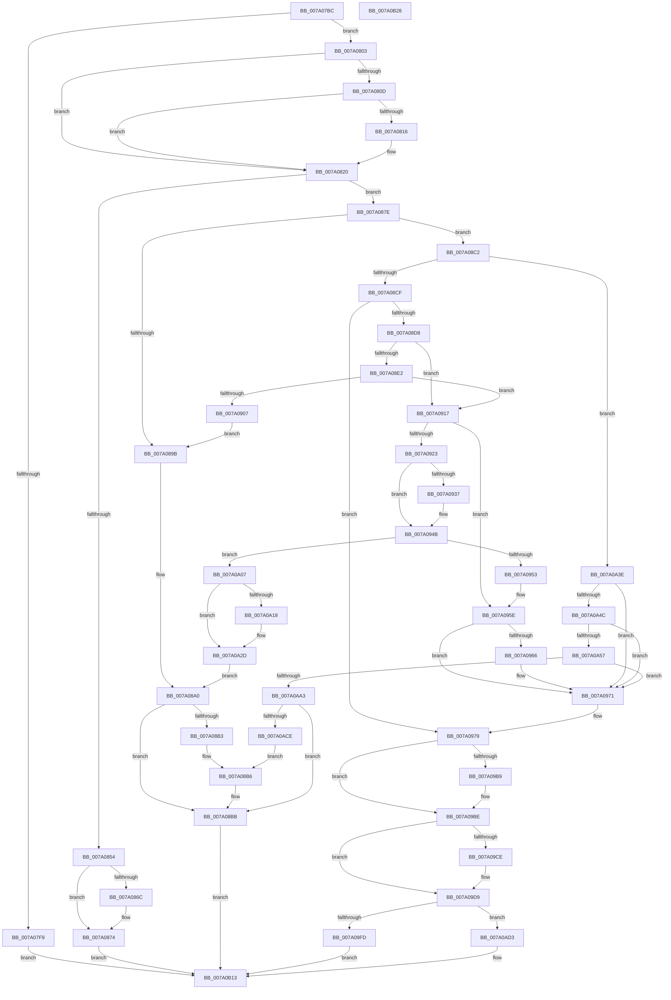

# SeExchangePrimaryToken

- RVA: `0x007A07BC`–`0x007A0B29` (길이 `877` bytes)
- VA: `0x00000001407A07BC`
- 실행 섹션: `PAGE`
- PDB 이름 있음: `예`; PDB Function 태그: `아니요`
- unwind 정보 RVA: `0x000C8344`
- 디코드: `215`개 명령, `877/877` bytes 표시
- 미해석 바이트: `0` (있으면 어셈블리에 `.byte`로 보존)

> 이 문서는 커널 이미지의 기계어와 PDB 기호를 분석해 생성했습니다. 4번과 5번은 함수 원형과 자료형을 바이너리 사용 방식에서 추정한 C 해석이며 원본 소스 복구 결과는 아닙니다.

## 1. Dependencies

- 직접 호출 지점: **33**; 고유 호출 대상: **19**
- 직접 호출자로 확인된 함수: **1**
- RIP 상대 이미지 참조: **1**

### Outgoing calls
- `0x007A0803` → [PsGetProcessSessionIdEx](../../text/22/PsGetProcessSessionIdEx_function_0022F8F0.md) (function, `0x0022F8F0`)
- `0x007A0818` → [PsGetSessionObjectById](../../text/22/PsGetSessionObjectById_function_002250C0.md) (function, `0x002250C0`)
- `0x007A0823` → [PsGetProcessSessionId](../../text/22/PsGetProcessSessionId_function_002233A0.md) (function, `0x002233A0`)
- `0x007A0841` → [ExAcquireResourceExclusiveLite](../../text/21/ExAcquireResourceExclusiveLite_function_00214E20.md) (function, `0x00214E20`)
- `0x007A085D` → [ExReleaseResourceLite](../../text/25/ExReleaseResourceLite_function_0025FA10.md) (function, `0x0025FA10`)
- `0x007A0862` → [KeLeaveCriticalRegion](../../text/25/KeLeaveCriticalRegion_function_0025D8B0.md) (function, `0x0025D8B0`)
- `0x007A086F` → [ObfDereferenceObject](../../text/2F/ObfDereferenceObject_function_002F9350.md) (function, `0x002F9350`)
- `0x007A0890` → [SepSetTrustLevelForProcessToken](../../text/40/SepSetTrustLevelForProcessToken_function_00400604.md) (function, `0x00400604`)
- `0x007A08A4` → [ExReleaseResourceLite](../../text/25/ExReleaseResourceLite_function_0025FA10.md) (function, `0x0025FA10`)
- `0x007A08A9` → [KeLeaveCriticalRegion](../../text/25/KeLeaveCriticalRegion_function_0025D8B0.md) (function, `0x0025D8B0`)
- `0x007A08B6` → [ObfDereferenceObject](../../text/2F/ObfDereferenceObject_function_002F9350.md) (function, `0x002F9350`)
- `0x007A08C2` → [Feature_OutsideInProtection__private_IsEnabledDeviceUsageNoInline](../../text/5C/Feature_OutsideInProtection__private_IsEnabledDeviceUsageNoInline_function_005CD968.md) (function, `0x005CD968`)
- `0x007A08FC` → [SepSetTokenLowboxNumberEntry](../../text/60/SepSetTokenLowboxNumberEntry_function_0060B594.md) (function, `0x0060B594`)
- `0x007A0944` → [SepSetTokenAntiTamperEntry](../../text/60/SepSetTokenAntiTamperEntry_function_0060B28C.md) (function, `0x0060B28C`)
- `0x007A0959` → [SepDereferenceAntiTamperEntry](SepDereferenceAntiTamperEntry_function_007A2E50.md) (function, `0x007A2E50`)
- `0x007A096C` → [SepDereferenceLowBoxNumberEntry](../A5/SepDereferenceLowBoxNumberEntry_function_00A55DBC.md) (function, `0x00A55DBC`)
- `0x007A0991` → [SepSetTokenSessionById](../A0/SepSetTokenSessionById_function_00A0DAE4.md) (function, `0x00A0DAE4`)
- `0x007A09A2` → [ExReleaseResourceLite](../../text/25/ExReleaseResourceLite_function_0025FA10.md) (function, `0x0025FA10`)
- `0x007A09A7` → [KeLeaveCriticalRegion](../../text/25/KeLeaveCriticalRegion_function_0025D8B0.md) (function, `0x0025D8B0`)
- `0x007A09B9` → [ObfDereferenceObject](../../text/2F/ObfDereferenceObject_function_002F9350.md) (function, `0x002F9350`)
- `0x007A09C5` → [SeAuditingWithTokenForSubcategory](../90/SeAuditingWithTokenForSubcategory_function_009047D0.md) (function, `0x009047D0`)
- `0x007A09D4` → [SepAuditAssignPrimaryToken](../79/SepAuditAssignPrimaryToken_function_0079F828.md) (function, `0x0079F828`)
- `0x007A09DC` → [ObfReferenceObject](../../text/20/ObfReferenceObject_function_0020FA20.md) (function, `0x0020FA20`)
- `0x007A09EC` → [ObFastReplaceObject](../../text/45/ObFastReplaceObject_function_0045819C.md) (function, `0x0045819C`)
- `0x007A0A21` → [SepDereferenceLowBoxNumberEntry](../A5/SepDereferenceLowBoxNumberEntry_function_00A55DBC.md) (function, `0x00A55DBC`)
- `0x007A0A5E` → [SepDereferenceLowBoxNumberEntry](../A5/SepDereferenceLowBoxNumberEntry_function_00A55DBC.md) (function, `0x00A55DBC`)
- `0x007A0A82` → [SepSetTokenSessionById](../A0/SepSetTokenSessionById_function_00A0DAE4.md) (function, `0x00A0DAE4`)
- `0x007A0A94` → [SepSetTokenLowboxNumber](../A6/SepSetTokenLowboxNumber_function_00A64D6C.md) (function, `0x00A64D6C`)
- `0x007A0AB3` → [ExReleaseResourceLite](../../text/25/ExReleaseResourceLite_function_0025FA10.md) (function, `0x0025FA10`)
- `0x007A0AB8` → [KeLeaveCriticalRegion](../../text/25/KeLeaveCriticalRegion_function_0025D8B0.md) (function, `0x0025D8B0`)
- `0x007A0AEA` → [ExAcquireResourceExclusiveLite](../../text/21/ExAcquireResourceExclusiveLite_function_00214E20.md) (function, `0x00214E20`)
- `0x007A0B04` → [ExReleaseResourceLite](../../text/25/ExReleaseResourceLite_function_0025FA10.md) (function, `0x0025FA10`)
- `0x007A0B09` → [KeLeaveCriticalRegion](../../text/25/KeLeaveCriticalRegion_function_0025D8B0.md) (function, `0x0025D8B0`)

### Direct callers
- [PspAssignPrimaryToken](../78/PspAssignPrimaryToken_function_00784870.md) at `0x0078498A`

### Static image references
- `0x007A080D` → RVA `0x00FD80D8` (`PAGEDATA`; read)

## 2. Other-region calls and transfers

- 다른 실행 섹션으로 향하는 call: **24**
  - `0x007A0803` → [PsGetProcessSessionIdEx](../../text/22/PsGetProcessSessionIdEx_function_0022F8F0.md) (`PAGE` → `.text`)
  - `0x007A0818` → [PsGetSessionObjectById](../../text/22/PsGetSessionObjectById_function_002250C0.md) (`PAGE` → `.text`)
  - `0x007A0823` → [PsGetProcessSessionId](../../text/22/PsGetProcessSessionId_function_002233A0.md) (`PAGE` → `.text`)
  - `0x007A0841` → [ExAcquireResourceExclusiveLite](../../text/21/ExAcquireResourceExclusiveLite_function_00214E20.md) (`PAGE` → `.text`)
  - `0x007A085D` → [ExReleaseResourceLite](../../text/25/ExReleaseResourceLite_function_0025FA10.md) (`PAGE` → `.text`)
  - `0x007A0862` → [KeLeaveCriticalRegion](../../text/25/KeLeaveCriticalRegion_function_0025D8B0.md) (`PAGE` → `.text`)
  - `0x007A086F` → [ObfDereferenceObject](../../text/2F/ObfDereferenceObject_function_002F9350.md) (`PAGE` → `.text`)
  - `0x007A0890` → [SepSetTrustLevelForProcessToken](../../text/40/SepSetTrustLevelForProcessToken_function_00400604.md) (`PAGE` → `.text`)
  - `0x007A08A4` → [ExReleaseResourceLite](../../text/25/ExReleaseResourceLite_function_0025FA10.md) (`PAGE` → `.text`)
  - `0x007A08A9` → [KeLeaveCriticalRegion](../../text/25/KeLeaveCriticalRegion_function_0025D8B0.md) (`PAGE` → `.text`)
  - `0x007A08B6` → [ObfDereferenceObject](../../text/2F/ObfDereferenceObject_function_002F9350.md) (`PAGE` → `.text`)
  - `0x007A08C2` → [Feature_OutsideInProtection__private_IsEnabledDeviceUsageNoInline](../../text/5C/Feature_OutsideInProtection__private_IsEnabledDeviceUsageNoInline_function_005CD968.md) (`PAGE` → `.text`)
  - `0x007A08FC` → [SepSetTokenLowboxNumberEntry](../../text/60/SepSetTokenLowboxNumberEntry_function_0060B594.md) (`PAGE` → `.text`)
  - `0x007A0944` → [SepSetTokenAntiTamperEntry](../../text/60/SepSetTokenAntiTamperEntry_function_0060B28C.md) (`PAGE` → `.text`)
  - `0x007A09A2` → [ExReleaseResourceLite](../../text/25/ExReleaseResourceLite_function_0025FA10.md) (`PAGE` → `.text`)
  - `0x007A09A7` → [KeLeaveCriticalRegion](../../text/25/KeLeaveCriticalRegion_function_0025D8B0.md) (`PAGE` → `.text`)
  - `0x007A09B9` → [ObfDereferenceObject](../../text/2F/ObfDereferenceObject_function_002F9350.md) (`PAGE` → `.text`)
  - `0x007A09DC` → [ObfReferenceObject](../../text/20/ObfReferenceObject_function_0020FA20.md) (`PAGE` → `.text`)
  - `0x007A09EC` → [ObFastReplaceObject](../../text/45/ObFastReplaceObject_function_0045819C.md) (`PAGE` → `.text`)
  - `0x007A0AB3` → [ExReleaseResourceLite](../../text/25/ExReleaseResourceLite_function_0025FA10.md) (`PAGE` → `.text`)
  - `0x007A0AB8` → [KeLeaveCriticalRegion](../../text/25/KeLeaveCriticalRegion_function_0025D8B0.md) (`PAGE` → `.text`)
  - `0x007A0AEA` → [ExAcquireResourceExclusiveLite](../../text/21/ExAcquireResourceExclusiveLite_function_00214E20.md) (`PAGE` → `.text`)
  - `0x007A0B04` → [ExReleaseResourceLite](../../text/25/ExReleaseResourceLite_function_0025FA10.md) (`PAGE` → `.text`)
  - `0x007A0B09` → [KeLeaveCriticalRegion](../../text/25/KeLeaveCriticalRegion_function_0025D8B0.md) (`PAGE` → `.text`)
- 별도 외부 분기/꼬리 이동을 확인하지 못했습니다.

## 3. Assembly (complete function range)

```asm
007A07BC  48 8B C4                        mov rax, rsp
007A07BF  48 89 58 08                     mov qword ptr [rax + 8], rbx
007A07C3  4C 89 40 18                     mov qword ptr [rax + 0x18], r8
007A07C7  55                              push rbp
007A07C8  56                              push rsi
007A07C9  57                              push rdi
007A07CA  41 54                           push r12
007A07CC  41 55                           push r13
007A07CE  41 56                           push r14
007A07D0  41 57                           push r15
007A07D2  48 83 EC 30                     sub rsp, 0x30
007A07D6  45 33 ED                        xor r13d, r13d
007A07D9  4D 8B F8                        mov r15, r8
007A07DC  83 BA C0 00 00 00 01            cmp dword ptr [rdx + 0xc0], 1
007A07E3  48 8B DA                        mov rbx, rdx
007A07E6  4C 8B E1                        mov r12, rcx
007A07E9  4C 89 68 20                     mov qword ptr [rax + 0x20], r13
007A07ED  41 8B FD                        mov edi, r13d
007A07F0  44 88 68 10                     mov byte ptr [rax + 0x10], r13b
007A07F4  45 8B F5                        mov r14d, r13d
007A07F7  74 0A                           je 0x1407a0803
007A07F9  B8 A8 00 00 C0                  mov eax, 0xc00000a8
007A07FE  E9 10 03 00 00                  jmp 0x1407a0b13
007A0803  E8 E8 F0 A8 FF                  call 0x14022f8f0
007A0808  83 F8 FF                        cmp eax, -1
007A080B  74 13                           je 0x1407a0820
007A080D  44 39 2D C4 78 83 00            cmp dword ptr [rip + 0x8378c4], r13d
007A0814  75 0A                           jne 0x1407a0820
007A0816  8B C8                           mov ecx, eax
007A0818  E8 A3 48 A8 FF                  call 0x1402250c0
007A081D  48 8B F8                        mov rdi, rax
007A0820  49 8B CC                        mov rcx, r12
007A0823  E8 78 2B A8 FF                  call 0x1402233a0
007A0828  65 48 8B 0C 25 88 01 00 00      mov rcx, qword ptr gs:[0x188]
007A0831  B2 01                           mov dl, 1
007A0833  8B E8                           mov ebp, eax
007A0835  66 FF 89 E4 01 00 00            dec word ptr [rcx + 0x1e4]
007A083C  90                              nop
007A083D  48 8B 4B 30                     mov rcx, qword ptr [rbx + 0x30]
007A0841  E8 DA 45 A7 FF                  call 0x140214e20
007A0846  F0 44 09 2C 24                  lock or dword ptr [rsp], r13d
007A084B  44 38 AB CC 00 00 00            cmp byte ptr [rbx + 0xcc], r13b
007A0852  74 2A                           je 0x1407a087e
007A0854  F0 44 09 2C 24                  lock or dword ptr [rsp], r13d
007A0859  48 8B 4B 30                     mov rcx, qword ptr [rbx + 0x30]
007A085D  E8 AE F1 AB FF                  call 0x14025fa10
007A0862  E8 49 D0 AB FF                  call 0x14025d8b0
007A0867  48 85 FF                        test rdi, rdi
007A086A  74 08                           je 0x1407a0874
007A086C  48 8B CF                        mov rcx, rdi
007A086F  E8 DC 8A B5 FF                  call 0x1402f9350
007A0874  B8 2B 01 00 C0                  mov eax, 0xc000012b
007A0879  E9 95 02 00 00                  jmp 0x1407a0b13
007A087E  4C 8D 44 24 78                  lea r8, [rsp + 0x78]
007A0883  C6 83 CC 00 00 00 01            mov byte ptr [rbx + 0xcc], 1
007A088A  49 8B D4                        mov rdx, r12
007A088D  48 8B CB                        mov rcx, rbx
007A0890  E8 6F FD C5 FF                  call 0x140400604
007A0895  8B F0                           mov esi, eax
007A0897  85 C0                           test eax, eax
007A0899  79 27                           jns 0x1407a08c2
007A089B  F0 44 09 2C 24                  lock or dword ptr [rsp], r13d
007A08A0  48 8B 4B 30                     mov rcx, qword ptr [rbx + 0x30]
007A08A4  E8 67 F1 AB FF                  call 0x14025fa10
007A08A9  E8 02 D0 AB FF                  call 0x14025d8b0
007A08AE  48 85 FF                        test rdi, rdi
007A08B1  74 08                           je 0x1407a08bb
007A08B3  48 8B CF                        mov rcx, rdi
007A08B6  E8 95 8A B5 FF                  call 0x1402f9350
007A08BB  8B C6                           mov eax, esi
007A08BD  E9 51 02 00 00                  jmp 0x1407a0b13
007A08C2  E8 A1 D0 E2 FF                  call 0x1405cd968
007A08C7  85 C0                           test eax, eax
007A08C9  0F 84 6F 01 00 00               je 0x1407a0a3e
007A08CF  39 6B 78                        cmp dword ptr [rbx + 0x78], ebp
007A08D2  0F 84 A1 00 00 00               je 0x1407a0979
007A08D8  0F BA A3 C8 00 00 00 0E         bt dword ptr [rbx + 0xc8], 0xe
007A08E0  73 35                           jae 0x1407a0917
007A08E2  4C 8B B3 38 04 00 00            mov r14, qword ptr [rbx + 0x438]
007A08E9  8B D5                           mov edx, ebp
007A08EB  4C 8B 83 10 03 00 00            mov r8, qword ptr [rbx + 0x310]
007A08F2  48 8B CB                        mov rcx, rbx
007A08F5  4C 89 AB 38 04 00 00            mov qword ptr [rbx + 0x438], r13
007A08FC  E8 93 AC E6 FF                  call 0x14060b594
007A0901  8B F0                           mov esi, eax
007A0903  85 C0                           test eax, eax
007A0905  79 10                           jns 0x1407a0917
007A0907  4C 89 B3 38 04 00 00            mov qword ptr [rbx + 0x438], r14
007A090E  44 88 AB CC 00 00 00            mov byte ptr [rbx + 0xcc], r13b
007A0915  EB 84                           jmp 0x1407a089b
007A0917  4C 8B AB B8 05 00 00            mov r13, qword ptr [rbx + 0x5b8]
007A091E  4D 85 ED                        test r13, r13
007A0921  74 3B                           je 0x1407a095e
007A0923  48 83 A3 B8 05 00 00 00         and qword ptr [rbx + 0x5b8], 0
007A092B  4C 8B 83 98 04 00 00            mov r8, qword ptr [rbx + 0x498]
007A0932  4D 85 C0                        test r8, r8
007A0935  74 14                           je 0x1407a094b
007A0937  4D 8B 4D 30                     mov r9, qword ptr [r13 + 0x30]
007A093B  8B D5                           mov edx, ebp
007A093D  4D 8B 40 10                     mov r8, qword ptr [r8 + 0x10]
007A0941  48 8B CB                        mov rcx, rbx
007A0944  E8 43 A9 E6 FF                  call 0x14060b28c
007A0949  8B F0                           mov esi, eax
007A094B  85 F6                           test esi, esi
007A094D  0F 88 B4 00 00 00               js 0x1407a0a07
007A0953  8B 4B 78                        mov ecx, dword ptr [rbx + 0x78]
007A0956  49 8B D5                        mov rdx, r13
007A0959  E8 F2 24 00 00                  call 0x1407a2e50
007A095E  45 33 ED                        xor r13d, r13d
007A0961  4D 85 F6                        test r14, r14
007A0964  74 0B                           je 0x1407a0971
007A0966  8B 4B 78                        mov ecx, dword ptr [rbx + 0x78]
007A0969  49 8B D6                        mov rdx, r14
007A096C  E8 4B 54 2B 00                  call 0x140a55dbc
007A0971  4C 8B BC 24 80 00 00 00         mov r15, qword ptr [rsp + 0x80]
007A0979  48 8D 84 24 88 00 00 00         lea rax, [rsp + 0x88]
007A0981  4C 8B CF                        mov r9, rdi
007A0984  41 B0 01                        mov r8b, 1
007A0987  48 89 44 24 20                  mov qword ptr [rsp + 0x20], rax
007A098C  8B D5                           mov edx, ebp
007A098E  48 8B CB                        mov rcx, rbx
007A0991  E8 4E D1 26 00                  call 0x140a0dae4
007A0996  89 6B 78                        mov dword ptr [rbx + 0x78], ebp
007A0999  F0 44 09 2C 24                  lock or dword ptr [rsp], r13d
007A099E  48 8B 4B 30                     mov rcx, qword ptr [rbx + 0x30]
007A09A2  E8 69 F0 AB FF                  call 0x14025fa10
007A09A7  E8 04 CF AB FF                  call 0x14025d8b0
007A09AC  48 8B 8C 24 88 00 00 00         mov rcx, qword ptr [rsp + 0x88]
007A09B4  48 85 C9                        test rcx, rcx
007A09B7  74 05                           je 0x1407a09be
007A09B9  E8 92 89 B5 FF                  call 0x1402f9350
007A09BE  33 D2                           xor edx, edx
007A09C0  B9 86 00 00 00                  mov ecx, 0x86
007A09C5  E8 06 3E 16 00                  call 0x1409047d0
007A09CA  84 C0                           test al, al
007A09CC  74 0B                           je 0x1407a09d9
007A09CE  48 8B D3                        mov rdx, rbx
007A09D1  49 8B CC                        mov rcx, r12
007A09D4  E8 4F EE FF FF                  call 0x14079f828
007A09D9  48 8B CB                        mov rcx, rbx
007A09DC  E8 3F F0 A6 FF                  call 0x14020fa20
007A09E1  49 8D 8C 24 48 02 00 00         lea rcx, [r12 + 0x248]
007A09E9  48 8B D3                        mov rdx, rbx
007A09EC  E8 AB 77 CB FF                  call 0x14045819c
007A09F1  48 8B D8                        mov rbx, rax
007A09F4  48 85 C0                        test rax, rax
007A09F7  0F 85 D6 00 00 00               jne 0x1407a0ad3
007A09FD  B8 7C 00 00 C0                  mov eax, 0xc000007c
007A0A02  E9 0C 01 00 00                  jmp 0x1407a0b13
007A0A07  0F BA A3 C8 00 00 00 0E         bt dword ptr [rbx + 0xc8], 0xe
007A0A0F  4C 89 AB B8 05 00 00            mov qword ptr [rbx + 0x5b8], r13
007A0A16  73 15                           jae 0x1407a0a2d
007A0A18  48 8B 93 38 04 00 00            mov rdx, qword ptr [rbx + 0x438]
007A0A1F  8B CD                           mov ecx, ebp
007A0A21  E8 96 53 2B 00                  call 0x140a55dbc
007A0A26  4C 89 B3 38 04 00 00            mov qword ptr [rbx + 0x438], r14
007A0A2D  C6 83 CC 00 00 00 00            mov byte ptr [rbx + 0xcc], 0
007A0A34  F0 83 0C 24 00                  lock or dword ptr [rsp], 0
007A0A39  E9 62 FE FF FF                  jmp 0x1407a08a0
007A0A3E  0F BA A3 C8 00 00 00 0E         bt dword ptr [rbx + 0xc8], 0xe
007A0A46  0F 83 25 FF FF FF               jae 0x1407a0971
007A0A4C  8B 4B 78                        mov ecx, dword ptr [rbx + 0x78]
007A0A4F  3B CD                           cmp ecx, ebp
007A0A51  0F 84 1A FF FF FF               je 0x1407a0971
007A0A57  48 8B 93 38 04 00 00            mov rdx, qword ptr [rbx + 0x438]
007A0A5E  E8 59 53 2B 00                  call 0x140a55dbc
007A0A63  48 8D 84 24 88 00 00 00         lea rax, [rsp + 0x88]
007A0A6B  4C 89 AB 38 04 00 00            mov qword ptr [rbx + 0x438], r13
007A0A72  4C 8B CF                        mov r9, rdi
007A0A75  48 89 44 24 20                  mov qword ptr [rsp + 0x20], rax
007A0A7A  41 B0 01                        mov r8b, 1
007A0A7D  8B D5                           mov edx, ebp
007A0A7F  48 8B CB                        mov rcx, rbx
007A0A82  E8 5D D0 26 00                  call 0x140a0dae4
007A0A87  48 8B 93 10 03 00 00            mov rdx, qword ptr [rbx + 0x310]
007A0A8E  48 8B CB                        mov rcx, rbx
007A0A91  89 6B 78                        mov dword ptr [rbx + 0x78], ebp
007A0A94  E8 D3 42 2C 00                  call 0x140a64d6c
007A0A99  8B F0                           mov esi, eax
007A0A9B  85 C0                           test eax, eax
007A0A9D  0F 89 CE FE FF FF               jns 0x1407a0971
007A0AA3  44 88 AB CC 00 00 00            mov byte ptr [rbx + 0xcc], r13b
007A0AAA  F0 44 09 2C 24                  lock or dword ptr [rsp], r13d
007A0AAF  48 8B 4B 30                     mov rcx, qword ptr [rbx + 0x30]
007A0AB3  E8 58 EF AB FF                  call 0x14025fa10
007A0AB8  E8 F3 CD AB FF                  call 0x14025d8b0
007A0ABD  48 8B 8C 24 88 00 00 00         mov rcx, qword ptr [rsp + 0x88]
007A0AC5  48 85 C9                        test rcx, rcx
007A0AC8  0F 84 ED FD FF FF               je 0x1407a08bb
007A0ACE  E9 E3 FD FF FF                  jmp 0x1407a08b6
007A0AD3  65 48 8B 04 25 88 01 00 00      mov rax, qword ptr gs:[0x188]
007A0ADC  B2 01                           mov dl, 1
007A0ADE  66 FF 88 E4 01 00 00            dec word ptr [rax + 0x1e4]
007A0AE5  90                              nop
007A0AE6  48 8B 4B 30                     mov rcx, qword ptr [rbx + 0x30]
007A0AEA  E8 31 43 A7 FF                  call 0x140214e20
007A0AEF  F0 44 09 2C 24                  lock or dword ptr [rsp], r13d
007A0AF4  44 88 AB CC 00 00 00            mov byte ptr [rbx + 0xcc], r13b
007A0AFB  F0 44 09 2C 24                  lock or dword ptr [rsp], r13d
007A0B00  48 8B 4B 30                     mov rcx, qword ptr [rbx + 0x30]
007A0B04  E8 07 EF AB FF                  call 0x14025fa10
007A0B09  E8 A2 CD AB FF                  call 0x14025d8b0
007A0B0E  33 C0                           xor eax, eax
007A0B10  49 89 1F                        mov qword ptr [r15], rbx
007A0B13  48 8B 5C 24 70                  mov rbx, qword ptr [rsp + 0x70]
007A0B18  48 83 C4 30                     add rsp, 0x30
007A0B1C  41 5F                           pop r15
007A0B1E  41 5E                           pop r14
007A0B20  41 5D                           pop r13
007A0B22  41 5C                           pop r12
007A0B24  5F                              pop rdi
007A0B25  5E                              pop rsi
007A0B26  5D                              pop rbp
007A0B27  C3                              ret
007A0B28  CC                              int3
```

## 4. C-style interpretation (structured pseudocode)

```c
__int64 __fastcall SeExchangePrimaryToken(__int64 a1, __int64 a2, __int64 a3)
{
    __int64 result;
    __int64 v_r13;
    __int64 v_rdi;
    __int64 v_rsi;
    __int64 v_rsp;
    unsigned __int64 v_stack_m48;
    unsigned int v_stack_m68;
    unsigned __int64 v_stack_p10;
    unsigned __int64 v_stack_p18;
    unsigned __int64 v_stack_p20;
    unsigned __int64 v_stack_p8;

    *(unsigned __int64 *)(v_rsp + 8) = v_rbx;
    *(unsigned __int64 *)(v_rsp + 24) = a3;
    v_rsp = (v_rsp) - (48);
    v_r13 = 0;
    *(unsigned __int64 *)(v_rsp + 32) = 0;
    *(unsigned __int8 *)(v_rsp + 16) = 0;
    if ((*(unsigned int *)(a2 + 192)) == 1) goto loc_007A0803;
    goto loc_007A0B13;
loc_007A0803:
    result = PsGetProcessSessionIdEx(a1, a2, a3, a4);
    if (((unsigned int)(result)) == -1) goto loc_007A0820;
    v_rdi = 0;
    if ((*(unsigned int *)(v_rip + 8616132)) == 0) {
        a1 = (unsigned int)(result);
        result = PsGetSessionObjectById(a1, a2, a3, a4);
        v_rdi = result;
    }
    result = PsGetProcessSessionId(a1, a2, a3, a4);
    result = ExAcquireResourceExclusiveLite(*(unsigned __int64 *)(a2 + 48), 1, a3, a4);
    if ((*(unsigned __int8 *)(a2 + 204)) == 0) goto loc_007A087E;
    result = ExReleaseResourceLite(*(unsigned __int64 *)(a2 + 48), 1, a3, a4);
    result = KeLeaveCriticalRegion(*(unsigned __int64 *)(a2 + 48), 1, a3, a4);
    if (v_rdi != 0) {
        a1 = v_rdi;
        result = ObfDereferenceObject(a1, 1, a3, a4);
    }
    goto loc_007A0B13;
loc_007A087E:
    *(unsigned __int8 *)(a2 + 204) = 1;
    result = SepSetTrustLevelForProcessToken(a2, a1, v_stack_p10, a4);
    if (!sign_flag) goto loc_007A08C2;
loc_007A089B:
loc_007A08A0:
    result = ExReleaseResourceLite(*(unsigned __int64 *)(a2 + 48), a1, v_stack_p10, a4);
    result = KeLeaveCriticalRegion(*(unsigned __int64 *)(a2 + 48), a1, v_stack_p10, a4);
    if (v_rdi == 0) goto loc_007A08BB;
loc_007A08B6:
    result = ObfDereferenceObject(v_rdi, a1, v_stack_p10, a4);
loc_007A08BB:
    goto loc_007A0B13;
loc_007A08C2:
    result = Feature_OutsideInProtection__private_IsEnabledDeviceUsageNoInline(v_rdi, a1, v_stack_p10, a4);
    if ((unsigned int)(result) == 0) goto loc_007A0A3E;
    if ((*(unsigned int *)(a2 + 120)) == ((unsigned int)((unsigned int)((unsigned int)(result))))) goto loc_007A0979;
    if ((*(unsigned int *)(a2 + 120)) >= ((unsigned int)((unsigned int)((unsigned int)(result))))) goto loc_007A0917;
    *(unsigned __int64 *)(a2 + 1080) = 0;
    result = SepSetTokenLowboxNumberEntry(a2, (unsigned int)((unsigned int)((unsigned int)((unsigned int)(result)))), *(unsigned __int64 *)(a2 + 784), a4);
    if (!sign_flag) goto loc_007A0917;
    *(unsigned __int64 *)(a2 + 1080) = *(unsigned __int64 *)(a2 + 1080);
    *(unsigned __int8 *)(a2 + 204) = 0;
    goto loc_007A089B;
loc_007A0917:
    if (*(unsigned __int64 *)(a2 + 1464) == 0) goto loc_007A095E;
    v_rsi = (unsigned int)((unsigned int)(result));
    if (*(unsigned __int64 *)(a2 + 1176) != 0) {
        a4 = *(unsigned __int64 *)(*(unsigned __int64 *)(a2 + 1464) + 48);
        a2 = (unsigned int)((unsigned int)((unsigned int)(result)));
        a3 = *(unsigned __int64 *)(*(unsigned __int64 *)(a2 + 1176) + 16);
        a1 = a2;
        result = SepSetTokenAntiTamperEntry(a1, a2, a3, a4);
        v_rsi = (unsigned int)(result);
    }
    if (sign_flag) goto loc_007A0A07;
    result = SepDereferenceAntiTamperEntry((unsigned int)(*(unsigned int *)(a2 + 120)), *(unsigned __int64 *)(a2 + 1464), a3, a4);
loc_007A095E:
    v_r13 = 0;
    if (*(unsigned __int64 *)(a2 + 1080) != 0) {
        a1 = *(unsigned int *)(a2 + 120);
        a2 = *(unsigned __int64 *)(a2 + 1080);
        result = SepDereferenceLowBoxNumberEntry(a1, a2, a3, a4);
    }
loc_007A0979:
    v_stack_m48 = v_stack_p20;
    result = SepSetTokenSessionById(a2, (unsigned int)((unsigned int)((unsigned int)((unsigned int)(result)))), 1, v_rdi);
    *(unsigned int *)(a2 + 120) = (unsigned int)((unsigned int)((unsigned int)(result)));
    result = ExReleaseResourceLite(*(unsigned __int64 *)(a2 + 48), (unsigned int)((unsigned int)((unsigned int)((unsigned int)(result)))), 1, v_rdi);
    result = KeLeaveCriticalRegion(*(unsigned __int64 *)(a2 + 48), (unsigned int)((unsigned int)((unsigned int)((unsigned int)(result)))), 1, v_rdi);
    if (v_stack_p20 != 0) {
        result = ObfDereferenceObject(v_stack_p20, (unsigned int)((unsigned int)((unsigned int)((unsigned int)(result)))), 1, v_rdi);
    }
    a2 = 0;
    result = SeAuditingWithTokenForSubcategory(134, a2, 1, v_rdi);
    if ((unsigned __int8)(result) != 0) {
        a2 = 0;
        a1 = a1;
        result = SepAuditAssignPrimaryToken(a1, a2, 1, v_rdi);
    }
    result = ObfReferenceObject(a2, a2, 1, v_rdi);
    result = ObFastReplaceObject(a1 + 584, a2, 1, v_rdi);
    if (result != 0) goto loc_007A0AD3;
    goto loc_007A0B13;
loc_007A0A07:
    *(unsigned __int64 *)(result + 1464) = 0;
    result = (unsigned int)(0xC000007CULL);
    if (!(condition_is_above_or_equal)) {
        a2 = *(unsigned __int64 *)(result + 1080);
        a1 = (unsigned int)((unsigned int)((unsigned int)(result)));
        result = SepDereferenceLowBoxNumberEntry(a1, a2, 1, v_rdi);
        *(unsigned __int64 *)(result + 1080) = *(unsigned __int64 *)(a2 + 1080);
    }
    *(unsigned __int8 *)(result + 204) = 0;
    goto loc_007A08A0;
loc_007A0A3E:
    if (condition_is_above_or_equal) goto loc_007A0971;
    if (((unsigned int)((unsigned int)(*(unsigned int *)(result + 120)))) == ((unsigned int)((unsigned int)((unsigned int)(result))))) goto loc_007A0971;
    result = SepDereferenceLowBoxNumberEntry((unsigned int)(*(unsigned int *)(result + 120)), *(unsigned __int64 *)(result + 1080), 1, v_rdi);
    *(unsigned __int64 *)(result + 1080) = 0;
    v_stack_m48 = v_stack_p20;
    result = SepSetTokenSessionById(result, (unsigned int)((unsigned int)((unsigned int)((unsigned int)(result)))), 1, v_rdi);
    *(unsigned int *)(result + 120) = (unsigned int)((unsigned int)((unsigned int)(result)));
    result = SepSetTokenLowboxNumber(result, *(unsigned __int64 *)(result + 784), 1, v_rdi);
    if (!sign_flag) goto loc_007A0971;
    *(unsigned __int8 *)(result + 204) = 0;
    result = ExReleaseResourceLite(*(unsigned __int64 *)(result + 48), *(unsigned __int64 *)(result + 784), 1, v_rdi);
    result = KeLeaveCriticalRegion(*(unsigned __int64 *)(result + 48), *(unsigned __int64 *)(result + 784), 1, v_rdi);
    if (v_stack_p20 == 0) goto loc_007A08BB;
    goto loc_007A08B6;
loc_007A0AD3:
    result = ExAcquireResourceExclusiveLite(*(unsigned __int64 *)(result + 48), 1, 1, v_rdi);
    *(unsigned __int8 *)(result + 204) = 0;
    result = ExReleaseResourceLite(*(unsigned __int64 *)(result + 48), 1, 1, v_rdi);
    result = KeLeaveCriticalRegion(*(unsigned __int64 *)(result + 48), 1, 1, v_rdi);
    result = 0;
    *(unsigned __int64 *)(v_stack_p18) = 0;
loc_007A0B13:
    v_rsp = (v_rsp) + (48);
    return result;
}
```

## 5. (Beta) C Style

```c
int64_t SeExchangePrimaryToken(void *Arg1, void *Arg2, int64_t Arg3)
{
    uint8_t *arg1 = (uint8_t *)Arg1;
    uint8_t *arg2 = (uint8_t *)Arg2;

    int64_t result;
    int64_t local_r13;
    int64_t local_rdi;
    int64_t local_rsi;
    int64_t local_rsp;
    uint64_t v_stack_m48;
    uint32_t v_stack_m68;
    uint64_t v_stack_p10;
    uint64_t v_stack_p18;
    uint64_t v_stack_p20;
    uint64_t v_stack_p8;

    *(uint64_t *)(local_rsp + 0x8) = local_rbx;
    *(uint64_t *)(local_rsp + 0x18) = Arg3;
    local_rsp = (local_rsp) - (48);
    local_r13 = 0;
    *(uint64_t *)(local_rsp + 0x20) = 0;
    *(uint8_t *)(local_rsp + 0x10) = 0;
    if ((*(uint32_t *)(arg2 + 0xC0)) == 1) goto loc_007A0803;
    goto loc_007A0B13;
loc_007A0803:
    result = PsGetProcessSessionIdEx(Arg1, Arg2, Arg3, a4);
    if (((uint32_t)(result)) == -1) goto loc_007A0820;
    local_rdi = 0;
    if ((*(uint32_t *)(v_rip + 0x8378C4)) == 0) {
        Arg1 = (uint32_t)(result);
        result = PsGetSessionObjectById(Arg1, Arg2, Arg3, a4);
        local_rdi = result;
    }
    result = PsGetProcessSessionId(Arg1, Arg2, Arg3, a4);
    result = ExAcquireResourceExclusiveLite(*(uint64_t *)(arg2 + 0x30), 1, Arg3, a4);
    if ((*(uint8_t *)(arg2 + 0xCC)) == 0) goto loc_007A087E;
    result = ExReleaseResourceLite(*(uint64_t *)(arg2 + 0x30), 1, Arg3, a4);
    result = KeLeaveCriticalRegion(*(uint64_t *)(arg2 + 0x30), 1, Arg3, a4);
    if (local_rdi != 0) {
        Arg1 = local_rdi;
        result = ObfDereferenceObject(Arg1, 1, Arg3, a4);
    }
    goto loc_007A0B13;
loc_007A087E:
    *(uint8_t *)(arg2 + 0xCC) = 1;
    result = SepSetTrustLevelForProcessToken(Arg2, Arg1, v_stack_p10, a4);
    if (!sign_flag) goto loc_007A08C2;
loc_007A089B:
loc_007A08A0:
    result = ExReleaseResourceLite(*(uint64_t *)(arg2 + 0x30), Arg1, v_stack_p10, a4);
    result = KeLeaveCriticalRegion(*(uint64_t *)(arg2 + 0x30), Arg1, v_stack_p10, a4);
    if (local_rdi == 0) goto loc_007A08BB;
loc_007A08B6:
    result = ObfDereferenceObject(local_rdi, Arg1, v_stack_p10, a4);
loc_007A08BB:
    goto loc_007A0B13;
loc_007A08C2:
    result = Feature_OutsideInProtection__private_IsEnabledDeviceUsageNoInline(local_rdi, Arg1, v_stack_p10, a4);
    if ((uint32_t)(result) == 0) goto loc_007A0A3E;
    if ((*(uint32_t *)(arg2 + 0x78)) == ((uint32_t)((uint32_t)((uint32_t)(result))))) goto loc_007A0979;
    if ((*(uint32_t *)(arg2 + 0x78)) >= ((uint32_t)((uint32_t)((uint32_t)(result))))) goto loc_007A0917;
    *(uint64_t *)(arg2 + 0x438) = 0;
    result = SepSetTokenLowboxNumberEntry(Arg2, (uint32_t)((uint32_t)((uint32_t)((uint32_t)(result)))), *(uint64_t *)(arg2 + 0x310), a4);
    if (!sign_flag) goto loc_007A0917;
    *(uint64_t *)(arg2 + 0x438) = *(uint64_t *)(arg2 + 0x438);
    *(uint8_t *)(arg2 + 0xCC) = 0;
    goto loc_007A089B;
loc_007A0917:
    if (*(uint64_t *)(arg2 + 0x5B8) == 0) goto loc_007A095E;
    local_rsi = (uint32_t)((uint32_t)(result));
    if (*(uint64_t *)(arg2 + 0x498) != 0) {
        a4 = *(uint64_t *)(*(uint64_t *)(arg2 + 0x5B8) + 0x30);
        Arg2 = (uint32_t)((uint32_t)((uint32_t)(result)));
        Arg3 = *(uint64_t *)(*(uint64_t *)(arg2 + 0x498) + 0x10);
        Arg1 = Arg2;
        result = SepSetTokenAntiTamperEntry(Arg1, Arg2, Arg3, a4);
        local_rsi = (uint32_t)(result);
    }
    if (sign_flag) goto loc_007A0A07;
    result = SepDereferenceAntiTamperEntry((uint32_t)(*(uint32_t *)(arg2 + 0x78)), *(uint64_t *)(arg2 + 0x5B8), Arg3, a4);
loc_007A095E:
    local_r13 = 0;
    if (*(uint64_t *)(arg2 + 0x438) != 0) {
        Arg1 = *(uint32_t *)(arg2 + 0x78);
        Arg2 = *(uint64_t *)(arg2 + 0x438);
        result = SepDereferenceLowBoxNumberEntry(Arg1, Arg2, Arg3, a4);
    }
loc_007A0979:
    v_stack_m48 = v_stack_p20;
    result = SepSetTokenSessionById(Arg2, (uint32_t)((uint32_t)((uint32_t)((uint32_t)(result)))), 1, local_rdi);
    *(uint32_t *)(arg2 + 0x78) = (uint32_t)((uint32_t)((uint32_t)(result)));
    result = ExReleaseResourceLite(*(uint64_t *)(arg2 + 0x30), (uint32_t)((uint32_t)((uint32_t)((uint32_t)(result)))), 1, local_rdi);
    result = KeLeaveCriticalRegion(*(uint64_t *)(arg2 + 0x30), (uint32_t)((uint32_t)((uint32_t)((uint32_t)(result)))), 1, local_rdi);
    if (v_stack_p20 != 0) {
        result = ObfDereferenceObject(v_stack_p20, (uint32_t)((uint32_t)((uint32_t)((uint32_t)(result)))), 1, local_rdi);
    }
    Arg2 = 0;
    result = SeAuditingWithTokenForSubcategory(134, Arg2, 1, local_rdi);
    if ((uint8_t)(result) != 0) {
        Arg2 = 0;
        Arg1 = Arg1;
        result = SepAuditAssignPrimaryToken(Arg1, Arg2, 1, local_rdi);
    }
    result = ObfReferenceObject(Arg2, Arg2, 1, local_rdi);
    result = ObFastReplaceObject(Arg1 + 584, Arg2, 1, local_rdi);
    if (result != 0) goto loc_007A0AD3;
    goto loc_007A0B13;
loc_007A0A07:
    *(uint64_t *)(result + 0x5B8) = 0;
    result = (uint32_t)(0xC000007CULL);
    if (!(condition_is_above_or_equal)) {
        Arg2 = *(uint64_t *)(result + 0x438);
        Arg1 = (uint32_t)((uint32_t)((uint32_t)(result)));
        result = SepDereferenceLowBoxNumberEntry(Arg1, Arg2, 1, local_rdi);
        *(uint64_t *)(result + 0x438) = *(uint64_t *)(arg2 + 0x438);
    }
    *(uint8_t *)(result + 0xCC) = 0;
    goto loc_007A08A0;
loc_007A0A3E:
    if (condition_is_above_or_equal) goto loc_007A0971;
    if (((uint32_t)((uint32_t)(*(uint32_t *)(result + 0x78)))) == ((uint32_t)((uint32_t)((uint32_t)(result))))) goto loc_007A0971;
    result = SepDereferenceLowBoxNumberEntry((uint32_t)(*(uint32_t *)(result + 0x78)), *(uint64_t *)(result + 0x438), 1, local_rdi);
    *(uint64_t *)(result + 0x438) = 0;
    v_stack_m48 = v_stack_p20;
    result = SepSetTokenSessionById(result, (uint32_t)((uint32_t)((uint32_t)((uint32_t)(result)))), 1, local_rdi);
    *(uint32_t *)(result + 0x78) = (uint32_t)((uint32_t)((uint32_t)(result)));
    result = SepSetTokenLowboxNumber(result, *(uint64_t *)(result + 0x310), 1, local_rdi);
    if (!sign_flag) goto loc_007A0971;
    *(uint8_t *)(result + 0xCC) = 0;
    result = ExReleaseResourceLite(*(uint64_t *)(result + 0x30), *(uint64_t *)(result + 0x310), 1, local_rdi);
    result = KeLeaveCriticalRegion(*(uint64_t *)(result + 0x30), *(uint64_t *)(result + 0x310), 1, local_rdi);
    if (v_stack_p20 == 0) goto loc_007A08BB;
    goto loc_007A08B6;
loc_007A0AD3:
    result = ExAcquireResourceExclusiveLite(*(uint64_t *)(result + 0x30), 1, 1, local_rdi);
    *(uint8_t *)(result + 0xCC) = 0;
    result = ExReleaseResourceLite(*(uint64_t *)(result + 0x30), 1, 1, local_rdi);
    result = KeLeaveCriticalRegion(*(uint64_t *)(result + 0x30), 1, 1, local_rdi);
    result = 0;
    *(uint64_t *)(v_stack_p18) = 0;
loc_007A0B13:
    local_rsp = (local_rsp) + (48);
    return result;
}
```

### 관측된 메모리 오프셋

구조체 형식이 확인되지 않은 접근은 인자 기준의 오프셋으로만 기록했습니다.

| 기준 인자 | 오프셋 표현 | 폭 (bit) | 접근 |
|---|---:|---:|---|
| `Arg1` | `+ 0x248` | `64` | `R` |
| `Arg2` | `+ 0x30` | `64` | `R` |
| `Arg2` | `+ 0x78` | `32` | `R` |
| `Arg2` | `+ 0x78` | `32` | `W` |
| `Arg2` | `+ 0xC0` | `32` | `R` |
| `Arg2` | `+ 0xC8` | `32` | `R` |
| `Arg2` | `+ 0xCC` | `8` | `R` |
| `Arg2` | `+ 0xCC` | `8` | `W` |
| `Arg2` | `+ 0x310` | `64` | `R` |
| `Arg2` | `+ 0x438` | `64` | `R` |
| `Arg2` | `+ 0x438` | `64` | `W` |
| `Arg2` | `+ 0x498` | `64` | `R` |
| `Arg2` | `+ 0x5B8` | `64` | `R` |
| `Arg2` | `+ 0x5B8` | `64` | `R/W` |
| `Arg2` | `+ 0x5B8` | `64` | `W` |

## 6. Execution-region graph

[열기: 2D/3D 그래프와 함수 탐색 컨트롤 패널](../../../control-panel.html?section=page&rva=0x007A07BC&view=graph)

- 2D 그래프는 위에서 아래로 흐르고, 3D 그래프는 빈 공간을 드래그해 회전합니다. Shift+드래그는 이동, 휠은 확대·축소, 함수 노드 선택은 대상 보고서 이동입니다.

### Static fallback


