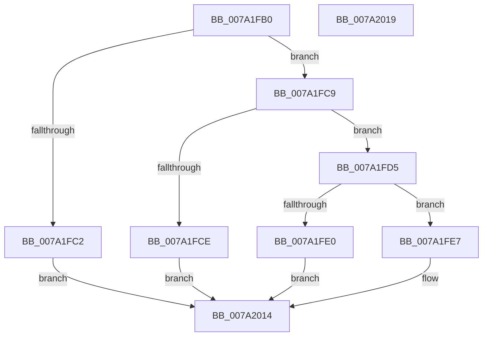

# SeQuerySecureBootPlatformManifest

- RVA: `0x007A1FB0`–`0x007A201A` (길이 `106` bytes)
- VA: `0x00000001407A1FB0`
- 실행 섹션: `PAGE`
- PDB 이름 있음: `예`; PDB Function 태그: `아니요`
- unwind 정보 RVA: `0x0005D2F4`
- 디코드: `30`개 명령, `106/106` bytes 표시
- 미해석 바이트: `0` (있으면 어셈블리에 `.byte`로 보존)

> 이 문서는 커널 이미지의 기계어와 PDB 기호를 분석해 생성했습니다. 4번과 5번은 함수 원형과 자료형을 바이너리 사용 방식에서 추정한 C 해석이며 원본 소스 복구 결과는 아닙니다.

## 1. Dependencies

- 직접 호출 지점: **1**; 고유 호출 대상: **1**
- 직접 호출자로 확인된 함수: **0**
- RIP 상대 이미지 참조: **2**

### Outgoing calls
- `0x007A2001` → [bsearch_s](../../text/50/bsearch_s_function_00500540.md) (function, `0x00500540`)

### Direct callers
- 이 함수 시작 RVA로 연결되는 직접 call은 확인되지 않았습니다. 간접 호출은 완전히 역산할 수 없습니다.

### Static image references
- `0x007A1FB6` → RVA `0x00F04E20` (`.data`; read)
- `0x007A1FEB` → RVA `0x007A24F0` (`SepSecureBootManifestCompareElements`; read)

## 2. Other-region calls and transfers

- 다른 실행 섹션으로 향하는 call: **1**
  - `0x007A2001` → [bsearch_s](../../text/50/bsearch_s_function_00500540.md) (`PAGE` → `.text`)
- 별도 외부 분기/꼬리 이동을 확인하지 못했습니다.

## 3. Assembly (complete function range)

```asm
007A1FB0  48 83 EC 38                     sub rsp, 0x38
007A1FB4  8B C2                           mov eax, edx
007A1FB6  48 8B 15 63 2E 76 00            mov rdx, qword ptr [rip + 0x762e63]
007A1FBD  48 85 D2                        test rdx, rdx
007A1FC0  75 07                           jne 0x1407a1fc9
007A1FC2  B8 06 00 EB C0                  mov eax, 0xc0eb0006
007A1FC7  EB 4B                           jmp 0x1407a2014
007A1FC9  48 85 C9                        test rcx, rcx
007A1FCC  75 07                           jne 0x1407a1fd5
007A1FCE  B8 25 02 00 C0                  mov eax, 0xc0000225
007A1FD3  EB 3F                           jmp 0x1407a2014
007A1FD5  41 B9 20 00 00 00               mov r9d, 0x20
007A1FDB  41 3B C1                        cmp eax, r9d
007A1FDE  74 07                           je 0x1407a1fe7
007A1FE0  B8 0D 00 00 C0                  mov eax, 0xc000000d
007A1FE5  EB 2D                           jmp 0x1407a2014
007A1FE7  44 8B 42 04                     mov r8d, dword ptr [rdx + 4]
007A1FEB  48 8D 05 FE 04 00 00            lea rax, [rip + 0x4fe]
007A1FF2  48 8B 52 10                     mov rdx, qword ptr [rdx + 0x10]
007A1FF6  48 83 64 24 28 00               and qword ptr [rsp + 0x28], 0
007A1FFC  48 89 44 24 20                  mov qword ptr [rsp + 0x20], rax
007A2001  E8 3A E5 D5 FF                  call 0x140500540
007A2006  48 F7 D8                        neg rax
007A2009  B8 25 02 00 C0                  mov eax, 0xc0000225
007A200E  1B C9                           sbb ecx, ecx
007A2010  F7 D1                           not ecx
007A2012  23 C1                           and eax, ecx
007A2014  48 83 C4 38                     add rsp, 0x38
007A2018  C3                              ret
007A2019  CC                              int3
```

## 4. C-style interpretation (structured pseudocode)

```c
__int64 __fastcall SeQuerySecureBootPlatformManifest(__int64 a1, int a2)
{
    __int64 result;
    __int64 v_rsp;
    unsigned __int64 v_stack_m10;
    unsigned __int64 v_stack_m18;

    v_rsp = (v_rsp) - (56);
    if (*(unsigned __int64 *)(v_rip + 7745123) != 0) goto loc_007A1FC9;
    goto loc_007A2014;
loc_007A1FC9:
    if (a1 != 0) goto loc_007A1FD5;
    goto loc_007A2014;
loc_007A1FD5:
    if (((unsigned int)((unsigned int)(0xC0000225ULL))) == 32) goto loc_007A1FE7;
    goto loc_007A2014;
loc_007A1FE7:
    v_stack_m18 = v_rip + 1278;
    result = bsearch_s(a1, *(unsigned __int64 *)(*(unsigned __int64 *)(v_rip + 7745123) + 16), (unsigned int)(*(unsigned int *)(*(unsigned __int64 *)(v_rip + 7745123) + 4)), 32);
    result = -(result);
    a1 = (unsigned int)(~(a1));
    result = (unsigned int)(((unsigned int)(0xC0000225ULL)) & ((unsigned int)(a1)));
loc_007A2014:
    v_rsp = (v_rsp) + (56);
    return result;
}
```

## 5. (Beta) C Style

```c
int64_t SeQuerySecureBootPlatformManifest(int64_t Arg1, int32_t Arg2)
{
    int64_t result;
    int64_t local_rsp;
    uint64_t v_stack_m10;
    uint64_t v_stack_m18;

    local_rsp = (local_rsp) - (56);
    if (*(uint64_t *)(v_rip + 0x762E63) != 0) goto loc_007A1FC9;
    goto loc_007A2014;
loc_007A1FC9:
    if (Arg1 != 0) goto loc_007A1FD5;
    goto loc_007A2014;
loc_007A1FD5:
    if (((uint32_t)((uint32_t)(0xC0000225ULL))) == 32) goto loc_007A1FE7;
    goto loc_007A2014;
loc_007A1FE7:
    v_stack_m18 = v_rip + 1278;
    result = bsearch_s(Arg1, *(uint64_t *)(*(uint64_t *)(v_rip + 0x762E63) + 0x10), (uint32_t)(*(uint32_t *)(*(uint64_t *)(v_rip + 0x762E63) + 0x4)), 32);
    result = -(result);
    Arg1 = (uint32_t)(~(Arg1));
    result = (uint32_t)(((uint32_t)(0xC0000225ULL)) & ((uint32_t)(Arg1)));
loc_007A2014:
    local_rsp = (local_rsp) + (56);
    return result;
}
```

## 6. Execution-region graph

[열기: 2D/3D 그래프와 함수 탐색 컨트롤 패널](../../../control-panel.html?section=page&rva=0x007A1FB0&view=graph)

- 2D 그래프는 위에서 아래로 흐르고, 3D 그래프는 빈 공간을 드래그해 회전합니다. Shift+드래그는 이동, 휠은 확대·축소, 함수 노드 선택은 대상 보고서 이동입니다.

### Static fallback


