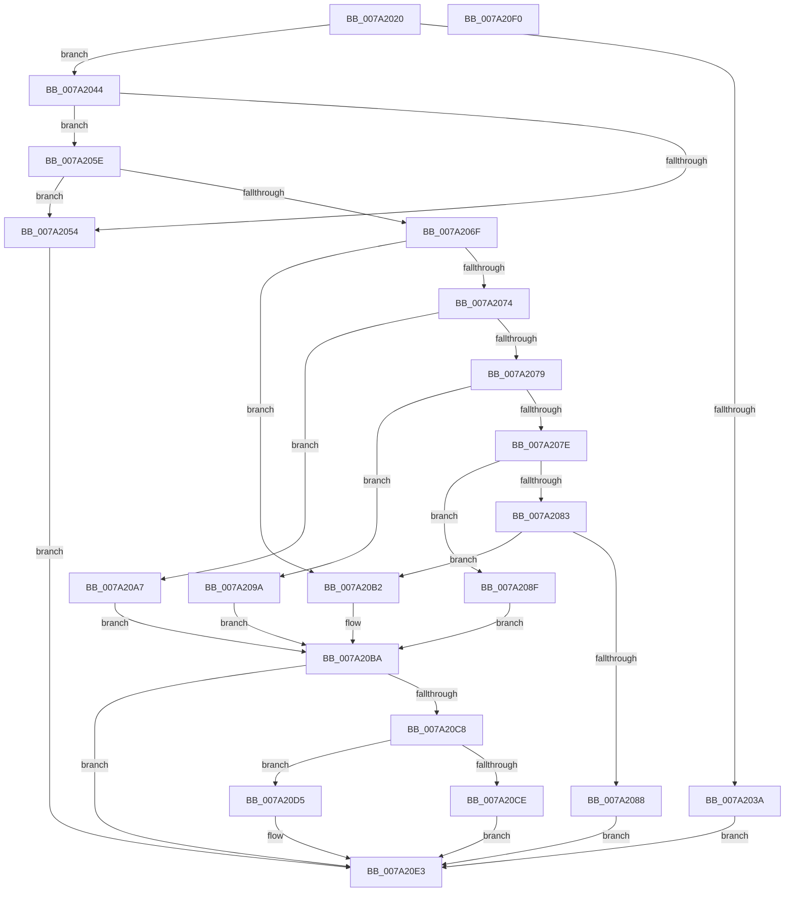

# SeQuerySecureBootPolicyValue

- RVA: `0x007A2020`–`0x007A20F1` (길이 `209` bytes)
- VA: `0x00000001407A2020`
- 실행 섹션: `PAGE`
- PDB 이름 있음: `예`; PDB Function 태그: `아니요`
- unwind 정보 RVA: `0x0005CAAC`
- 디코드: `64`개 명령, `209/209` bytes 표시
- 미해석 바이트: `0` (있으면 어셈블리에 `.byte`로 보존)

> 이 문서는 커널 이미지의 기계어와 PDB 기호를 분석해 생성했습니다. 4번과 5번은 함수 원형과 자료형을 바이너리 사용 방식에서 추정한 C 해석이며 원본 소스 복구 결과는 아닙니다.

## 1. Dependencies

- 직접 호출 지점: **2**; 고유 호출 대상: **2**
- 직접 호출자로 확인된 함수: **0**
- RIP 상대 이미지 참조: **2**

### Outgoing calls
- `0x007A204A` → [SepSecureBootFindMatchingRegistryRule](SepSecureBootFindMatchingRegistryRule_function_007A2414.md) (function, `0x007A2414`)
- `0x007A20DE` → [memcpy](../../text/6C/memcpy_function_006C6840.md) (function, `0x006C6840`)

### Direct callers
- 이 함수 시작 RVA로 연결되는 직접 call은 확인되지 않았습니다. 간접 호출은 완전히 역산할 수 없습니다.

### Static image references
- `0x007A202A` → RVA `0x00E67DF0` (`.data`; read)
- `0x007A2061` → RVA `0x00E67DE0` (`.data`; read)

## 2. Other-region calls and transfers

- 다른 실행 섹션으로 향하는 call: **1**
  - `0x007A20DE` → [memcpy](../../text/6C/memcpy_function_006C6840.md) (`PAGE` → `.text`)
- 별도 외부 분기/꼬리 이동을 확인하지 못했습니다.

## 3. Assembly (complete function range)

```asm
007A2020  48 89 5C 24 08                  mov qword ptr [rsp + 8], rbx
007A2025  57                              push rdi
007A2026  48 83 EC 20                     sub rsp, 0x20
007A202A  48 83 3D BE 5D 6C 00 00         cmp qword ptr [rip + 0x6c5dbe], 0
007A2032  49 8B F9                        mov rdi, r9
007A2035  41 8B D8                        mov ebx, r8d
007A2038  75 0A                           jne 0x1407a2044
007A203A  BB 06 00 43 80                  mov ebx, 0x80430006
007A203F  E9 9F 00 00 00                  jmp 0x1407a20e3
007A2044  4C 8B C2                        mov r8, rdx
007A2047  48 8B D1                        mov rdx, rcx
007A204A  E8 C5 03 00 00                  call 0x1407a2414
007A204F  48 85 C0                        test rax, rax
007A2052  75 0A                           jne 0x1407a205e
007A2054  BB 34 00 00 C0                  mov ebx, 0xc0000034
007A2059  E9 85 00 00 00                  jmp 0x1407a20e3
007A205E  8B 48 0C                        mov ecx, dword ptr [rax + 0xc]
007A2061  48 03 0D 78 5D 6C 00            add rcx, qword ptr [rip + 0x6c5d78]
007A2068  0F B7 01                        movzx eax, word ptr [rcx]
007A206B  3B D8                           cmp ebx, eax
007A206D  75 E5                           jne 0x1407a2054
007A206F  83 E0 1F                        and eax, 0x1f
007A2072  74 3E                           je 0x1407a20b2
007A2074  83 E8 02                        sub eax, 2
007A2077  74 2E                           je 0x1407a20a7
007A2079  83 E8 02                        sub eax, 2
007A207C  74 1C                           je 0x1407a209a
007A207E  83 E8 01                        sub eax, 1
007A2081  74 0C                           je 0x1407a208f
007A2083  83 F8 05                        cmp eax, 5
007A2086  74 2A                           je 0x1407a20b2
007A2088  BB 02 00 00 C0                  mov ebx, 0xc0000002
007A208D  EB 54                           jmp 0x1407a20e3
007A208F  4C 8D 49 02                     lea r9, [rcx + 2]
007A2093  BA 08 00 00 00                  mov edx, 8
007A2098  EB 20                           jmp 0x1407a20ba
007A209A  0F B7 51 06                     movzx edx, word ptr [rcx + 6]
007A209E  4C 8D 49 08                     lea r9, [rcx + 8]
007A20A2  C1 E2 02                        shl edx, 2
007A20A5  EB 13                           jmp 0x1407a20ba
007A20A7  4C 8D 49 02                     lea r9, [rcx + 2]
007A20AB  BA 04 00 00 00                  mov edx, 4
007A20B0  EB 08                           jmp 0x1407a20ba
007A20B2  0F B7 51 02                     movzx edx, word ptr [rcx + 2]
007A20B6  4C 8D 49 04                     lea r9, [rcx + 4]
007A20BA  48 8B 44 24 58                  mov rax, qword ptr [rsp + 0x58]
007A20BF  33 DB                           xor ebx, ebx
007A20C1  89 10                           mov dword ptr [rax], edx
007A20C3  48 85 FF                        test rdi, rdi
007A20C6  74 1B                           je 0x1407a20e3
007A20C8  39 54 24 50                     cmp dword ptr [rsp + 0x50], edx
007A20CC  73 07                           jae 0x1407a20d5
007A20CE  BB 23 00 00 C0                  mov ebx, 0xc0000023
007A20D3  EB 0E                           jmp 0x1407a20e3
007A20D5  44 8B C2                        mov r8d, edx
007A20D8  48 8B CF                        mov rcx, rdi
007A20DB  49 8B D1                        mov rdx, r9
007A20DE  E8 5D 47 F2 FF                  call 0x1406c6840
007A20E3  8B C3                           mov eax, ebx
007A20E5  48 8B 5C 24 30                  mov rbx, qword ptr [rsp + 0x30]
007A20EA  48 83 C4 20                     add rsp, 0x20
007A20EE  5F                              pop rdi
007A20EF  C3                              ret
007A20F0  CC                              int3
```

## 4. C-style interpretation (structured pseudocode)

```c
__int64 __fastcall SeQuerySecureBootPolicyValue(__int64 a1, __int64 a2, int a3, __int64 a4, unsigned int a5, __int64 a6)
{
    __int64 result;
    __int64 v_rbx;
    __int64 v_rsp;
    unsigned __int64 v_stack_p8;

    v_stack_p8 = v_rbx;
    v_rsp = (v_rsp) - (32);
    if ((*(unsigned __int64 *)(v_rip + 7101886)) != 0) goto loc_007A2044;
    goto loc_007A20E3;
loc_007A2044:
    result = SepSecureBootFindMatchingRegistryRule(a1, a1, a2, a4);
    if (result != 0) goto loc_007A205E;
loc_007A2054:
    goto loc_007A20E3;
loc_007A205E:
    a1 = ((unsigned int)(*(unsigned int *)(result + 12))) + (*(unsigned __int64 *)(v_rip + 7101816));
    if (((unsigned int)((unsigned int)(0xC0000034ULL))) != ((unsigned int)(*(unsigned __int16 *)(a1)))) goto loc_007A2054;
    result = (unsigned int)((*(unsigned __int16 *)(a1)) & (31));
    if (condition_is_equal) goto loc_007A20B2;
    result = (unsigned int)((result) - (2));
    if (condition_is_equal) goto loc_007A20A7;
    result = (unsigned int)((result) - (2));
    if (condition_is_equal) goto loc_007A209A;
    result = (unsigned int)((result) - (1));
    if (condition_is_equal) goto loc_007A208F;
    if (((unsigned int)(result)) == 5) goto loc_007A20B2;
    goto loc_007A20E3;
loc_007A208F:
    goto loc_007A20BA;
loc_007A209A:
    a2 = (unsigned int)((*(unsigned __int16 *)(a1 + 6)) << (2));
    goto loc_007A20BA;
loc_007A20A7:
    goto loc_007A20BA;
loc_007A20B2:
loc_007A20BA:
    v_rbx = 0;
    *(unsigned int *)(a6) = (unsigned int)(*(unsigned __int16 *)(a1 + 2));
    if (a4 == 0) goto loc_007A20E3;
    if (a5 >= ((unsigned int)(*(unsigned __int16 *)(a1 + 2)))) goto loc_007A20D5;
    goto loc_007A20E3;
loc_007A20D5:
    result = memcpy(a4, a1 + 4, (unsigned int)((unsigned int)(*(unsigned __int16 *)(a1 + 2))), a1 + 4);
loc_007A20E3:
    v_rsp = (v_rsp) + (32);
    return (unsigned int)((unsigned int)((unsigned int)(0xC0000023ULL)));
}
```

## 5. (Beta) C Style

```c
int64_t SeQuerySecureBootPolicyValue(int64_t Arg1, int64_t Arg2, int32_t Arg3, int64_t Arg4, uint32_t Arg5, void *Arg6)
{
    uint8_t *arg6 = (uint8_t *)Arg6;

    int64_t result;
    int64_t local_rbx;
    int64_t local_rsp;
    uint64_t v_stack_p8;

    v_stack_p8 = local_rbx;
    local_rsp = (local_rsp) - (32);
    if ((*(uint64_t *)(v_rip + 0x6C5DBE)) != 0) goto loc_007A2044;
    goto loc_007A20E3;
loc_007A2044:
    result = SepSecureBootFindMatchingRegistryRule(Arg1, Arg1, Arg2, Arg4);
    if (result != 0) goto loc_007A205E;
loc_007A2054:
    goto loc_007A20E3;
loc_007A205E:
    Arg1 = ((uint32_t)(*(uint32_t *)(result + 0xC))) + (*(uint64_t *)(v_rip + 0x6C5D78));
    if (((uint32_t)((uint32_t)(0xC0000034ULL))) != ((uint32_t)(*(uint16_t *)(Arg1)))) goto loc_007A2054;
    result = (uint32_t)((*(uint16_t *)(Arg1)) & (31));
    if (condition_is_equal) goto loc_007A20B2;
    result = (uint32_t)((result) - (2));
    if (condition_is_equal) goto loc_007A20A7;
    result = (uint32_t)((result) - (2));
    if (condition_is_equal) goto loc_007A209A;
    result = (uint32_t)((result) - (1));
    if (condition_is_equal) goto loc_007A208F;
    if (((uint32_t)(result)) == 5) goto loc_007A20B2;
    goto loc_007A20E3;
loc_007A208F:
    goto loc_007A20BA;
loc_007A209A:
    Arg2 = (uint32_t)((*(uint16_t *)(Arg1 + 0x6)) << (2));
    goto loc_007A20BA;
loc_007A20A7:
    goto loc_007A20BA;
loc_007A20B2:
loc_007A20BA:
    local_rbx = 0;
    *(uint32_t *)(arg6) = (uint32_t)(*(uint16_t *)(Arg1 + 0x2));
    if (Arg4 == 0) goto loc_007A20E3;
    if (Arg5 >= ((uint32_t)(*(uint16_t *)(Arg1 + 0x2)))) goto loc_007A20D5;
    goto loc_007A20E3;
loc_007A20D5:
    result = memcpy(Arg4, Arg1 + 4, (uint32_t)((uint32_t)(*(uint16_t *)(Arg1 + 0x2))), Arg1 + 4);
loc_007A20E3:
    local_rsp = (local_rsp) + (32);
    return (uint32_t)((uint32_t)((uint32_t)(0xC0000023ULL)));
}
```

### 관측된 메모리 오프셋

구조체 형식이 확인되지 않은 접근은 인자 기준의 오프셋으로만 기록했습니다.

| 기준 인자 | 오프셋 표현 | 폭 (bit) | 접근 |
|---|---:|---:|---|
| `Arg6` | `+ 0x0` | `32` | `W` |

## 6. Execution-region graph

[열기: 2D/3D 그래프와 함수 탐색 컨트롤 패널](../../../control-panel.html?section=page&rva=0x007A2020&view=graph)

- 2D 그래프는 위에서 아래로 흐르고, 3D 그래프는 빈 공간을 드래그해 회전합니다. Shift+드래그는 이동, 휠은 확대·축소, 함수 노드 선택은 대상 보고서 이동입니다.

### Static fallback


