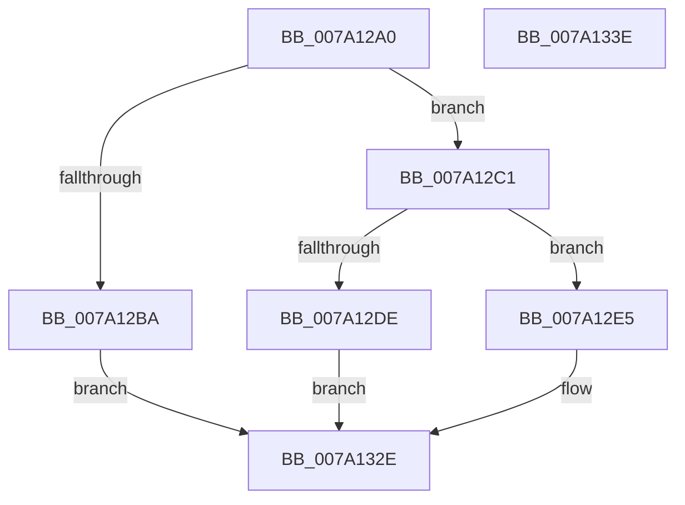

# SeRegisterLogonSessionTerminatedRoutineEx

- RVA: `0x007A12A0`–`0x007A133F` (길이 `159` bytes)
- VA: `0x00000001407A12A0`
- 실행 섹션: `PAGE`
- PDB 이름 있음: `예`; PDB Function 태그: `아니요`
- unwind 정보 RVA: `0x00060BC4`
- 디코드: `39`개 명령, `159/159` bytes 표시
- 미해석 바이트: `0` (있으면 어셈블리에 `.byte`로 보존)

> 이 문서는 커널 이미지의 기계어와 PDB 기호를 분석해 생성했습니다. 4번과 5번은 함수 원형과 자료형을 바이너리 사용 방식에서 추정한 C 해석이며 원본 소스 복구 결과는 아닙니다.

## 1. Dependencies

- 직접 호출 지점: **4**; 고유 호출 대상: **4**
- 직접 호출자로 확인된 함수: **0**
- RIP 상대 이미지 참조: **3**

### Outgoing calls
- `0x007A12D1` → [ExAllocatePool2](../../poolcode/B8/ExAllocatePool2_function_00B820F0.md) (function, `0x00B820F0`)
- `0x007A12FD` → [ExAcquireFastMutexUnsafe](../../text/3F/ExAcquireFastMutexUnsafe_function_003F3720.md) (function, `0x003F3720`)
- `0x007A1322` → [ExReleaseFastMutexUnsafe](../../text/25/ExReleaseFastMutexUnsafe_function_002503A0.md) (function, `0x002503A0`)
- `0x007A1327` → [KeLeaveCriticalRegion](../../text/25/KeLeaveCriticalRegion_function_0025D8B0.md) (function, `0x0025D8B0`)

### Direct callers
- 이 함수 시작 RVA로 연결되는 직접 call은 확인되지 않았습니다. 간접 호출은 완전히 역산할 수 없습니다.

### Static image references
- `0x007A12EE` → RVA `0x00E680C0` (`.data`; read)
- `0x007A1302` → RVA `0x00FD82F8` (`PAGEDATA`; read)
- `0x007A131B` → RVA `0x00FD82F8` (`PAGEDATA`; write)

## 2. Other-region calls and transfers

- 다른 실행 섹션으로 향하는 call: **4**
  - `0x007A12D1` → [ExAllocatePool2](../../poolcode/B8/ExAllocatePool2_function_00B820F0.md) (`PAGE` → `POOLCODE`)
  - `0x007A12FD` → [ExAcquireFastMutexUnsafe](../../text/3F/ExAcquireFastMutexUnsafe_function_003F3720.md) (`PAGE` → `.text`)
  - `0x007A1322` → [ExReleaseFastMutexUnsafe](../../text/25/ExReleaseFastMutexUnsafe_function_002503A0.md) (`PAGE` → `.text`)
  - `0x007A1327` → [KeLeaveCriticalRegion](../../text/25/KeLeaveCriticalRegion_function_0025D8B0.md) (`PAGE` → `.text`)
- 별도 외부 분기/꼬리 이동을 확인하지 못했습니다.

## 3. Assembly (complete function range)

```asm
007A12A0  48 89 5C 24 08                  mov qword ptr [rsp + 8], rbx
007A12A5  48 89 74 24 10                  mov qword ptr [rsp + 0x10], rsi
007A12AA  57                              push rdi
007A12AB  48 83 EC 20                     sub rsp, 0x20
007A12AF  48 8B F2                        mov rsi, rdx
007A12B2  48 8B F9                        mov rdi, rcx
007A12B5  48 85 C9                        test rcx, rcx
007A12B8  75 07                           jne 0x1407a12c1
007A12BA  B8 0D 00 00 C0                  mov eax, 0xc000000d
007A12BF  EB 6D                           jmp 0x1407a132e
007A12C1  BA 18 00 00 00                  mov edx, 0x18
007A12C6  B9 00 01 00 00                  mov ecx, 0x100
007A12CB  41 B8 53 65 46 53               mov r8d, 0x53466553
007A12D1  E8 1A 0E 3E 00                  call 0x140b820f0
007A12D6  48 8B D8                        mov rbx, rax
007A12D9  48 85 C0                        test rax, rax
007A12DC  75 07                           jne 0x1407a12e5
007A12DE  B8 9A 00 00 C0                  mov eax, 0xc000009a
007A12E3  EB 49                           jmp 0x1407a132e
007A12E5  65 48 8B 04 25 88 01 00 00      mov rax, qword ptr gs:[0x188]
007A12EE  48 8D 0D CB 6D 6C 00            lea rcx, [rip + 0x6c6dcb]
007A12F5  66 FF 88 E4 01 00 00            dec word ptr [rax + 0x1e4]
007A12FC  90                              nop
007A12FD  E8 1E 24 C5 FF                  call 0x1403f3720
007A1302  48 8B 05 EF 6F 83 00            mov rax, qword ptr [rip + 0x836fef]
007A1309  48 8D 0D B0 6D 6C 00            lea rcx, [rip + 0x6c6db0]
007A1310  48 89 03                        mov qword ptr [rbx], rax
007A1313  48 89 7B 08                     mov qword ptr [rbx + 8], rdi
007A1317  48 89 73 10                     mov qword ptr [rbx + 0x10], rsi
007A131B  48 89 1D D6 6F 83 00            mov qword ptr [rip + 0x836fd6], rbx
007A1322  E8 79 F0 AA FF                  call 0x1402503a0
007A1327  E8 84 C5 AB FF                  call 0x14025d8b0
007A132C  33 C0                           xor eax, eax
007A132E  48 8B 5C 24 30                  mov rbx, qword ptr [rsp + 0x30]
007A1333  48 8B 74 24 38                  mov rsi, qword ptr [rsp + 0x38]
007A1338  48 83 C4 20                     add rsp, 0x20
007A133C  5F                              pop rdi
007A133D  C3                              ret
007A133E  CC                              int3
```

## 4. C-style interpretation (structured pseudocode)

```c
__int64 __fastcall SeRegisterLogonSessionTerminatedRoutineEx(__int64 a1, __int64 a2)
{
    __int64 result;
    __int64 v_rsp;
    unsigned __int64 v_stack_p10;
    unsigned __int64 v_stack_p8;

    v_stack_p8 = v_rbx;
    v_stack_p10 = v_rsi;
    v_rsp = (v_rsp) - (32);
    if (a1 != 0) goto loc_007A12C1;
    goto loc_007A132E;
loc_007A12C1:
    result = ExAllocatePool2(256, 24, (unsigned int)(0x53466553ULL), a4);
    if (result != 0) goto loc_007A12E5;
    goto loc_007A132E;
loc_007A12E5:
    result = ExAcquireFastMutexUnsafe(v_rip + 7105995, 24, (unsigned int)(0x53466553ULL), a4);
    *(unsigned __int64 *)(result) = *(unsigned __int64 *)(v_rip + 8613871);
    *(unsigned __int64 *)(result + 8) = a1;
    *(unsigned __int64 *)(result + 16) = a2;
    *(unsigned __int64 *)(v_rip + 8613846) = result;
    result = ExReleaseFastMutexUnsafe(v_rip + 7105968, 24, (unsigned int)(0x53466553ULL), a4);
    result = KeLeaveCriticalRegion(v_rip + 7105968, 24, (unsigned int)(0x53466553ULL), a4);
    result = 0;
loc_007A132E:
    v_rsp = (v_rsp) + (32);
    return result;
}
```

## 5. (Beta) C Style

```c
int64_t SeRegisterLogonSessionTerminatedRoutineEx(int64_t Arg1, int64_t Arg2)
{
    int64_t result;
    int64_t local_rsp;
    uint64_t v_stack_p10;
    uint64_t v_stack_p8;

    v_stack_p8 = local_rbx;
    v_stack_p10 = local_rsi;
    local_rsp = (local_rsp) - (32);
    if (Arg1 != 0) goto loc_007A12C1;
    goto loc_007A132E;
loc_007A12C1:
    result = ExAllocatePool2(256, 24, (uint32_t)(0x53466553ULL), a4);
    if (result != 0) goto loc_007A12E5;
    goto loc_007A132E;
loc_007A12E5:
    result = ExAcquireFastMutexUnsafe(v_rip + 7105995, 24, (uint32_t)(0x53466553ULL), a4);
    *(uint64_t *)(result) = *(uint64_t *)(v_rip + 0x836FEF);
    *(uint64_t *)(result + 0x8) = Arg1;
    *(uint64_t *)(result + 0x10) = Arg2;
    *(uint64_t *)(v_rip + 0x836FD6) = result;
    result = ExReleaseFastMutexUnsafe(v_rip + 7105968, 24, (uint32_t)(0x53466553ULL), a4);
    result = KeLeaveCriticalRegion(v_rip + 7105968, 24, (uint32_t)(0x53466553ULL), a4);
    result = 0;
loc_007A132E:
    local_rsp = (local_rsp) + (32);
    return result;
}
```

## 6. Execution-region graph

[열기: 2D/3D 그래프와 함수 탐색 컨트롤 패널](../../../control-panel.html?section=page&rva=0x007A12A0&view=graph)

- 2D 그래프는 위에서 아래로 흐르고, 3D 그래프는 빈 공간을 드래그해 회전합니다. Shift+드래그는 이동, 휠은 확대·축소, 함수 노드 선택은 대상 보고서 이동입니다.

### Static fallback


