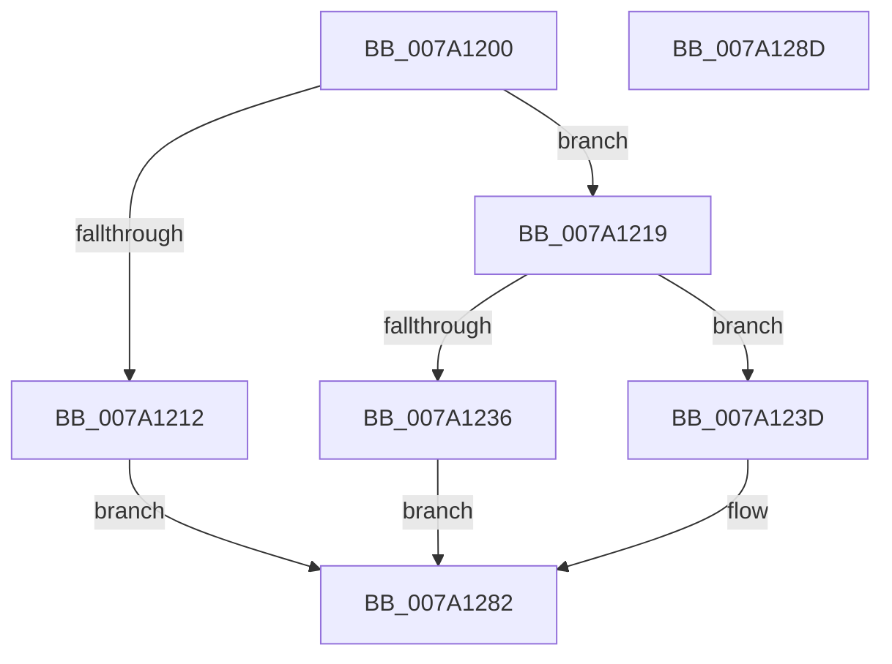

# SeRegisterLogonSessionTerminatedRoutine

- RVA: `0x007A1200`–`0x007A128E` (길이 `142` bytes)
- VA: `0x00000001407A1200`
- 실행 섹션: `PAGE`
- PDB 이름 있음: `예`; PDB Function 태그: `아니요`
- unwind 정보 RVA: `0x0005CAAC`
- 디코드: `35`개 명령, `142/142` bytes 표시
- 미해석 바이트: `0` (있으면 어셈블리에 `.byte`로 보존)

> 이 문서는 커널 이미지의 기계어와 PDB 기호를 분석해 생성했습니다. 4번과 5번은 함수 원형과 자료형을 바이너리 사용 방식에서 추정한 C 해석이며 원본 소스 복구 결과는 아닙니다.

## 1. Dependencies

- 직접 호출 지점: **4**; 고유 호출 대상: **4**
- 직접 호출자로 확인된 함수: **0**
- RIP 상대 이미지 참조: **3**

### Outgoing calls
- `0x007A1229` → [ExAllocatePool2](../../poolcode/B8/ExAllocatePool2_function_00B820F0.md) (function, `0x00B820F0`)
- `0x007A1255` → [ExAcquireFastMutexUnsafe](../../text/3F/ExAcquireFastMutexUnsafe_function_003F3720.md) (function, `0x003F3720`)
- `0x007A1276` → [ExReleaseFastMutexUnsafe](../../text/25/ExReleaseFastMutexUnsafe_function_002503A0.md) (function, `0x002503A0`)
- `0x007A127B` → [KeLeaveCriticalRegion](../../text/25/KeLeaveCriticalRegion_function_0025D8B0.md) (function, `0x0025D8B0`)

### Direct callers
- 이 함수 시작 RVA로 연결되는 직접 call은 확인되지 않았습니다. 간접 호출은 완전히 역산할 수 없습니다.

### Static image references
- `0x007A1246` → RVA `0x00E680C0` (`.data`; read)
- `0x007A125A` → RVA `0x00FD8268` (`PAGEDATA`; read)
- `0x007A126F` → RVA `0x00FD8268` (`PAGEDATA`; write)

## 2. Other-region calls and transfers

- 다른 실행 섹션으로 향하는 call: **4**
  - `0x007A1229` → [ExAllocatePool2](../../poolcode/B8/ExAllocatePool2_function_00B820F0.md) (`PAGE` → `POOLCODE`)
  - `0x007A1255` → [ExAcquireFastMutexUnsafe](../../text/3F/ExAcquireFastMutexUnsafe_function_003F3720.md) (`PAGE` → `.text`)
  - `0x007A1276` → [ExReleaseFastMutexUnsafe](../../text/25/ExReleaseFastMutexUnsafe_function_002503A0.md) (`PAGE` → `.text`)
  - `0x007A127B` → [KeLeaveCriticalRegion](../../text/25/KeLeaveCriticalRegion_function_0025D8B0.md) (`PAGE` → `.text`)
- 별도 외부 분기/꼬리 이동을 확인하지 못했습니다.

## 3. Assembly (complete function range)

```asm
007A1200  48 89 5C 24 08                  mov qword ptr [rsp + 8], rbx
007A1205  57                              push rdi
007A1206  48 83 EC 20                     sub rsp, 0x20
007A120A  48 8B F9                        mov rdi, rcx
007A120D  48 85 C9                        test rcx, rcx
007A1210  75 07                           jne 0x1407a1219
007A1212  B8 0D 00 00 C0                  mov eax, 0xc000000d
007A1217  EB 69                           jmp 0x1407a1282
007A1219  BA 10 00 00 00                  mov edx, 0x10
007A121E  B9 00 01 00 00                  mov ecx, 0x100
007A1223  41 B8 53 65 46 53               mov r8d, 0x53466553
007A1229  E8 C2 0E 3E 00                  call 0x140b820f0
007A122E  48 8B D8                        mov rbx, rax
007A1231  48 85 C0                        test rax, rax
007A1234  75 07                           jne 0x1407a123d
007A1236  B8 9A 00 00 C0                  mov eax, 0xc000009a
007A123B  EB 45                           jmp 0x1407a1282
007A123D  65 48 8B 04 25 88 01 00 00      mov rax, qword ptr gs:[0x188]
007A1246  48 8D 0D 73 6E 6C 00            lea rcx, [rip + 0x6c6e73]
007A124D  66 FF 88 E4 01 00 00            dec word ptr [rax + 0x1e4]
007A1254  90                              nop
007A1255  E8 C6 24 C5 FF                  call 0x1403f3720
007A125A  48 8B 05 07 70 83 00            mov rax, qword ptr [rip + 0x837007]
007A1261  48 8D 0D 58 6E 6C 00            lea rcx, [rip + 0x6c6e58]
007A1268  48 89 03                        mov qword ptr [rbx], rax
007A126B  48 89 7B 08                     mov qword ptr [rbx + 8], rdi
007A126F  48 89 1D F2 6F 83 00            mov qword ptr [rip + 0x836ff2], rbx
007A1276  E8 25 F1 AA FF                  call 0x1402503a0
007A127B  E8 30 C6 AB FF                  call 0x14025d8b0
007A1280  33 C0                           xor eax, eax
007A1282  48 8B 5C 24 30                  mov rbx, qword ptr [rsp + 0x30]
007A1287  48 83 C4 20                     add rsp, 0x20
007A128B  5F                              pop rdi
007A128C  C3                              ret
007A128D  CC                              int3
```

## 4. C-style interpretation (structured pseudocode)

```c
__int64 __fastcall SeRegisterLogonSessionTerminatedRoutine(__int64 a1)
{
    __int64 result;
    __int64 v_rsp;
    unsigned __int64 v_stack_p8;

    v_stack_p8 = v_rbx;
    v_rsp = (v_rsp) - (32);
    if (a1 != 0) goto loc_007A1219;
    goto loc_007A1282;
loc_007A1219:
    result = ExAllocatePool2(256, 16, (unsigned int)(0x53466553ULL), a4);
    if (result != 0) goto loc_007A123D;
    goto loc_007A1282;
loc_007A123D:
    result = ExAcquireFastMutexUnsafe(v_rip + 7106163, 16, (unsigned int)(0x53466553ULL), a4);
    *(unsigned __int64 *)(result) = *(unsigned __int64 *)(v_rip + 8613895);
    *(unsigned __int64 *)(result + 8) = a1;
    *(unsigned __int64 *)(v_rip + 8613874) = result;
    result = ExReleaseFastMutexUnsafe(v_rip + 7106136, 16, (unsigned int)(0x53466553ULL), a4);
    result = KeLeaveCriticalRegion(v_rip + 7106136, 16, (unsigned int)(0x53466553ULL), a4);
    result = 0;
loc_007A1282:
    v_rsp = (v_rsp) + (32);
    return result;
}
```

## 5. (Beta) C Style

```c
int64_t SeRegisterLogonSessionTerminatedRoutine(int64_t Arg1)
{
    int64_t result;
    int64_t local_rsp;
    uint64_t v_stack_p8;

    v_stack_p8 = local_rbx;
    local_rsp = (local_rsp) - (32);
    if (Arg1 != 0) goto loc_007A1219;
    goto loc_007A1282;
loc_007A1219:
    result = ExAllocatePool2(256, 16, (uint32_t)(0x53466553ULL), a4);
    if (result != 0) goto loc_007A123D;
    goto loc_007A1282;
loc_007A123D:
    result = ExAcquireFastMutexUnsafe(v_rip + 7106163, 16, (uint32_t)(0x53466553ULL), a4);
    *(uint64_t *)(result) = *(uint64_t *)(v_rip + 0x837007);
    *(uint64_t *)(result + 0x8) = Arg1;
    *(uint64_t *)(v_rip + 0x836FF2) = result;
    result = ExReleaseFastMutexUnsafe(v_rip + 7106136, 16, (uint32_t)(0x53466553ULL), a4);
    result = KeLeaveCriticalRegion(v_rip + 7106136, 16, (uint32_t)(0x53466553ULL), a4);
    result = 0;
loc_007A1282:
    local_rsp = (local_rsp) + (32);
    return result;
}
```

## 6. Execution-region graph

[열기: 2D/3D 그래프와 함수 탐색 컨트롤 패널](../../../control-panel.html?section=page&rva=0x007A1200&view=graph)

- 2D 그래프는 위에서 아래로 흐르고, 3D 그래프는 빈 공간을 드래그해 회전합니다. Shift+드래그는 이동, 휠은 확대·축소, 함수 노드 선택은 대상 보고서 이동입니다.

### Static fallback


