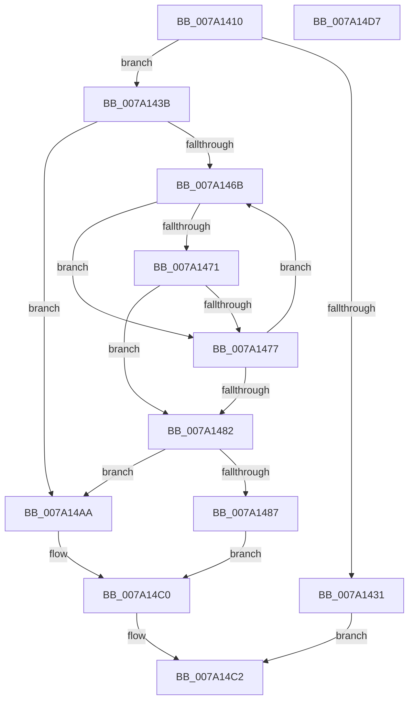

# SeUnregisterLogonSessionTerminatedRoutineEx

- RVA: `0x007A1410`–`0x007A14D8` (길이 `200` bytes)
- VA: `0x00000001407A1410`
- 실행 섹션: `PAGE`
- PDB 이름 있음: `예`; PDB Function 태그: `아니요`
- unwind 정보 RVA: `0x0005C954`
- 디코드: `52`개 명령, `200/200` bytes 표시
- 미해석 바이트: `0` (있으면 어셈블리에 `.byte`로 보존)

> 이 문서는 커널 이미지의 기계어와 PDB 기호를 분석해 생성했습니다. 4번과 5번은 함수 원형과 자료형을 바이너리 사용 방식에서 추정한 C 해석이며 원본 소스 복구 결과는 아닙니다.

## 1. Dependencies

- 직접 호출 지점: **6**; 고유 호출 대상: **4**
- 직접 호출자로 확인된 함수: **0**
- RIP 상대 이미지 참조: **2**

### Outgoing calls
- `0x007A1453` → [ExAcquireFastMutexUnsafe](../../text/3F/ExAcquireFastMutexUnsafe_function_003F3720.md) (function, `0x003F3720`)
- `0x007A1494` → [ExReleaseFastMutexUnsafe](../../text/25/ExReleaseFastMutexUnsafe_function_002503A0.md) (function, `0x002503A0`)
- `0x007A1499` → [KeLeaveCriticalRegion](../../text/25/KeLeaveCriticalRegion_function_0025D8B0.md) (function, `0x0025D8B0`)
- `0x007A14A3` → [ExFreePoolWithTag](../../poolcode/B8/ExFreePoolWithTag_function_00B82870.md) (function, `0x00B82870`)
- `0x007A14B1` → [ExReleaseFastMutexUnsafe](../../text/25/ExReleaseFastMutexUnsafe_function_002503A0.md) (function, `0x002503A0`)
- `0x007A14B6` → [KeLeaveCriticalRegion](../../text/25/KeLeaveCriticalRegion_function_0025D8B0.md) (function, `0x0025D8B0`)

### Direct callers
- 이 함수 시작 RVA로 연결되는 직접 call은 확인되지 않았습니다. 간접 호출은 완전히 역산할 수 없습니다.

### Static image references
- `0x007A1444` → RVA `0x00E680C0` (`.data`; read)
- `0x007A1458` → RVA `0x00FD82F8` (`PAGEDATA`; read)

## 2. Other-region calls and transfers

- 다른 실행 섹션으로 향하는 call: **6**
  - `0x007A1453` → [ExAcquireFastMutexUnsafe](../../text/3F/ExAcquireFastMutexUnsafe_function_003F3720.md) (`PAGE` → `.text`)
  - `0x007A1494` → [ExReleaseFastMutexUnsafe](../../text/25/ExReleaseFastMutexUnsafe_function_002503A0.md) (`PAGE` → `.text`)
  - `0x007A1499` → [KeLeaveCriticalRegion](../../text/25/KeLeaveCriticalRegion_function_0025D8B0.md) (`PAGE` → `.text`)
  - `0x007A14A3` → [ExFreePoolWithTag](../../poolcode/B8/ExFreePoolWithTag_function_00B82870.md) (`PAGE` → `POOLCODE`)
  - `0x007A14B1` → [ExReleaseFastMutexUnsafe](../../text/25/ExReleaseFastMutexUnsafe_function_002503A0.md) (`PAGE` → `.text`)
  - `0x007A14B6` → [KeLeaveCriticalRegion](../../text/25/KeLeaveCriticalRegion_function_0025D8B0.md) (`PAGE` → `.text`)
- 별도 외부 분기/꼬리 이동을 확인하지 못했습니다.

## 3. Assembly (complete function range)

```asm
007A1410  48 89 5C 24 08                  mov qword ptr [rsp + 8], rbx
007A1415  48 89 6C 24 10                  mov qword ptr [rsp + 0x10], rbp
007A141A  48 89 74 24 18                  mov qword ptr [rsp + 0x18], rsi
007A141F  57                              push rdi
007A1420  48 83 EC 20                     sub rsp, 0x20
007A1424  33 FF                           xor edi, edi
007A1426  48 8B EA                        mov rbp, rdx
007A1429  48 8B F1                        mov rsi, rcx
007A142C  48 85 C9                        test rcx, rcx
007A142F  75 0A                           jne 0x1407a143b
007A1431  B8 0D 00 00 C0                  mov eax, 0xc000000d
007A1436  E9 87 00 00 00                  jmp 0x1407a14c2
007A143B  65 48 8B 04 25 88 01 00 00      mov rax, qword ptr gs:[0x188]
007A1444  48 8D 0D 75 6C 6C 00            lea rcx, [rip + 0x6c6c75]
007A144B  66 FF 88 E4 01 00 00            dec word ptr [rax + 0x1e4]
007A1452  90                              nop
007A1453  E8 C8 22 C5 FF                  call 0x1403f3720
007A1458  48 8B 1D 99 6E 83 00            mov rbx, qword ptr [rip + 0x836e99]
007A145F  48 8D 15 92 6E 83 00            lea rdx, [rip + 0x836e92]
007A1466  48 85 DB                        test rbx, rbx
007A1469  74 3F                           je 0x1407a14aa
007A146B  48 39 73 08                     cmp qword ptr [rbx + 8], rsi
007A146F  75 06                           jne 0x1407a1477
007A1471  48 39 6B 10                     cmp qword ptr [rbx + 0x10], rbp
007A1475  74 0B                           je 0x1407a1482
007A1477  48 8B D3                        mov rdx, rbx
007A147A  48 8B 1B                        mov rbx, qword ptr [rbx]
007A147D  48 85 DB                        test rbx, rbx
007A1480  75 E9                           jne 0x1407a146b
007A1482  48 85 DB                        test rbx, rbx
007A1485  74 23                           je 0x1407a14aa
007A1487  48 8B 03                        mov rax, qword ptr [rbx]
007A148A  48 8D 0D 2F 6C 6C 00            lea rcx, [rip + 0x6c6c2f]
007A1491  48 89 02                        mov qword ptr [rdx], rax
007A1494  E8 07 EF AA FF                  call 0x1402503a0
007A1499  E8 12 C4 AB FF                  call 0x14025d8b0
007A149E  33 D2                           xor edx, edx
007A14A0  48 8B CB                        mov rcx, rbx
007A14A3  E8 C8 13 3E 00                  call 0x140b82870
007A14A8  EB 16                           jmp 0x1407a14c0
007A14AA  48 8D 0D 0F 6C 6C 00            lea rcx, [rip + 0x6c6c0f]
007A14B1  E8 EA EE AA FF                  call 0x1402503a0
007A14B6  E8 F5 C3 AB FF                  call 0x14025d8b0
007A14BB  BF 25 02 00 C0                  mov edi, 0xc0000225
007A14C0  8B C7                           mov eax, edi
007A14C2  48 8B 5C 24 30                  mov rbx, qword ptr [rsp + 0x30]
007A14C7  48 8B 6C 24 38                  mov rbp, qword ptr [rsp + 0x38]
007A14CC  48 8B 74 24 40                  mov rsi, qword ptr [rsp + 0x40]
007A14D1  48 83 C4 20                     add rsp, 0x20
007A14D5  5F                              pop rdi
007A14D6  C3                              ret
007A14D7  CC                              int3
```

## 4. C-style interpretation (structured pseudocode)

```c
__int64 __fastcall SeUnregisterLogonSessionTerminatedRoutineEx(__int64 a1, __int64 a2)
{
    __int64 result;
    __int64 v_rdi;
    __int64 v_rsp;
    unsigned __int64 v_stack_p10;
    unsigned __int64 v_stack_p18;
    unsigned __int64 v_stack_p8;

    v_stack_p8 = v_rbx;
    v_stack_p10 = v_rbp;
    v_stack_p18 = v_rsi;
    v_rsp = (v_rsp) - (32);
    v_rdi = 0;
    if (a1 != 0) goto loc_007A143B;
    goto loc_007A14C2;
loc_007A143B:
    result = ExAcquireFastMutexUnsafe(v_rip + 7105653, a2, a3, a4);
    if (*(unsigned __int64 *)(v_rip + 8613529) == 0) goto loc_007A14AA;
loc_007A146B:
    if ((*(unsigned __int64 *)(*(unsigned __int64 *)(v_rip + 8613529) + 8)) != a1) goto loc_007A1477;
    if ((*(unsigned __int64 *)(*(unsigned __int64 *)(v_rip + 8613529) + 16)) == a2) goto loc_007A1482;
loc_007A1477:
    if (*(unsigned __int64 *)(*(unsigned __int64 *)(v_rip + 8613529)) != 0) goto loc_007A146B;
loc_007A1482:
    if (*(unsigned __int64 *)(*(unsigned __int64 *)(v_rip + 8613529)) == 0) goto loc_007A14AA;
    *(unsigned __int64 *)(*(unsigned __int64 *)(v_rip + 8613529)) = *(unsigned __int64 *)(*(unsigned __int64 *)(*(unsigned __int64 *)(v_rip + 8613529)));
    result = ExReleaseFastMutexUnsafe(v_rip + 7105583, *(unsigned __int64 *)(v_rip + 8613529), a3, a4);
    result = KeLeaveCriticalRegion(v_rip + 7105583, *(unsigned __int64 *)(v_rip + 8613529), a3, a4);
    a2 = 0;
    result = ExFreePoolWithTag(*(unsigned __int64 *)(*(unsigned __int64 *)(v_rip + 8613529)), a2, a3, a4);
    goto loc_007A14C0;
loc_007A14AA:
    result = ExReleaseFastMutexUnsafe(v_rip + 7105551, a2, a3, a4);
    result = KeLeaveCriticalRegion(v_rip + 7105551, a2, a3, a4);
loc_007A14C0:
loc_007A14C2:
    v_rsp = (v_rsp) + (32);
    return (unsigned int)((unsigned int)((unsigned int)(0xC0000225ULL)));
}
```

## 5. (Beta) C Style

```c
int64_t SeUnregisterLogonSessionTerminatedRoutineEx(int64_t Arg1, int64_t Arg2)
{
    int64_t result;
    int64_t local_rdi;
    int64_t local_rsp;
    uint64_t v_stack_p10;
    uint64_t v_stack_p18;
    uint64_t v_stack_p8;

    v_stack_p8 = local_rbx;
    v_stack_p10 = local_rbp;
    v_stack_p18 = local_rsi;
    local_rsp = (local_rsp) - (32);
    local_rdi = 0;
    if (Arg1 != 0) goto loc_007A143B;
    goto loc_007A14C2;
loc_007A143B:
    result = ExAcquireFastMutexUnsafe(v_rip + 7105653, Arg2, a3, a4);
    if (*(uint64_t *)(v_rip + 0x836E99) == 0) goto loc_007A14AA;
loc_007A146B:
    if ((*(uint64_t *)(*(uint64_t *)(v_rip + 0x836E99) + 0x8)) != Arg1) goto loc_007A1477;
    if ((*(uint64_t *)(*(uint64_t *)(v_rip + 0x836E99) + 0x10)) == Arg2) goto loc_007A1482;
loc_007A1477:
    if (*(uint64_t *)(*(uint64_t *)(v_rip + 0x836E99)) != 0) goto loc_007A146B;
loc_007A1482:
    if (*(uint64_t *)(*(uint64_t *)(v_rip + 0x836E99)) == 0) goto loc_007A14AA;
    *(uint64_t *)(*(uint64_t *)(v_rip + 0x836E99)) = *(uint64_t *)(*(uint64_t *)(*(uint64_t *)(v_rip + 0x836E99)));
    result = ExReleaseFastMutexUnsafe(v_rip + 7105583, *(uint64_t *)(v_rip + 0x836E99), a3, a4);
    result = KeLeaveCriticalRegion(v_rip + 7105583, *(uint64_t *)(v_rip + 0x836E99), a3, a4);
    Arg2 = 0;
    result = ExFreePoolWithTag(*(uint64_t *)(*(uint64_t *)(v_rip + 0x836E99)), Arg2, a3, a4);
    goto loc_007A14C0;
loc_007A14AA:
    result = ExReleaseFastMutexUnsafe(v_rip + 7105551, Arg2, a3, a4);
    result = KeLeaveCriticalRegion(v_rip + 7105551, Arg2, a3, a4);
loc_007A14C0:
loc_007A14C2:
    local_rsp = (local_rsp) + (32);
    return (uint32_t)((uint32_t)((uint32_t)(0xC0000225ULL)));
}
```

## 6. Execution-region graph

[열기: 2D/3D 그래프와 함수 탐색 컨트롤 패널](../../../control-panel.html?section=page&rva=0x007A1410&view=graph)

- 2D 그래프는 위에서 아래로 흐르고, 3D 그래프는 빈 공간을 드래그해 회전합니다. Shift+드래그는 이동, 휠은 확대·축소, 함수 노드 선택은 대상 보고서 이동입니다.

### Static fallback


