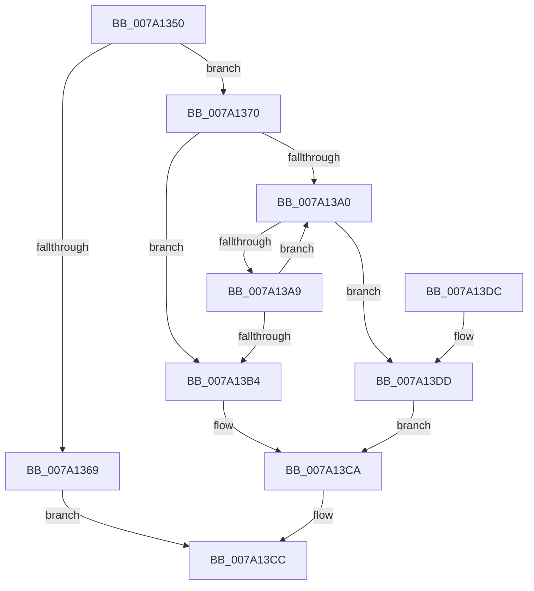

# SeUnregisterLogonSessionTerminatedRoutine

- RVA: `0x007A1350`–`0x007A13FD` (길이 `173` bytes)
- VA: `0x00000001407A1350`
- 실행 섹션: `PAGE`
- PDB 이름 있음: `예`; PDB Function 태그: `아니요`
- unwind 정보 RVA: `0x00065748`
- 디코드: `45`개 명령, `173/173` bytes 표시
- 미해석 바이트: `0` (있으면 어셈블리에 `.byte`로 보존)

> 이 문서는 커널 이미지의 기계어와 PDB 기호를 분석해 생성했습니다. 4번과 5번은 함수 원형과 자료형을 바이너리 사용 방식에서 추정한 C 해석이며 원본 소스 복구 결과는 아닙니다.

## 1. Dependencies

- 직접 호출 지점: **6**; 고유 호출 대상: **4**
- 직접 호출자로 확인된 함수: **0**
- RIP 상대 이미지 참조: **2**

### Outgoing calls
- `0x007A1388` → [ExAcquireFastMutexUnsafe](../../text/3F/ExAcquireFastMutexUnsafe_function_003F3720.md) (function, `0x003F3720`)
- `0x007A13BB` → [ExReleaseFastMutexUnsafe](../../text/25/ExReleaseFastMutexUnsafe_function_002503A0.md) (function, `0x002503A0`)
- `0x007A13C0` → [KeLeaveCriticalRegion](../../text/25/KeLeaveCriticalRegion_function_0025D8B0.md) (function, `0x0025D8B0`)
- `0x007A13E7` → [ExReleaseFastMutexUnsafe](../../text/25/ExReleaseFastMutexUnsafe_function_002503A0.md) (function, `0x002503A0`)
- `0x007A13EC` → [KeLeaveCriticalRegion](../../text/25/KeLeaveCriticalRegion_function_0025D8B0.md) (function, `0x0025D8B0`)
- `0x007A13F6` → [ExFreePoolWithTag](../../poolcode/B8/ExFreePoolWithTag_function_00B82870.md) (function, `0x00B82870`)

### Direct callers
- 이 함수 시작 RVA로 연결되는 직접 call은 확인되지 않았습니다. 간접 호출은 완전히 역산할 수 없습니다.

### Static image references
- `0x007A1379` → RVA `0x00E680C0` (`.data`; read)
- `0x007A138D` → RVA `0x00FD8268` (`PAGEDATA`; read)

## 2. Other-region calls and transfers

- 다른 실행 섹션으로 향하는 call: **6**
  - `0x007A1388` → [ExAcquireFastMutexUnsafe](../../text/3F/ExAcquireFastMutexUnsafe_function_003F3720.md) (`PAGE` → `.text`)
  - `0x007A13BB` → [ExReleaseFastMutexUnsafe](../../text/25/ExReleaseFastMutexUnsafe_function_002503A0.md) (`PAGE` → `.text`)
  - `0x007A13C0` → [KeLeaveCriticalRegion](../../text/25/KeLeaveCriticalRegion_function_0025D8B0.md) (`PAGE` → `.text`)
  - `0x007A13E7` → [ExReleaseFastMutexUnsafe](../../text/25/ExReleaseFastMutexUnsafe_function_002503A0.md) (`PAGE` → `.text`)
  - `0x007A13EC` → [KeLeaveCriticalRegion](../../text/25/KeLeaveCriticalRegion_function_0025D8B0.md) (`PAGE` → `.text`)
  - `0x007A13F6` → [ExFreePoolWithTag](../../poolcode/B8/ExFreePoolWithTag_function_00B82870.md) (`PAGE` → `POOLCODE`)
- 별도 외부 분기/꼬리 이동을 확인하지 못했습니다.

## 3. Assembly (complete function range)

```asm
007A1350  48 89 5C 24 08                  mov qword ptr [rsp + 8], rbx
007A1355  48 89 74 24 10                  mov qword ptr [rsp + 0x10], rsi
007A135A  57                              push rdi
007A135B  48 83 EC 20                     sub rsp, 0x20
007A135F  33 DB                           xor ebx, ebx
007A1361  48 8B F1                        mov rsi, rcx
007A1364  48 85 C9                        test rcx, rcx
007A1367  75 07                           jne 0x1407a1370
007A1369  B8 0D 00 00 C0                  mov eax, 0xc000000d
007A136E  EB 5C                           jmp 0x1407a13cc
007A1370  65 48 8B 04 25 88 01 00 00      mov rax, qword ptr gs:[0x188]
007A1379  48 8D 0D 40 6D 6C 00            lea rcx, [rip + 0x6c6d40]
007A1380  66 FF 88 E4 01 00 00            dec word ptr [rax + 0x1e4]
007A1387  90                              nop
007A1388  E8 93 23 C5 FF                  call 0x1403f3720
007A138D  48 8B 3D D4 6E 83 00            mov rdi, qword ptr [rip + 0x836ed4]
007A1394  48 8D 0D CD 6E 83 00            lea rcx, [rip + 0x836ecd]
007A139B  48 85 FF                        test rdi, rdi
007A139E  74 14                           je 0x1407a13b4
007A13A0  48 8B 07                        mov rax, qword ptr [rdi]
007A13A3  48 39 77 08                     cmp qword ptr [rdi + 8], rsi
007A13A7  74 34                           je 0x1407a13dd
007A13A9  48 8B CF                        mov rcx, rdi
007A13AC  48 8B F8                        mov rdi, rax
007A13AF  48 85 C0                        test rax, rax
007A13B2  75 EC                           jne 0x1407a13a0
007A13B4  48 8D 0D 05 6D 6C 00            lea rcx, [rip + 0x6c6d05]
007A13BB  E8 E0 EF AA FF                  call 0x1402503a0
007A13C0  E8 EB C4 AB FF                  call 0x14025d8b0
007A13C5  BB 25 02 00 C0                  mov ebx, 0xc0000225
007A13CA  8B C3                           mov eax, ebx
007A13CC  48 8B 5C 24 30                  mov rbx, qword ptr [rsp + 0x30]
007A13D1  48 8B 74 24 38                  mov rsi, qword ptr [rsp + 0x38]
007A13D6  48 83 C4 20                     add rsp, 0x20
007A13DA  5F                              pop rdi
007A13DB  C3                              ret
007A13DC  CC                              int3
007A13DD  48 89 01                        mov qword ptr [rcx], rax
007A13E0  48 8D 0D D9 6C 6C 00            lea rcx, [rip + 0x6c6cd9]
007A13E7  E8 B4 EF AA FF                  call 0x1402503a0
007A13EC  E8 BF C4 AB FF                  call 0x14025d8b0
007A13F1  33 D2                           xor edx, edx
007A13F3  48 8B CF                        mov rcx, rdi
007A13F6  E8 75 14 3E 00                  call 0x140b82870
007A13FB  EB CD                           jmp 0x1407a13ca
```

## 4. C-style interpretation (structured pseudocode)

```c
__int64 __fastcall SeUnregisterLogonSessionTerminatedRoutine(__int64 a1, int a2)
{
    __int64 result;
    __int64 v_rbx;
    __int64 v_rsp;
    unsigned __int64 v_stack_p10;
    unsigned __int64 v_stack_p8;

    v_stack_p8 = v_rbx;
    v_stack_p10 = v_rsi;
    v_rsp = (v_rsp) - (32);
    v_rbx = 0;
    if (a1 != 0) goto loc_007A1370;
    goto loc_007A13CC;
loc_007A1370:
    result = ExAcquireFastMutexUnsafe(v_rip + 7105856, a2, a3, a4);
    if (*(unsigned __int64 *)(v_rip + 8613588) == 0) goto loc_007A13B4;
loc_007A13A0:
    if ((*(unsigned __int64 *)(*(unsigned __int64 *)(v_rip + 8613588) + 8)) == a1) goto loc_007A13DD;
    if (*(unsigned __int64 *)(*(unsigned __int64 *)(v_rip + 8613588)) != 0) goto loc_007A13A0;
loc_007A13B4:
    result = ExReleaseFastMutexUnsafe(v_rip + 7105797, a2, a3, a4);
    result = KeLeaveCriticalRegion(v_rip + 7105797, a2, a3, a4);
loc_007A13CA:
loc_007A13CC:
    v_rsp = (v_rsp) + (32);
    return (unsigned int)((unsigned int)((unsigned int)(0xC0000225ULL)));
loc_007A13DD:
    *(unsigned __int64 *)(v_rip + 7105797) = (unsigned int)((unsigned int)((unsigned int)(0xC0000225ULL)));
    result = ExReleaseFastMutexUnsafe(v_rip + 7105753, a2, a3, a4);
    result = KeLeaveCriticalRegion(v_rip + 7105753, a2, a3, a4);
    a2 = 0;
    result = ExFreePoolWithTag(*(unsigned __int64 *)(*(unsigned __int64 *)(v_rip + 8613588)), a2, a3, a4);
    goto loc_007A13CA;
}
```

## 5. (Beta) C Style

```c
int64_t SeUnregisterLogonSessionTerminatedRoutine(int64_t Arg1, int32_t Arg2)
{
    int64_t result;
    int64_t local_rbx;
    int64_t local_rsp;
    uint64_t v_stack_p10;
    uint64_t v_stack_p8;

    v_stack_p8 = local_rbx;
    v_stack_p10 = local_rsi;
    local_rsp = (local_rsp) - (32);
    local_rbx = 0;
    if (Arg1 != 0) goto loc_007A1370;
    goto loc_007A13CC;
loc_007A1370:
    result = ExAcquireFastMutexUnsafe(v_rip + 7105856, Arg2, a3, a4);
    if (*(uint64_t *)(v_rip + 0x836ED4) == 0) goto loc_007A13B4;
loc_007A13A0:
    if ((*(uint64_t *)(*(uint64_t *)(v_rip + 0x836ED4) + 0x8)) == Arg1) goto loc_007A13DD;
    if (*(uint64_t *)(*(uint64_t *)(v_rip + 0x836ED4)) != 0) goto loc_007A13A0;
loc_007A13B4:
    result = ExReleaseFastMutexUnsafe(v_rip + 7105797, Arg2, a3, a4);
    result = KeLeaveCriticalRegion(v_rip + 7105797, Arg2, a3, a4);
loc_007A13CA:
loc_007A13CC:
    local_rsp = (local_rsp) + (32);
    return (uint32_t)((uint32_t)((uint32_t)(0xC0000225ULL)));
loc_007A13DD:
    *(uint64_t *)(v_rip + 0x6C6D05) = (uint32_t)((uint32_t)((uint32_t)(0xC0000225ULL)));
    result = ExReleaseFastMutexUnsafe(v_rip + 7105753, Arg2, a3, a4);
    result = KeLeaveCriticalRegion(v_rip + 7105753, Arg2, a3, a4);
    Arg2 = 0;
    result = ExFreePoolWithTag(*(uint64_t *)(*(uint64_t *)(v_rip + 0x836ED4)), Arg2, a3, a4);
    goto loc_007A13CA;
}
```

## 6. Execution-region graph

[열기: 2D/3D 그래프와 함수 탐색 컨트롤 패널](../../../control-panel.html?section=page&rva=0x007A1350&view=graph)

- 2D 그래프는 위에서 아래로 흐르고, 3D 그래프는 빈 공간을 드래그해 회전합니다. Shift+드래그는 이동, 휠은 확대·축소, 함수 노드 선택은 대상 보고서 이동입니다.

### Static fallback


