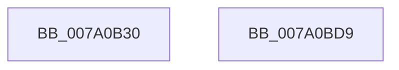

# SepAddAgentIdClaimToToken

- RVA: `0x007A0B30`–`0x007A0BDA` (길이 `170` bytes)
- VA: `0x00000001407A0B30`
- 실행 섹션: `PAGE`
- PDB 이름 있음: `예`; PDB Function 태그: `아니요`
- unwind 정보 RVA: `0x000D144C`
- 디코드: `43`개 명령, `170/170` bytes 표시
- 미해석 바이트: `0` (있으면 어셈블리에 `.byte`로 보존)

> 이 문서는 커널 이미지의 기계어와 PDB 기호를 분석해 생성했습니다. 4번과 5번은 함수 원형과 자료형을 바이너리 사용 방식에서 추정한 C 해석이며 원본 소스 복구 결과는 아닙니다.

## 1. Dependencies

- 직접 호출 지점: **2**; 고유 호출 대상: **2**
- 직접 호출자로 확인된 함수: **2**
- RIP 상대 이미지 참조: **1**

### Outgoing calls
- `0x007A0B7B` → [RtlInitUnicodeString](../../text/42/RtlInitUnicodeString_function_0042A780.md) (function, `0x0042A780`)
- `0x007A0BBF` → [SepSetUserClaimAttributesToken](SepSetUserClaimAttributesToken_function_007A36C0.md) (function, `0x007A36C0`)

### Direct callers
- [SeSubProcessToken](../AA/SeSubProcessToken_function_00AAD570.md) at `0x00AADC9D`
- [NtSetInformationToken](../AF/NtSetInformationToken_function_00AF0530.md) at `0x00AF1300`

### Static image references
- `0x007A0B69` → RVA `0x00B05EC0` (` ?? ::NNGAKEGL::`string'`; read)

## 2. Other-region calls and transfers

- 다른 실행 섹션으로 향하는 call: **1**
  - `0x007A0B7B` → [RtlInitUnicodeString](../../text/42/RtlInitUnicodeString_function_0042A780.md) (`PAGE` → `.text`)
- 별도 외부 분기/꼬리 이동을 확인하지 못했습니다.

## 3. Assembly (complete function range)

```asm
007A0B30  48 89 5C 24 08                  mov qword ptr [rsp + 8], rbx
007A0B35  48 89 7C 24 10                  mov qword ptr [rsp + 0x10], rdi
007A0B3A  4C 89 44 24 18                  mov qword ptr [rsp + 0x18], r8
007A0B3F  55                              push rbp
007A0B40  48 8B EC                        mov rbp, rsp
007A0B43  48 81 EC 80 00 00 00            sub rsp, 0x80
007A0B4A  0F B7 02                        movzx eax, word ptr [rdx]
007A0B4D  48 8B D9                        mov rbx, rcx
007A0B50  66 89 45 A0                     mov word ptr [rbp - 0x60], ax
007A0B54  48 8D 4D C0                     lea rcx, [rbp - 0x40]
007A0B58  0F B7 42 02                     movzx eax, word ptr [rdx + 2]
007A0B5C  0F 57 C0                        xorps xmm0, xmm0
007A0B5F  66 89 45 A2                     mov word ptr [rbp - 0x5e], ax
007A0B63  33 FF                           xor edi, edi
007A0B65  48 8B 42 08                     mov rax, qword ptr [rdx + 8]
007A0B69  48 8D 15 50 53 36 00            lea rdx, [rip + 0x365350]
007A0B70  48 89 45 A8                     mov qword ptr [rbp - 0x58], rax
007A0B74  0F 11 45 C0                     movups xmmword ptr [rbp - 0x40], xmm0
007A0B78  89 7D A4                        mov dword ptr [rbp - 0x5c], edi
007A0B7B  E8 00 9C C8 FF                  call 0x14042a780
007A0B80  0F 10 45 C0                     movups xmm0, xmmword ptr [rbp - 0x40]
007A0B84  8D 4F 01                        lea ecx, [rdi + 1]
007A0B87  48 C7 45 E0 03 00 00 00         mov qword ptr [rbp - 0x20], 3
007A0B8F  48 8D 45 D0                     lea rax, [rbp - 0x30]
007A0B93  89 4D B0                        mov dword ptr [rbp - 0x50], ecx
007A0B96  48 89 45 B8                     mov qword ptr [rbp - 0x48], rax
007A0B9A  4C 8D 45 B0                     lea r8, [rbp - 0x50]
007A0B9E  48 8D 45 A0                     lea rax, [rbp - 0x60]
007A0BA2  89 4D B4                        mov dword ptr [rbp - 0x4c], ecx
007A0BA5  89 4D E8                        mov dword ptr [rbp - 0x18], ecx
007A0BA8  48 8D 55 20                     lea rdx, [rbp + 0x20]
007A0BAC  48 8B CB                        mov rcx, rbx
007A0BAF  48 89 45 F0                     mov qword ptr [rbp - 0x10], rax
007A0BB3  F3 0F 7F 45 D0                  movdqu xmmword ptr [rbp - 0x30], xmm0
007A0BB8  C7 45 20 04 00 00 00            mov dword ptr [rbp + 0x20], 4
007A0BBF  E8 FC 2A 00 00                  call 0x1407a36c0
007A0BC4  4C 8D 9C 24 80 00 00 00         lea r11, [rsp + 0x80]
007A0BCC  49 8B 5B 10                     mov rbx, qword ptr [r11 + 0x10]
007A0BD0  49 8B 7B 18                     mov rdi, qword ptr [r11 + 0x18]
007A0BD4  49 8B E3                        mov rsp, r11
007A0BD7  5D                              pop rbp
007A0BD8  C3                              ret
007A0BD9  CC                              int3
```

## 4. C-style interpretation (structured pseudocode)

```c
__int64 __fastcall SepAddAgentIdClaimToToken(__int64 a1, __int64 a2, __int64 a3)
{
    __int64 result;
    __int64 v_rdi;
    __int64 v_rsp;
    unsigned __int64 v_stack_m18;
    unsigned int v_stack_m20;
    unsigned __int64 v_stack_m28;
    unsigned __int64 v_stack_m38;
    unsigned __int64 v_stack_m48;
    unsigned __int64 v_stack_m50;
    unsigned int v_stack_m54;
    unsigned int v_stack_m58;
    unsigned __int64 v_stack_m60;
    unsigned int v_stack_m64;
    unsigned __int16 v_stack_m66;
    unsigned __int16 v_stack_m68;
    unsigned __int64 v_stack_m8;
    unsigned __int64 v_stack_p10;
    unsigned __int64 v_stack_p18;
    unsigned __int64 v_stack_p8;

    v_stack_p8 = v_rbx;
    v_stack_p10 = v_rdi;
    v_stack_p18 = a3;
    v_rsp = (v_rsp) - (128);
    v_stack_m68 = (unsigned __int16)(*(unsigned __int16 *)(a2));
    v_stack_m66 = (unsigned __int16)(*(unsigned __int16 *)(a2 + 2));
    v_rdi = 0;
    v_stack_m60 = *(unsigned __int64 *)(a2 + 8);
    v_stack_m48 = v_xmm0;
    v_stack_m64 = 0;
    result = RtlInitUnicodeString(v_stack_m48, v_rip + 3560272, a3, a4);
    v_stack_m28 = 3;
    v_stack_m58 = (unsigned int)(v_rdi + 1);
    v_stack_m50 = v_stack_m38;
    v_stack_m54 = (unsigned int)(v_rdi + 1);
    v_stack_m20 = (unsigned int)(v_rdi + 1);
    v_stack_m18 = v_stack_m68;
    v_stack_m38 = v_xmm0;
    v_stack_p18 = 4;
    result = SepSetUserClaimAttributesToken(a1, v_stack_p18, v_stack_m58, a4);
    return result;
}
```

## 5. (Beta) C Style

```c
int64_t SepAddAgentIdClaimToToken(int64_t Arg1, void *Arg2, int64_t Arg3)
{
    uint8_t *arg2 = (uint8_t *)Arg2;

    int64_t result;
    int64_t local_rdi;
    int64_t local_rsp;
    uint64_t v_stack_m18;
    uint32_t v_stack_m20;
    uint64_t v_stack_m28;
    uint64_t v_stack_m38;
    uint64_t v_stack_m48;
    uint64_t v_stack_m50;
    uint32_t v_stack_m54;
    uint32_t v_stack_m58;
    uint64_t v_stack_m60;
    uint32_t v_stack_m64;
    uint16_t v_stack_m66;
    uint16_t v_stack_m68;
    uint64_t v_stack_m8;
    uint64_t v_stack_p10;
    uint64_t v_stack_p18;
    uint64_t v_stack_p8;

    v_stack_p8 = local_rbx;
    v_stack_p10 = local_rdi;
    v_stack_p18 = Arg3;
    local_rsp = (local_rsp) - (128);
    v_stack_m68 = (uint16_t)(*(uint16_t *)(arg2));
    v_stack_m66 = (uint16_t)(*(uint16_t *)(arg2 + 0x2));
    local_rdi = 0;
    v_stack_m60 = *(uint64_t *)(arg2 + 0x8);
    v_stack_m48 = v_xmm0;
    v_stack_m64 = 0;
    result = RtlInitUnicodeString(v_stack_m48, v_rip + 3560272, Arg3, a4);
    v_stack_m28 = 3;
    v_stack_m58 = (uint32_t)(local_rdi + 1);
    v_stack_m50 = v_stack_m38;
    v_stack_m54 = (uint32_t)(local_rdi + 1);
    v_stack_m20 = (uint32_t)(local_rdi + 1);
    v_stack_m18 = v_stack_m68;
    v_stack_m38 = v_xmm0;
    v_stack_p18 = 4;
    result = SepSetUserClaimAttributesToken(Arg1, v_stack_p18, v_stack_m58, a4);
    return result;
}
```

### 관측된 메모리 오프셋

구조체 형식이 확인되지 않은 접근은 인자 기준의 오프셋으로만 기록했습니다.

| 기준 인자 | 오프셋 표현 | 폭 (bit) | 접근 |
|---|---:|---:|---|
| `Arg2` | `+ 0x0` | `16` | `R` |
| `Arg2` | `+ 0x2` | `16` | `R` |
| `Arg2` | `+ 0x8` | `64` | `R` |

## 6. Execution-region graph

[열기: 2D/3D 그래프와 함수 탐색 컨트롤 패널](../../../control-panel.html?section=page&rva=0x007A0B30&view=graph)

- 2D 그래프는 위에서 아래로 흐르고, 3D 그래프는 빈 공간을 드래그해 회전합니다. Shift+드래그는 이동, 휠은 확대·축소, 함수 노드 선택은 대상 보고서 이동입니다.

### Static fallback


