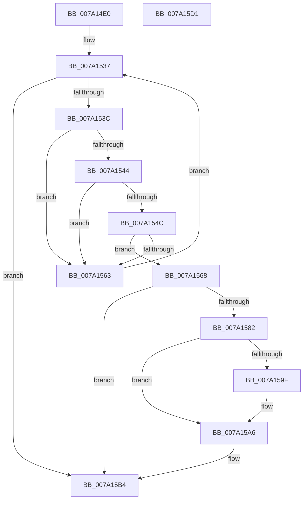

# SepAddTokenLogonSession

- RVA: `0x007A14E0`–`0x007A15D2` (길이 `242` bytes)
- VA: `0x00000001407A14E0`
- 실행 섹션: `PAGE`
- PDB 이름 있음: `예`; PDB Function 태그: `아니요`
- unwind 정보 RVA: `0x00060BC4`
- 디코드: `63`개 명령, `242/242` bytes 표시
- 미해석 바이트: `0` (있으면 어셈블리에 `.byte`로 보존)

> 이 문서는 커널 이미지의 기계어와 PDB 기호를 분석해 생성했습니다. 4번과 5번은 함수 원형과 자료형을 바이너리 사용 방식에서 추정한 C 해석이며 원본 소스 복구 결과는 아닙니다.

## 1. Dependencies

- 직접 호출 지점: **4**; 고유 호출 대상: **4**
- 직접 호출자로 확인된 함수: **4**
- RIP 상대 이미지 참조: **2**

### Outgoing calls
- `0x007A1527` → [ExAcquireResourceExclusiveLite](../../text/21/ExAcquireResourceExclusiveLite_function_00214E20.md) (function, `0x00214E20`)
- `0x007A1578` → [ExAllocatePool2](../../poolcode/B8/ExAllocatePool2_function_00B820F0.md) (function, `0x00B820F0`)
- `0x007A15B7` → [ExReleaseResourceLite](../../text/25/ExReleaseResourceLite_function_0025FA10.md) (function, `0x0025FA10`)
- `0x007A15BC` → [KeLeaveCriticalRegion](../../text/25/KeLeaveCriticalRegion_function_0025D8B0.md) (function, `0x0025D8B0`)

### Direct callers
- [SepCreateTokenEx](../../text/4E/SepCreateTokenEx_function_004E9CD0.md) at `0x004EA5F5`
- [SepSetServerSiloToken](../79/SepSetServerSiloToken_function_0079D2A8.md) at `0x0079D335`
- [SepDuplicateToken](../8B/SepDuplicateToken_function_008B87EC.md) at `0x008B8FE3`
- [SepFilterToken](../9C/SepFilterToken_function_009C6B80.md) at `0x009C71FA`

### Static image references
- `0x007A1502` → RVA `0x00E67F20` (`.data`; read)
- `0x007A152C` → RVA `0x00FD9AF0` (`PAGEDATA`; read)

## 2. Other-region calls and transfers

- 다른 실행 섹션으로 향하는 call: **4**
  - `0x007A1527` → [ExAcquireResourceExclusiveLite](../../text/21/ExAcquireResourceExclusiveLite_function_00214E20.md) (`PAGE` → `.text`)
  - `0x007A1578` → [ExAllocatePool2](../../poolcode/B8/ExAllocatePool2_function_00B820F0.md) (`PAGE` → `POOLCODE`)
  - `0x007A15B7` → [ExReleaseResourceLite](../../text/25/ExReleaseResourceLite_function_0025FA10.md) (`PAGE` → `.text`)
  - `0x007A15BC` → [KeLeaveCriticalRegion](../../text/25/KeLeaveCriticalRegion_function_0025D8B0.md) (`PAGE` → `.text`)
- 별도 외부 분기/꼬리 이동을 확인하지 못했습니다.

## 3. Assembly (complete function range)

```asm
007A14E0  48 89 5C 24 08                  mov qword ptr [rsp + 8], rbx
007A14E5  48 89 74 24 10                  mov qword ptr [rsp + 0x10], rsi
007A14EA  57                              push rdi
007A14EB  48 83 EC 20                     sub rsp, 0x20
007A14EF  69 51 18 24 0A 25 5B            imul edx, dword ptr [rcx + 0x18], 0x5b250a24
007A14F6  48 8B F9                        mov rdi, rcx
007A14F9  65 48 8B 04 25 88 01 00 00      mov rax, qword ptr gs:[0x188]
007A1502  48 8D 0D 17 6A 6C 00            lea rcx, [rip + 0x6c6a17]
007A1509  66 FF 88 E4 01 00 00            dec word ptr [rax + 0x1e4]
007A1510  90                              nop
007A1511  C1 EA 1C                        shr edx, 0x1c
007A1514  8B C2                           mov eax, edx
007A1516  83 E0 03                        and eax, 3
007A1519  8B DA                           mov ebx, edx
007A151B  48 6B F0 68                     imul rsi, rax, 0x68
007A151F  B2 01                           mov dl, 1
007A1521  48 03 F1                        add rsi, rcx
007A1524  48 8B CE                        mov rcx, rsi
007A1527  E8 F4 38 A7 FF                  call 0x140214e20
007A152C  48 8B 05 BD 85 83 00            mov rax, qword ptr [rip + 0x8385bd]
007A1533  48 8B 1C D8                     mov rbx, qword ptr [rax + rbx*8]
007A1537  48 85 DB                        test rbx, rbx
007A153A  74 78                           je 0x1407a15b4
007A153C  8B 43 08                        mov eax, dword ptr [rbx + 8]
007A153F  39 47 18                        cmp dword ptr [rdi + 0x18], eax
007A1542  75 1F                           jne 0x1407a1563
007A1544  8B 43 0C                        mov eax, dword ptr [rbx + 0xc]
007A1547  39 47 1C                        cmp dword ptr [rdi + 0x1c], eax
007A154A  75 17                           jne 0x1407a1563
007A154C  48 8B 8F D8 00 00 00            mov rcx, qword ptr [rdi + 0xd8]
007A1553  48 8B 83 A8 00 00 00            mov rax, qword ptr [rbx + 0xa8]
007A155A  48 39 81 A8 00 00 00            cmp qword ptr [rcx + 0xa8], rax
007A1561  74 05                           je 0x1407a1568
007A1563  48 8B 1B                        mov rbx, qword ptr [rbx]
007A1566  EB CF                           jmp 0x1407a1537
007A1568  BA 18 00 00 00                  mov edx, 0x18
007A156D  B9 00 01 00 00                  mov ecx, 0x100
007A1572  41 B8 53 65 4C 73               mov r8d, 0x734c6553
007A1578  E8 73 0B 3E 00                  call 0x140b820f0
007A157D  48 85 C0                        test rax, rax
007A1580  74 32                           je 0x1407a15b4
007A1582  48 83 20 00                     and qword ptr [rax], 0
007A1586  48 81 C3 B8 00 00 00            add rbx, 0xb8
007A158D  48 83 60 08 00                  and qword ptr [rax + 8], 0
007A1592  48 89 78 10                     mov qword ptr [rax + 0x10], rdi
007A1596  48 8B 53 08                     mov rdx, qword ptr [rbx + 8]
007A159A  48 39 1A                        cmp qword ptr [rdx], rbx
007A159D  74 07                           je 0x1407a15a6
007A159F  B9 03 00 00 00                  mov ecx, 3
007A15A4  CD 29                           int 0x29
007A15A6  48 89 18                        mov qword ptr [rax], rbx
007A15A9  48 89 50 08                     mov qword ptr [rax + 8], rdx
007A15AD  48 89 02                        mov qword ptr [rdx], rax
007A15B0  48 89 43 08                     mov qword ptr [rbx + 8], rax
007A15B4  48 8B CE                        mov rcx, rsi
007A15B7  E8 54 E4 AB FF                  call 0x14025fa10
007A15BC  E8 EF C2 AB FF                  call 0x14025d8b0
007A15C1  48 8B 5C 24 30                  mov rbx, qword ptr [rsp + 0x30]
007A15C6  48 8B 74 24 38                  mov rsi, qword ptr [rsp + 0x38]
007A15CB  48 83 C4 20                     add rsp, 0x20
007A15CF  5F                              pop rdi
007A15D0  C3                              ret
007A15D1  CC                              int3
```

## 4. C-style interpretation (structured pseudocode)

```c
__int64 __fastcall SepAddTokenLogonSession(__int64 a1)
{
    __int64 result;
    __int64 v_rbx;
    __int64 v_rsi;
    __int64 v_rsp;
    unsigned __int64 v_stack_p10;
    unsigned __int64 v_stack_p8;

    v_stack_p8 = v_rbx;
    v_stack_p10 = v_rsi;
    v_rsp = (v_rsp) - (32);
    a2 = (unsigned int)((a2) * (*(unsigned int *)(a1 + 24)));
    a2 = (unsigned int)((a2) >> (28));
    result = (unsigned int)(((unsigned int)((unsigned int)(a2))) & (3));
    v_rsi = (v_rsi) * (result);
    v_rsi = (v_rsi) + (v_rip + 7105047);
    result = ExAcquireResourceExclusiveLite(v_rsi, 1, a3, a4);
loc_007A1537:
    if (*(unsigned __int64 *)(*(unsigned __int64 *)(v_rip + 8619453) + (unsigned int)((unsigned int)(a2)) * 8) == 0) goto loc_007A15B4;
    if ((*(unsigned int *)(a1 + 24)) != ((unsigned int)((unsigned int)(*(unsigned int *)(*(unsigned __int64 *)(*(unsigned __int64 *)(v_rip + 8619453) + (unsigned int)((unsigned int)(a2)) * 8) + 8))))) goto loc_007A1563;
    if ((*(unsigned int *)(a1 + 28)) != ((unsigned int)((unsigned int)(*(unsigned int *)(*(unsigned __int64 *)(*(unsigned __int64 *)(v_rip + 8619453) + (unsigned int)((unsigned int)(a2)) * 8) + 12))))) goto loc_007A1563;
    if ((*(unsigned __int64 *)(*(unsigned __int64 *)(a1 + 216) + 168)) == (*(unsigned __int64 *)(*(unsigned __int64 *)(*(unsigned __int64 *)(v_rip + 8619453) + (unsigned int)((unsigned int)(a2)) * 8) + 168))) goto loc_007A1568;
loc_007A1563:
    goto loc_007A1537;
loc_007A1568:
    result = ExAllocatePool2(256, 24, (unsigned int)(0x734C6553ULL), a4);
    if (result == 0) goto loc_007A15B4;
    v_rbx = (*(unsigned __int64 *)(*(unsigned __int64 *)(*(unsigned __int64 *)(v_rip + 8619453) + (unsigned int)((unsigned int)(a2)) * 8))) + (184);
    *(unsigned __int64 *)(result + 16) = a1;
    if ((*(unsigned __int64 *)(*(unsigned __int64 *)(v_rbx + 8))) != v_rbx) {
        a1 = 3;
    }
    *(unsigned __int64 *)(result) = v_rbx;
    *(unsigned __int64 *)(result + 8) = *(unsigned __int64 *)(v_rbx + 8);
    *(unsigned __int64 *)(*(unsigned __int64 *)(v_rbx + 8)) = result;
    *(unsigned __int64 *)(v_rbx + 8) = result;
loc_007A15B4:
    result = ExReleaseResourceLite(v_rsi, *(unsigned __int64 *)(v_rbx + 8), (unsigned int)(0x734C6553ULL), a4);
    result = KeLeaveCriticalRegion(v_rsi, *(unsigned __int64 *)(v_rbx + 8), (unsigned int)(0x734C6553ULL), a4);
    v_rsp = (v_rsp) + (32);
    return result;
}
```

## 5. (Beta) C Style

```c
int64_t SepAddTokenLogonSession(void *Arg1)
{
    uint8_t *arg1 = (uint8_t *)Arg1;

    int64_t result;
    int64_t local_rbx;
    int64_t local_rsi;
    int64_t local_rsp;
    uint64_t v_stack_p10;
    uint64_t v_stack_p8;

    v_stack_p8 = local_rbx;
    v_stack_p10 = local_rsi;
    local_rsp = (local_rsp) - (32);
    a2 = (uint32_t)((a2) * (*(uint32_t *)(arg1 + 0x18)));
    a2 = (uint32_t)((a2) >> (28));
    result = (uint32_t)(((uint32_t)((uint32_t)(a2))) & (3));
    local_rsi = (local_rsi) * (result);
    local_rsi = (local_rsi) + (v_rip + 7105047);
    result = ExAcquireResourceExclusiveLite(local_rsi, 1, a3, a4);
loc_007A1537:
    if (*(uint64_t *)(*(uint64_t *)(v_rip + 0x8385BD) + (uint32_t)((uint32_t)(a2)) * 8) == 0) goto loc_007A15B4;
    if ((*(uint32_t *)(arg1 + 0x18)) != ((uint32_t)((uint32_t)(*(uint32_t *)(*(uint64_t *)(*(uint64_t *)(v_rip + 0x8385BD) + (uint32_t)((uint32_t)(a2)) * 8) + 0x8))))) goto loc_007A1563;
    if ((*(uint32_t *)(arg1 + 0x1C)) != ((uint32_t)((uint32_t)(*(uint32_t *)(*(uint64_t *)(*(uint64_t *)(v_rip + 0x8385BD) + (uint32_t)((uint32_t)(a2)) * 8) + 0xC))))) goto loc_007A1563;
    if ((*(uint64_t *)(*(uint64_t *)(arg1 + 0xD8) + 0xA8)) == (*(uint64_t *)(*(uint64_t *)(*(uint64_t *)(v_rip + 0x8385BD) + (uint32_t)((uint32_t)(a2)) * 8) + 0xA8))) goto loc_007A1568;
loc_007A1563:
    goto loc_007A1537;
loc_007A1568:
    result = ExAllocatePool2(256, 24, (uint32_t)(0x734C6553ULL), a4);
    if (result == 0) goto loc_007A15B4;
    local_rbx = (*(uint64_t *)(*(uint64_t *)(*(uint64_t *)(v_rip + 0x8385BD) + (uint32_t)((uint32_t)(a2)) * 8))) + (184);
    *(void **)(result + 0x10) = Arg1;
    if ((*(uint64_t *)(*(uint64_t *)(local_rbx + 0x8))) != local_rbx) {
        Arg1 = 3;
    }
    *(uint64_t *)(result) = local_rbx;
    *(uint64_t *)(result + 0x8) = *(uint64_t *)(local_rbx + 0x8);
    *(uint64_t *)(*(uint64_t *)(local_rbx + 0x8)) = result;
    *(uint64_t *)(local_rbx + 0x8) = result;
loc_007A15B4:
    result = ExReleaseResourceLite(local_rsi, *(uint64_t *)(local_rbx + 0x8), (uint32_t)(0x734C6553ULL), a4);
    result = KeLeaveCriticalRegion(local_rsi, *(uint64_t *)(local_rbx + 0x8), (uint32_t)(0x734C6553ULL), a4);
    local_rsp = (local_rsp) + (32);
    return result;
}
```

### 관측된 메모리 오프셋

구조체 형식이 확인되지 않은 접근은 인자 기준의 오프셋으로만 기록했습니다.

| 기준 인자 | 오프셋 표현 | 폭 (bit) | 접근 |
|---|---:|---:|---|
| `Arg1` | `+ 0x18` | `32` | `R` |
| `Arg1` | `+ 0x1C` | `32` | `R` |
| `Arg1` | `+ 0xD8` | `64` | `R` |

## 6. Execution-region graph

[열기: 2D/3D 그래프와 함수 탐색 컨트롤 패널](../../../control-panel.html?section=page&rva=0x007A14E0&view=graph)

- 2D 그래프는 위에서 아래로 흐르고, 3D 그래프는 빈 공간을 드래그해 회전합니다. Shift+드래그는 이동, 휠은 확대·축소, 함수 노드 선택은 대상 보고서 이동입니다.

### Static fallback


