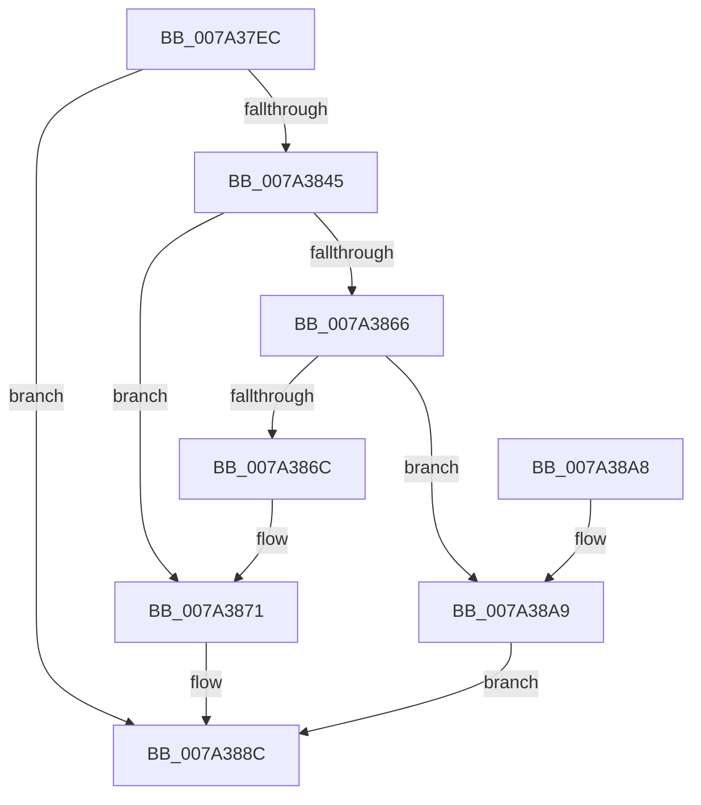

# SepAdtCopyToLsaSharedMemory

- RVA: `0x007A37EC`–`0x007A38B2` (길이 `198` bytes)
- VA: `0x00000001407A37EC`
- 실행 섹션: `PAGE`
- PDB 이름 있음: `예`; PDB Function 태그: `아니요`
- unwind 정보 RVA: `0x000D16D4`
- 디코드: `58`개 명령, `198/198` bytes 표시
- 미해석 바이트: `0` (있으면 어셈블리에 `.byte`로 보존)

> 이 문서는 커널 이미지의 기계어와 PDB 기호를 분석해 생성했습니다. 4번과 5번은 함수 원형과 자료형을 바이너리 사용 방식에서 추정한 C 해석이며 원본 소스 복구 결과는 아닙니다.

## 1. Dependencies

- 직접 호출 지점: **3**; 고유 호출 대상: **3**
- 직접 호출자로 확인된 함수: **1**
- RIP 상대 이미지 참조: **0**

### Outgoing calls
- `0x007A383A` → [ZwAllocateVirtualMemory](../../text/6A/ZwAllocateVirtualMemory_function_006AD3D0.md) (function, `0x006AD3D0`)
- `0x007A385B` → [ZwWriteVirtualMemory](../../text/6A/ZwWriteVirtualMemory_function_006AD810.md) (function, `0x006AD810`)
- `0x007A3887` → [ZwFreeVirtualMemory](../../text/6A/ZwFreeVirtualMemory_function_006AD490.md) (function, `0x006AD490`)

### Direct callers
- [sub_006D6A74](../../text/6D/Unknown_function_006D6A74.md) at `0x006D6A80`

### Static image references
- 디코드된 RIP-relative 메모리 참조가 없습니다.

## 2. Other-region calls and transfers

- 다른 실행 섹션으로 향하는 call: **3**
  - `0x007A383A` → [ZwAllocateVirtualMemory](../../text/6A/ZwAllocateVirtualMemory_function_006AD3D0.md) (`PAGE` → `.text`)
  - `0x007A385B` → [ZwWriteVirtualMemory](../../text/6A/ZwWriteVirtualMemory_function_006AD810.md) (`PAGE` → `.text`)
  - `0x007A3887` → [ZwFreeVirtualMemory](../../text/6A/ZwFreeVirtualMemory_function_006AD490.md) (`PAGE` → `.text`)
- 별도 외부 분기/꼬리 이동을 확인하지 못했습니다.

## 3. Assembly (complete function range)

```asm
007A37EC  48 8B C4                        mov rax, rsp
007A37EF  48 89 58 08                     mov qword ptr [rax + 8], rbx
007A37F3  48 89 70 10                     mov qword ptr [rax + 0x10], rsi
007A37F7  48 89 78 18                     mov qword ptr [rax + 0x18], rdi
007A37FB  55                              push rbp
007A37FC  41 56                           push r14
007A37FE  41 57                           push r15
007A3800  48 8B EC                        mov rbp, rsp
007A3803  48 83 EC 50                     sub rsp, 0x50
007A3807  48 83 65 E0 00                  and qword ptr [rbp - 0x20], 0
007A380C  4D 8B F1                        mov r14, r9
007A380F  48 83 65 F0 00                  and qword ptr [rbp - 0x10], 0
007A3814  4C 8D 4D E8                     lea r9, [rbp - 0x18]
007A3818  41 8B F8                        mov edi, r8d
007A381B  4C 8B FA                        mov r15, rdx
007A381E  C7 40 C0 04 00 00 00            mov dword ptr [rax - 0x40], 4
007A3825  48 8D 55 E0                     lea rdx, [rbp - 0x20]
007A3829  45 33 C0                        xor r8d, r8d
007A382C  48 89 7D E8                     mov qword ptr [rbp - 0x18], rdi
007A3830  48 8B F1                        mov rsi, rcx
007A3833  C7 40 B8 00 10 00 00            mov dword ptr [rax - 0x48], 0x1000
007A383A  E8 91 9B F0 FF                  call 0x1406ad3d0
007A383F  8B D8                           mov ebx, eax
007A3841  85 C0                           test eax, eax
007A3843  78 47                           js 0x1407a388c
007A3845  48 8B 55 E0                     mov rdx, qword ptr [rbp - 0x20]
007A3849  48 8D 45 F0                     lea rax, [rbp - 0x10]
007A384D  44 8B CF                        mov r9d, edi
007A3850  48 89 44 24 20                  mov qword ptr [rsp + 0x20], rax
007A3855  4D 8B C7                        mov r8, r15
007A3858  48 8B CE                        mov rcx, rsi
007A385B  E8 B0 9F F0 FF                  call 0x1406ad810
007A3860  8B D8                           mov ebx, eax
007A3862  85 C0                           test eax, eax
007A3864  78 0B                           js 0x1407a3871
007A3866  48 3B 7D F0                     cmp rdi, qword ptr [rbp - 0x10]
007A386A  74 3D                           je 0x1407a38a9
007A386C  BB 01 00 00 C0                  mov ebx, 0xc0000001
007A3871  48 83 65 E8 00                  and qword ptr [rbp - 0x18], 0
007A3876  4C 8D 45 E8                     lea r8, [rbp - 0x18]
007A387A  41 B9 00 80 00 00               mov r9d, 0x8000
007A3880  48 8D 55 E0                     lea rdx, [rbp - 0x20]
007A3884  48 8B CE                        mov rcx, rsi
007A3887  E8 04 9C F0 FF                  call 0x1406ad490
007A388C  4C 8D 5C 24 50                  lea r11, [rsp + 0x50]
007A3891  8B C3                           mov eax, ebx
007A3893  49 8B 5B 20                     mov rbx, qword ptr [r11 + 0x20]
007A3897  49 8B 73 28                     mov rsi, qword ptr [r11 + 0x28]
007A389B  49 8B 7B 30                     mov rdi, qword ptr [r11 + 0x30]
007A389F  49 8B E3                        mov rsp, r11
007A38A2  41 5F                           pop r15
007A38A4  41 5E                           pop r14
007A38A6  5D                              pop rbp
007A38A7  C3                              ret
007A38A8  CC                              int3
007A38A9  48 8B 45 E0                     mov rax, qword ptr [rbp - 0x20]
007A38AD  49 89 06                        mov qword ptr [r14], rax
007A38B0  EB DA                           jmp 0x1407a388c
```

## 4. C-style interpretation (structured pseudocode)

```c
__int64 __fastcall SepAdtCopyToLsaSharedMemory(__int64 a1, __int64 a2, int a3, __int64 a4)
{
    __int64 result;
    __int64 v_rsp;
    unsigned __int64 v_stack_m18;
    unsigned __int64 v_stack_m28;
    unsigned __int64 v_stack_m30;
    unsigned __int64 v_stack_m38;
    unsigned __int64 v_stack_m48;

    *(unsigned __int64 *)(v_rsp + 8) = v_rbx;
    *(unsigned __int64 *)(v_rsp + 16) = v_rsi;
    *(unsigned __int64 *)(v_rsp + 24) = v_rdi;
    v_rsp = (v_rsp) - (80);
    *(unsigned int *)(v_rsp - 64) = 4;
    a3 = 0;
    v_stack_m30 = (unsigned int)(a3);
    *(unsigned int *)(v_rsp - 72) = 0x1000ULL;
    result = ZwAllocateVirtualMemory(a1, v_stack_m38, a3, v_stack_m30);
    if (sign_flag) goto loc_007A388C;
    v_stack_m48 = v_stack_m28;
    result = ZwWriteVirtualMemory(a1, v_stack_m38, a2, (unsigned int)((unsigned int)((unsigned int)(a3))));
    if (sign_flag) goto loc_007A3871;
    if (((unsigned int)(a3)) == v_stack_m28) goto loc_007A38A9;
loc_007A3871:
    result = ZwFreeVirtualMemory(a1, v_stack_m38, v_stack_m30, (unsigned int)(0x8000ULL));
loc_007A388C:
    return (unsigned int)((unsigned int)((unsigned int)(0xC0000001ULL)));
loc_007A38A9:
    *(unsigned __int64 *)(a4) = v_stack_m38;
    goto loc_007A388C;
}
```

## 5. (Beta) C Style

```c
int64_t SepAdtCopyToLsaSharedMemory(int64_t Arg1, int64_t Arg2, int32_t Arg3, void *Arg4)
{
    uint8_t *arg4 = (uint8_t *)Arg4;

    int64_t result;
    int64_t local_rsp;
    uint64_t v_stack_m18;
    uint64_t v_stack_m28;
    uint64_t v_stack_m30;
    uint64_t v_stack_m38;
    uint64_t v_stack_m48;

    *(uint64_t *)(local_rsp + 0x8) = local_rbx;
    *(uint64_t *)(local_rsp + 0x10) = local_rsi;
    *(uint64_t *)(local_rsp + 0x18) = local_rdi;
    local_rsp = (local_rsp) - (80);
    *(uint32_t *)(local_rsp - 0x40) = 4;
    Arg3 = 0;
    v_stack_m30 = (uint32_t)(Arg3);
    *(uint32_t *)(local_rsp - 0x48) = 0x1000ULL;
    result = ZwAllocateVirtualMemory(Arg1, v_stack_m38, Arg3, v_stack_m30);
    if (sign_flag) goto loc_007A388C;
    v_stack_m48 = v_stack_m28;
    result = ZwWriteVirtualMemory(Arg1, v_stack_m38, Arg2, (uint32_t)((uint32_t)((uint32_t)(Arg3))));
    if (sign_flag) goto loc_007A3871;
    if (((uint32_t)(Arg3)) == v_stack_m28) goto loc_007A38A9;
loc_007A3871:
    result = ZwFreeVirtualMemory(Arg1, v_stack_m38, v_stack_m30, (uint32_t)(0x8000ULL));
loc_007A388C:
    return (uint32_t)((uint32_t)((uint32_t)(0xC0000001ULL)));
loc_007A38A9:
    *(uint64_t *)(arg4) = v_stack_m38;
    goto loc_007A388C;
}
```

### 관측된 메모리 오프셋

구조체 형식이 확인되지 않은 접근은 인자 기준의 오프셋으로만 기록했습니다.

| 기준 인자 | 오프셋 표현 | 폭 (bit) | 접근 |
|---|---:|---:|---|
| `Arg4` | `+ 0x0` | `64` | `W` |

## 6. Execution-region graph

[열기: 2D/3D 그래프와 함수 탐색 컨트롤 패널](../../../control-panel.html?section=page&rva=0x007A37EC&view=graph)

- 2D 그래프는 위에서 아래로 흐르고, 3D 그래프는 빈 공간을 드래그해 회전합니다. Shift+드래그는 이동, 휠은 확대·축소, 함수 노드 선택은 대상 보고서 이동입니다.

### Static fallback


