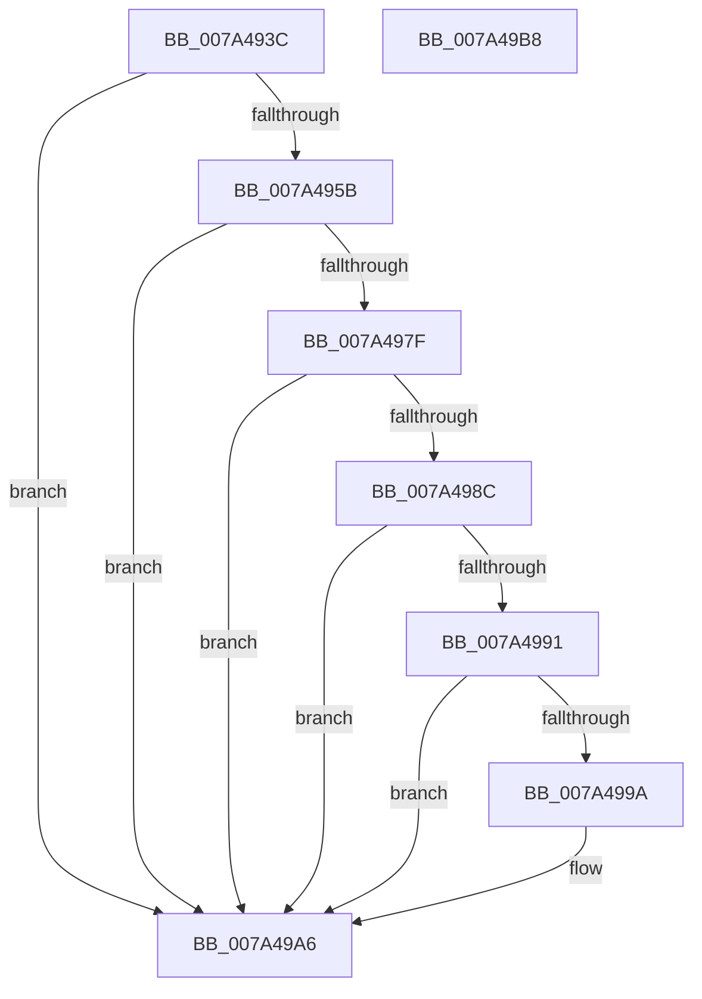

# SepAdtInitializeBounds

- RVA: `0x007A493C`–`0x007A49B9` (길이 `125` bytes)
- VA: `0x00000001407A493C`
- 실행 섹션: `PAGE`
- PDB 이름 있음: `예`; PDB Function 태그: `아니요`
- unwind 정보 RVA: `0x000C4098`
- 디코드: `33`개 명령, `125/125` bytes 표시
- 미해석 바이트: `0` (있으면 어셈블리에 `.byte`로 보존)

> 이 문서는 커널 이미지의 기계어와 PDB 기호를 분석해 생성했습니다. 4번과 5번은 함수 원형과 자료형을 바이너리 사용 방식에서 추정한 C 해석이며 원본 소스 복구 결과는 아닙니다.

## 1. Dependencies

- 직접 호출 지점: **2**; 고유 호출 대상: **2**
- 직접 호출자로 확인된 함수: **2**
- RIP 상대 이미지 참조: **5**

### Outgoing calls
- `0x007A4976` → [SepRegQueryValue](../A3/SepRegQueryValue_function_00A3A730.md) (function, `0x00A3A730`)
- `0x007A49AE` → [_security_check_cookie](../../text/6A/_security_check_cookie_function_006AC640.md) (function, `0x006AC640`)

### Direct callers
- [SepAdtRegNotificationCallback](SepAdtRegNotificationCallback_function_007A4B20.md) at `0x007A4B2E`
- [SepAdtInitializeAuditingOptions](../../init/C4/SepAdtInitializeAuditingOptions_function_00C4BC1C.md) at `0x00C4BC70`

### Static image references
- `0x007A4940` → RVA `0x00E0A740` (`.data`; read)
- `0x007A494F` → RVA `0x00FD80A0` (`PAGEDATA`; read)
- `0x007A4966` → RVA `0x00B06390` (` ?? ::NNGAKEGL::`string'`; read)
- `0x007A499A` → RVA `0x00E0CDC4` (`.data`; write)
- `0x007A49A0` → RVA `0x00E0CDC8` (`.data`; write)

## 2. Other-region calls and transfers

- 다른 실행 섹션으로 향하는 call: **1**
  - `0x007A49AE` → [_security_check_cookie](../../text/6A/_security_check_cookie_function_006AC640.md) (`PAGE` → `.text`)
- 별도 외부 분기/꼬리 이동을 확인하지 못했습니다.

## 3. Assembly (complete function range)

```asm
007A493C  48 83 EC 48                     sub rsp, 0x48
007A4940  48 8B 05 F9 5D 66 00            mov rax, qword ptr [rip + 0x665df9]
007A4947  48 33 C4                        xor rax, rsp
007A494A  48 89 44 24 38                  mov qword ptr [rsp + 0x38], rax
007A494F  48 8B 0D 4A 37 83 00            mov rcx, qword ptr [rip + 0x83374a]
007A4956  48 85 C9                        test rcx, rcx
007A4959  74 4B                           je 0x1407a49a6
007A495B  41 B9 08 00 00 00               mov r9d, 8
007A4961  48 8D 44 24 30                  lea rax, [rsp + 0x30]
007A4966  48 8D 15 23 1A 36 00            lea rdx, [rip + 0x361a23]
007A496D  48 89 44 24 20                  mov qword ptr [rsp + 0x20], rax
007A4972  45 8D 41 FB                     lea r8d, [r9 - 5]
007A4976  E8 B5 5D 29 00                  call 0x140a3a730
007A497B  85 C0                           test eax, eax
007A497D  78 27                           js 0x1407a49a6
007A497F  48 8B 44 24 30                  mov rax, qword ptr [rsp + 0x30]
007A4984  8B 54 24 34                     mov edx, dword ptr [rsp + 0x34]
007A4988  3B D0                           cmp edx, eax
007A498A  73 1A                           jae 0x1407a49a6
007A498C  83 FA 10                        cmp edx, 0x10
007A498F  72 15                           jb 0x1407a49a6
007A4991  8B C8                           mov ecx, eax
007A4993  2B CA                           sub ecx, edx
007A4995  83 F9 10                        cmp ecx, 0x10
007A4998  72 0C                           jb 0x1407a49a6
007A499A  89 05 24 84 66 00               mov dword ptr [rip + 0x668424], eax
007A49A0  89 15 22 84 66 00               mov dword ptr [rip + 0x668422], edx
007A49A6  48 8B 4C 24 38                  mov rcx, qword ptr [rsp + 0x38]
007A49AB  48 33 CC                        xor rcx, rsp
007A49AE  E8 8D 7C F0 FF                  call 0x1406ac640
007A49B3  48 83 C4 48                     add rsp, 0x48
007A49B7  C3                              ret
007A49B8  CC                              int3
```

## 4. C-style interpretation (structured pseudocode)

```c
__int64 __fastcall SepAdtInitializeBounds(void)
{
    __int64 result;
    __int64 v_rsp;
    unsigned __int64 v_stack_m10;
    unsigned int v_stack_m14;
    unsigned __int64 v_stack_m18;
    unsigned __int64 v_stack_m28;

    v_rsp = (v_rsp) - (72);
    result = (*(unsigned __int64 *)(v_rip + 6708729)) ^ (v_rsp);
    v_stack_m10 = result;
    if (*(unsigned __int64 *)(v_rip + 8599370) == 0) goto loc_007A49A6;
    v_stack_m28 = v_stack_m18;
    result = SepRegQueryValue(*(unsigned __int64 *)(v_rip + 8599370), v_rip + 3545635, 8 - 5, 8);
    if (sign_flag) goto loc_007A49A6;
    if (((unsigned int)((unsigned int)(v_stack_m14))) >= ((unsigned int)(v_stack_m18))) goto loc_007A49A6;
    if (((unsigned int)((unsigned int)(v_stack_m14))) < 16) goto loc_007A49A6;
    a1 = (unsigned int)(((unsigned int)((unsigned int)(v_stack_m18))) - ((unsigned int)((unsigned int)(v_stack_m14))));
    if (((unsigned int)(a1)) >= 16) {
        *(unsigned int *)(v_rip + 6718500) = (unsigned int)(v_stack_m18);
        *(unsigned int *)(v_rip + 6718498) = (unsigned int)((unsigned int)(v_stack_m14));
    }
    a1 = (v_stack_m10) ^ (v_rsp);
    result = _security_check_cookie(a1, (unsigned int)(v_stack_m14), 8 - 5, 8);
    v_rsp = (v_rsp) + (72);
    return result;
}
```

## 5. (Beta) C Style

```c
void SepAdtInitializeBounds(void)
{
    int64_t result;
    int64_t local_rsp;
    uint64_t v_stack_m10;
    uint32_t v_stack_m14;
    uint64_t v_stack_m18;
    uint64_t v_stack_m28;

    local_rsp = (local_rsp) - (72);
    result = (*(uint64_t *)(v_rip + 0x665DF9)) ^ (local_rsp);
    v_stack_m10 = result;
    if (*(uint64_t *)(v_rip + 0x83374A) == 0) goto loc_007A49A6;
    v_stack_m28 = v_stack_m18;
    result = SepRegQueryValue(*(uint64_t *)(v_rip + 0x83374A), v_rip + 3545635, 8 - 5, 8);
    if (sign_flag) goto loc_007A49A6;
    if (((uint32_t)((uint32_t)(v_stack_m14))) >= ((uint32_t)(v_stack_m18))) goto loc_007A49A6;
    if (((uint32_t)((uint32_t)(v_stack_m14))) < 16) goto loc_007A49A6;
    a1 = (uint32_t)(((uint32_t)((uint32_t)(v_stack_m18))) - ((uint32_t)((uint32_t)(v_stack_m14))));
    if (((uint32_t)(a1)) >= 16) {
        *(uint32_t *)(v_rip + 0x668424) = (uint32_t)(v_stack_m18);
        *(uint32_t *)(v_rip + 0x668422) = (uint32_t)((uint32_t)(v_stack_m14));
    }
    a1 = (v_stack_m10) ^ (local_rsp);
    result = _security_check_cookie(a1, (uint32_t)(v_stack_m14), 8 - 5, 8);
    local_rsp = (local_rsp) + (72);
    return result;
}
```

## 6. Execution-region graph

[열기: 2D/3D 그래프와 함수 탐색 컨트롤 패널](../../../control-panel.html?section=page&rva=0x007A493C&view=graph)

- 2D 그래프는 위에서 아래로 흐르고, 3D 그래프는 빈 공간을 드래그해 회전합니다. Shift+드래그는 이동, 휠은 확대·축소, 함수 노드 선택은 대상 보고서 이동입니다.

### Static fallback


