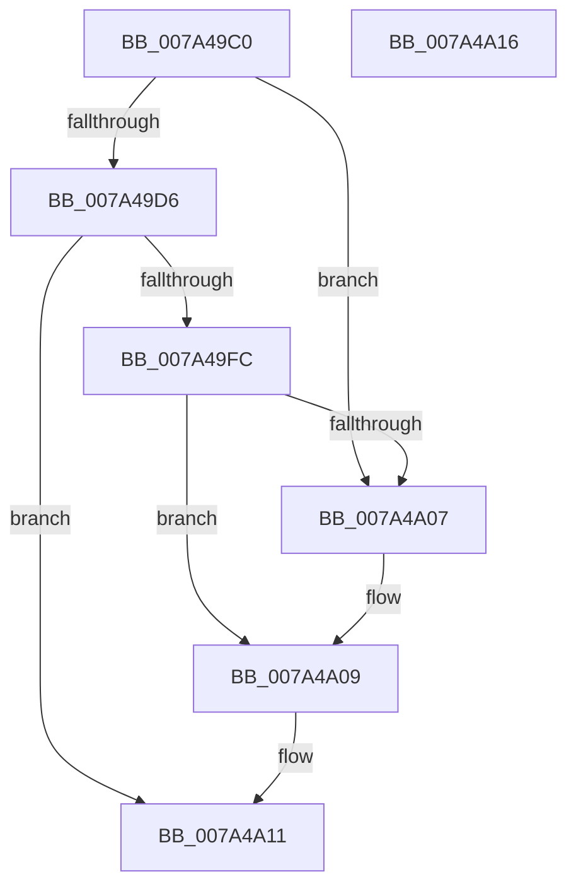

# SepAdtInitializeCrashOnFail

- RVA: `0x007A49C0`–`0x007A4A17` (길이 `87` bytes)
- VA: `0x00000001407A49C0`
- 실행 섹션: `PAGE`
- PDB 이름 있음: `예`; PDB Function 태그: `아니요`
- unwind 정보 RVA: `0x0005D2F4`
- 디코드: `24`개 명령, `87/87` bytes 표시
- 미해석 바이트: `0` (있으면 어셈블리에 `.byte`로 보존)

> 이 문서는 커널 이미지의 기계어와 PDB 기호를 분석해 생성했습니다. 4번과 5번은 함수 원형과 자료형을 바이너리 사용 방식에서 추정한 C 해석이며 원본 소스 복구 결과는 아닙니다.

## 1. Dependencies

- 직접 호출 지점: **1**; 고유 호출 대상: **1**
- 직접 호출자로 확인된 함수: **2**
- RIP 상대 이미지 참조: **3**

### Outgoing calls
- `0x007A49EE` → [SepRegQueryValue](../A3/SepRegQueryValue_function_00A3A730.md) (function, `0x00A3A730`)

### Direct callers
- [SepAdtRegNotificationCallback](SepAdtRegNotificationCallback_function_007A4B20.md) at `0x007A4B24`
- [SepAdtInitializeAuditingOptions](../../init/C4/SepAdtInitializeAuditingOptions_function_00C4BC1C.md) at `0x00C4BC66`

### Static image references
- `0x007A49C4` → RVA `0x00FD80A0` (`PAGEDATA`; read)
- `0x007A49E2` → RVA `0x00B06190` (` ?? ::NNGAKEGL::`string'`; read)
- `0x007A4A09` → RVA `0x00E67F1C` (`.data`; write)

## 2. Other-region calls and transfers

- 다른 실행 섹션으로 향하는 call: **0**
- 별도 외부 분기/꼬리 이동을 확인하지 못했습니다.

## 3. Assembly (complete function range)

```asm
007A49C0  48 83 EC 38                     sub rsp, 0x38
007A49C4  48 8B 0D D5 36 83 00            mov rcx, qword ptr [rip + 0x8336d5]
007A49CB  33 D2                           xor edx, edx
007A49CD  21 54 24 40                     and dword ptr [rsp + 0x40], edx
007A49D1  48 85 C9                        test rcx, rcx
007A49D4  74 31                           je 0x1407a4a07
007A49D6  44 8D 42 04                     lea r8d, [rdx + 4]
007A49DA  48 8D 44 24 40                  lea rax, [rsp + 0x40]
007A49DF  45 8B C8                        mov r9d, r8d
007A49E2  48 8D 15 A7 17 36 00            lea rdx, [rip + 0x3617a7]
007A49E9  48 89 44 24 20                  mov qword ptr [rsp + 0x20], rax
007A49EE  E8 3D 5D 29 00                  call 0x140a3a730
007A49F3  83 7C 24 40 02                  cmp dword ptr [rsp + 0x40], 2
007A49F8  8B D0                           mov edx, eax
007A49FA  77 15                           ja 0x1407a4a11
007A49FC  B8 01 00 00 00                  mov eax, 1
007A4A01  39 44 24 40                     cmp dword ptr [rsp + 0x40], eax
007A4A05  74 02                           je 0x1407a4a09
007A4A07  32 C0                           xor al, al
007A4A09  88 05 0D 35 6C 00               mov byte ptr [rip + 0x6c350d], al
007A4A0F  8B C2                           mov eax, edx
007A4A11  48 83 C4 38                     add rsp, 0x38
007A4A15  C3                              ret
007A4A16  CC                              int3
```

## 4. C-style interpretation (structured pseudocode)

```c
__int64 __fastcall SepAdtInitializeCrashOnFail(__int64 a1, int a2)
{
    __int64 result;
    __int64 v_rsp;
    unsigned __int64 v_stack_m18;
    unsigned int v_stack_p8;

    v_rsp = (v_rsp) - (56);
    a2 = 0;
    if (*(unsigned __int64 *)(v_rip + 8599253) == 0) goto loc_007A4A07;
    v_stack_m18 = v_stack_p8;
    result = SepRegQueryValue(*(unsigned __int64 *)(v_rip + 8599253), v_rip + 3544999, a2 + 4, (unsigned int)((unsigned int)(a2 + 4)));
    if (v_stack_p8 > 2) goto loc_007A4A11;
    result = 1;
    if (v_stack_p8 != 1) {
        result = 0;
    }
    *(unsigned __int8 *)(v_rip + 7091469) = 0;
loc_007A4A11:
    v_rsp = (v_rsp) + (56);
    return (unsigned int)((unsigned int)((unsigned int)((unsigned int)(result))));
}
```

## 5. (Beta) C Style

```c
int64_t SepAdtInitializeCrashOnFail(int64_t Arg1, int32_t Arg2)
{
    int64_t result;
    int64_t local_rsp;
    uint64_t v_stack_m18;
    uint32_t v_stack_p8;

    local_rsp = (local_rsp) - (56);
    Arg2 = 0;
    if (*(uint64_t *)(v_rip + 0x8336D5) == 0) goto loc_007A4A07;
    v_stack_m18 = v_stack_p8;
    result = SepRegQueryValue(*(uint64_t *)(v_rip + 0x8336D5), v_rip + 3544999, Arg2 + 4, (uint32_t)((uint32_t)(Arg2 + 4)));
    if (v_stack_p8 > 2) goto loc_007A4A11;
    result = 1;
    if (v_stack_p8 != 1) {
        result = 0;
    }
    *(uint8_t *)(v_rip + 0x6C350D) = 0;
loc_007A4A11:
    local_rsp = (local_rsp) + (56);
    return (uint32_t)((uint32_t)((uint32_t)((uint32_t)(result))));
}
```

## 6. Execution-region graph

[열기: 2D/3D 그래프와 함수 탐색 컨트롤 패널](../../../control-panel.html?section=page&rva=0x007A49C0&view=graph)

- 2D 그래프는 위에서 아래로 흐르고, 3D 그래프는 빈 공간을 드래그해 회전합니다. Shift+드래그는 이동, 휠은 확대·축소, 함수 노드 선택은 대상 보고서 이동입니다.

### Static fallback


