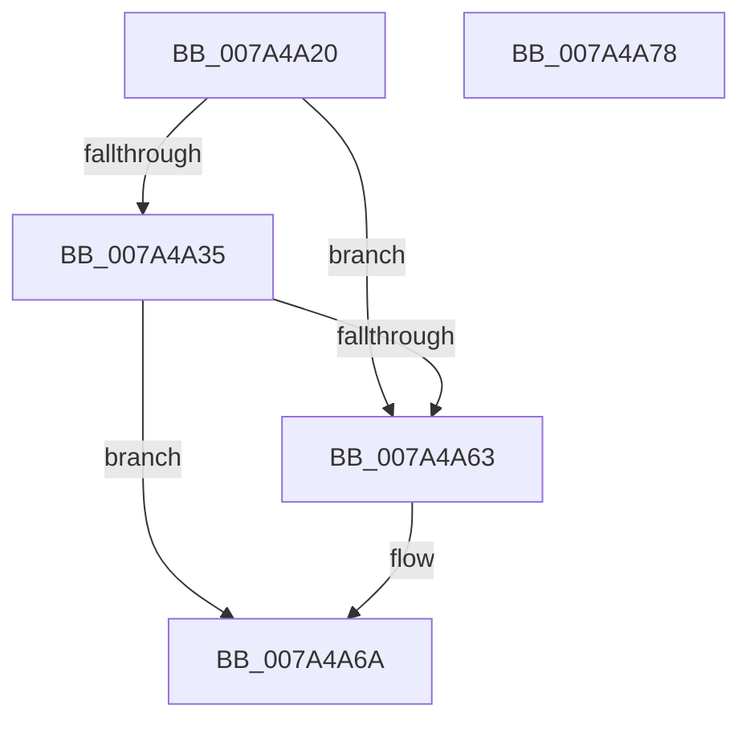

# SepAdtInitializePrivilegeAuditing

- RVA: `0x007A4A20`–`0x007A4A79` (길이 `89` bytes)
- VA: `0x00000001407A4A20`
- 실행 섹션: `PAGE`
- PDB 이름 있음: `예`; PDB Function 태그: `아니요`
- unwind 정보 RVA: `0x0005D2F4`
- 디코드: `20`개 명령, `89/89` bytes 표시
- 미해석 바이트: `0` (있으면 어셈블리에 `.byte`로 보존)

> 이 문서는 커널 이미지의 기계어와 PDB 기호를 분석해 생성했습니다. 4번과 5번은 함수 원형과 자료형을 바이너리 사용 방식에서 추정한 C 해석이며 원본 소스 복구 결과는 아닙니다.

## 1. Dependencies

- 직접 호출 지점: **1**; 고유 호출 대상: **1**
- 직접 호출자로 확인된 함수: **2**
- RIP 상대 이미지 참조: **5**

### Outgoing calls
- `0x007A4A50` → [SepRegQueryValue](../A3/SepRegQueryValue_function_00A3A730.md) (function, `0x00A3A730`)

### Direct callers
- [SepAdtRegNotificationCallback](SepAdtRegNotificationCallback_function_007A4B20.md) at `0x007A4B29`
- [SepAdtInitializeAuditingOptions](../../init/C4/SepAdtInitializeAuditingOptions_function_00C4BC1C.md) at `0x00C4BC6B`

### Static image references
- `0x007A4A24` → RVA `0x00FD80A0` (`PAGEDATA`; read)
- `0x007A4A40` → RVA `0x00B06330` (` ?? ::NNGAKEGL::`string'`; read)
- `0x007A4A5A` → RVA `0x00B4C460` (`SepFilterPrivilegesShort`; read)
- `0x007A4A63` → RVA `0x00B4D500` (`SepFilterPrivilegesLong`; read)
- `0x007A4A6A` → RVA `0x00FD8238` (`PAGEDATA`; write)

## 2. Other-region calls and transfers

- 다른 실행 섹션으로 향하는 call: **0**
- 별도 외부 분기/꼬리 이동을 확인하지 못했습니다.

## 3. Assembly (complete function range)

```asm
007A4A20  48 83 EC 38                     sub rsp, 0x38
007A4A24  48 8B 0D 75 36 83 00            mov rcx, qword ptr [rip + 0x833675]
007A4A2B  C6 44 24 40 00                  mov byte ptr [rsp + 0x40], 0
007A4A30  48 85 C9                        test rcx, rcx
007A4A33  74 2E                           je 0x1407a4a63
007A4A35  41 B9 01 00 00 00               mov r9d, 1
007A4A3B  48 8D 44 24 40                  lea rax, [rsp + 0x40]
007A4A40  48 8D 15 E9 18 36 00            lea rdx, [rip + 0x3618e9]
007A4A47  48 89 44 24 20                  mov qword ptr [rsp + 0x20], rax
007A4A4C  45 8D 41 02                     lea r8d, [r9 + 2]
007A4A50  E8 DB 5C 29 00                  call 0x140a3a730
007A4A55  80 7C 24 40 00                  cmp byte ptr [rsp + 0x40], 0
007A4A5A  48 8D 05 FF 79 3A 00            lea rax, [rip + 0x3a79ff]
007A4A61  75 07                           jne 0x1407a4a6a
007A4A63  48 8D 05 96 8A 3A 00            lea rax, [rip + 0x3a8a96]
007A4A6A  48 89 05 C7 37 83 00            mov qword ptr [rip + 0x8337c7], rax
007A4A71  B0 01                           mov al, 1
007A4A73  48 83 C4 38                     add rsp, 0x38
007A4A77  C3                              ret
007A4A78  CC                              int3
```

## 4. C-style interpretation (structured pseudocode)

```c
__int64 __fastcall SepAdtInitializePrivilegeAuditing(void)
{
    __int64 result;
    __int64 v_rsp;
    unsigned __int64 v_stack_m18;
    unsigned __int8 v_stack_p8;

    v_rsp = (v_rsp) - (56);
    v_stack_p8 = 0;
    if (*(unsigned __int64 *)(v_rip + 8599157) == 0) goto loc_007A4A63;
    v_stack_m18 = v_stack_p8;
    result = SepRegQueryValue(*(unsigned __int64 *)(v_rip + 8599157), v_rip + 3545321, 1 + 2, 1);
    result = v_rip + 3832319;
    if (v_stack_p8 == 0) {
        result = v_rip + 3836566;
    }
    *(unsigned __int64 *)(v_rip + 8599495) = result;
    v_rsp = (v_rsp) + (56);
    return 1;
}
```

## 5. (Beta) C Style

```c
void SepAdtInitializePrivilegeAuditing(void)
{
    int64_t result;
    int64_t local_rsp;
    uint64_t v_stack_m18;
    uint8_t v_stack_p8;

    local_rsp = (local_rsp) - (56);
    v_stack_p8 = 0;
    if (*(uint64_t *)(v_rip + 0x833675) == 0) goto loc_007A4A63;
    v_stack_m18 = v_stack_p8;
    result = SepRegQueryValue(*(uint64_t *)(v_rip + 0x833675), v_rip + 3545321, 1 + 2, 1);
    result = v_rip + 3832319;
    if (v_stack_p8 == 0) {
        result = v_rip + 3836566;
    }
    *(uint64_t *)(v_rip + 0x8337C7) = result;
    local_rsp = (local_rsp) + (56);
    return 1;
}
```

## 6. Execution-region graph

[열기: 2D/3D 그래프와 함수 탐색 컨트롤 패널](../../../control-panel.html?section=page&rva=0x007A4A20&view=graph)

- 2D 그래프는 위에서 아래로 흐르고, 3D 그래프는 빈 공간을 드래그해 회전합니다. Shift+드래그는 이동, 휠은 확대·축소, 함수 노드 선택은 대상 보고서 이동입니다.

### Static fallback


