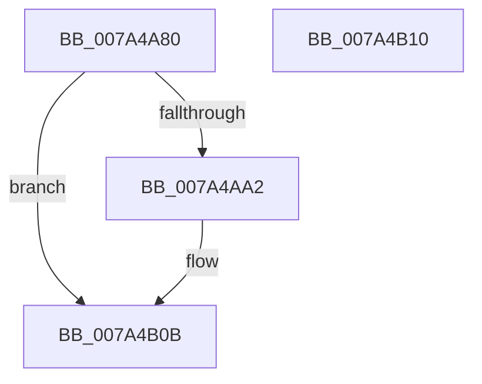

# SepAdtOpenRegAndSetupNotification

- RVA: `0x007A4A80`–`0x007A4B11` (길이 `145` bytes)
- VA: `0x00000001407A4A80`
- 실행 섹션: `PAGE`
- PDB 이름 있음: `예`; PDB Function 태그: `아니요`
- unwind 정보 RVA: `0x0006E590`
- 디코드: `29`개 명령, `145/145` bytes 표시
- 미해석 바이트: `0` (있으면 어셈블리에 `.byte`로 보존)

> 이 문서는 커널 이미지의 기계어와 PDB 기호를 분석해 생성했습니다. 4번과 5번은 함수 원형과 자료형을 바이너리 사용 방식에서 추정한 C 해석이며 원본 소스 복구 결과는 아닙니다.

## 1. Dependencies

- 직접 호출 지점: **2**; 고유 호출 대상: **2**
- 직접 호출자로 확인된 함수: **1**
- RIP 상대 이미지 참조: **8**

### Outgoing calls
- `0x007A4A97` → [SepRegOpenKey](../A3/SepRegOpenKey_function_00A3A6B4.md) (function, `0x00A3A6B4`)
- `0x007A4B06` → [NtNotifyChangeMultipleKeys](../9D/NtNotifyChangeMultipleKeys_function_009DC6B0.md) (function, `0x009DC6B0`)

### Direct callers
- [SepAdtInitializeAuditingOptions](../../init/C4/SepAdtInitializeAuditingOptions_function_00C4BC1C.md) at `0x00C4BC5B`

### Static image references
- `0x007A4A84` → RVA `0x00FD80A0` (`PAGEDATA`; read)
- `0x007A4A90` → RVA `0x00C79DE0` (` ?? ::PBOPGDP::`string'`; read)
- `0x007A4AA9` → RVA `0x007A4B20` (`SepAdtRegNotificationCallback`; read)
- `0x007A4AC8` → RVA `0x00E68178` (`.data`; write)
- `0x007A4ACF` → RVA `0x00E68188` (`.data`; read)
- `0x007A4AE3` → RVA `0x00E68168` (`.data`; read)
- `0x007A4AF8` → RVA `0x00E68180` (`.data`; write)
- `0x007A4AFF` → RVA `0x00E68168` (`.data`; write)

## 2. Other-region calls and transfers

- 다른 실행 섹션으로 향하는 call: **0**
- 별도 외부 분기/꼬리 이동을 확인하지 못했습니다.

## 3. Assembly (complete function range)

```asm
007A4A80  48 83 EC 68                     sub rsp, 0x68
007A4A84  4C 8D 05 15 36 83 00            lea r8, [rip + 0x833615]
007A4A8B  BA 11 02 00 00                  mov edx, 0x211
007A4A90  48 8D 0D 49 53 4D 00            lea rcx, [rip + 0x4d5349]
007A4A97  E8 18 5C 29 00                  call 0x140a3a6b4
007A4A9C  33 D2                           xor edx, edx
007A4A9E  85 C0                           test eax, eax
007A4AA0  78 69                           js 0x1407a4b0b
007A4AA2  48 8B 0D F7 35 83 00            mov rcx, qword ptr [rip + 0x8335f7]
007A4AA9  48 8D 05 70 00 00 00            lea rax, [rip + 0x70]
007A4AB0  C6 44 24 58 01                  mov byte ptr [rsp + 0x58], 1
007A4AB5  45 33 C9                        xor r9d, r9d
007A4AB8  89 54 24 50                     mov dword ptr [rsp + 0x50], edx
007A4ABC  45 33 C0                        xor r8d, r8d
007A4ABF  48 89 54 24 48                  mov qword ptr [rsp + 0x48], rdx
007A4AC4  88 54 24 40                     mov byte ptr [rsp + 0x40], dl
007A4AC8  48 89 05 A9 36 6C 00            mov qword ptr [rip + 0x6c36a9], rax
007A4ACF  48 8D 05 B2 36 6C 00            lea rax, [rip + 0x6c36b2]
007A4AD6  C7 44 24 38 05 00 00 00         mov dword ptr [rsp + 0x38], 5
007A4ADE  48 89 44 24 30                  mov qword ptr [rsp + 0x30], rax
007A4AE3  48 8D 05 7E 36 6C 00            lea rax, [rip + 0x6c367e]
007A4AEA  48 C7 44 24 28 01 00 00 00      mov qword ptr [rsp + 0x28], 1
007A4AF3  48 89 44 24 20                  mov qword ptr [rsp + 0x20], rax
007A4AF8  48 89 15 81 36 6C 00            mov qword ptr [rip + 0x6c3681], rdx
007A4AFF  48 89 15 62 36 6C 00            mov qword ptr [rip + 0x6c3662], rdx
007A4B06  E8 A5 7B 23 00                  call 0x1409dc6b0
007A4B0B  48 83 C4 68                     add rsp, 0x68
007A4B0F  C3                              ret
007A4B10  CC                              int3
```

## 4. C-style interpretation (structured pseudocode)

```c
__int64 __fastcall SepAdtOpenRegAndSetupNotification(__int64 a1, __int64 a2, __int64 a3, int a4)
{
    __int64 result;
    __int64 v_rsp;
    unsigned __int8 v_stack_m10;
    unsigned int v_stack_m18;
    unsigned __int64 v_stack_m20;
    unsigned __int8 v_stack_m28;
    unsigned int v_stack_m30;
    unsigned __int64 v_stack_m38;
    unsigned __int64 v_stack_m40;
    unsigned __int64 v_stack_m48;

    v_rsp = (v_rsp) - (104);
    result = SepRegOpenKey(v_rip + 5067593, 529, v_rip + 8599061, a4);
    a2 = 0;
    if (!(sign_flag)) {
        a1 = *(unsigned __int64 *)(v_rip + 8599031);
        result = v_rip + 112;
        v_stack_m10 = 1;
        a4 = 0;
        v_stack_m18 = 0;
        a3 = 0;
        v_stack_m20 = 0;
        v_stack_m28 = 0;
        *(unsigned __int64 *)(v_rip + 7091881) = result;
        result = v_rip + 7091890;
        v_stack_m30 = 5;
        v_stack_m38 = result;
        result = v_rip + 7091838;
        v_stack_m40 = 1;
        v_stack_m48 = result;
        *(unsigned __int64 *)(v_rip + 7091841) = 0;
        *(unsigned __int64 *)(v_rip + 7091810) = 0;
        result = NtNotifyChangeMultipleKeys(a1, a2, a3, a4);
    }
    v_rsp = (v_rsp) + (104);
    return result;
}
```

## 5. (Beta) C Style

```c
int64_t SepAdtOpenRegAndSetupNotification(int64_t Arg1, int64_t Arg2, int64_t Arg3, int32_t Arg4)
{
    int64_t result;
    int64_t local_rsp;
    uint8_t v_stack_m10;
    uint32_t v_stack_m18;
    uint64_t v_stack_m20;
    uint8_t v_stack_m28;
    uint32_t v_stack_m30;
    uint64_t v_stack_m38;
    uint64_t v_stack_m40;
    uint64_t v_stack_m48;

    local_rsp = (local_rsp) - (104);
    result = SepRegOpenKey(v_rip + 5067593, 529, v_rip + 8599061, Arg4);
    Arg2 = 0;
    if (!(sign_flag)) {
        Arg1 = *(uint64_t *)(v_rip + 0x8335F7);
        result = v_rip + 112;
        v_stack_m10 = 1;
        Arg4 = 0;
        v_stack_m18 = 0;
        Arg3 = 0;
        v_stack_m20 = 0;
        v_stack_m28 = 0;
        *(uint64_t *)(v_rip + 0x6C36A9) = result;
        result = v_rip + 7091890;
        v_stack_m30 = 5;
        v_stack_m38 = result;
        result = v_rip + 7091838;
        v_stack_m40 = 1;
        v_stack_m48 = result;
        *(uint64_t *)(v_rip + 0x6C3681) = 0;
        *(uint64_t *)(v_rip + 0x6C3662) = 0;
        result = NtNotifyChangeMultipleKeys(Arg1, Arg2, Arg3, Arg4);
    }
    local_rsp = (local_rsp) + (104);
    return result;
}
```

## 6. Execution-region graph

[열기: 2D/3D 그래프와 함수 탐색 컨트롤 패널](../../../control-panel.html?section=page&rva=0x007A4A80&view=graph)

- 2D 그래프는 위에서 아래로 흐르고, 3D 그래프는 빈 공간을 드래그해 회전합니다. Shift+드래그는 이동, 휠은 확대·축소, 함수 노드 선택은 대상 보고서 이동입니다.

### Static fallback


