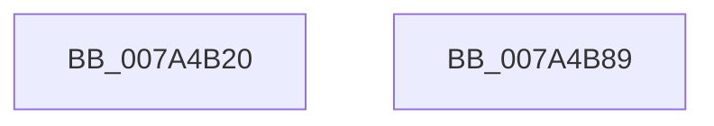

# SepAdtRegNotificationCallback

- RVA: `0x007A4B20`–`0x007A4B8A` (길이 `106` bytes)
- VA: `0x00000001407A4B20`
- 실행 섹션: `PAGE`
- PDB 이름 있음: `예`; PDB Function 태그: `아니요`
- unwind 정보 RVA: `0x0006E590`
- 디코드: `23`개 명령, `106/106` bytes 표시
- 미해석 바이트: `0` (있으면 어셈블리에 `.byte`로 보존)

> 이 문서는 커널 이미지의 기계어와 PDB 기호를 분석해 생성했습니다. 4번과 5번은 함수 원형과 자료형을 바이너리 사용 방식에서 추정한 C 해석이며 원본 소스 복구 결과는 아닙니다.

## 1. Dependencies

- 직접 호출 지점: **4**; 고유 호출 대상: **4**
- 직접 호출자로 확인된 함수: **0**
- RIP 상대 이미지 참조: **3**

### Outgoing calls
- `0x007A4B24` → [SepAdtInitializeCrashOnFail](SepAdtInitializeCrashOnFail_function_007A49C0.md) (function, `0x007A49C0`)
- `0x007A4B29` → [SepAdtInitializePrivilegeAuditing](SepAdtInitializePrivilegeAuditing_function_007A4A20.md) (function, `0x007A4A20`)
- `0x007A4B2E` → [SepAdtInitializeBounds](SepAdtInitializeBounds_function_007A493C.md) (function, `0x007A493C`)
- `0x007A4B7F` → [NtNotifyChangeMultipleKeys](../9D/NtNotifyChangeMultipleKeys_function_009DC6B0.md) (function, `0x009DC6B0`)

### Direct callers
- 이 함수 시작 RVA로 연결되는 직접 call은 확인되지 않았습니다. 간접 호출은 완전히 역산할 수 없습니다.

### Static image references
- `0x007A4B33` → RVA `0x00FD80A0` (`PAGEDATA`; read)
- `0x007A4B56` → RVA `0x00E68188` (`.data`; read)
- `0x007A4B6A` → RVA `0x00E68168` (`.data`; read)

## 2. Other-region calls and transfers

- 다른 실행 섹션으로 향하는 call: **0**
- 별도 외부 분기/꼬리 이동을 확인하지 못했습니다.

## 3. Assembly (complete function range)

```asm
007A4B20  48 83 EC 68                     sub rsp, 0x68
007A4B24  E8 97 FE FF FF                  call 0x1407a49c0
007A4B29  E8 F2 FE FF FF                  call 0x1407a4a20
007A4B2E  E8 09 FE FF FF                  call 0x1407a493c
007A4B33  48 8B 0D 66 35 83 00            mov rcx, qword ptr [rip + 0x833566]
007A4B3A  33 C0                           xor eax, eax
007A4B3C  C6 44 24 58 01                  mov byte ptr [rsp + 0x58], 1
007A4B41  45 33 C9                        xor r9d, r9d
007A4B44  89 44 24 50                     mov dword ptr [rsp + 0x50], eax
007A4B48  45 33 C0                        xor r8d, r8d
007A4B4B  48 89 44 24 48                  mov qword ptr [rsp + 0x48], rax
007A4B50  33 D2                           xor edx, edx
007A4B52  88 44 24 40                     mov byte ptr [rsp + 0x40], al
007A4B56  48 8D 05 2B 36 6C 00            lea rax, [rip + 0x6c362b]
007A4B5D  C7 44 24 38 05 00 00 00         mov dword ptr [rsp + 0x38], 5
007A4B65  48 89 44 24 30                  mov qword ptr [rsp + 0x30], rax
007A4B6A  48 8D 05 F7 35 6C 00            lea rax, [rip + 0x6c35f7]
007A4B71  48 C7 44 24 28 01 00 00 00      mov qword ptr [rsp + 0x28], 1
007A4B7A  48 89 44 24 20                  mov qword ptr [rsp + 0x20], rax
007A4B7F  E8 2C 7B 23 00                  call 0x1409dc6b0
007A4B84  48 83 C4 68                     add rsp, 0x68
007A4B88  C3                              ret
007A4B89  CC                              int3
```

## 4. C-style interpretation (structured pseudocode)

```c
__int64 __fastcall SepAdtRegNotificationCallback(__int64 a1, int a2, int a3, int a4)
{
    __int64 result;
    __int64 v_rsp;
    unsigned __int8 v_stack_m10;
    unsigned int v_stack_m18;
    unsigned __int64 v_stack_m20;
    unsigned __int8 v_stack_m28;
    unsigned int v_stack_m30;
    unsigned __int64 v_stack_m38;
    unsigned __int64 v_stack_m40;
    unsigned __int64 v_stack_m48;

    v_rsp = (v_rsp) - (104);
    result = SepAdtInitializeCrashOnFail(a1, a2, a3, a4);
    result = SepAdtInitializePrivilegeAuditing(a1, a2, a3, a4);
    result = SepAdtInitializeBounds(a1, a2, a3, a4);
    result = 0;
    v_stack_m10 = 1;
    a4 = 0;
    v_stack_m18 = 0;
    a3 = 0;
    v_stack_m20 = 0;
    a2 = 0;
    v_stack_m28 = 0;
    v_stack_m30 = 5;
    v_stack_m38 = v_rip + 7091755;
    v_stack_m40 = 1;
    v_stack_m48 = v_rip + 7091703;
    result = NtNotifyChangeMultipleKeys(*(unsigned __int64 *)(v_rip + 8598886), a2, a3, a4);
    v_rsp = (v_rsp) + (104);
    return result;
}
```

## 5. (Beta) C Style

```c
int64_t SepAdtRegNotificationCallback(int64_t Arg1, int32_t Arg2, int32_t Arg3, int32_t Arg4)
{
    int64_t result;
    int64_t local_rsp;
    uint8_t v_stack_m10;
    uint32_t v_stack_m18;
    uint64_t v_stack_m20;
    uint8_t v_stack_m28;
    uint32_t v_stack_m30;
    uint64_t v_stack_m38;
    uint64_t v_stack_m40;
    uint64_t v_stack_m48;

    local_rsp = (local_rsp) - (104);
    result = SepAdtInitializeCrashOnFail(Arg1, Arg2, Arg3, Arg4);
    result = SepAdtInitializePrivilegeAuditing(Arg1, Arg2, Arg3, Arg4);
    result = SepAdtInitializeBounds(Arg1, Arg2, Arg3, Arg4);
    result = 0;
    v_stack_m10 = 1;
    Arg4 = 0;
    v_stack_m18 = 0;
    Arg3 = 0;
    v_stack_m20 = 0;
    Arg2 = 0;
    v_stack_m28 = 0;
    v_stack_m30 = 5;
    v_stack_m38 = v_rip + 7091755;
    v_stack_m40 = 1;
    v_stack_m48 = v_rip + 7091703;
    result = NtNotifyChangeMultipleKeys(*(uint64_t *)(v_rip + 0x833566), Arg2, Arg3, Arg4);
    local_rsp = (local_rsp) + (104);
    return result;
}
```

## 6. Execution-region graph

[열기: 2D/3D 그래프와 함수 탐색 컨트롤 패널](../../../control-panel.html?section=page&rva=0x007A4B20&view=graph)

- 2D 그래프는 위에서 아래로 흐르고, 3D 그래프는 빈 공간을 드래그해 회전합니다. Shift+드래그는 이동, 휠은 확대·축소, 함수 노드 선택은 대상 보고서 이동입니다.

### Static fallback


