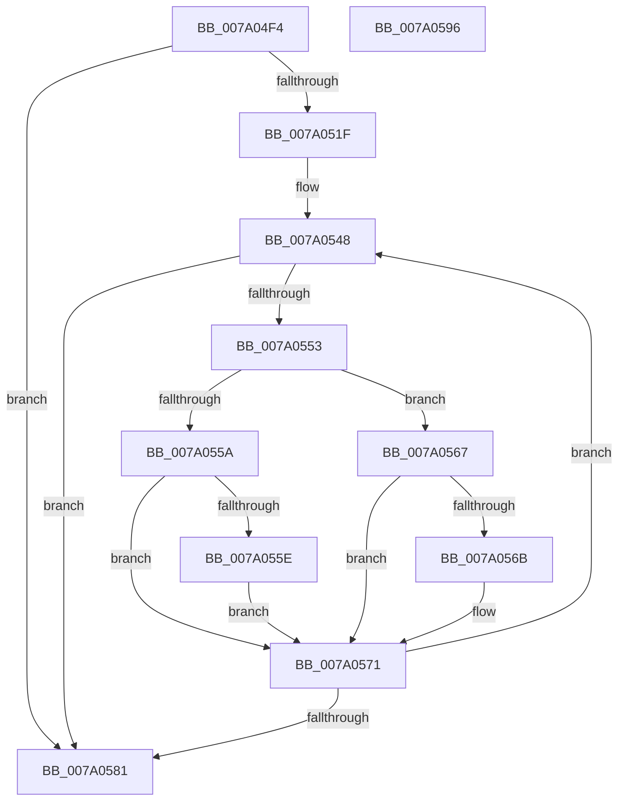

# SepAuditTypeList

- RVA: `0x007A04F4`–`0x007A0597` (길이 `163` bytes)
- VA: `0x00000001407A04F4`
- 실행 섹션: `PAGE`
- PDB 이름 있음: `예`; PDB Function 태그: `아니요`
- unwind 정보 RVA: `0x000A5A38`
- 디코드: `49`개 명령, `163/163` bytes 표시
- 미해석 바이트: `0` (있으면 어셈블리에 `.byte`로 보존)

> 이 문서는 커널 이미지의 기계어와 PDB 기호를 분석해 생성했습니다. 4번과 5번은 함수 원형과 자료형을 바이너리 사용 방식에서 추정한 C 해석이며 원본 소스 복구 결과는 아닙니다.

## 1. Dependencies

- 직접 호출 지점: **0**; 고유 호출 대상: **0**
- 직접 호출자로 확인된 함수: **1**
- RIP 상대 이미지 참조: **0**

### Outgoing calls
- 직접 디코드된 call 명령이 없습니다.

### Direct callers
- [SepSetAuditInfoForObjectType](SepSetAuditInfoForObjectType_function_007A05A0.md) at `0x007A069A`

### Static image references
- 디코드된 RIP-relative 메모리 참조가 없습니다.

## 2. Other-region calls and transfers

- 다른 실행 섹션으로 향하는 call: **0**
- 별도 외부 분기/꼬리 이동을 확인하지 못했습니다.

## 3. Assembly (complete function range)

```asm
007A04F4  48 8B C4                        mov rax, rsp
007A04F7  48 89 58 08                     mov qword ptr [rax + 8], rbx
007A04FB  48 89 68 10                     mov qword ptr [rax + 0x10], rbp
007A04FF  48 89 70 18                     mov qword ptr [rax + 0x18], rsi
007A0503  48 89 78 20                     mov qword ptr [rax + 0x20], rdi
007A0507  45 8B D1                        mov r10d, r9d
007A050A  8B DA                           mov ebx, edx
007A050C  48 8B F9                        mov rdi, rcx
007A050F  47 8B 1C 90                     mov r11d, dword ptr [r8 + r10*4]
007A0513  41 C1 EB 1F                     shr r11d, 0x1f
007A0517  41 FF C1                        inc r9d
007A051A  44 3B CA                        cmp r9d, edx
007A051D  73 62                           jae 0x1407a0581
007A051F  48 8B 74 24 28                  mov rsi, qword ptr [rsp + 0x28]
007A0524  4B 8D 0C 49                     lea rcx, [r9 + r9*2]
007A0528  48 C1 E1 04                     shl rcx, 4
007A052C  4F 8D 14 52                     lea r10, [r10 + r10*2]
007A0530  48 83 C1 02                     add rcx, 2
007A0534  4B 8D 14 88                     lea rdx, [r8 + r9*4]
007A0538  4C 8B 44 24 30                  mov r8, qword ptr [rsp + 0x30]
007A053D  4D 03 D2                        add r10, r10
007A0540  48 03 CF                        add rcx, rdi
007A0543  BD 01 00 00 00                  mov ebp, 1
007A0548  42 0F B7 04 D7                  movzx eax, word ptr [rdi + r10*8]
007A054D  66 39 41 FE                     cmp word ptr [rcx - 2], ax
007A0551  76 2E                           jbe 0x1407a0581
007A0553  8B 02                           mov eax, dword ptr [rdx]
007A0555  45 84 DB                        test r11b, r11b
007A0558  75 0D                           jne 0x1407a0567
007A055A  85 C0                           test eax, eax
007A055C  79 13                           jns 0x1407a0571
007A055E  41 88 28                        mov byte ptr [r8], bpl
007A0561  66 83 09 02                     or word ptr [rcx], 2
007A0565  EB 0A                           jmp 0x1407a0571
007A0567  85 C0                           test eax, eax
007A0569  78 06                           js 0x1407a0571
007A056B  40 88 2E                        mov byte ptr [rsi], bpl
007A056E  66 09 29                        or word ptr [rcx], bp
007A0571  44 03 CD                        add r9d, ebp
007A0574  48 83 C2 04                     add rdx, 4
007A0578  48 83 C1 30                     add rcx, 0x30
007A057C  44 3B CB                        cmp r9d, ebx
007A057F  72 C7                           jb 0x1407a0548
007A0581  48 8B 5C 24 08                  mov rbx, qword ptr [rsp + 8]
007A0586  48 8B 6C 24 10                  mov rbp, qword ptr [rsp + 0x10]
007A058B  48 8B 74 24 18                  mov rsi, qword ptr [rsp + 0x18]
007A0590  48 8B 7C 24 20                  mov rdi, qword ptr [rsp + 0x20]
007A0595  C3                              ret
007A0596  CC                              int3
```

## 4. C-style interpretation (structured pseudocode)

```c
__int64 __fastcall SepAuditTypeList(__int64 a1, int a2, __int64 a3, int a4, __int64 a5, __int64 a6)
{
    __int64 v_r10;
    __int64 v_r11;
    unsigned __int64 v_stack_p10;
    unsigned __int64 v_stack_p18;
    unsigned __int64 v_stack_p20;
    unsigned __int64 v_stack_p8;

    *(unsigned __int64 *)(v_rsp + 8) = v_rbx;
    *(unsigned __int64 *)(v_rsp + 16) = v_rbp;
    *(unsigned __int64 *)(v_rsp + 24) = v_rsi;
    *(unsigned __int64 *)(v_rsp + 32) = v_rdi;
    v_r11 = (unsigned int)(((unsigned int)(*(unsigned int *)(a3 + (unsigned int)(a4) * 4))) >> (31));
    a4 = (unsigned int)((a4) + 1);
    if (a4 >= a2) goto loc_007A0581;
    a1 = (a4 + a4 * 2) << (4);
    a1 = (a1) + (2);
    v_r10 = ((unsigned int)(a4) + (unsigned int)(a4) * 2) + ((unsigned int)(a4) + (unsigned int)(a4) * 2);
    a1 = (a1) + (a1);
loc_007A0548:
    if ((*(unsigned __int16 *)(a1 - 2)) <= ((unsigned __int16)(*(unsigned __int16 *)(a1 + v_r10 * 8)))) goto loc_007A0581;
    if ((unsigned __int8)(v_r11) != 0) goto loc_007A0567;
    if (!sign_flag) goto loc_007A0571;
    *(unsigned __int8 *)(a6) = 1;
    goto loc_007A0571;
loc_007A0567:
    if (!(sign_flag)) {
        *(unsigned __int8 *)(a5) = 1;
    }
    a4 = (unsigned int)((a4) + (1));
    a2 = (a3 + a4 * 4) + (4);
    a1 = (a1) + (48);
    if (a4 < ((unsigned int)((unsigned int)(a2)))) goto loc_007A0548;
loc_007A0581:
    return (unsigned int)(*(unsigned int *)(a3 + a4 * 4));
}
```

## 5. (Beta) C Style

```c
int64_t SepAuditTypeList(void *Arg1, int32_t Arg2, void *Arg3, void *Arg4, void *Arg5, void *Arg6)
{
    uint8_t *arg1 = (uint8_t *)Arg1;
    uint8_t *arg3 = (uint8_t *)Arg3;
    uint8_t *arg4 = (uint8_t *)Arg4;
    uint8_t *arg5 = (uint8_t *)Arg5;
    uint8_t *arg6 = (uint8_t *)Arg6;

    int64_t local_r10;
    int64_t local_r11;
    uint64_t v_stack_p10;
    uint64_t v_stack_p18;
    uint64_t v_stack_p20;
    uint64_t v_stack_p8;

    *(uint64_t *)(local_rsp + 0x8) = local_rbx;
    *(uint64_t *)(local_rsp + 0x10) = local_rbp;
    *(uint64_t *)(local_rsp + 0x18) = local_rsi;
    *(uint64_t *)(local_rsp + 0x20) = local_rdi;
    local_r11 = (uint32_t)(((uint32_t)(*(uint32_t *)(arg3 + (uint32_t)(arg4) * 4))) >> (31));
    Arg4 = (uint32_t)((Arg4) + 1);
    if (Arg4 >= Arg2) goto loc_007A0581;
    Arg1 = (Arg4 + Arg4 * 2) << (4);
    Arg1 = (Arg1) + (2);
    local_r10 = ((uint32_t)(Arg4) + (uint32_t)(Arg4) * 2) + ((uint32_t)(Arg4) + (uint32_t)(Arg4) * 2);
    Arg1 = (Arg1) + (Arg1);
loc_007A0548:
    if ((*(uint16_t *)(arg1 - 0x2)) <= ((uint16_t)(*(uint16_t *)(arg1 + local_r10 * 8)))) goto loc_007A0581;
    if ((uint8_t)(local_r11) != 0) goto loc_007A0567;
    if (!sign_flag) goto loc_007A0571;
    *(uint8_t *)(arg6) = 1;
    goto loc_007A0571;
loc_007A0567:
    if (!(sign_flag)) {
        *(uint8_t *)(arg5) = 1;
    }
    Arg4 = (uint32_t)((Arg4) + (1));
    Arg2 = (Arg3 + Arg4 * 4) + (4);
    Arg1 = (Arg1) + (48);
    if (Arg4 < ((uint32_t)((uint32_t)(Arg2)))) goto loc_007A0548;
loc_007A0581:
    return (uint32_t)(*(uint32_t *)(arg3 + arg4 * 4));
}
```

### 관측된 메모리 오프셋

구조체 형식이 확인되지 않은 접근은 인자 기준의 오프셋으로만 기록했습니다.

| 기준 인자 | 오프셋 표현 | 폭 (bit) | 접근 |
|---|---:|---:|---|
| `Arg1` | `+ 0x0 + r10*8` | `16` | `R` |
| `Arg3` | `+ 0x0` | `32` | `R` |
| `Arg3` | `+ 0x0 + r10*4` | `32` | `R` |
| `Arg3` | `+ 0x0 + r9*4` | `64` | `R` |
| `Arg4` | `+ 0x0 + r10*2` | `64` | `R` |
| `Arg5` | `+ 0x0` | `8` | `W` |
| `Arg6` | `+ 0x0` | `8` | `W` |

## 6. Execution-region graph

[열기: 2D/3D 그래프와 함수 탐색 컨트롤 패널](../../../control-panel.html?section=page&rva=0x007A04F4&view=graph)

- 2D 그래프는 위에서 아래로 흐르고, 3D 그래프는 빈 공간을 드래그해 회전합니다. Shift+드래그는 이동, 휠은 확대·축소, 함수 노드 선택은 대상 보고서 이동입니다.

### Static fallback


