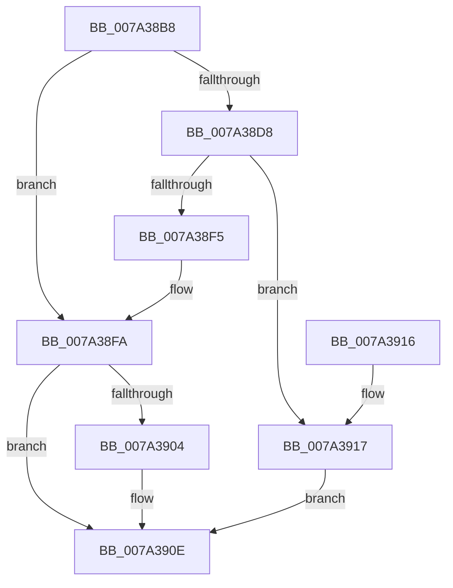

# SepBuildDefaultCap

- RVA: `0x007A38B8`–`0x007A3958` (길이 `160` bytes)
- VA: `0x00000001407A38B8`
- 실행 섹션: `PAGE`
- PDB 이름 있음: `예`; PDB Function 태그: `아니요`
- unwind 정보 RVA: `0x000D16F0`
- 디코드: `41`개 명령, `160/160` bytes 표시
- 미해석 바이트: `0` (있으면 어셈블리에 `.byte`로 보존)

> 이 문서는 커널 이미지의 기계어와 PDB 기호를 분석해 생성했습니다. 4번과 5번은 함수 원형과 자료형을 바이너리 사용 방식에서 추정한 C 해석이며 원본 소스 복구 결과는 아닙니다.

## 1. Dependencies

- 직접 호출 지점: **3**; 고유 호출 대상: **3**
- 직접 호출자로 확인된 함수: **1**
- RIP 상대 이미지 참조: **2**

### Outgoing calls
- `0x007A38CD` → [SepBuildDefaultCape](../../text/60/SepBuildDefaultCape_function_0060BA78.md) (function, `0x0060BA78`)
- `0x007A38E8` → [ExAllocatePool2](../../poolcode/B8/ExAllocatePool2_function_00B820F0.md) (function, `0x00B820F0`)
- `0x007A3909` → [ExFreePoolWithTag](../../poolcode/B8/ExFreePoolWithTag_function_00B82870.md) (function, `0x00B82870`)

### Direct callers
- [SepRmDbInitialization](../../init/C4/SepRmDbInitialization_function_00C4BAF4.md) at `0x00C4BBEE`

### Static image references
- `0x007A392A` → RVA `0x00FD86F0` (`PAGEDATA`; read)
- `0x007A394F` → RVA `0x00FD80F0` (`PAGEDATA`; write)

## 2. Other-region calls and transfers

- 다른 실행 섹션으로 향하는 call: **3**
  - `0x007A38CD` → [SepBuildDefaultCape](../../text/60/SepBuildDefaultCape_function_0060BA78.md) (`PAGE` → `.text`)
  - `0x007A38E8` → [ExAllocatePool2](../../poolcode/B8/ExAllocatePool2_function_00B820F0.md) (`PAGE` → `POOLCODE`)
  - `0x007A3909` → [ExFreePoolWithTag](../../poolcode/B8/ExFreePoolWithTag_function_00B82870.md) (`PAGE` → `POOLCODE`)
- 별도 외부 분기/꼬리 이동을 확인하지 못했습니다.

## 3. Assembly (complete function range)

```asm
007A38B8  48 89 4C 24 08                  mov qword ptr [rsp + 8], rcx
007A38BD  53                              push rbx
007A38BE  48 83 EC 20                     sub rsp, 0x20
007A38C2  48 83 64 24 30 00               and qword ptr [rsp + 0x30], 0
007A38C8  48 8D 4C 24 30                  lea rcx, [rsp + 0x30]
007A38CD  E8 A6 81 E6 FF                  call 0x14060ba78
007A38D2  8B D8                           mov ebx, eax
007A38D4  85 C0                           test eax, eax
007A38D6  78 22                           js 0x1407a38fa
007A38D8  BA 48 00 00 00                  mov edx, 0x48
007A38DD  B9 00 01 00 00                  mov ecx, 0x100
007A38E2  41 B8 53 65 53 70               mov r8d, 0x70536553
007A38E8  E8 03 E8 3D 00                  call 0x140b820f0
007A38ED  48 8B C8                        mov rcx, rax
007A38F0  48 85 C0                        test rax, rax
007A38F3  75 22                           jne 0x1407a3917
007A38F5  BB 9A 00 00 C0                  mov ebx, 0xc000009a
007A38FA  48 8B 4C 24 30                  mov rcx, qword ptr [rsp + 0x30]
007A38FF  48 85 C9                        test rcx, rcx
007A3902  74 0A                           je 0x1407a390e
007A3904  BA 53 65 53 70                  mov edx, 0x70536553
007A3909  E8 62 EF 3D 00                  call 0x140b82870
007A390E  8B C3                           mov eax, ebx
007A3910  48 83 C4 20                     add rsp, 0x20
007A3914  5B                              pop rbx
007A3915  C3                              ret
007A3916  CC                              int3
007A3917  48 83 20 00                     and qword ptr [rax], 0
007A391B  48 83 60 08 00                  and qword ptr [rax + 8], 0
007A3920  48 83 60 10 00                  and qword ptr [rax + 0x10], 0
007A3925  48 83 60 20 00                  and qword ptr [rax + 0x20], 0
007A392A  0F 10 05 BF 4D 83 00            movups xmm0, xmmword ptr [rip + 0x834dbf]
007A3931  48 83 61 18 00                  and qword ptr [rcx + 0x18], 0
007A3936  F3 0F 7F 40 28                  movdqu xmmword ptr [rax + 0x28], xmm0
007A393B  B8 01 00 00 00                  mov eax, 1
007A3940  89 41 38                        mov dword ptr [rcx + 0x38], eax
007A3943  89 41 3C                        mov dword ptr [rcx + 0x3c], eax
007A3946  48 8B 44 24 30                  mov rax, qword ptr [rsp + 0x30]
007A394B  48 89 41 40                     mov qword ptr [rcx + 0x40], rax
007A394F  48 89 0D 9A 47 83 00            mov qword ptr [rip + 0x83479a], rcx
007A3956  EB B6                           jmp 0x1407a390e
```

## 4. C-style interpretation (structured pseudocode)

```c
__int64 __fastcall SepBuildDefaultCap(__int64 a1)
{
    __int64 result;
    __int64 v_rsp;
    unsigned __int64 v_stack_p30;
    unsigned __int64 v_stack_p8;

    v_stack_p8 = a1;
    v_rsp = (v_rsp) - (32);
    result = SepBuildDefaultCape(v_stack_p8, a2, a3, a4);
    if (sign_flag) goto loc_007A38FA;
    result = ExAllocatePool2(256, 72, (unsigned int)(0x70536553ULL), a4);
    if (result != 0) goto loc_007A3917;
loc_007A38FA:
    if (v_stack_p8 != 0) {
        a2 = 0x70536553ULL;
        result = ExFreePoolWithTag(v_stack_p8, a2, (unsigned int)(0x70536553ULL), a4);
    }
    v_rsp = (v_rsp) + (32);
    return (unsigned int)((unsigned int)((unsigned int)(0xC000009AULL)));
loc_007A3917:
    *(unsigned __int64 *)((unsigned int)((unsigned int)((unsigned int)(0xC000009AULL))) + 40) = v_xmm0;
    *(unsigned int *)(v_stack_p8 + 56) = 1;
    *(unsigned int *)(v_stack_p8 + 60) = 1;
    *(unsigned __int64 *)(v_stack_p8 + 64) = v_stack_p30;
    *(unsigned __int64 *)(v_rip + 8603546) = v_stack_p8;
    goto loc_007A390E;
}
```

## 5. (Beta) C Style

```c
int64_t SepBuildDefaultCap(int64_t Arg1)
{
    int64_t result;
    int64_t local_rsp;
    uint64_t v_stack_p30;
    uint64_t v_stack_p8;

    v_stack_p8 = Arg1;
    local_rsp = (local_rsp) - (32);
    result = SepBuildDefaultCape(v_stack_p8, a2, a3, a4);
    if (sign_flag) goto loc_007A38FA;
    result = ExAllocatePool2(256, 72, (uint32_t)(0x70536553ULL), a4);
    if (result != 0) goto loc_007A3917;
loc_007A38FA:
    if (v_stack_p8 != 0) {
        a2 = 0x70536553ULL;
        result = ExFreePoolWithTag(v_stack_p8, a2, (uint32_t)(0x70536553ULL), a4);
    }
    local_rsp = (local_rsp) + (32);
    return (uint32_t)((uint32_t)((uint32_t)(0xC000009AULL)));
loc_007A3917:
    *(uint64_t *)((uint32_t)((uint32_t)((uint32_t)(0xC000009AULL))) + 0x28) = v_xmm0;
    *(uint32_t *)(v_stack_p8 + 0x38) = 1;
    *(uint32_t *)(v_stack_p8 + 0x3C) = 1;
    *(uint64_t *)(v_stack_p8 + 0x40) = v_stack_p30;
    *(uint64_t *)(v_rip + 0x83479A) = v_stack_p8;
    goto loc_007A390E;
}
```

## 6. Execution-region graph

[열기: 2D/3D 그래프와 함수 탐색 컨트롤 패널](../../../control-panel.html?section=page&rva=0x007A38B8&view=graph)

- 2D 그래프는 위에서 아래로 흐르고, 3D 그래프는 빈 공간을 드래그해 회전합니다. Shift+드래그는 이동, 휠은 확대·축소, 함수 노드 선택은 대상 보고서 이동입니다.

### Static fallback


