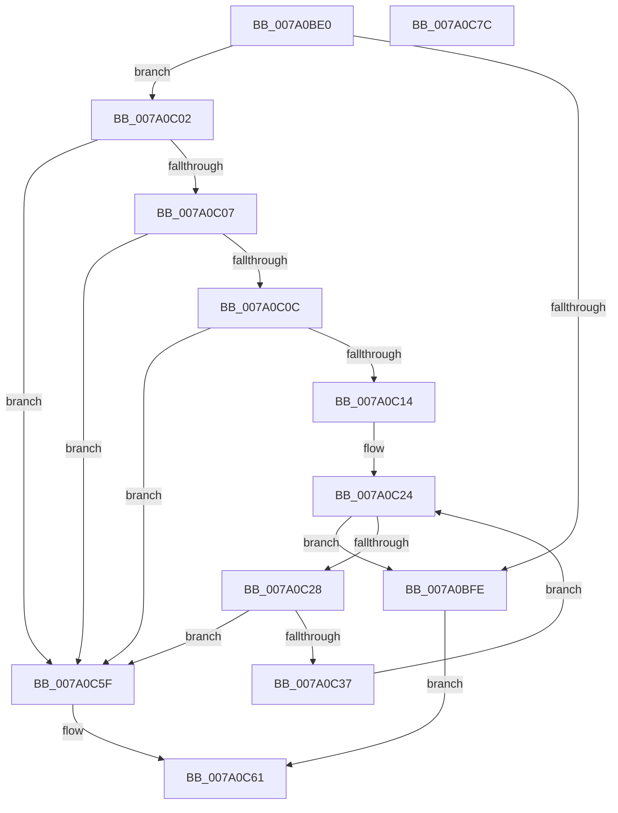

# SepCompareSidValuesBlocks

- RVA: `0x007A0BE0`–`0x007A0C7D` (길이 `157` bytes)
- VA: `0x00000001407A0BE0`
- 실행 섹션: `PAGE`
- PDB 이름 있음: `예`; PDB Function 태그: `아니요`
- unwind 정보 RVA: `0x0005E6B4`
- 디코드: `48`개 명령, `157/157` bytes 표시
- 미해석 바이트: `0` (있으면 어셈블리에 `.byte`로 보존)

> 이 문서는 커널 이미지의 기계어와 PDB 기호를 분석해 생성했습니다. 4번과 5번은 함수 원형과 자료형을 바이너리 사용 방식에서 추정한 C 해석이며 원본 소스 복구 결과는 아닙니다.

## 1. Dependencies

- 직접 호출 지점: **1**; 고유 호출 대상: **1**
- 직접 호출자로 확인된 함수: **1**
- RIP 상대 이미지 참조: **0**

### Outgoing calls
- `0x007A0C2E` → [RtlEqualSid](../../text/40/RtlEqualSid_function_00400AD0.md) (function, `0x00400AD0`)

### Direct callers
- [SepSetTokenUserAndGroups](../9F/SepSetTokenUserAndGroups_function_009FDCD0.md) at `0x009FDE6A`

### Static image references
- 디코드된 RIP-relative 메모리 참조가 없습니다.

## 2. Other-region calls and transfers

- 다른 실행 섹션으로 향하는 call: **1**
  - `0x007A0C2E` → [RtlEqualSid](../../text/40/RtlEqualSid_function_00400AD0.md) (`PAGE` → `.text`)
- 별도 외부 분기/꼬리 이동을 확인하지 못했습니다.

## 3. Assembly (complete function range)

```asm
007A0BE0  48 8B C4                        mov rax, rsp
007A0BE3  48 89 58 08                     mov qword ptr [rax + 8], rbx
007A0BE7  48 89 68 10                     mov qword ptr [rax + 0x10], rbp
007A0BEB  48 89 70 18                     mov qword ptr [rax + 0x18], rsi
007A0BEF  48 89 78 20                     mov qword ptr [rax + 0x20], rdi
007A0BF3  41 56                           push r14
007A0BF5  48 83 EC 20                     sub rsp, 0x20
007A0BF9  48 3B CA                        cmp rcx, rdx
007A0BFC  75 04                           jne 0x1407a0c02
007A0BFE  B0 01                           mov al, 1
007A0C00  EB 5F                           jmp 0x1407a0c61
007A0C02  48 85 C9                        test rcx, rcx
007A0C05  74 58                           je 0x1407a0c5f
007A0C07  48 85 D2                        test rdx, rdx
007A0C0A  74 53                           je 0x1407a0c5f
007A0C0C  8B 59 10                        mov ebx, dword ptr [rcx + 0x10]
007A0C0F  3B 5A 10                        cmp ebx, dword ptr [rdx + 0x10]
007A0C12  75 4B                           jne 0x1407a0c5f
007A0C14  48 8D 79 18                     lea rdi, [rcx + 0x18]
007A0C18  33 ED                           xor ebp, ebp
007A0C1A  48 8D 72 18                     lea rsi, [rdx + 0x18]
007A0C1E  41 BE FC FF FF FF               mov r14d, 0xfffffffc
007A0C24  3B EB                           cmp ebp, ebx
007A0C26  73 D6                           jae 0x1407a0bfe
007A0C28  48 8B D6                        mov rdx, rsi
007A0C2B  48 8B CF                        mov rcx, rdi
007A0C2E  E8 9D FE C5 FF                  call 0x140400ad0
007A0C33  84 C0                           test al, al
007A0C35  74 28                           je 0x1407a0c5f
007A0C37  0F B6 47 01                     movzx eax, byte ptr [rdi + 1]
007A0C3B  48 8D 04 85 0B 00 00 00         lea rax, [rax*4 + 0xb]
007A0C43  49 23 C6                        and rax, r14
007A0C46  48 03 F8                        add rdi, rax
007A0C49  0F B6 46 01                     movzx eax, byte ptr [rsi + 1]
007A0C4D  48 8D 04 85 0B 00 00 00         lea rax, [rax*4 + 0xb]
007A0C55  49 23 C6                        and rax, r14
007A0C58  48 03 F0                        add rsi, rax
007A0C5B  FF C5                           inc ebp
007A0C5D  EB C5                           jmp 0x1407a0c24
007A0C5F  32 C0                           xor al, al
007A0C61  48 8B 5C 24 30                  mov rbx, qword ptr [rsp + 0x30]
007A0C66  48 8B 6C 24 38                  mov rbp, qword ptr [rsp + 0x38]
007A0C6B  48 8B 74 24 40                  mov rsi, qword ptr [rsp + 0x40]
007A0C70  48 8B 7C 24 48                  mov rdi, qword ptr [rsp + 0x48]
007A0C75  48 83 C4 20                     add rsp, 0x20
007A0C79  41 5E                           pop r14
007A0C7B  C3                              ret
007A0C7C  CC                              int3
```

## 4. C-style interpretation (structured pseudocode)

```c
__int64 __fastcall SepCompareSidValuesBlocks(__int64 a1, __int64 a2)
{
    __int64 result;
    __int64 v_rbp;
    __int64 v_rdi;
    __int64 v_rsi;
    __int64 v_rsp;
    unsigned __int64 v_stack_p10;
    unsigned __int64 v_stack_p18;
    unsigned __int64 v_stack_p20;
    unsigned __int64 v_stack_p8;

    *(unsigned __int64 *)(v_rsp + 8) = v_rbx;
    *(unsigned __int64 *)(v_rsp + 16) = v_rbp;
    *(unsigned __int64 *)(v_rsp + 24) = v_rsi;
    *(unsigned __int64 *)(v_rsp + 32) = v_rdi;
    v_rsp = (v_rsp) - (32);
    if (a1 != a2) goto loc_007A0C02;
loc_007A0BFE:
    goto loc_007A0C61;
loc_007A0C02:
    if (a1 == 0) goto loc_007A0C5F;
    if (a2 == 0) goto loc_007A0C5F;
    if (((unsigned int)((unsigned int)(*(unsigned int *)(a1 + 16)))) != (*(unsigned int *)(a2 + 16))) goto loc_007A0C5F;
    v_rbp = 0;
loc_007A0C24:
    if (0 >= ((unsigned int)((unsigned int)(*(unsigned int *)(a1 + 16))))) goto loc_007A0BFE;
    result = RtlEqualSid(a1 + 24, a2 + 24, a3, a4);
    if ((unsigned __int8)(result) == 0) goto loc_007A0C5F;
    result = (*(unsigned __int8 *)(a1 + 24 + 1) * 4 + 11) & ((unsigned int)(0xFFFFFFFCULL));
    v_rdi = (a1 + 24) + (result);
    result = (*(unsigned __int8 *)(a2 + 24 + 1) * 4 + 11) & ((unsigned int)(0xFFFFFFFCULL));
    v_rsi = (a2 + 24) + (result);
    v_rbp = (unsigned int)((v_rbp) + 1);
    goto loc_007A0C24;
loc_007A0C5F:
    result = 0;
loc_007A0C61:
    v_rsp = (v_rsp) + (32);
    return result;
}
```

## 5. (Beta) C Style

```c
int64_t SepCompareSidValuesBlocks(int64_t Arg1, int64_t Arg2)
{
    int64_t result;
    int64_t local_rbp;
    int64_t local_rdi;
    int64_t local_rsi;
    int64_t local_rsp;
    uint64_t v_stack_p10;
    uint64_t v_stack_p18;
    uint64_t v_stack_p20;
    uint64_t v_stack_p8;

    *(uint64_t *)(local_rsp + 0x8) = local_rbx;
    *(uint64_t *)(local_rsp + 0x10) = local_rbp;
    *(uint64_t *)(local_rsp + 0x18) = local_rsi;
    *(uint64_t *)(local_rsp + 0x20) = local_rdi;
    local_rsp = (local_rsp) - (32);
    if (Arg1 != Arg2) goto loc_007A0C02;
loc_007A0BFE:
    goto loc_007A0C61;
loc_007A0C02:
    if (Arg1 == 0) goto loc_007A0C5F;
    if (Arg2 == 0) goto loc_007A0C5F;
    if (((uint32_t)((uint32_t)(*(uint32_t *)(Arg1 + 0x10)))) != (*(uint32_t *)(Arg2 + 0x10))) goto loc_007A0C5F;
    local_rbp = 0;
loc_007A0C24:
    if (0 >= ((uint32_t)((uint32_t)(*(uint32_t *)(Arg1 + 0x10))))) goto loc_007A0BFE;
    result = RtlEqualSid(Arg1 + 24, Arg2 + 24, a3, a4);
    if ((uint8_t)(result) == 0) goto loc_007A0C5F;
    result = (*(uint8_t *)(Arg1 + 0x18 + 0x1) * 4 + 11) & ((uint32_t)(0xFFFFFFFCULL));
    local_rdi = (Arg1 + 24) + (result);
    result = (*(uint8_t *)(Arg2 + 0x18 + 0x1) * 4 + 11) & ((uint32_t)(0xFFFFFFFCULL));
    local_rsi = (Arg2 + 24) + (result);
    local_rbp = (uint32_t)((local_rbp) + 1);
    goto loc_007A0C24;
loc_007A0C5F:
    result = 0;
loc_007A0C61:
    local_rsp = (local_rsp) + (32);
    return result;
}
```

## 6. Execution-region graph

[열기: 2D/3D 그래프와 함수 탐색 컨트롤 패널](../../../control-panel.html?section=page&rva=0x007A0BE0&view=graph)

- 2D 그래프는 위에서 아래로 흐르고, 3D 그래프는 빈 공간을 드래그해 회전합니다. Shift+드래그는 이동, 휠은 확대·축소, 함수 노드 선택은 대상 보고서 이동입니다.

### Static fallback


