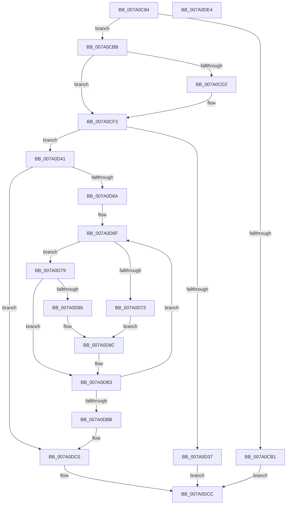

# SepCreateSidValuesBlock

- RVA: `0x007A0C84`–`0x007A0DE5` (길이 `353` bytes)
- VA: `0x00000001407A0C84`
- 실행 섹션: `PAGE`
- PDB 이름 있음: `예`; PDB Function 태그: `아니요`
- unwind 정보 RVA: `0x000ADC84`
- 디코드: `98`개 명령, `353/353` bytes 표시
- 미해석 바이트: `0` (있으면 어셈블리에 `.byte`로 보존)

> 이 문서는 커널 이미지의 기계어와 PDB 기호를 분석해 생성했습니다. 4번과 5번은 함수 원형과 자료형을 바이너리 사용 방식에서 추정한 C 해석이며 원본 소스 복구 결과는 아닙니다.

## 1. Dependencies

- 직접 호출 지점: **3**; 고유 호출 대상: **3**
- 직접 호출자로 확인된 함수: **1**
- RIP 상대 이미지 참조: **0**

### Outgoing calls
- `0x007A0D2A` → [ExAllocatePool2](../../poolcode/B8/ExAllocatePool2_function_00B820F0.md) (function, `0x00B820F0`)
- `0x007A0D49` → [memset](../../text/6C/memset_function_006C6C40.md) (function, `0x006C6C40`)
- `0x007A0D9B` → [RtlCopySid](../9A/RtlCopySid_function_009A9A50.md) (function, `0x009A9A50`)

### Direct callers
- [SepSetTokenUserAndGroups](../9F/SepSetTokenUserAndGroups_function_009FDCD0.md) at `0x009FDD59`

### Static image references
- 디코드된 RIP-relative 메모리 참조가 없습니다.

## 2. Other-region calls and transfers

- 다른 실행 섹션으로 향하는 call: **2**
  - `0x007A0D2A` → [ExAllocatePool2](../../poolcode/B8/ExAllocatePool2_function_00B820F0.md) (`PAGE` → `POOLCODE`)
  - `0x007A0D49` → [memset](../../text/6C/memset_function_006C6C40.md) (`PAGE` → `.text`)
- 별도 외부 분기/꼬리 이동을 확인하지 못했습니다.

## 3. Assembly (complete function range)

```asm
007A0C84  48 89 5C 24 10                  mov qword ptr [rsp + 0x10], rbx
007A0C89  48 89 74 24 18                  mov qword ptr [rsp + 0x18], rsi
007A0C8E  48 89 4C 24 08                  mov qword ptr [rsp + 8], rcx
007A0C93  57                              push rdi
007A0C94  41 54                           push r12
007A0C96  41 55                           push r13
007A0C98  41 56                           push r14
007A0C9A  41 57                           push r15
007A0C9C  48 83 EC 30                     sub rsp, 0x30
007A0CA0  4D 8B E1                        mov r12, r9
007A0CA3  41 8B F8                        mov edi, r8d
007A0CA6  4C 8B EA                        mov r13, rdx
007A0CA9  48 8B F1                        mov rsi, rcx
007A0CAC  48 85 C9                        test rcx, rcx
007A0CAF  75 0A                           jne 0x1407a0cbb
007A0CB1  B8 0D 00 00 C0                  mov eax, 0xc000000d
007A0CB6  E9 11 01 00 00                  jmp 0x1407a0dcc
007A0CBB  48 83 21 00                     and qword ptr [rcx], 0
007A0CBF  44 8B F7                        mov r14d, edi
007A0CC2  8B 94 24 80 00 00 00            mov edx, dword ptr [rsp + 0x80]
007A0CC9  39 BC 24 88 00 00 00            cmp dword ptr [rsp + 0x88], edi
007A0CD0  73 21                           jae 0x1407a0cf3
007A0CD2  0F AE E8                        lfence
007A0CD5  8B 84 24 88 00 00 00            mov eax, dword ptr [rsp + 0x88]
007A0CDC  45 8D 70 FF                     lea r14d, [r8 - 1]
007A0CE0  48 03 C0                        add rax, rax
007A0CE3  49 8B 04 C1                     mov rax, qword ptr [r9 + rax*8]
007A0CE7  0F B6 48 01                     movzx ecx, byte ptr [rax + 1]
007A0CEB  C1 E1 02                        shl ecx, 2
007A0CEE  2B D1                           sub edx, ecx
007A0CF0  83 EA 08                        sub edx, 8
007A0CF3  49 8B 45 00                     mov rax, qword ptr [r13]
007A0CF7  44 8D 7A 07                     lea r15d, [rdx + 7]
007A0CFB  41 B8 FC FF FF FF               mov r8d, 0xfffffffc
007A0D01  41 83 E7 F8                     and r15d, 0xfffffff8
007A0D05  0F B6 48 01                     movzx ecx, byte ptr [rax + 1]
007A0D09  8D 0C 8D 0B 00 00 00            lea ecx, [rcx*4 + 0xb]
007A0D10  41 23 C8                        and ecx, r8d
007A0D13  83 C1 1B                        add ecx, 0x1b
007A0D16  44 03 F9                        add r15d, ecx
007A0D19  B9 00 01 00 00                  mov ecx, 0x100
007A0D1E  45 23 F8                        and r15d, r8d
007A0D21  41 B8 53 65 53 76               mov r8d, 0x76536553
007A0D27  41 8B D7                        mov edx, r15d
007A0D2A  E8 C1 13 3E 00                  call 0x140b820f0
007A0D2F  48 8B D8                        mov rbx, rax
007A0D32  48 85 C0                        test rax, rax
007A0D35  75 0A                           jne 0x1407a0d41
007A0D37  B8 9A 00 00 C0                  mov eax, 0xc000009a
007A0D3C  E9 8B 00 00 00                  jmp 0x1407a0dcc
007A0D41  45 8B C7                        mov r8d, r15d
007A0D44  33 D2                           xor edx, edx
007A0D46  48 8B CB                        mov rcx, rbx
007A0D49  E8 F2 5E F2 FF                  call 0x1406c6c40
007A0D4E  8D 47 01                        lea eax, [rdi + 1]
007A0D51  44 89 3B                        mov dword ptr [rbx], r15d
007A0D54  33 FF                           xor edi, edi
007A0D56  48 C7 43 08 01 00 00 00         mov qword ptr [rbx + 8], 1
007A0D5E  89 44 24 20                     mov dword ptr [rsp + 0x20], eax
007A0D62  4C 8D 7B 18                     lea r15, [rbx + 0x18]
007A0D66  85 C0                           test eax, eax
007A0D68  74 56                           je 0x1407a0dc0
007A0D6A  BE FC FF FF FF                  mov esi, 0xfffffffc
007A0D6F  85 FF                           test edi, edi
007A0D71  75 06                           jne 0x1407a0d79
007A0D73  4D 8B 45 00                     mov r8, qword ptr [r13]
007A0D77  EB 13                           jmp 0x1407a0d8c
007A0D79  8D 47 FF                        lea eax, [rdi - 1]
007A0D7C  3B 84 24 88 00 00 00            cmp eax, dword ptr [rsp + 0x88]
007A0D83  74 2E                           je 0x1407a0db3
007A0D85  48 03 C0                        add rax, rax
007A0D88  4D 8B 04 C4                     mov r8, qword ptr [r12 + rax*8]
007A0D8C  41 0F B6 48 01                  movzx ecx, byte ptr [r8 + 1]
007A0D91  49 8B D7                        mov rdx, r15
007A0D94  8D 0C 8D 08 00 00 00            lea ecx, [rcx*4 + 8]
007A0D9B  E8 B0 8C 20 00                  call 0x1409a9a50
007A0DA0  41 0F B6 47 01                  movzx eax, byte ptr [r15 + 1]
007A0DA5  48 8D 04 85 0B 00 00 00         lea rax, [rax*4 + 0xb]
007A0DAD  48 23 C6                        and rax, rsi
007A0DB0  4C 03 F8                        add r15, rax
007A0DB3  FF C7                           inc edi
007A0DB5  3B 7C 24 20                     cmp edi, dword ptr [rsp + 0x20]
007A0DB9  72 B4                           jb 0x1407a0d6f
007A0DBB  48 8B 74 24 60                  mov rsi, qword ptr [rsp + 0x60]
007A0DC0  41 8D 46 01                     lea eax, [r14 + 1]
007A0DC4  48 89 1E                        mov qword ptr [rsi], rbx
007A0DC7  89 43 10                        mov dword ptr [rbx + 0x10], eax
007A0DCA  33 C0                           xor eax, eax
007A0DCC  48 8B 5C 24 68                  mov rbx, qword ptr [rsp + 0x68]
007A0DD1  48 8B 74 24 70                  mov rsi, qword ptr [rsp + 0x70]
007A0DD6  48 83 C4 30                     add rsp, 0x30
007A0DDA  41 5F                           pop r15
007A0DDC  41 5E                           pop r14
007A0DDE  41 5D                           pop r13
007A0DE0  41 5C                           pop r12
007A0DE2  5F                              pop rdi
007A0DE3  C3                              ret
007A0DE4  CC                              int3
```

## 4. C-style interpretation (structured pseudocode)

```c
__int64 __fastcall SepCreateSidValuesBlock(__int64 a1, __int64 a2, __int64 a3, __int64 a4, unsigned int a5, unsigned int a6)
{
    __int64 result;
    __int64 v_r14;
    __int64 v_r15;
    __int64 v_rdi;
    __int64 v_rsp;
    unsigned int v_stack_m38;
    unsigned __int64 v_stack_p10;
    unsigned __int64 v_stack_p18;
    unsigned __int64 v_stack_p8;

    v_stack_p10 = v_rbx;
    v_stack_p18 = v_rsi;
    v_stack_p8 = a1;
    v_rsp = (v_rsp) - (48);
    if (a1 != 0) goto loc_007A0CBB;
    goto loc_007A0DCC;
loc_007A0CBB:
    result = (unsigned int)(0xC000000DULL);
    v_r14 = (unsigned int)((unsigned int)((unsigned int)((unsigned int)(a3))));
    if (a6 < ((unsigned int)((unsigned int)((unsigned int)(a3))))) {
        result = a6;
        v_r14 = a3 - 1;
        result = (result) + (result);
        result = *(unsigned __int64 *)(a4 + result * 8);
        a1 = *(unsigned __int8 *)(result + 1);
        a1 = (unsigned int)((a1) << (2));
        a2 = (unsigned int)(((unsigned int)(a5)) - ((unsigned int)(a1)));
        a2 = (unsigned int)((a2) - (8));
    }
    v_r15 = (unsigned int)((a2 + 7) & (0xFFFFFFF8ULL));
    a1 = (unsigned int)((*(unsigned __int8 *)(*(unsigned __int64 *)(a2) + 1) * 4 + 11) & ((unsigned int)((unsigned int)(0xFFFFFFFCULL))));
    a1 = (unsigned int)((a1) + (27));
    v_r15 = (unsigned int)((v_r15) + ((unsigned int)(a1)));
    v_r15 = (unsigned int)((v_r15) & ((unsigned int)((unsigned int)(0xFFFFFFFCULL))));
    result = ExAllocatePool2(256, (unsigned int)((unsigned int)(v_r15)), (unsigned int)(0x76536553ULL), a4);
    if (result != 0) goto loc_007A0D41;
    goto loc_007A0DCC;
loc_007A0D41:
    a2 = 0;
    result = memset(result, a2, (unsigned int)((unsigned int)(v_r15)), a4);
    *(unsigned int *)(result) = (unsigned int)(v_r15);
    v_rdi = 0;
    *(unsigned __int64 *)(result + 8) = 1;
    v_stack_m38 = (unsigned int)((unsigned int)((unsigned int)(a3)) + 1);
    if ((unsigned int)((unsigned int)((unsigned int)(a3)) + 1) == 0) goto loc_007A0DC0;
loc_007A0D6F:
    if (0 != 0) goto loc_007A0D79;
    goto loc_007A0D8C;
loc_007A0D79:
    if (((unsigned int)(v_rdi - 1)) == a6) goto loc_007A0DB3;
    result = (v_rdi - 1) + (v_rdi - 1);
loc_007A0D8C:
    result = RtlCopySid(*(unsigned __int8 *)(*(unsigned __int64 *)(a4 + result * 8) + 1) * 4 + 8, result + 24, *(unsigned __int64 *)(a4 + result * 8), a4);
    result = (*(unsigned __int8 *)(result + 24 + 1) * 4 + 11) & ((unsigned int)(0xFFFFFFFCULL));
    v_r15 = (result + 24) + (result);
loc_007A0DB3:
    v_rdi = (unsigned int)((v_rdi) + 1);
    if (((unsigned int)(v_rdi)) < v_stack_m38) goto loc_007A0D6F;
loc_007A0DC0:
    *(unsigned __int64 *)(v_stack_p8) = result;
    *(unsigned int *)(result + 16) = (unsigned int)(v_r14 + 1);
    result = 0;
loc_007A0DCC:
    v_rsp = (v_rsp) + (48);
    return result;
}
```

## 5. (Beta) C Style

```c
int64_t SepCreateSidValuesBlock(int64_t Arg1, void *Arg2, void *Arg3, void *Arg4, void *Arg5, uint32_t Arg6)
{
    uint8_t *arg2 = (uint8_t *)Arg2;
    uint8_t *arg3 = (uint8_t *)Arg3;
    uint8_t *arg4 = (uint8_t *)Arg4;
    uint8_t *arg5 = (uint8_t *)Arg5;

    int64_t result;
    int64_t local_r14;
    int64_t local_r15;
    int64_t local_rdi;
    int64_t local_rsp;
    uint32_t v_stack_m38;
    uint64_t v_stack_p10;
    uint64_t v_stack_p18;
    uint64_t v_stack_p8;

    v_stack_p10 = local_rbx;
    v_stack_p18 = local_rsi;
    v_stack_p8 = Arg1;
    local_rsp = (local_rsp) - (48);
    if (Arg1 != 0) goto loc_007A0CBB;
    goto loc_007A0DCC;
loc_007A0CBB:
    result = (uint32_t)(0xC000000DULL);
    local_r14 = (uint32_t)((uint32_t)((uint32_t)((uint32_t)(Arg3))));
    if (Arg6 < ((uint32_t)((uint32_t)((uint32_t)(Arg3))))) {
        result = Arg6;
        local_r14 = Arg3 - 1;
        result = (result) + (result);
        result = *(uint64_t *)(arg4 + result * 8);
        Arg1 = *(uint8_t *)(result + 0x1);
        Arg1 = (uint32_t)((Arg1) << (2));
        Arg2 = (uint32_t)(((uint32_t)(Arg5)) - ((uint32_t)(Arg1)));
        Arg2 = (uint32_t)((Arg2) - (8));
    }
    local_r15 = (uint32_t)((Arg2 + 7) & (0xFFFFFFF8ULL));
    Arg1 = (uint32_t)((*(uint8_t *)(*(uint64_t *)(arg2) + 0x1) * 4 + 11) & ((uint32_t)((uint32_t)(0xFFFFFFFCULL))));
    Arg1 = (uint32_t)((Arg1) + (27));
    local_r15 = (uint32_t)((local_r15) + ((uint32_t)(Arg1)));
    local_r15 = (uint32_t)((local_r15) & ((uint32_t)((uint32_t)(0xFFFFFFFCULL))));
    result = ExAllocatePool2(256, (uint32_t)((uint32_t)(local_r15)), (uint32_t)(0x76536553ULL), Arg4);
    if (result != 0) goto loc_007A0D41;
    goto loc_007A0DCC;
loc_007A0D41:
    Arg2 = 0;
    result = memset(result, Arg2, (uint32_t)((uint32_t)(local_r15)), Arg4);
    *(uint32_t *)(result) = (uint32_t)(local_r15);
    local_rdi = 0;
    *(uint64_t *)(result + 0x8) = 1;
    v_stack_m38 = (uint32_t)((uint32_t)((uint32_t)(Arg3)) + 1);
    if ((uint32_t)((uint32_t)((uint32_t)(Arg3)) + 1) == 0) goto loc_007A0DC0;
loc_007A0D6F:
    if (0 != 0) goto loc_007A0D79;
    goto loc_007A0D8C;
loc_007A0D79:
    if (((uint32_t)(local_rdi - 1)) == Arg6) goto loc_007A0DB3;
    result = (local_rdi - 1) + (local_rdi - 1);
loc_007A0D8C:
    result = RtlCopySid(*(uint8_t *)(*(uint64_t *)(arg4 + result * 8) + 0x1) * 4 + 8, result + 24, *(uint64_t *)(arg4 + result * 8), Arg4);
    result = (*(uint8_t *)(result + 0x18 + 0x1) * 4 + 11) & ((uint32_t)(0xFFFFFFFCULL));
    local_r15 = (result + 24) + (result);
loc_007A0DB3:
    local_rdi = (uint32_t)((local_rdi) + 1);
    if (((uint32_t)(local_rdi)) < v_stack_m38) goto loc_007A0D6F;
loc_007A0DC0:
    *(uint64_t *)(v_stack_p8) = result;
    *(uint32_t *)(result + 0x10) = (uint32_t)(local_r14 + 1);
    result = 0;
loc_007A0DCC:
    local_rsp = (local_rsp) + (48);
    return result;
}
```

### 관측된 메모리 오프셋

구조체 형식이 확인되지 않은 접근은 인자 기준의 오프셋으로만 기록했습니다.

| 기준 인자 | 오프셋 표현 | 폭 (bit) | 접근 |
|---|---:|---:|---|
| `Arg2` | `+ 0x0` | `64` | `R` |
| `Arg3` | `- 0x1` | `32` | `R` |
| `Arg3` | `+ 0x1` | `32` | `R` |
| `Arg4` | `+ 0x0 + rax*8` | `64` | `R` |
| `Arg5` | `+ 0x7` | `32` | `R` |

## 6. Execution-region graph

[열기: 2D/3D 그래프와 함수 탐색 컨트롤 패널](../../../control-panel.html?section=page&rva=0x007A0C84&view=graph)

- 2D 그래프는 위에서 아래로 흐르고, 3D 그래프는 빈 공간을 드래그해 회전합니다. Shift+드래그는 이동, 휠은 확대·축소, 함수 노드 선택은 대상 보고서 이동입니다.

### Static fallback


