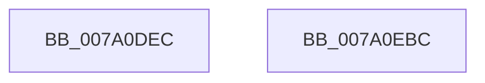

# SepCreateToken

- RVA: `0x007A0DEC`–`0x007A0EBD` (길이 `209` bytes)
- VA: `0x00000001407A0DEC`
- 실행 섹션: `PAGE`
- PDB 이름 있음: `예`; PDB Function 태그: `아니요`
- unwind 정보 RVA: `0x000D13F8`
- 디코드: `40`개 명령, `209/209` bytes 표시
- 미해석 바이트: `0` (있으면 어셈블리에 `.byte`로 보존)

> 이 문서는 커널 이미지의 기계어와 PDB 기호를 분석해 생성했습니다. 4번과 5번은 함수 원형과 자료형을 바이너리 사용 방식에서 추정한 C 해석이며 원본 소스 복구 결과는 아닙니다.

## 1. Dependencies

- 직접 호출 지점: **1**; 고유 호출 대상: **1**
- 직접 호출자로 확인된 함수: **3**
- RIP 상대 이미지 참조: **1**

### Outgoing calls
- `0x007A0EAF` → [SepCreateTokenEx](../../text/4E/SepCreateTokenEx_function_004E9CD0.md) (function, `0x004E9CD0`)

### Direct callers
- [SeMakeAnonymousLogonToken](../../init/C4/SeMakeAnonymousLogonToken_function_00C4A8D8.md) at `0x00C4AAFA`
- [SeMakeAnonymousLogonTokenNoEveryone](../../init/C4/SeMakeAnonymousLogonTokenNoEveryone_function_00C4AB5C.md) at `0x00C4AD58`
- [SeMakeSystemToken](../../init/C4/SeMakeSystemToken_function_00C4ADBC.md) at `0x00C4B2E0`

### Static image references
- `0x007A0DFB` → RVA `0x00B4B0C0` (`SeSystemTokenSource`; read)

## 2. Other-region calls and transfers

- 다른 실행 섹션으로 향하는 call: **1**
  - `0x007A0EAF` → [SepCreateTokenEx](../../text/4E/SepCreateTokenEx_function_004E9CD0.md) (`PAGE` → `.text`)
- 별도 외부 분기/꼬리 이동을 확인하지 못했습니다.

## 3. Assembly (complete function range)

```asm
007A0DEC  4C 8B DC                        mov r11, rsp
007A0DEF  48 81 EC C8 00 00 00            sub rsp, 0xc8
007A0DF6  41 C6 43 F0 01                  mov byte ptr [r11 - 0x10], 1
007A0DFB  48 8D 05 BE A2 3A 00            lea rax, [rip + 0x3aa2be]
007A0E02  33 D2                           xor edx, edx
007A0E04  45 33 C0                        xor r8d, r8d
007A0E07  49 89 53 E8                     mov qword ptr [r11 - 0x18], rdx
007A0E0B  49 89 53 E0                     mov qword ptr [r11 - 0x20], rdx
007A0E0F  41 89 53 D8                     mov dword ptr [r11 - 0x28], edx
007A0E13  49 89 53 D0                     mov qword ptr [r11 - 0x30], rdx
007A0E17  49 89 53 C8                     mov qword ptr [r11 - 0x38], rdx
007A0E1B  49 89 43 C0                     mov qword ptr [r11 - 0x40], rax
007A0E1F  48 8B 84 24 50 01 00 00         mov rax, qword ptr [rsp + 0x150]
007A0E27  49 89 43 B8                     mov qword ptr [r11 - 0x48], rax
007A0E2B  48 8B 84 24 48 01 00 00         mov rax, qword ptr [rsp + 0x148]
007A0E33  49 89 43 B0                     mov qword ptr [r11 - 0x50], rax
007A0E37  48 8B 84 24 40 01 00 00         mov rax, qword ptr [rsp + 0x140]
007A0E3F  49 89 43 A8                     mov qword ptr [r11 - 0x58], rax
007A0E43  48 8B 84 24 38 01 00 00         mov rax, qword ptr [rsp + 0x138]
007A0E4B  49 89 43 A0                     mov qword ptr [r11 - 0x60], rax
007A0E4F  8B 84 24 30 01 00 00            mov eax, dword ptr [rsp + 0x130]
007A0E56  89 44 24 60                     mov dword ptr [rsp + 0x60], eax
007A0E5A  8B 84 24 28 01 00 00            mov eax, dword ptr [rsp + 0x128]
007A0E61  89 44 24 58                     mov dword ptr [rsp + 0x58], eax
007A0E65  48 8B 84 24 20 01 00 00         mov rax, qword ptr [rsp + 0x120]
007A0E6D  49 89 43 88                     mov qword ptr [r11 - 0x78], rax
007A0E71  8B 84 24 18 01 00 00            mov eax, dword ptr [rsp + 0x118]
007A0E78  89 44 24 48                     mov dword ptr [rsp + 0x48], eax
007A0E7C  48 8B 84 24 10 01 00 00         mov rax, qword ptr [rsp + 0x110]
007A0E84  48 89 44 24 40                  mov qword ptr [rsp + 0x40], rax
007A0E89  48 8B 84 24 08 01 00 00         mov rax, qword ptr [rsp + 0x108]
007A0E91  48 89 44 24 38                  mov qword ptr [rsp + 0x38], rax
007A0E96  48 8B 84 24 00 01 00 00         mov rax, qword ptr [rsp + 0x100]
007A0E9E  48 89 44 24 30                  mov qword ptr [rsp + 0x30], rax
007A0EA3  89 54 24 28                     mov dword ptr [rsp + 0x28], edx
007A0EA7  C7 44 24 20 01 00 00 00         mov dword ptr [rsp + 0x20], 1
007A0EAF  E8 1C 8E D4 FF                  call 0x1404e9cd0
007A0EB4  48 81 C4 C8 00 00 00            add rsp, 0xc8
007A0EBB  C3                              ret
007A0EBC  CC                              int3
```

## 4. C-style interpretation (structured pseudocode)

```c
__int64 __fastcall SepCreateToken(__int64 a1, int a2, int a3, __int64 a4, __int64 a5, __int64 a6, __int64 a7, __int64 a8, __int64 a9, unsigned int a10, __int64 a11, unsigned int a12, unsigned int a13, __int64 a14, __int64 a15, __int64 a16, __int64 a17)
{
    __int64 result;
    __int64 v_rsp;
    unsigned int v_stack_m68;
    unsigned int v_stack_m70;
    unsigned int v_stack_m80;
    unsigned __int64 v_stack_m88;
    unsigned __int64 v_stack_m90;
    unsigned __int64 v_stack_m98;
    unsigned int v_stack_mA0;
    unsigned int v_stack_mA8;

    v_rsp = (v_rsp) - (200);
    *(unsigned __int8 *)(v_rsp - 16) = 1;
    a2 = 0;
    a3 = 0;
    *(unsigned __int64 *)(v_rsp - 24) = 0;
    *(unsigned __int64 *)(v_rsp - 32) = 0;
    *(unsigned int *)(v_rsp - 40) = 0;
    *(unsigned __int64 *)(v_rsp - 48) = 0;
    *(unsigned __int64 *)(v_rsp - 56) = 0;
    *(unsigned __int64 *)(v_rsp - 64) = v_rip + 3842750;
    *(unsigned __int64 *)(v_rsp - 72) = a17;
    *(unsigned __int64 *)(v_rsp - 80) = a16;
    *(unsigned __int64 *)(v_rsp - 88) = a15;
    *(unsigned __int64 *)(v_rsp - 96) = a14;
    v_stack_m68 = (unsigned int)((unsigned int)(a13));
    v_stack_m70 = (unsigned int)((unsigned int)(a12));
    *(unsigned __int64 *)(v_rsp - 120) = a11;
    v_stack_m80 = (unsigned int)((unsigned int)(a10));
    v_stack_m88 = a9;
    v_stack_m90 = a8;
    v_stack_m98 = a7;
    v_stack_mA0 = 0;
    v_stack_mA8 = 1;
    result = SepCreateTokenEx(a1, a2, a3, a4);
    v_rsp = (v_rsp) + (200);
    return result;
}
```

## 5. (Beta) C Style

```c
int64_t SepCreateToken(int64_t Arg1, int32_t Arg2, int32_t Arg3, int64_t Arg4, uint64_t Arg5, uint64_t Arg6, int64_t Arg7, int64_t Arg8, int64_t Arg9, uint32_t Arg10, int64_t Arg11, uint32_t Arg12, uint32_t Arg13, int64_t Arg14, int64_t Arg15, int64_t Arg16, int64_t Arg17)
{
    int64_t result;
    int64_t local_rsp;
    uint32_t v_stack_m68;
    uint32_t v_stack_m70;
    uint32_t v_stack_m80;
    uint64_t v_stack_m88;
    uint64_t v_stack_m90;
    uint64_t v_stack_m98;
    uint32_t v_stack_mA0;
    uint32_t v_stack_mA8;

    local_rsp = (local_rsp) - (200);
    *(uint8_t *)(local_rsp - 0x10) = 1;
    Arg2 = 0;
    Arg3 = 0;
    *(uint64_t *)(local_rsp - 0x18) = 0;
    *(uint64_t *)(local_rsp - 0x20) = 0;
    *(uint32_t *)(local_rsp - 0x28) = 0;
    *(uint64_t *)(local_rsp - 0x30) = 0;
    *(uint64_t *)(local_rsp - 0x38) = 0;
    *(uint64_t *)(local_rsp - 0x40) = v_rip + 3842750;
    *(uint64_t *)(local_rsp - 0x48) = Arg17;
    *(uint64_t *)(local_rsp - 0x50) = Arg16;
    *(uint64_t *)(local_rsp - 0x58) = Arg15;
    *(uint64_t *)(local_rsp - 0x60) = Arg14;
    v_stack_m68 = (uint32_t)((uint32_t)(Arg13));
    v_stack_m70 = (uint32_t)((uint32_t)(Arg12));
    *(uint64_t *)(local_rsp - 0x78) = Arg11;
    v_stack_m80 = (uint32_t)((uint32_t)(Arg10));
    v_stack_m88 = Arg9;
    v_stack_m90 = Arg8;
    v_stack_m98 = Arg7;
    v_stack_mA0 = 0;
    v_stack_mA8 = 1;
    result = SepCreateTokenEx(Arg1, Arg2, Arg3, Arg4);
    local_rsp = (local_rsp) + (200);
    return result;
}
```

## 6. Execution-region graph

[열기: 2D/3D 그래프와 함수 탐색 컨트롤 패널](../../../control-panel.html?section=page&rva=0x007A0DEC&view=graph)

- 2D 그래프는 위에서 아래로 흐르고, 3D 그래프는 빈 공간을 드래그해 회전합니다. Shift+드래그는 이동, 휠은 확대·축소, 함수 노드 선택은 대상 보고서 이동입니다.

### Static fallback


