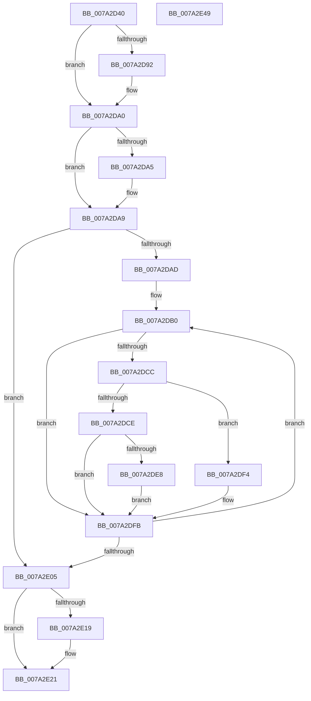

# SepDeReferenceSharedSidEntries

- RVA: `0x007A2D40`–`0x007A2E4A` (길이 `266` bytes)
- VA: `0x00000001407A2D40`
- 실행 섹션: `PAGE`
- PDB 이름 있음: `예`; PDB Function 태그: `아니요`
- unwind 정보 RVA: `0x0005E6B4`
- 디코드: `74`개 명령, `266/266` bytes 표시
- 미해석 바이트: `0` (있으면 어셈블리에 `.byte`로 보존)

> 이 문서는 커널 이미지의 기계어와 PDB 기호를 분석해 생성했습니다. 4번과 5번은 함수 원형과 자료형을 바이너리 사용 방식에서 추정한 C 해석이며 원본 소스 복구 결과는 아닙니다.

## 1. Dependencies

- 직접 호출 지점: **8**; 고유 호출 대상: **8**
- 직접 호출자로 확인된 함수: **1**
- RIP 상대 이미지 참조: **1**

### Outgoing calls
- `0x007A2D82` → [KeAbPreAcquire](../../text/21/KeAbPreAcquire_function_00210230.md) (function, `0x00210230`)
- `0x007A2D9B` → [ExfAcquirePushLockExclusiveEx](../../text/20/ExfAcquirePushLockExclusiveEx_function_0020FC90.md) (function, `0x0020FC90`)
- `0x007A2DB3` → [SepFindSharedSidEntry](SepFindSharedSidEntry_function_007A3148.md) (function, `0x007A3148`)
- `0x007A2DDF` → [RtlRemoveEntryHashTable](../../text/2E/RtlRemoveEntryHashTable_function_002EEF00.md) (function, `0x002EEF00`)
- `0x007A2DED` → [ExFreePoolWithTag](../../poolcode/B8/ExFreePoolWithTag_function_00B82870.md) (function, `0x00B82870`)
- `0x007A2E1C` → [ExfTryToWakePushLock](../../text/26/ExfTryToWakePushLock_function_00265DD0.md) (function, `0x00265DD0`)
- `0x007A2E24` → [KeAbPostRelease](../../text/2E/KeAbPostRelease_function_002E1600.md) (function, `0x002E1600`)
- `0x007A2E29` → [KeLeaveCriticalRegion](../../text/25/KeLeaveCriticalRegion_function_0025D8B0.md) (function, `0x0025D8B0`)

### Direct callers
- [SepFreeTokenCapabilities](../../text/47/SepFreeTokenCapabilities_function_0047BB70.md) at `0x0047BBA0`

### Static image references
- `0x007A2D78` → RVA `0x00FD8088` (`PAGEDATA`; read)

## 2. Other-region calls and transfers

- 다른 실행 섹션으로 향하는 call: **7**
  - `0x007A2D82` → [KeAbPreAcquire](../../text/21/KeAbPreAcquire_function_00210230.md) (`PAGE` → `.text`)
  - `0x007A2D9B` → [ExfAcquirePushLockExclusiveEx](../../text/20/ExfAcquirePushLockExclusiveEx_function_0020FC90.md) (`PAGE` → `.text`)
  - `0x007A2DDF` → [RtlRemoveEntryHashTable](../../text/2E/RtlRemoveEntryHashTable_function_002EEF00.md) (`PAGE` → `.text`)
  - `0x007A2DED` → [ExFreePoolWithTag](../../poolcode/B8/ExFreePoolWithTag_function_00B82870.md) (`PAGE` → `POOLCODE`)
  - `0x007A2E1C` → [ExfTryToWakePushLock](../../text/26/ExfTryToWakePushLock_function_00265DD0.md) (`PAGE` → `.text`)
  - `0x007A2E24` → [KeAbPostRelease](../../text/2E/KeAbPostRelease_function_002E1600.md) (`PAGE` → `.text`)
  - `0x007A2E29` → [KeLeaveCriticalRegion](../../text/25/KeLeaveCriticalRegion_function_0025D8B0.md) (`PAGE` → `.text`)
- 별도 외부 분기/꼬리 이동을 확인하지 못했습니다.

## 3. Assembly (complete function range)

```asm
007A2D40  48 8B C4                        mov rax, rsp
007A2D43  48 89 58 08                     mov qword ptr [rax + 8], rbx
007A2D47  48 89 68 10                     mov qword ptr [rax + 0x10], rbp
007A2D4B  48 89 70 18                     mov qword ptr [rax + 0x18], rsi
007A2D4F  48 89 78 20                     mov qword ptr [rax + 0x20], rdi
007A2D53  41 56                           push r14
007A2D55  48 83 EC 20                     sub rsp, 0x20
007A2D59  65 48 8B 04 25 88 01 00 00      mov rax, qword ptr gs:[0x188]
007A2D62  4C 8B F1                        mov r14, rcx
007A2D65  8B EA                           mov ebp, edx
007A2D67  48 83 CB FF                     or rbx, 0xffffffffffffffff
007A2D6B  45 33 C0                        xor r8d, r8d
007A2D6E  33 D2                           xor edx, edx
007A2D70  66 01 98 E4 01 00 00            add word ptr [rax + 0x1e4], bx
007A2D77  90                              nop
007A2D78  48 8B 35 09 53 83 00            mov rsi, qword ptr [rip + 0x835309]
007A2D7F  48 8B CE                        mov rcx, rsi
007A2D82  E8 A9 D4 A6 FF                  call 0x140210230
007A2D87  F0 48 0F BA 2E 00               lock bts qword ptr [rsi], 0
007A2D8D  48 8B F8                        mov rdi, rax
007A2D90  73 0E                           jae 0x1407a2da0
007A2D92  4C 8B C6                        mov r8, rsi
007A2D95  48 8B D0                        mov rdx, rax
007A2D98  48 8B CE                        mov rcx, rsi
007A2D9B  E8 F0 CE A6 FF                  call 0x14020fc90
007A2DA0  48 85 FF                        test rdi, rdi
007A2DA3  74 04                           je 0x1407a2da9
007A2DA5  C6 47 0A 01                     mov byte ptr [rdi + 0xa], 1
007A2DA9  85 ED                           test ebp, ebp
007A2DAB  74 58                           je 0x1407a2e05
007A2DAD  48 8B F5                        mov rsi, rbp
007A2DB0  49 8B 0E                        mov rcx, qword ptr [r14]
007A2DB3  E8 90 03 00 00                  call 0x1407a3148
007A2DB8  48 8B F8                        mov rdi, rax
007A2DBB  48 8B CB                        mov rcx, rbx
007A2DBE  F0 48 0F C1 48 18               lock xadd qword ptr [rax + 0x18], rcx
007A2DC4  48 03 CB                        add rcx, rbx
007A2DC7  48 85 C9                        test rcx, rcx
007A2DCA  7F 2F                           jg 0x1407a2dfb
007A2DCC  75 26                           jne 0x1407a2df4
007A2DCE  48 8B 0D B3 52 83 00            mov rcx, qword ptr [rip + 0x8352b3]
007A2DD5  45 33 C0                        xor r8d, r8d
007A2DD8  48 8B D0                        mov rdx, rax
007A2DDB  48 8B 49 08                     mov rcx, qword ptr [rcx + 8]
007A2DDF  E8 1C C1 B4 FF                  call 0x1402eef00
007A2DE4  84 C0                           test al, al
007A2DE6  74 13                           je 0x1407a2dfb
007A2DE8  33 D2                           xor edx, edx
007A2DEA  48 8B CF                        mov rcx, rdi
007A2DED  E8 7E FA 3D 00                  call 0x140b82870
007A2DF2  EB 07                           jmp 0x1407a2dfb
007A2DF4  B9 0E 00 00 00                  mov ecx, 0xe
007A2DF9  CD 29                           int 0x29
007A2DFB  49 83 C6 10                     add r14, 0x10
007A2DFF  48 83 EE 01                     sub rsi, 1
007A2E03  75 AB                           jne 0x1407a2db0
007A2E05  48 8B 3D 7C 52 83 00            mov rdi, qword ptr [rip + 0x83527c]
007A2E0C  F0 48 0F C1 1F                  lock xadd qword ptr [rdi], rbx
007A2E11  80 E3 06                        and bl, 6
007A2E14  80 FB 02                        cmp bl, 2
007A2E17  75 08                           jne 0x1407a2e21
007A2E19  48 8B CF                        mov rcx, rdi
007A2E1C  E8 AF 2F AC FF                  call 0x140265dd0
007A2E21  48 8B CF                        mov rcx, rdi
007A2E24  E8 D7 E7 B3 FF                  call 0x1402e1600
007A2E29  E8 82 AA AB FF                  call 0x14025d8b0
007A2E2E  48 8B 5C 24 30                  mov rbx, qword ptr [rsp + 0x30]
007A2E33  48 8B 6C 24 38                  mov rbp, qword ptr [rsp + 0x38]
007A2E38  48 8B 74 24 40                  mov rsi, qword ptr [rsp + 0x40]
007A2E3D  48 8B 7C 24 48                  mov rdi, qword ptr [rsp + 0x48]
007A2E42  48 83 C4 20                     add rsp, 0x20
007A2E46  41 5E                           pop r14
007A2E48  C3                              ret
007A2E49  CC                              int3
```

## 4. C-style interpretation (structured pseudocode)

```c
__int64 __fastcall SepDeReferenceSharedSidEntries(__int64 a1, int a2, int a3)
{
    __int64 result;
    __int64 v_r14;
    __int64 v_rbx;
    __int64 v_rsi;
    __int64 v_rsp;
    unsigned __int64 v_stack_p10;
    unsigned __int64 v_stack_p18;
    unsigned __int64 v_stack_p20;
    unsigned __int64 v_stack_p8;

    *(unsigned __int64 *)(v_rsp + 8) = v_rbx;
    *(unsigned __int64 *)(v_rsp + 16) = v_rbp;
    *(unsigned __int64 *)(v_rsp + 24) = v_rsi;
    *(unsigned __int64 *)(v_rsp + 32) = v_rdi;
    v_rsp = (v_rsp) - (32);
    v_rbx = (v_rbx) | (-1);
    a3 = 0;
    a2 = 0;
    result = KeAbPreAcquire(*(unsigned __int64 *)(v_rip + 8606473), a2, a3, a4);
    if (!(condition_is_above_or_equal)) {
        a3 = *(unsigned __int64 *)(v_rip + 8606473);
        a2 = result;
        a1 = *(unsigned __int64 *)(v_rip + 8606473);
        result = ExfAcquirePushLockExclusiveEx(a1, a2, a3, a4);
    }
    if (result != 0) {
        *(unsigned __int8 *)(result + 10) = 1;
    }
    if ((unsigned int)((unsigned int)(a2)) == 0) goto loc_007A2E05;
loc_007A2DB0:
    result = SepFindSharedSidEntry(*(unsigned __int64 *)(a1), a2, a3, a4);
    a1 = (v_rbx) + (v_rbx);
    if (condition_is_greater) goto loc_007A2DFB;
    if (a1 != 0) goto loc_007A2DF4;
    a3 = 0;
    result = RtlRemoveEntryHashTable(*(unsigned __int64 *)(*(unsigned __int64 *)(v_rip + 8606387) + 8), result, a3, a4);
    if ((unsigned __int8)(result) == 0) goto loc_007A2DFB;
    a2 = 0;
    result = ExFreePoolWithTag(result, a2, a3, a4);
    goto loc_007A2DFB;
loc_007A2DF4:
loc_007A2DFB:
    v_r14 = (a1) + (16);
    v_rsi = ((unsigned int)(a2)) - (1);
    if (condition_is_not_equal) goto loc_007A2DB0;
loc_007A2E05:
    v_rbx = (unsigned __int8)((v_rbx) & (6));
    if (((unsigned __int8)(v_rbx)) == 2) {
        a1 = *(unsigned __int64 *)(v_rip + 8606332);
        result = ExfTryToWakePushLock(a1, a2, a3, a4);
    }
    result = KeAbPostRelease(*(unsigned __int64 *)(v_rip + 8606332), a2, a3, a4);
    result = KeLeaveCriticalRegion(*(unsigned __int64 *)(v_rip + 8606332), a2, a3, a4);
    v_rsp = (v_rsp) + (32);
    return result;
}
```

## 5. (Beta) C Style

```c
int64_t SepDeReferenceSharedSidEntries(void *Arg1, int32_t Arg2, int32_t Arg3)
{
    uint8_t *arg1 = (uint8_t *)Arg1;

    int64_t result;
    int64_t local_r14;
    int64_t local_rbx;
    int64_t local_rsi;
    int64_t local_rsp;
    uint64_t v_stack_p10;
    uint64_t v_stack_p18;
    uint64_t v_stack_p20;
    uint64_t v_stack_p8;

    *(uint64_t *)(local_rsp + 0x8) = local_rbx;
    *(uint64_t *)(local_rsp + 0x10) = local_rbp;
    *(uint64_t *)(local_rsp + 0x18) = local_rsi;
    *(uint64_t *)(local_rsp + 0x20) = local_rdi;
    local_rsp = (local_rsp) - (32);
    local_rbx = (local_rbx) | (-1);
    Arg3 = 0;
    Arg2 = 0;
    result = KeAbPreAcquire(*(uint64_t *)(v_rip + 0x835309), Arg2, Arg3, a4);
    if (!(condition_is_above_or_equal)) {
        Arg3 = *(uint64_t *)(v_rip + 0x835309);
        Arg2 = result;
        Arg1 = *(uint64_t *)(v_rip + 0x835309);
        result = ExfAcquirePushLockExclusiveEx(Arg1, Arg2, Arg3, a4);
    }
    if (result != 0) {
        *(uint8_t *)(result + 0xA) = 1;
    }
    if ((uint32_t)((uint32_t)(Arg2)) == 0) goto loc_007A2E05;
loc_007A2DB0:
    result = SepFindSharedSidEntry(*(uint64_t *)(arg1), Arg2, Arg3, a4);
    Arg1 = (local_rbx) + (local_rbx);
    if (condition_is_greater) goto loc_007A2DFB;
    if (Arg1 != NULL) goto loc_007A2DF4;
    Arg3 = 0;
    result = RtlRemoveEntryHashTable(*(uint64_t *)(*(uint64_t *)(v_rip + 0x8352B3) + 0x8), result, Arg3, a4);
    if ((uint8_t)(result) == 0) goto loc_007A2DFB;
    Arg2 = 0;
    result = ExFreePoolWithTag(result, Arg2, Arg3, a4);
    goto loc_007A2DFB;
loc_007A2DF4:
loc_007A2DFB:
    local_r14 = (Arg1) + (16);
    local_rsi = ((uint32_t)(Arg2)) - (1);
    if (condition_is_not_equal) goto loc_007A2DB0;
loc_007A2E05:
    local_rbx = (uint8_t)((local_rbx) & (6));
    if (((uint8_t)(local_rbx)) == 2) {
        Arg1 = *(uint64_t *)(v_rip + 0x83527C);
        result = ExfTryToWakePushLock(Arg1, Arg2, Arg3, a4);
    }
    result = KeAbPostRelease(*(uint64_t *)(v_rip + 0x83527C), Arg2, Arg3, a4);
    result = KeLeaveCriticalRegion(*(uint64_t *)(v_rip + 0x83527C), Arg2, Arg3, a4);
    local_rsp = (local_rsp) + (32);
    return result;
}
```

### 관측된 메모리 오프셋

구조체 형식이 확인되지 않은 접근은 인자 기준의 오프셋으로만 기록했습니다.

| 기준 인자 | 오프셋 표현 | 폭 (bit) | 접근 |
|---|---:|---:|---|
| `Arg1` | `+ 0x0` | `64` | `R` |

## 6. Execution-region graph

[열기: 2D/3D 그래프와 함수 탐색 컨트롤 패널](../../../control-panel.html?section=page&rva=0x007A2D40&view=graph)

- 2D 그래프는 위에서 아래로 흐르고, 3D 그래프는 빈 공간을 드래그해 회전합니다. Shift+드래그는 이동, 휠은 확대·축소, 함수 노드 선택은 대상 보고서 이동입니다.

### Static fallback


