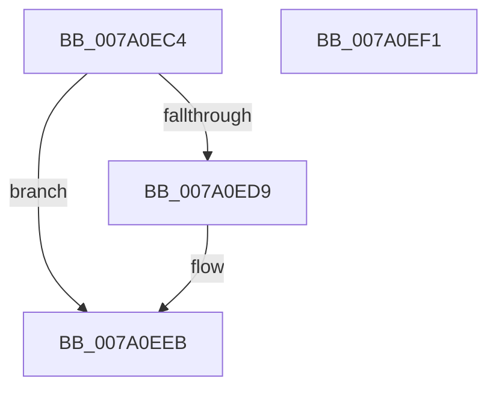

# SepDeleteLogonSessionSidValues

- RVA: `0x007A0EC4`–`0x007A0EF2` (길이 `46` bytes)
- VA: `0x00000001407A0EC4`
- 실행 섹션: `PAGE`
- PDB 이름 있음: `예`; PDB Function 태그: `아니요`
- unwind 정보 RVA: `0x0005CF00`
- 디코드: `14`개 명령, `46/46` bytes 표시
- 미해석 바이트: `0` (있으면 어셈블리에 `.byte`로 보존)

> 이 문서는 커널 이미지의 기계어와 PDB 기호를 분석해 생성했습니다. 4번과 5번은 함수 원형과 자료형을 바이너리 사용 방식에서 추정한 C 해석이며 원본 소스 복구 결과는 아닙니다.

## 1. Dependencies

- 직접 호출 지점: **1**; 고유 호출 대상: **1**
- 직접 호출자로 확인된 함수: **2**
- RIP 상대 이미지 참조: **0**

### Outgoing calls
- `0x007A0EDE` → [SepDereferenceSidValuesBlock](SepDereferenceSidValuesBlock_function_007A0F80.md) (function, `0x007A0F80`)

### Direct callers
- [SepDeleteLogonSessionTrack](../AA/SepDeleteLogonSessionTrack_function_00AA04E0.md) at `0x00AA0660`
- [SepDeReferenceLogonSession](../AF/SepDeReferenceLogonSession_function_00AF25EC.md) at `0x00AF27F8`

### Static image references
- 디코드된 RIP-relative 메모리 참조가 없습니다.

## 2. Other-region calls and transfers

- 다른 실행 섹션으로 향하는 call: **0**
- 별도 외부 분기/꼬리 이동을 확인하지 못했습니다.

## 3. Assembly (complete function range)

```asm
007A0EC4  40 53                           push rbx
007A0EC6  48 83 EC 20                     sub rsp, 0x20
007A0ECA  48 8B D9                        mov rbx, rcx
007A0ECD  48 8B 89 80 00 00 00            mov rcx, qword ptr [rcx + 0x80]
007A0ED4  48 85 C9                        test rcx, rcx
007A0ED7  74 12                           je 0x1407a0eeb
007A0ED9  4C 8B C3                        mov r8, rbx
007A0EDC  33 D2                           xor edx, edx
007A0EDE  E8 9D 00 00 00                  call 0x1407a0f80
007A0EE3  48 83 A3 80 00 00 00 00         and qword ptr [rbx + 0x80], 0
007A0EEB  48 83 C4 20                     add rsp, 0x20
007A0EEF  5B                              pop rbx
007A0EF0  C3                              ret
007A0EF1  CC                              int3
```

## 4. C-style interpretation (structured pseudocode)

```c
__int64 __fastcall SepDeleteLogonSessionSidValues(__int64 a1, int a2)
{
    __int64 result;
    __int64 v_rsp;

    v_rsp = (v_rsp) - (32);
    if (*(unsigned __int64 *)(a1 + 128) != 0) {
        a3 = a1;
        a2 = 0;
        result = SepDereferenceSidValuesBlock(*(unsigned __int64 *)(a1 + 128), a2, a3, a4);
    }
    v_rsp = (v_rsp) + (32);
    return result;
}
```

## 5. (Beta) C Style

```c
int64_t SepDeleteLogonSessionSidValues(void *Arg1, int32_t Arg2)
{
    uint8_t *arg1 = (uint8_t *)Arg1;

    int64_t result;
    int64_t local_rsp;

    local_rsp = (local_rsp) - (32);
    if (*(uint64_t *)(arg1 + 0x80) != 0) {
        a3 = Arg1;
        Arg2 = 0;
        result = SepDereferenceSidValuesBlock(*(uint64_t *)(arg1 + 0x80), Arg2, a3, a4);
    }
    local_rsp = (local_rsp) + (32);
    return result;
}
```

### 관측된 메모리 오프셋

구조체 형식이 확인되지 않은 접근은 인자 기준의 오프셋으로만 기록했습니다.

| 기준 인자 | 오프셋 표현 | 폭 (bit) | 접근 |
|---|---:|---:|---|
| `Arg1` | `+ 0x80` | `64` | `R` |
| `Arg1` | `+ 0x80` | `64` | `R/W` |

## 6. Execution-region graph

[열기: 2D/3D 그래프와 함수 탐색 컨트롤 패널](../../../control-panel.html?section=page&rva=0x007A0EC4&view=graph)

- 2D 그래프는 위에서 아래로 흐르고, 3D 그래프는 빈 공간을 드래그해 회전합니다. Shift+드래그는 이동, 휠은 확대·축소, 함수 노드 선택은 대상 보고서 이동입니다.

### Static fallback


