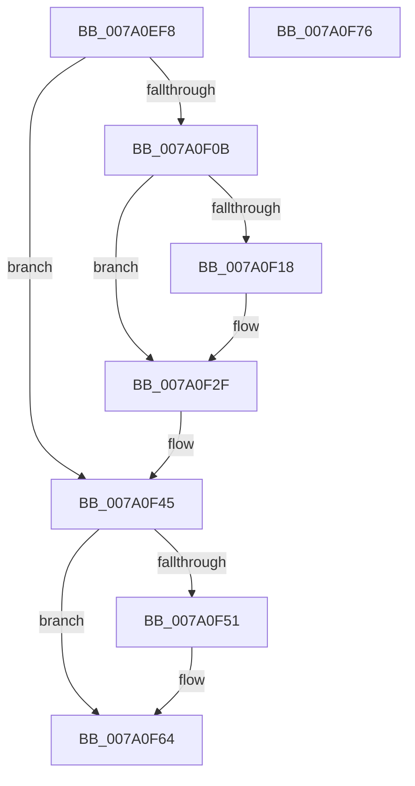

# SepDeleteTokenUserAndGroups

- RVA: `0x007A0EF8`–`0x007A0F77` (길이 `127` bytes)
- VA: `0x00000001407A0EF8`
- 실행 섹션: `PAGE`
- PDB 이름 있음: `예`; PDB Function 태그: `아니요`
- unwind 정보 RVA: `0x0005CF00`
- 디코드: `31`개 명령, `127/127` bytes 표시
- 미해석 바이트: `0` (있으면 어셈블리에 `.byte`로 보존)

> 이 문서는 커널 이미지의 기계어와 PDB 기호를 분석해 생성했습니다. 4번과 5번은 함수 원형과 자료형을 바이너리 사용 방식에서 추정한 C 해석이며 원본 소스 복구 결과는 아닙니다.

## 1. Dependencies

- 직접 호출 지점: **2**; 고유 호출 대상: **2**
- 직접 호출자로 확인된 함수: **1**
- RIP 상대 이미지 참조: **0**

### Outgoing calls
- `0x007A0F38` → [ExFreePoolWithTag](../../poolcode/B8/ExFreePoolWithTag_function_00B82870.md) (function, `0x00B82870`)
- `0x007A0F57` → [SepDereferenceSidValuesBlock](SepDereferenceSidValuesBlock_function_007A0F80.md) (function, `0x007A0F80`)

### Direct callers
- [SepTokenDeleteMethod](../AF/SepTokenDeleteMethod_function_00AF23D0.md) at `0x00AF242F`

### Static image references
- 디코드된 RIP-relative 메모리 참조가 없습니다.

## 2. Other-region calls and transfers

- 다른 실행 섹션으로 향하는 call: **1**
  - `0x007A0F38` → [ExFreePoolWithTag](../../poolcode/B8/ExFreePoolWithTag_function_00B82870.md) (`PAGE` → `POOLCODE`)
- 별도 외부 분기/꼬리 이동을 확인하지 못했습니다.

## 3. Assembly (complete function range)

```asm
007A0EF8  40 53                           push rbx
007A0EFA  48 83 EC 20                     sub rsp, 0x20
007A0EFE  48 83 B9 60 04 00 00 00         cmp qword ptr [rcx + 0x460], 0
007A0F06  48 8B D9                        mov rbx, rcx
007A0F09  74 3A                           je 0x1407a0f45
007A0F0B  8B 81 D0 00 00 00               mov eax, dword ptr [rcx + 0xd0]
007A0F11  83 CA FF                        or edx, 0xffffffff
007A0F14  3B C2                           cmp eax, edx
007A0F16  74 17                           je 0x1407a0f2f
007A0F18  8B C8                           mov ecx, eax
007A0F1A  48 8B 83 98 00 00 00            mov rax, qword ptr [rbx + 0x98]
007A0F21  48 03 C9                        add rcx, rcx
007A0F24  48 83 24 C8 00                  and qword ptr [rax + rcx*8], 0
007A0F29  89 93 D0 00 00 00               mov dword ptr [rbx + 0xd0], edx
007A0F2F  48 8B 8B 60 04 00 00            mov rcx, qword ptr [rbx + 0x460]
007A0F36  33 D2                           xor edx, edx
007A0F38  E8 33 19 3E 00                  call 0x140b82870
007A0F3D  48 83 A3 60 04 00 00 00         and qword ptr [rbx + 0x460], 0
007A0F45  48 8B 8B 68 04 00 00            mov rcx, qword ptr [rbx + 0x468]
007A0F4C  48 85 C9                        test rcx, rcx
007A0F4F  74 13                           je 0x1407a0f64
007A0F51  45 33 C0                        xor r8d, r8d
007A0F54  48 8B D3                        mov rdx, rbx
007A0F57  E8 24 00 00 00                  call 0x1407a0f80
007A0F5C  48 83 A3 68 04 00 00 00         and qword ptr [rbx + 0x468], 0
007A0F64  48 83 A3 98 00 00 00 00         and qword ptr [rbx + 0x98], 0
007A0F6C  83 63 7C 00                     and dword ptr [rbx + 0x7c], 0
007A0F70  48 83 C4 20                     add rsp, 0x20
007A0F74  5B                              pop rbx
007A0F75  C3                              ret
007A0F76  CC                              int3
```

## 4. C-style interpretation (structured pseudocode)

```c
__int64 __fastcall SepDeleteTokenUserAndGroups(__int64 a1, int a2, int a3)
{
    __int64 result;
    __int64 v_rsp;

    v_rsp = (v_rsp) - (32);
    if ((*(unsigned __int64 *)(a1 + 1120)) == 0) goto loc_007A0F45;
    a2 = (unsigned int)((a2) | (0xFFFFFFFFULL));
    result = (unsigned int)(*(unsigned int *)(a1 + 208));
    if (((unsigned int)((unsigned int)(*(unsigned int *)(a1 + 208)))) != a2) {
        a1 = (unsigned int)((unsigned int)(*(unsigned int *)(a1 + 208)));
        result = *(unsigned __int64 *)(a1 + 152);
        a1 = (a1) + (a1);
        *(unsigned int *)(a1 + 208) = a2;
    }
    a2 = 0;
    result = ExFreePoolWithTag(*(unsigned __int64 *)(a1 + 1120), a2, a3, a4);
loc_007A0F45:
    if (*(unsigned __int64 *)(a1 + 1128) != 0) {
        a3 = 0;
        a2 = a1;
        result = SepDereferenceSidValuesBlock(*(unsigned __int64 *)(a1 + 1128), a2, a3, a4);
    }
    v_rsp = (v_rsp) + (32);
    return result;
}
```

## 5. (Beta) C Style

```c
int64_t SepDeleteTokenUserAndGroups(void *Arg1, int32_t Arg2, int32_t Arg3)
{
    uint8_t *arg1 = (uint8_t *)Arg1;

    int64_t result;
    int64_t local_rsp;

    local_rsp = (local_rsp) - (32);
    if ((*(uint64_t *)(arg1 + 0x460)) == 0) goto loc_007A0F45;
    Arg2 = (uint32_t)((Arg2) | (0xFFFFFFFFULL));
    result = (uint32_t)(*(uint32_t *)(arg1 + 0xD0));
    if (((uint32_t)((uint32_t)(*(uint32_t *)(arg1 + 0xD0)))) != Arg2) {
        Arg1 = (uint32_t)((uint32_t)(*(uint32_t *)(arg1 + 0xD0)));
        result = *(uint64_t *)(arg1 + 0x98);
        Arg1 = (Arg1) + (Arg1);
        *(uint32_t *)(arg1 + 0xD0) = Arg2;
    }
    Arg2 = 0;
    result = ExFreePoolWithTag(*(uint64_t *)(arg1 + 0x460), Arg2, Arg3, a4);
loc_007A0F45:
    if (*(uint64_t *)(arg1 + 0x468) != 0) {
        Arg3 = 0;
        Arg2 = Arg1;
        result = SepDereferenceSidValuesBlock(*(uint64_t *)(arg1 + 0x468), Arg2, Arg3, a4);
    }
    local_rsp = (local_rsp) + (32);
    return result;
}
```

### 관측된 메모리 오프셋

구조체 형식이 확인되지 않은 접근은 인자 기준의 오프셋으로만 기록했습니다.

| 기준 인자 | 오프셋 표현 | 폭 (bit) | 접근 |
|---|---:|---:|---|
| `Arg1` | `+ 0x7C` | `32` | `R/W` |
| `Arg1` | `+ 0x98` | `64` | `R` |
| `Arg1` | `+ 0x98` | `64` | `R/W` |
| `Arg1` | `+ 0xD0` | `32` | `R` |
| `Arg1` | `+ 0xD0` | `32` | `W` |
| `Arg1` | `+ 0x460` | `64` | `R` |
| `Arg1` | `+ 0x460` | `64` | `R/W` |
| `Arg1` | `+ 0x468` | `64` | `R` |
| `Arg1` | `+ 0x468` | `64` | `R/W` |

## 6. Execution-region graph

[열기: 2D/3D 그래프와 함수 탐색 컨트롤 패널](../../../control-panel.html?section=page&rva=0x007A0EF8&view=graph)

- 2D 그래프는 위에서 아래로 흐르고, 3D 그래프는 빈 공간을 드래그해 회전합니다. Shift+드래그는 이동, 휠은 확대·축소, 함수 노드 선택은 대상 보고서 이동입니다.

### Static fallback


